# _CmSetDeviceInterfaceMappedPropertyFromRegValue

- RVA: `0x00A729E4`–`0x00A72DA2` (길이 `958` bytes)
- VA: `0x0000000140A729E4`
- 실행 섹션: `PAGE`
- PDB 이름 있음: `예`; PDB Function 태그: `예`
- unwind 정보 RVA: `0x000B55D4`
- 디코드: `239`개 명령, `958/958` bytes 표시
- 미해석 바이트: `0` (있으면 어셈블리에 `.byte`로 보존)

> 이 문서는 커널 이미지의 기계어와 PDB 기호를 분석해 생성했습니다. 4번과 5번은 함수 원형과 자료형을 바이너리 사용 방식에서 추정한 C 해석이며 원본 소스 복구 결과는 아닙니다.

## 1. Dependencies

- 직접 호출 지점: **13**; 고유 호출 대상: **8**
- 직접 호출자로 확인된 함수: **1**
- RIP 상대 이미지 참조: **10**

### Outgoing calls
- `0x00A72AFF` → [_CmOpenDeviceInterfaceRegKey](../8F/_CmOpenDeviceInterfaceRegKey_function_008F31F4.md) (function, `0x008F31F4`)
- `0x00A72B26` → [RegRtlSetValue](../99/RegRtlSetValue_function_00991B28.md) (function, `0x00991B28`)
- `0x00A72B5C` → [ZwClose](../../text/6A/ZwClose_function_006AD2B0.md) (function, `0x006AD2B0`)
- `0x00A72B84` → [ZwClose](../../text/6A/ZwClose_function_006AD2B0.md) (function, `0x006AD2B0`)
- `0x00A72B8B` → [ZwClose](../../text/6A/ZwClose_function_006AD2B0.md) (function, `0x006AD2B0`)
- `0x00A72C07` → [RegRtlCreateKeyTransacted](../93/RegRtlCreateKeyTransacted_function_0093207C.md) (function, `0x0093207C`)
- `0x00A72C3F` → [RegRtlSetValue](../99/RegRtlSetValue_function_00991B28.md) (function, `0x00991B28`)
- `0x00A72C68` → [RegRtlIsPredefinedKey](../93/RegRtlIsPredefinedKey_function_009321CC.md) (function, `0x009321CC`)
- `0x00A72C80` → [RtlInitUnicodeStringEx](../../text/46/RtlInitUnicodeStringEx_function_00463960.md) (function, `0x00463960`)
- `0x00A72CD5` → [ZwCreateKey](../../text/6A/ZwCreateKey_function_006AD470.md) (function, `0x006AD470`)
- `0x00A72CE9` → [ZwClose](../../text/6A/ZwClose_function_006AD2B0.md) (function, `0x006AD2B0`)
- `0x00A72D31` → [_CmOpenDeviceInterfaceRegKey](../8F/_CmOpenDeviceInterfaceRegKey_function_008F31F4.md) (function, `0x008F31F4`)
- `0x00A72D49` → [RegRtlOpenPredefinedKey](../83/RegRtlOpenPredefinedKey_function_00832A14.md) (function, `0x00832A14`)

### Direct callers
- [CmSetDeviceInterfaceMappedProperty](CmSetDeviceInterfaceMappedProperty_function_00A7287C.md) at `0x00A7292A`

### Static image references
- `0x00A72A5F` → RVA `0x00B4B1E0` (`PAGE`; read)
- `0x00A72ABE` → RVA `0x00011490` (`.rdata`; read)
- `0x00A72ACB` → RVA `0x00011498` (`.rdata`; read)
- `0x00A72B0D` → RVA `0x00B0D7F0` (` ?? ::NNGAKEGL::`string'`; read)
- `0x00A72B95` → RVA `0x000114F8` (`.rdata`; read)
- `0x00A72BA2` → RVA `0x00011500` (`.rdata`; read)
- `0x00A72BD6` → RVA `0x00B0D340` (` ?? ::NNGAKEGL::`string'`; read)
- `0x00A72C26` → RVA `0x00B09360` (` ?? ::NNGAKEGL::`string'`; read)
- `0x00A72D7B` → RVA `0x000114D0` (`.rdata`; read)
- `0x00A72D8C` → RVA `0x000114D8` (`.rdata`; read)

## 2. Other-region calls and transfers

- 다른 실행 섹션으로 향하는 call: **6**
  - `0x00A72B5C` → [ZwClose](../../text/6A/ZwClose_function_006AD2B0.md) (`PAGE` → `.text`)
  - `0x00A72B84` → [ZwClose](../../text/6A/ZwClose_function_006AD2B0.md) (`PAGE` → `.text`)
  - `0x00A72B8B` → [ZwClose](../../text/6A/ZwClose_function_006AD2B0.md) (`PAGE` → `.text`)
  - `0x00A72C80` → [RtlInitUnicodeStringEx](../../text/46/RtlInitUnicodeStringEx_function_00463960.md) (`PAGE` → `.text`)
  - `0x00A72CD5` → [ZwCreateKey](../../text/6A/ZwCreateKey_function_006AD470.md) (`PAGE` → `.text`)
  - `0x00A72CE9` → [ZwClose](../../text/6A/ZwClose_function_006AD2B0.md) (`PAGE` → `.text`)
- call이 아닌 외부 분기/꼬리 이동: **5**
  - `0x00A72CF6` → [sub_00B403DE + 0xA](../B4/Unknown_function_00B403DE.md) (`tail-transfer`)
  - `0x00A72D05` → [sub_00B403DE](../B4/Unknown_function_00B403DE.md) (`tail-transfer`)
  - `0x00A72D72` → [sub_00B403DE + 0x19](../B4/Unknown_function_00B403DE.md) (`tail-transfer`)
  - `0x00A72D82` → [sub_00B403DE + 0x14](../B4/Unknown_function_00B403DE.md) (`tail-transfer`)
  - `0x00A72D93` → [sub_00B403DE + 0x14](../B4/Unknown_function_00B403DE.md) (`tail-transfer`)

## 3. Assembly (complete function range)

```asm
00A729E4  48 8B C4                        mov rax, rsp
00A729E7  48 89 58 08                     mov qword ptr [rax + 8], rbx
00A729EB  48 89 70 10                     mov qword ptr [rax + 0x10], rsi
00A729EF  48 89 78 18                     mov qword ptr [rax + 0x18], rdi
00A729F3  55                              push rbp
00A729F4  41 54                           push r12
00A729F6  41 55                           push r13
00A729F8  41 56                           push r14
00A729FA  41 57                           push r15
00A729FC  48 8D 68 B9                     lea rbp, [rax - 0x47]
00A72A00  48 81 EC B0 00 00 00            sub rsp, 0xb0
00A72A07  45 8B 59 10                     mov r11d, dword ptr [r9 + 0x10]
00A72A0B  45 33 E4                        xor r12d, r12d
00A72A0E  49 8B F9                        mov rdi, r9
00A72A11  4C 89 65 CF                     mov qword ptr [rbp - 0x31], r12
00A72A15  4D 8B F8                        mov r15, r8
00A72A18  4C 89 65 67                     mov qword ptr [rbp + 0x67], r12
00A72A1C  48 8B F2                        mov rsi, rdx
00A72A1F  4C 89 65 C7                     mov qword ptr [rbp - 0x39], r12
00A72A23  45 8D 6C 24 02                  lea r13d, [r12 + 2]
00A72A28  4C 8B F1                        mov r14, rcx
00A72A2B  41 8B DC                        mov ebx, r12d
00A72A2E  45 3B DD                        cmp r11d, r13d
00A72A31  73 29                           jae 0x140a72a5c
00A72A33  BB 30 02 00 C0                  mov ebx, 0xc0000230
00A72A38  4C 8D 9C 24 B0 00 00 00         lea r11, [rsp + 0xb0]
00A72A40  8B C3                           mov eax, ebx
00A72A42  49 8B 5B 30                     mov rbx, qword ptr [r11 + 0x30]
00A72A46  49 8B 73 38                     mov rsi, qword ptr [r11 + 0x38]
00A72A4A  49 8B 7B 40                     mov rdi, qword ptr [r11 + 0x40]
00A72A4E  49 8B E3                        mov rsp, r11
00A72A51  41 5F                           pop r15
00A72A53  41 5E                           pop r14
00A72A55  41 5D                           pop r13
00A72A57  41 5C                           pop r12
00A72A59  5D                              pop rbp
00A72A5A  C3                              ret
00A72A5B  CC                              int3
00A72A5C  45 8B CC                        mov r9d, r12d
00A72A5F  48 8D 0D 7A 87 0D 00            lea rcx, [rip + 0xd877a]
00A72A66  4C 8B 11                        mov r10, qword ptr [rcx]
00A72A69  4C 8B C1                        mov r8, rcx
00A72A6C  45 3B 5A 10                     cmp r11d, dword ptr [r10 + 0x10]
00A72A70  0F 84 F0 00 00 00               je 0x140a72b66
00A72A76  41 FF C1                        inc r9d
00A72A79  48 83 C1 10                     add rcx, 0x10
00A72A7D  4D 8B C4                        mov r8, r12
00A72A80  41 83 F9 03                     cmp r9d, 3
00A72A84  72 E0                           jb 0x140a72a66
00A72A86  4D 85 C0                        test r8, r8
00A72A89  74 A8                           je 0x140a72a33
00A72A8B  41 8B 48 08                     mov ecx, dword ptr [r8 + 8]
00A72A8F  8B 45 6F                        mov eax, dword ptr [rbp + 0x6f]
00A72A92  3B C1                           cmp eax, ecx
00A72A94  0F 85 59 02 00 00               jne 0x140a72cf3
00A72A9A  4D 85 FF                        test r15, r15
00A72A9D  0F 84 67 02 00 00               je 0x140a72d0a
00A72AA3  8B 4F 10                        mov ecx, dword ptr [rdi + 0x10]
00A72AA6  41 3B CD                        cmp ecx, r13d
00A72AA9  0F 84 E3 00 00 00               je 0x140a72b92
00A72AAF  81 F9 00 01 00 00               cmp ecx, 0x100
00A72AB5  0F 85 B4 02 00 00               jne 0x140a72d6f
00A72ABB  48 8B 07                        mov rax, qword ptr [rdi]
00A72ABE  48 2B 05 CB E9 59 FF            sub rax, qword ptr [rip - 0xa61635]
00A72AC5  75 0B                           jne 0x140a72ad2
00A72AC7  48 8B 47 08                     mov rax, qword ptr [rdi + 8]
00A72ACB  48 2B 05 C6 E9 59 FF            sub rax, qword ptr [rip - 0xa6163a]
00A72AD2  48 85 C0                        test rax, rax
00A72AD5  0F 85 BD 02 00 00               jne 0x140a72d98
00A72ADB  4C 89 64 24 38                  mov qword ptr [rsp + 0x38], r12
00A72AE0  48 8D 45 C7                     lea rax, [rbp - 0x39]
00A72AE4  48 89 44 24 30                  mov qword ptr [rsp + 0x30], rax
00A72AE9  41 B8 31 00 00 00               mov r8d, 0x31
00A72AEF  44 88 64 24 28                  mov byte ptr [rsp + 0x28], r12b
00A72AF4  48 8B D6                        mov rdx, rsi
00A72AF7  49 8B CE                        mov rcx, r14
00A72AFA  44 89 6C 24 20                  mov dword ptr [rsp + 0x20], r13d
00A72AFF  E8 F0 06 E8 FF                  call 0x1408f31f4
00A72B04  8B D8                           mov ebx, eax
00A72B06  85 C0                           test eax, eax
00A72B08  78 33                           js 0x140a72b3d
00A72B0A  8B 45 7F                        mov eax, dword ptr [rbp + 0x7f]
00A72B0D  48 8D 15 DC AC 09 00            lea rdx, [rip + 0x9acdc]
00A72B14  4C 8B 4D 77                     mov r9, qword ptr [rbp + 0x77]
00A72B18  41 B8 01 00 00 00               mov r8d, 1
00A72B1E  48 8B 4D C7                     mov rcx, qword ptr [rbp - 0x39]
00A72B22  89 44 24 20                     mov dword ptr [rsp + 0x20], eax
00A72B26  E8 FD EF F1 FF                  call 0x140991b28
00A72B2B  BE 7C 01 00 C0                  mov esi, 0xc000017c
00A72B30  3B C6                           cmp eax, esi
00A72B32  0F 85 28 02 00 00               jne 0x140a72d60
00A72B38  BB 34 00 00 C0                  mov ebx, 0xc0000034
00A72B3D  48 8B 4D C7                     mov rcx, qword ptr [rbp - 0x39]
00A72B41  48 85 C9                        test rcx, rcx
00A72B44  75 3E                           jne 0x140a72b84
00A72B46  48 8B 4D 67                     mov rcx, qword ptr [rbp + 0x67]
00A72B4A  48 85 C9                        test rcx, rcx
00A72B4D  75 3C                           jne 0x140a72b8b
00A72B4F  48 8B 4D CF                     mov rcx, qword ptr [rbp - 0x31]
00A72B53  48 85 C9                        test rcx, rcx
00A72B56  0F 84 DC FE FF FF               je 0x140a72a38
00A72B5C  E8 4F A7 C3 FF                  call 0x1406ad2b0
00A72B61  E9 D2 FE FF FF                  jmp 0x140a72a38
00A72B66  48 8B 17                        mov rdx, qword ptr [rdi]
00A72B69  49 2B 12                        sub rdx, qword ptr [r10]
00A72B6C  75 08                           jne 0x140a72b76
00A72B6E  48 8B 57 08                     mov rdx, qword ptr [rdi + 8]
00A72B72  49 2B 52 08                     sub rdx, qword ptr [r10 + 8]
00A72B76  48 85 D2                        test rdx, rdx
00A72B79  0F 84 07 FF FF FF               je 0x140a72a86
00A72B7F  E9 F2 FE FF FF                  jmp 0x140a72a76
00A72B84  E8 27 A7 C3 FF                  call 0x1406ad2b0
00A72B89  EB BB                           jmp 0x140a72b46
00A72B8B  E8 20 A7 C3 FF                  call 0x1406ad2b0
00A72B90  EB BD                           jmp 0x140a72b4f
00A72B92  48 8B 07                        mov rax, qword ptr [rdi]
00A72B95  48 2B 05 5C E9 59 FF            sub rax, qword ptr [rip - 0xa616a4]
00A72B9C  75 0B                           jne 0x140a72ba9
00A72B9E  48 8B 47 08                     mov rax, qword ptr [rdi + 8]
00A72BA2  48 2B 05 57 E9 59 FF            sub rax, qword ptr [rip - 0xa616a9]
00A72BA9  48 85 C0                        test rax, rax
00A72BAC  0F 85 E6 01 00 00               jne 0x140a72d98
00A72BB2  48 8B 75 CF                     mov rsi, qword ptr [rbp - 0x31]
00A72BB6  4D 85 FF                        test r15, r15
00A72BB9  49 0F 45 F7                     cmovne rsi, r15
00A72BBD  4D 85 F6                        test r14, r14
00A72BC0  0F 84 83 00 00 00               je 0x140a72c49
00A72BC6  49 8B 86 E0 00 00 00            mov rax, qword ptr [r14 + 0xe0]
00A72BCD  48 85 C0                        test rax, rax
00A72BD0  74 77                           je 0x140a72c49
00A72BD2  48 8B 48 08                     mov rcx, qword ptr [rax + 8]
00A72BD6  48 8D 15 63 A7 09 00            lea rdx, [rip + 0x9a763]
00A72BDD  48 89 4C 24 40                  mov qword ptr [rsp + 0x40], rcx
00A72BE2  45 33 C0                        xor r8d, r8d
00A72BE5  44 38 60 10                     cmp byte ptr [rax + 0x10], r12b
00A72BE9  45 8B CD                        mov r9d, r13d
00A72BEC  4C 89 64 24 38                  mov qword ptr [rsp + 0x38], r12
00A72BF1  48 8D 45 67                     lea rax, [rbp + 0x67]
00A72BF5  48 89 44 24 30                  mov qword ptr [rsp + 0x30], rax
00A72BFA  48 8B CE                        mov rcx, rsi
00A72BFD  44 88 64 24 28                  mov byte ptr [rsp + 0x28], r12b
00A72C02  4C 89 64 24 20                  mov qword ptr [rsp + 0x20], r12
00A72C07  E8 70 F4 EB FF                  call 0x14093207c
00A72C0C  8B F8                           mov edi, eax
00A72C0E  BE 7C 01 00 C0                  mov esi, 0xc000017c
00A72C13  3B FE                           cmp edi, esi
00A72C15  0F 84 1D FF FF FF               je 0x140a72b38
00A72C1B  85 FF                           test edi, edi
00A72C1D  0F 88 36 01 00 00               js 0x140a72d59
00A72C23  8B 45 7F                        mov eax, dword ptr [rbp + 0x7f]
00A72C26  48 8D 15 33 67 09 00            lea rdx, [rip + 0x96733]
00A72C2D  4C 8B 4D 77                     mov r9, qword ptr [rbp + 0x77]
00A72C31  41 B8 01 00 00 00               mov r8d, 1
00A72C37  48 8B 4D 67                     mov rcx, qword ptr [rbp + 0x67]
00A72C3B  89 44 24 20                     mov dword ptr [rsp + 0x20], eax
00A72C3F  E8 E4 EE F1 FF                  call 0x140991b28
00A72C44  E9 E7 FE FF FF                  jmp 0x140a72b30
00A72C49  33 C0                           xor eax, eax
00A72C4B  4C 89 65 BF                     mov qword ptr [rbp - 0x41], r12
00A72C4F  0F 57 C0                        xorps xmm0, xmm0
00A72C52  48 89 45 07                     mov qword ptr [rbp + 7], rax
00A72C56  48 8B CE                        mov rcx, rsi
00A72C59  89 45 0F                        mov dword ptr [rbp + 0xf], eax
00A72C5C  0F 11 45 E7                     movups xmmword ptr [rbp - 0x19], xmm0
00A72C60  0F 11 45 F7                     movups xmmword ptr [rbp - 9], xmm0
00A72C64  0F 11 45 D7                     movups xmmword ptr [rbp - 0x29], xmm0
00A72C68  E8 5F F5 EB FF                  call 0x1409321cc
00A72C6D  84 C0                           test al, al
00A72C6F  0F 85 D0 00 00 00               jne 0x140a72d45
00A72C75  48 8D 15 C4 A6 09 00            lea rdx, [rip + 0x9a6c4]
00A72C7C  48 8D 4D D7                     lea rcx, [rbp - 0x29]
00A72C80  E8 DB 0C 9F FF                  call 0x140463960
00A72C85  8B F8                           mov edi, eax
00A72C87  85 C0                           test eax, eax
00A72C89  78 51                           js 0x140a72cdc
00A72C8B  48 8B 45 BF                     mov rax, qword ptr [rbp - 0x41]
00A72C8F  4C 8D 45 E7                     lea r8, [rbp - 0x19]
00A72C93  48 85 C0                        test rax, rax
00A72C96  4C 89 64 24 30                  mov qword ptr [rsp + 0x30], r12
00A72C9B  0F 57 C0                        xorps xmm0, xmm0
00A72C9E  44 89 64 24 28                  mov dword ptr [rsp + 0x28], r12d
00A72CA3  48 0F 45 F0                     cmovne rsi, rax
00A72CA7  C7 45 E7 30 00 00 00            mov dword ptr [rbp - 0x19], 0x30
00A72CAE  48 8D 45 D7                     lea rax, [rbp - 0x29]
00A72CB2  48 89 75 EF                     mov qword ptr [rbp - 0x11], rsi
00A72CB6  45 33 C9                        xor r9d, r9d
00A72CB9  48 89 45 F7                     mov qword ptr [rbp - 9], rax
00A72CBD  41 8B D5                        mov edx, r13d
00A72CC0  C7 45 FF C0 02 00 00            mov dword ptr [rbp - 1], 0x2c0
00A72CC7  48 8D 4D 67                     lea rcx, [rbp + 0x67]
00A72CCB  4C 89 64 24 20                  mov qword ptr [rsp + 0x20], r12
00A72CD0  F3 0F 7F 45 07                  movdqu xmmword ptr [rbp + 7], xmm0
00A72CD5  E8 96 A7 C3 FF                  call 0x1406ad470
00A72CDA  8B F8                           mov edi, eax
00A72CDC  48 8B 4D BF                     mov rcx, qword ptr [rbp - 0x41]
00A72CE0  48 85 C9                        test rcx, rcx
00A72CE3  0F 84 25 FF FF FF               je 0x140a72c0e
00A72CE9  E8 C2 A5 C3 FF                  call 0x1406ad2b0
00A72CEE  E9 1B FF FF FF                  jmp 0x140a72c0e
00A72CF3  83 F8 19                        cmp eax, 0x19
00A72CF6  0F 85 EC D6 0C 00               jne 0x140b403e8
00A72CFC  83 F9 12                        cmp ecx, 0x12
00A72CFF  0F 84 95 FD FF FF               je 0x140a72a9a
00A72D05  E9 D4 D6 0C 00                  jmp 0x140b403de
00A72D0A  4C 89 64 24 38                  mov qword ptr [rsp + 0x38], r12
00A72D0F  48 8D 45 CF                     lea rax, [rbp - 0x31]
00A72D13  48 89 44 24 30                  mov qword ptr [rsp + 0x30], rax
00A72D18  41 B8 30 00 00 00               mov r8d, 0x30
00A72D1E  44 88 64 24 28                  mov byte ptr [rsp + 0x28], r12b
00A72D23  48 8B D6                        mov rdx, rsi
00A72D26  49 8B CE                        mov rcx, r14
00A72D29  C7 44 24 20 01 00 00 00         mov dword ptr [rsp + 0x20], 1
00A72D31  E8 BE 04 E8 FF                  call 0x1408f31f4
00A72D36  8B D8                           mov ebx, eax
00A72D38  85 C0                           test eax, eax
00A72D3A  0F 88 FD FD FF FF               js 0x140a72b3d
00A72D40  E9 5E FD FF FF                  jmp 0x140a72aa3
00A72D45  48 8D 55 BF                     lea rdx, [rbp - 0x41]
00A72D49  E8 C6 FC DB FF                  call 0x140832a14
00A72D4E  8B F8                           mov edi, eax
00A72D50  85 C0                           test eax, eax
00A72D52  78 88                           js 0x140a72cdc
00A72D54  E9 1C FF FF FF                  jmp 0x140a72c75
00A72D59  8B DF                           mov ebx, edi
00A72D5B  E9 DD FD FF FF                  jmp 0x140a72b3d
00A72D60  85 C0                           test eax, eax
00A72D62  0F 89 D5 FD FF FF               jns 0x140a72b3d
00A72D68  8B D8                           mov ebx, eax
00A72D6A  E9 CE FD FF FF                  jmp 0x140a72b3d
00A72D6F  83 F9 03                        cmp ecx, 3
00A72D72  0F 85 7F D6 0C 00               jne 0x140b403f7
00A72D78  48 8B 07                        mov rax, qword ptr [rdi]
00A72D7B  48 2B 05 4E E7 59 FF            sub rax, qword ptr [rip - 0xa618b2]
00A72D82  0F 85 6A D6 0C 00               jne 0x140b403f2
00A72D88  48 8B 47 08                     mov rax, qword ptr [rdi + 8]
00A72D8C  48 2B 05 45 E7 59 FF            sub rax, qword ptr [rip - 0xa618bb]
00A72D93  E9 5A D6 0C 00                  jmp 0x140b403f2
00A72D98  BB 30 02 00 C0                  mov ebx, 0xc0000230
00A72D9D  E9 9B FD FF FF                  jmp 0x140a72b3d
```

## 4. C-style interpretation (structured pseudocode)

```c
__int64 __fastcall _CmSetDeviceInterfaceMappedPropertyFromRegValue(__int64 a1, __int64 a2, __int64 a3, __int64 a4)
{
    __int64 result;
    __int64 v_r12;
    __int64 v_rdi;
    __int64 v_rsi;
    __int64 v_rsp;
    unsigned __int64 v_stack_m28;
    unsigned __int64 v_stack_m70;
    unsigned __int64 v_stack_m78;
    unsigned __int64 v_stack_m80;
    unsigned __int8 v_stack_m88;
    unsigned int v_stack_m90;

    *(unsigned __int64 *)(v_rsp + 8) = v_rbx;
    *(unsigned __int64 *)(v_rsp + 16) = v_rsi;
    *(unsigned __int64 *)(v_rsp + 24) = v_rdi;
    v_rsp = (v_rsp) - (176);
    v_r12 = 0;
    *(unsigned __int64 *)(v_rsp - 71 - 49) = 0;
    *(unsigned __int64 *)(v_rsp - 71 + 103) = 0;
    *(unsigned __int64 *)(v_rsp - 71 - 57) = 0;
    if (((unsigned int)((unsigned int)(*(unsigned int *)(a4 + 16)))) >= ((unsigned int)(v_r12 + 2))) goto loc_00A72A5C;
loc_00A72A33:
loc_00A72A38:
    return (unsigned int)((unsigned int)((unsigned int)(0xC0000230ULL)));
loc_00A72A5C:
loc_00A72A66:
    if (((unsigned int)(v_stack_m28)) == (*(unsigned int *)(*(unsigned __int64 *)(v_rip + 886650) + 16))) goto loc_00A72B66;
loc_00A72A76:
    a4 = (unsigned int)((0) + 1);
    a1 = (v_rip + 886650) + (16);
    if (((unsigned int)(a4)) < 3) goto loc_00A72A66;
loc_00A72A86:
    if (0 == 0) goto loc_00A72A33;
    if (((unsigned int)((unsigned int)(*(unsigned int *)(v_rsp - 71 + 111)))) != ((unsigned int)((unsigned int)(*(unsigned int *)(0 + 8))))) goto loc_00A72CF3;
loc_00A72A9A:
    if (a3 == 0) goto loc_00A72D0A;
loc_00A72AA3:
    if (((unsigned int)((unsigned int)(*(unsigned int *)(*(unsigned __int64 *)(v_stack_m28 + 64) + 16)))) == ((unsigned int)(v_r12 + 2))) goto loc_00A72B92;
    if (((unsigned int)((unsigned int)(*(unsigned int *)(*(unsigned __int64 *)(v_stack_m28 + 64) + 16)))) != 256) goto loc_00A72D6F;
    result = (*(unsigned __int64 *)(*(unsigned __int64 *)(v_stack_m28 + 64))) - (*(unsigned __int64 *)(v_rip - 10884661));
    if (!(condition_is_not_equal)) {
        result = *(unsigned __int64 *)(*(unsigned __int64 *)(v_stack_m28 + 64) + 8);
        result = (result) - (*(unsigned __int64 *)(v_rip - 10884666));
    }
    if (result != 0) goto loc_00A72D98;
    v_stack_m78 = 0;
    v_stack_m80 = v_rsp - 71 - 57;
    v_stack_m88 = 0;
    v_stack_m90 = (unsigned int)(v_r12 + 2);
    result = _CmOpenDeviceInterfaceRegKey(a1, *(unsigned __int64 *)(v_stack_m28 + 56), 49, a4);
    if (sign_flag) goto loc_00A72B3D;
    v_stack_m90 = (unsigned int)((unsigned int)(*(unsigned int *)(v_rsp - 71 + 127)));
    result = RegRtlSetValue(*(unsigned __int64 *)(v_rsp - 71 - 57), v_rip + 634076, 1, *(unsigned __int64 *)(v_rsp - 71 + 119));
loc_00A72B30:
    if (((unsigned int)(result)) != ((unsigned int)((unsigned int)(0xC000017CULL)))) goto loc_00A72D60;
loc_00A72B38:
loc_00A72B3D:
    if (*(unsigned __int64 *)(v_rsp - 71 - 57) != 0) goto loc_00A72B84;
loc_00A72B46:
    if (*(unsigned __int64 *)(v_rsp - 71 + 103) != 0) goto loc_00A72B8B;
loc_00A72B4F:
    if (*(unsigned __int64 *)(v_rsp - 71 - 49) == 0) goto loc_00A72A38;
    result = ZwClose(*(unsigned __int64 *)(v_rsp - 71 - 49), v_rip + 634076, 1, *(unsigned __int64 *)(v_rsp - 71 + 119));
    goto loc_00A72A38;
loc_00A72B66:
    a2 = (*(unsigned __int64 *)(*(unsigned __int64 *)(v_stack_m28 + 64))) - (*(unsigned __int64 *)(*(unsigned __int64 *)(v_rip + 886650)));
    if (!(condition_is_not_equal)) {
        a2 = *(unsigned __int64 *)(*(unsigned __int64 *)(v_stack_m28 + 64) + 8);
        a2 = (a2) - (*(unsigned __int64 *)(*(unsigned __int64 *)(v_rip + 886650) + 8));
    }
    if (a2 == 0) goto loc_00A72A86;
    goto loc_00A72A76;
loc_00A72B84:
    result = ZwClose(*(unsigned __int64 *)(v_rsp - 71 - 49), a2, 1, *(unsigned __int64 *)(v_rsp - 71 + 119));
    goto loc_00A72B46;
loc_00A72B8B:
    result = ZwClose(*(unsigned __int64 *)(v_rsp - 71 - 49), a2, 1, *(unsigned __int64 *)(v_rsp - 71 + 119));
    goto loc_00A72B4F;
loc_00A72B92:
    result = (*(unsigned __int64 *)(*(unsigned __int64 *)(v_stack_m28 + 64))) - (*(unsigned __int64 *)(v_rip - 10884772));
    if (!(condition_is_not_equal)) {
        result = *(unsigned __int64 *)(*(unsigned __int64 *)(v_stack_m28 + 64) + 8);
        result = (result) - (*(unsigned __int64 *)(v_rip - 10884777));
    }
    if (result != 0) goto loc_00A72D98;
    v_rsi = *(unsigned __int64 *)(v_rsp - 71 - 49);
    if (a3 != 0) { v_rsi = a3; }
    if (a1 == 0) goto loc_00A72C49;
    if (*(unsigned __int64 *)(a1 + 224) == 0) goto loc_00A72C49;
    v_stack_m70 = *(unsigned __int64 *)(*(unsigned __int64 *)(a1 + 224) + 8);
    a3 = 0;
    v_stack_m78 = 0;
    v_stack_m80 = v_rsp - 71 + 103;
    v_stack_m88 = 0;
    v_stack_m90 = 0;
    result = RegRtlCreateKeyTransacted(v_rsi, v_rip + 632675, a3, (unsigned int)((unsigned int)(v_r12 + 2)));
loc_00A72C0E:
    if (((unsigned int)((unsigned int)((unsigned int)(result)))) == ((unsigned int)((unsigned int)(0xC000017CULL)))) goto loc_00A72B38;
    if (sign_flag) goto loc_00A72D59;
    v_stack_m90 = (unsigned int)((unsigned int)(*(unsigned int *)(v_rsp - 71 + 127)));
    result = RegRtlSetValue(*(unsigned __int64 *)(v_rsp - 71 + 103), v_rip + 616243, 1, *(unsigned __int64 *)(v_rsp - 71 + 119));
    goto loc_00A72B30;
loc_00A72C49:
    result = 0;
    *(unsigned __int64 *)(v_rsp - 71 - 65) = 0;
    *(unsigned __int64 *)(v_rsp - 71 + 7) = 0;
    *(unsigned int *)(v_rsp - 71 + 15) = 0;
    *(unsigned __int64 *)(v_rsp - 71 - 25) = v_xmm0;
    *(unsigned __int64 *)(v_rsp - 71 - 9) = v_xmm0;
    *(unsigned __int64 *)(v_rsp - 71 - 41) = v_xmm0;
    result = RegRtlIsPredefinedKey((unsigned int)(0xC000017CULL), v_rip + 616243, 1, *(unsigned __int64 *)(v_rsp - 71 + 119));
    if ((unsigned __int8)(result) != 0) goto loc_00A72D45;
loc_00A72C75:
    result = RtlInitUnicodeStringEx(v_rsp - 71 - 41, v_rip + 632516, 1, *(unsigned __int64 *)(v_rsp - 71 + 119));
    v_rsi = (unsigned int)(0xC000017CULL);
    v_rdi = (unsigned int)((unsigned int)(result));
    if (!(sign_flag)) {
        result = *(unsigned __int64 *)(v_rsp - 71 - 65);
        a3 = v_rsp - 71 - 25;
        v_stack_m80 = 0;
        v_stack_m88 = 0;
        v_rsi = (unsigned int)(0xC000017CULL);
        if (result != 0) { v_rsi = result; }
        *(unsigned int *)(v_rsp - 71 - 25) = 48;
        result = v_rsp - 71 - 41;
        *(unsigned __int64 *)(v_rsp - 71 - 17) = v_rsi;
        a4 = 0;
        *(unsigned __int64 *)(v_rsp - 71 - 9) = result;
        a2 = (unsigned int)(v_r12 + 2);
        *(unsigned int *)(v_rsp - 71 - 1) = 704;
        a1 = v_rsp - 71 + 103;
        v_stack_m90 = 0;
        *(unsigned __int64 *)(v_rsp - 71 + 7) = v_xmm0;
        result = ZwCreateKey(a1, a2, a3, a4);
        v_rdi = (unsigned int)(result);
    }
    if (*(unsigned __int64 *)(v_rsp - 71 - 65) == 0) goto loc_00A72C0E;
    result = ZwClose(*(unsigned __int64 *)(v_rsp - 71 - 65), a2, a3, a4);
    goto loc_00A72C0E;
loc_00A72CF3:
    if (((unsigned int)(*(unsigned __int64 *)(v_rsp - 71 - 65))) == 18) goto loc_00A72A9A;
loc_00A72D0A:
    v_stack_m78 = 0;
    v_stack_m80 = v_rsp - 71 - 49;
    v_stack_m88 = 0;
    v_stack_m90 = 1;
    result = _CmOpenDeviceInterfaceRegKey(a1, v_rsi, 48, a4);
    if (sign_flag) goto loc_00A72B3D;
    goto loc_00A72AA3;
loc_00A72D45:
    result = RegRtlOpenPredefinedKey(a1, v_rsp - 71 - 65, 48, a4);
    if (sign_flag) goto loc_00A72CDC;
    goto loc_00A72C75;
loc_00A72D59:
    goto loc_00A72B3D;
loc_00A72D60:
    if (!sign_flag) goto loc_00A72B3D;
    goto loc_00A72B3D;
loc_00A72D6F:
    result = (*(unsigned __int64 *)((unsigned int)((unsigned int)(result)))) - (*(unsigned __int64 *)(v_rip - 10885298));
    result = (*(unsigned __int64 *)((unsigned int)((unsigned int)(result)) + 8)) - (*(unsigned __int64 *)(v_rip - 10885307));
loc_00A72D98:
    goto loc_00A72B3D;
}
```

## 5. (Beta) C Style

```c
int64_t _CmSetDeviceInterfaceMappedPropertyFromRegValue(int64_t Arg1, int64_t Arg2, int64_t Arg3, void *Arg4)
{
    uint8_t *arg4 = (uint8_t *)Arg4;

    int64_t result;
    int64_t local_r12;
    int64_t local_rdi;
    int64_t local_rsi;
    int64_t local_rsp;
    uint64_t v_stack_m28;
    uint64_t v_stack_m70;
    uint64_t v_stack_m78;
    uint64_t v_stack_m80;
    uint8_t v_stack_m88;
    uint32_t v_stack_m90;

    *(uint64_t *)(local_rsp + 0x8) = local_rbx;
    *(uint64_t *)(local_rsp + 0x10) = local_rsi;
    *(uint64_t *)(local_rsp + 0x18) = local_rdi;
    local_rsp = (local_rsp) - (176);
    local_r12 = 0;
    *(uint64_t *)(local_rsp - 0x47 - 0x31) = 0;
    *(uint64_t *)(local_rsp - 0x47 + 0x67) = 0;
    *(uint64_t *)(local_rsp - 0x47 - 0x39) = 0;
    if (((uint32_t)((uint32_t)(*(uint32_t *)(arg4 + 0x10)))) >= ((uint32_t)(local_r12 + 2))) goto loc_00A72A5C;
loc_00A72A33:
loc_00A72A38:
    return (uint32_t)((uint32_t)((uint32_t)(0xC0000230ULL)));
loc_00A72A5C:
loc_00A72A66:
    if (((uint32_t)(v_stack_m28)) == (*(uint32_t *)(*(uint64_t *)(v_rip + 0xD877A) + 0x10))) goto loc_00A72B66;
loc_00A72A76:
    Arg4 = (uint32_t)((0) + 1);
    Arg1 = (v_rip + 886650) + (16);
    if (((uint32_t)(Arg4)) < 3) goto loc_00A72A66;
loc_00A72A86:
    if (0 == 0) goto loc_00A72A33;
    if (((uint32_t)((uint32_t)(*(uint32_t *)(local_rsp - 0x47 + 0x6F)))) != ((uint32_t)((uint32_t)(*(uint32_t *)(0 + 0x8))))) goto loc_00A72CF3;
loc_00A72A9A:
    if (Arg3 == 0) goto loc_00A72D0A;
loc_00A72AA3:
    if (((uint32_t)((uint32_t)(*(uint32_t *)(*(uint64_t *)(v_stack_m28 + 0x40) + 0x10)))) == ((uint32_t)(local_r12 + 2))) goto loc_00A72B92;
    if (((uint32_t)((uint32_t)(*(uint32_t *)(*(uint64_t *)(v_stack_m28 + 0x40) + 0x10)))) != 256) goto loc_00A72D6F;
    result = (*(uint64_t *)(*(uint64_t *)(v_stack_m28 + 0x40))) - (*(uint64_t *)(v_rip - 0xA61635));
    if (!(condition_is_not_equal)) {
        result = *(uint64_t *)(*(uint64_t *)(v_stack_m28 + 0x40) + 0x8);
        result = (result) - (*(uint64_t *)(v_rip - 0xA6163A));
    }
    if (result != 0) goto loc_00A72D98;
    v_stack_m78 = 0;
    v_stack_m80 = local_rsp - 71 - 57;
    v_stack_m88 = 0;
    v_stack_m90 = (uint32_t)(local_r12 + 2);
    result = _CmOpenDeviceInterfaceRegKey(Arg1, *(uint64_t *)(v_stack_m28 + 0x38), 49, Arg4);
    if (sign_flag) goto loc_00A72B3D;
    v_stack_m90 = (uint32_t)((uint32_t)(*(uint32_t *)(local_rsp - 0x47 + 0x7F)));
    result = RegRtlSetValue(*(uint64_t *)(local_rsp - 0x47 - 0x39), v_rip + 634076, 1, *(uint64_t *)(local_rsp - 0x47 + 0x77));
loc_00A72B30:
    if (((uint32_t)(result)) != ((uint32_t)((uint32_t)(0xC000017CULL)))) goto loc_00A72D60;
loc_00A72B38:
loc_00A72B3D:
    if (*(uint64_t *)(local_rsp - 0x47 - 0x39) != 0) goto loc_00A72B84;
loc_00A72B46:
    if (*(uint64_t *)(local_rsp - 0x47 + 0x67) != 0) goto loc_00A72B8B;
loc_00A72B4F:
    if (*(uint64_t *)(local_rsp - 0x47 - 0x31) == 0) goto loc_00A72A38;
    result = ZwClose(*(uint64_t *)(local_rsp - 0x47 - 0x31), v_rip + 634076, 1, *(uint64_t *)(local_rsp - 0x47 + 0x77));
    goto loc_00A72A38;
loc_00A72B66:
    Arg2 = (*(uint64_t *)(*(uint64_t *)(v_stack_m28 + 0x40))) - (*(uint64_t *)(*(uint64_t *)(v_rip + 0xD877A)));
    if (!(condition_is_not_equal)) {
        Arg2 = *(uint64_t *)(*(uint64_t *)(v_stack_m28 + 0x40) + 0x8);
        Arg2 = (Arg2) - (*(uint64_t *)(*(uint64_t *)(v_rip + 0xD877A) + 0x8));
    }
    if (Arg2 == 0) goto loc_00A72A86;
    goto loc_00A72A76;
loc_00A72B84:
    result = ZwClose(*(uint64_t *)(local_rsp - 0x47 - 0x31), Arg2, 1, *(uint64_t *)(local_rsp - 0x47 + 0x77));
    goto loc_00A72B46;
loc_00A72B8B:
    result = ZwClose(*(uint64_t *)(local_rsp - 0x47 - 0x31), Arg2, 1, *(uint64_t *)(local_rsp - 0x47 + 0x77));
    goto loc_00A72B4F;
loc_00A72B92:
    result = (*(uint64_t *)(*(uint64_t *)(v_stack_m28 + 0x40))) - (*(uint64_t *)(v_rip - 0xA616A4));
    if (!(condition_is_not_equal)) {
        result = *(uint64_t *)(*(uint64_t *)(v_stack_m28 + 0x40) + 0x8);
        result = (result) - (*(uint64_t *)(v_rip - 0xA616A9));
    }
    if (result != 0) goto loc_00A72D98;
    local_rsi = *(uint64_t *)(local_rsp - 0x47 - 0x31);
    if (Arg3 != 0) { local_rsi = Arg3; }
    if (Arg1 == 0) goto loc_00A72C49;
    if (*(uint64_t *)(Arg1 + 0xE0) == 0) goto loc_00A72C49;
    v_stack_m70 = *(uint64_t *)(*(uint64_t *)(Arg1 + 0xE0) + 0x8);
    Arg3 = 0;
    v_stack_m78 = 0;
    v_stack_m80 = local_rsp - 71 + 103;
    v_stack_m88 = 0;
    v_stack_m90 = 0;
    result = RegRtlCreateKeyTransacted(local_rsi, v_rip + 632675, Arg3, (uint32_t)((uint32_t)(local_r12 + 2)));
loc_00A72C0E:
    if (((uint32_t)((uint32_t)((uint32_t)(result)))) == ((uint32_t)((uint32_t)(0xC000017CULL)))) goto loc_00A72B38;
    if (sign_flag) goto loc_00A72D59;
    v_stack_m90 = (uint32_t)((uint32_t)(*(uint32_t *)(local_rsp - 0x47 + 0x7F)));
    result = RegRtlSetValue(*(uint64_t *)(local_rsp - 0x47 + 0x67), v_rip + 616243, 1, *(uint64_t *)(local_rsp - 0x47 + 0x77));
    goto loc_00A72B30;
loc_00A72C49:
    result = 0;
    *(uint64_t *)(local_rsp - 0x47 - 0x41) = 0;
    *(uint64_t *)(local_rsp - 0x47 + 0x7) = 0;
    *(uint32_t *)(local_rsp - 0x47 + 0xF) = 0;
    *(uint64_t *)(local_rsp - 0x47 - 0x19) = v_xmm0;
    *(uint64_t *)(local_rsp - 0x47 - 0x9) = v_xmm0;
    *(uint64_t *)(local_rsp - 0x47 - 0x29) = v_xmm0;
    result = RegRtlIsPredefinedKey((uint32_t)(0xC000017CULL), v_rip + 616243, 1, *(uint64_t *)(local_rsp - 0x47 + 0x77));
    if ((uint8_t)(result) != 0) goto loc_00A72D45;
loc_00A72C75:
    result = RtlInitUnicodeStringEx(local_rsp - 71 - 41, v_rip + 632516, 1, *(uint64_t *)(local_rsp - 0x47 + 0x77));
    local_rsi = (uint32_t)(0xC000017CULL);
    local_rdi = (uint32_t)((uint32_t)(result));
    if (!(sign_flag)) {
        result = *(uint64_t *)(local_rsp - 0x47 - 0x41);
        Arg3 = local_rsp - 71 - 25;
        v_stack_m80 = 0;
        v_stack_m88 = 0;
        local_rsi = (uint32_t)(0xC000017CULL);
        if (result != 0) { local_rsi = result; }
        *(uint32_t *)(local_rsp - 0x47 - 0x19) = 48;
        result = local_rsp - 71 - 41;
        *(uint64_t *)(local_rsp - 0x47 - 0x11) = local_rsi;
        Arg4 = 0;
        *(uint64_t *)(local_rsp - 0x47 - 0x9) = result;
        Arg2 = (uint32_t)(local_r12 + 2);
        *(uint32_t *)(local_rsp - 0x47 - 0x1) = 704;
        Arg1 = local_rsp - 71 + 103;
        v_stack_m90 = 0;
        *(uint64_t *)(local_rsp - 0x47 + 0x7) = v_xmm0;
        result = ZwCreateKey(Arg1, Arg2, Arg3, Arg4);
        local_rdi = (uint32_t)(result);
    }
    if (*(uint64_t *)(local_rsp - 0x47 - 0x41) == 0) goto loc_00A72C0E;
    result = ZwClose(*(uint64_t *)(local_rsp - 0x47 - 0x41), Arg2, Arg3, Arg4);
    goto loc_00A72C0E;
loc_00A72CF3:
    if (((uint32_t)(*(uint64_t *)(local_rsp - 0x47 - 0x41))) == 18) goto loc_00A72A9A;
loc_00A72D0A:
    v_stack_m78 = 0;
    v_stack_m80 = local_rsp - 71 - 49;
    v_stack_m88 = 0;
    v_stack_m90 = 1;
    result = _CmOpenDeviceInterfaceRegKey(Arg1, local_rsi, 48, Arg4);
    if (sign_flag) goto loc_00A72B3D;
    goto loc_00A72AA3;
loc_00A72D45:
    result = RegRtlOpenPredefinedKey(Arg1, local_rsp - 71 - 65, 48, Arg4);
    if (sign_flag) goto loc_00A72CDC;
    goto loc_00A72C75;
loc_00A72D59:
    goto loc_00A72B3D;
loc_00A72D60:
    if (!sign_flag) goto loc_00A72B3D;
    goto loc_00A72B3D;
loc_00A72D6F:
    result = (*(uint64_t *)((uint32_t)((uint32_t)(result)))) - (*(uint64_t *)(v_rip - 0xA618B2));
    result = (*(uint64_t *)((uint32_t)((uint32_t)(result)) + 0x8)) - (*(uint64_t *)(v_rip - 0xA618BB));
loc_00A72D98:
    goto loc_00A72B3D;
}
```

### 관측된 메모리 오프셋

구조체 형식이 확인되지 않은 접근은 인자 기준의 오프셋으로만 기록했습니다.

| 기준 인자 | 오프셋 표현 | 폭 (bit) | 접근 |
|---|---:|---:|---|
| `Arg4` | `+ 0x0` | `64` | `R` |
| `Arg4` | `+ 0x8` | `64` | `R` |
| `Arg4` | `+ 0x10` | `32` | `R` |

## 6. Execution-region graph

[열기: 2D/3D 그래프와 함수 탐색 컨트롤 패널](../../../control-panel.html?section=page&rva=0x00A729E4&view=graph)

- 2D 그래프는 위에서 아래로 흐르고, 3D 그래프는 빈 공간을 드래그해 회전합니다. Shift+드래그는 이동, 휠은 확대·축소, 함수 노드 선택은 대상 보고서 이동입니다.

### Static fallback

```mermaid
flowchart TD
  bb_00A729E4[BB_00A729E4]
  bb_00A72A33[BB_00A72A33]
  bb_00A72A38[BB_00A72A38]
  bb_00A72A5B[BB_00A72A5B]
  bb_00A72A5C[BB_00A72A5C]
  bb_00A72A66[BB_00A72A66]
  bb_00A72A76[BB_00A72A76]
  bb_00A72A86[BB_00A72A86]
  bb_00A72A8B[BB_00A72A8B]
  bb_00A72A9A[BB_00A72A9A]
  bb_00A72AA3[BB_00A72AA3]
  bb_00A72AAF[BB_00A72AAF]
  bb_00A72ABB[BB_00A72ABB]
  bb_00A72AC7[BB_00A72AC7]
  bb_00A72AD2[BB_00A72AD2]
  bb_00A72ADB[BB_00A72ADB]
  bb_00A72B0A[BB_00A72B0A]
  bb_00A72B30[BB_00A72B30]
  bb_00A72B38[BB_00A72B38]
  bb_00A72B3D[BB_00A72B3D]
  bb_00A72B46[BB_00A72B46]
  bb_00A72B4F[BB_00A72B4F]
  bb_00A72B5C[BB_00A72B5C]
  bb_00A72B66[BB_00A72B66]
  bb_00A72B6E[BB_00A72B6E]
  bb_00A72B76[BB_00A72B76]
  bb_00A72B7F[BB_00A72B7F]
  bb_00A72B84[BB_00A72B84]
  bb_00A72B8B[BB_00A72B8B]
  bb_00A72B92[BB_00A72B92]
  bb_00A72B9E[BB_00A72B9E]
  bb_00A72BA9[BB_00A72BA9]
  bb_00A72BB2[BB_00A72BB2]
  bb_00A72BC6[BB_00A72BC6]
  bb_00A72BD2[BB_00A72BD2]
  bb_00A72C0E[BB_00A72C0E]
  bb_00A72C1B[BB_00A72C1B]
  bb_00A72C23[BB_00A72C23]
  bb_00A72C49[BB_00A72C49]
  bb_00A72C75[BB_00A72C75]
  bb_00A72C8B[BB_00A72C8B]
  bb_00A72CDC[BB_00A72CDC]
  bb_00A72CE9[BB_00A72CE9]
  bb_00A72CF3[BB_00A72CF3]
  bb_00A72CFC[BB_00A72CFC]
  bb_00A72D05[BB_00A72D05]
  bb_00A72D0A[BB_00A72D0A]
  bb_00A72D40[BB_00A72D40]
  bb_00A72D45[BB_00A72D45]
  bb_00A72D54[BB_00A72D54]
  bb_00A72D59[BB_00A72D59]
  bb_00A72D60[BB_00A72D60]
  bb_00A72D68[BB_00A72D68]
  bb_00A72D6F[BB_00A72D6F]
  bb_00A72D78[BB_00A72D78]
  bb_00A72D88[BB_00A72D88]
  bb_00A72D98[BB_00A72D98]
  bb_00A729E4 -->|branch| bb_00A72A5C
  bb_00A729E4 -->|fallthrough| bb_00A72A33
  bb_00A72A33 -->|flow| bb_00A72A38
  bb_00A72A5B -->|flow| bb_00A72A5C
  bb_00A72A5C -->|flow| bb_00A72A66
  bb_00A72A66 -->|branch| bb_00A72B66
  bb_00A72A66 -->|fallthrough| bb_00A72A76
  bb_00A72A76 -->|branch| bb_00A72A66
  bb_00A72A76 -->|fallthrough| bb_00A72A86
  bb_00A72A86 -->|branch| bb_00A72A33
  bb_00A72A86 -->|fallthrough| bb_00A72A8B
  bb_00A72A8B -->|branch| bb_00A72CF3
  bb_00A72A8B -->|fallthrough| bb_00A72A9A
  bb_00A72A9A -->|branch| bb_00A72D0A
  bb_00A72A9A -->|fallthrough| bb_00A72AA3
  bb_00A72AA3 -->|branch| bb_00A72B92
  bb_00A72AA3 -->|fallthrough| bb_00A72AAF
  bb_00A72AAF -->|branch| bb_00A72D6F
  bb_00A72AAF -->|fallthrough| bb_00A72ABB
  bb_00A72ABB -->|branch| bb_00A72AD2
  bb_00A72ABB -->|fallthrough| bb_00A72AC7
  bb_00A72AC7 -->|flow| bb_00A72AD2
  bb_00A72AD2 -->|branch| bb_00A72D98
  bb_00A72AD2 -->|fallthrough| bb_00A72ADB
  bb_00A72ADB -->|branch| bb_00A72B3D
  bb_00A72ADB -->|fallthrough| bb_00A72B0A
  bb_00A72B0A -->|flow| bb_00A72B30
  bb_00A72B30 -->|branch| bb_00A72D60
  bb_00A72B30 -->|fallthrough| bb_00A72B38
  bb_00A72B38 -->|flow| bb_00A72B3D
  bb_00A72B3D -->|branch| bb_00A72B84
  bb_00A72B3D -->|fallthrough| bb_00A72B46
  bb_00A72B46 -->|branch| bb_00A72B8B
  bb_00A72B46 -->|fallthrough| bb_00A72B4F
  bb_00A72B4F -->|branch| bb_00A72A38
  bb_00A72B4F -->|fallthrough| bb_00A72B5C
  bb_00A72B5C -->|branch| bb_00A72A38
  bb_00A72B66 -->|branch| bb_00A72B76
  bb_00A72B66 -->|fallthrough| bb_00A72B6E
  bb_00A72B6E -->|flow| bb_00A72B76
  bb_00A72B76 -->|branch| bb_00A72A86
  bb_00A72B76 -->|fallthrough| bb_00A72B7F
  bb_00A72B7F -->|branch| bb_00A72A76
  bb_00A72B84 -->|branch| bb_00A72B46
  bb_00A72B8B -->|branch| bb_00A72B4F
  bb_00A72B92 -->|branch| bb_00A72BA9
  bb_00A72B92 -->|fallthrough| bb_00A72B9E
  bb_00A72B9E -->|flow| bb_00A72BA9
  bb_00A72BA9 -->|branch| bb_00A72D98
  bb_00A72BA9 -->|fallthrough| bb_00A72BB2
  bb_00A72BB2 -->|branch| bb_00A72C49
  bb_00A72BB2 -->|fallthrough| bb_00A72BC6
  bb_00A72BC6 -->|branch| bb_00A72C49
  bb_00A72BC6 -->|fallthrough| bb_00A72BD2
  bb_00A72BD2 -->|flow| bb_00A72C0E
  bb_00A72C0E -->|branch| bb_00A72B38
  bb_00A72C0E -->|fallthrough| bb_00A72C1B
  bb_00A72C1B -->|branch| bb_00A72D59
  bb_00A72C1B -->|fallthrough| bb_00A72C23
  bb_00A72C23 -->|branch| bb_00A72B30
  bb_00A72C49 -->|branch| bb_00A72D45
  bb_00A72C49 -->|fallthrough| bb_00A72C75
  bb_00A72C75 -->|branch| bb_00A72CDC
  bb_00A72C75 -->|fallthrough| bb_00A72C8B
  bb_00A72C8B -->|flow| bb_00A72CDC
  bb_00A72CDC -->|branch| bb_00A72C0E
  bb_00A72CDC -->|fallthrough| bb_00A72CE9
  bb_00A72CE9 -->|branch| bb_00A72C0E
  bb_00A72CF3 -->|fallthrough| bb_00A72CFC
  bb_00A72CFC -->|branch| bb_00A72A9A
  bb_00A72CFC -->|fallthrough| bb_00A72D05
  bb_00A72D0A -->|branch| bb_00A72B3D
  bb_00A72D0A -->|fallthrough| bb_00A72D40
  bb_00A72D40 -->|branch| bb_00A72AA3
  bb_00A72D45 -->|branch| bb_00A72CDC
  bb_00A72D45 -->|fallthrough| bb_00A72D54
  bb_00A72D54 -->|branch| bb_00A72C75
  bb_00A72D59 -->|branch| bb_00A72B3D
  bb_00A72D60 -->|branch| bb_00A72B3D
  bb_00A72D60 -->|fallthrough| bb_00A72D68
  bb_00A72D68 -->|branch| bb_00A72B3D
  bb_00A72D6F -->|fallthrough| bb_00A72D78
  bb_00A72D78 -->|fallthrough| bb_00A72D88
  bb_00A72D98 -->|branch| bb_00A72B3D
```


