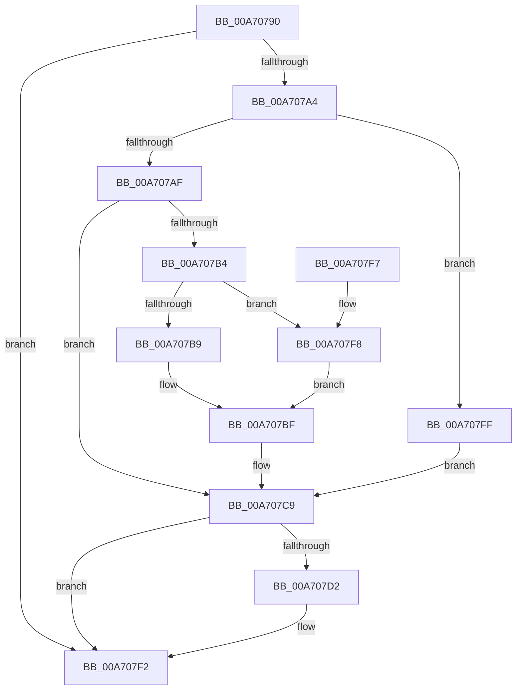

# tlgEnableCallback

- RVA: `0x00A70790`–`0x00A70804` (길이 `116` bytes)
- VA: `0x0000000140A70790`
- 실행 섹션: `PAGE`
- PDB 이름 있음: `예`; PDB Function 태그: `아니요`
- unwind 정보 RVA: `0x000816B0`
- 디코드: `35`개 명령, `116/116` bytes 표시
- 미해석 바이트: `0` (있으면 어셈블리에 `.byte`로 보존)

> 이 문서는 커널 이미지의 기계어와 PDB 기호를 분석해 생성했습니다. 4번과 5번은 함수 원형과 자료형을 바이너리 사용 방식에서 추정한 C 해석이며 원본 소스 복구 결과는 아닙니다.

## 1. Dependencies

- 직접 호출 지점: **1**; 고유 호출 대상: **1**
- 직접 호출자로 확인된 함수: **0**
- RIP 상대 이미지 참조: **0**

### Outgoing calls
- `0x00A707ED` → [guard_dispatch_icall](../../text/6B/guard_dispatch_icall_function_006BAAD0.md) (function, `0x006BAAD0`)

### Direct callers
- 이 함수 시작 RVA로 연결되는 직접 call은 확인되지 않았습니다. 간접 호출은 완전히 역산할 수 없습니다.

### Static image references
- 디코드된 RIP-relative 메모리 참조가 없습니다.

## 2. Other-region calls and transfers

- 다른 실행 섹션으로 향하는 call: **1**
  - `0x00A707ED` → [guard_dispatch_icall](../../text/6B/guard_dispatch_icall_function_006BAAD0.md) (`PAGE` → `.text`)
- 별도 외부 분기/꼬리 이동을 확인하지 못했습니다.

## 3. Assembly (complete function range)

```asm
00A70790  48 83 EC 48                     sub rsp, 0x48
00A70794  4C 8B D9                        mov r11, rcx
00A70797  48 8B 8C 24 80 00 00 00         mov rcx, qword ptr [rsp + 0x80]
00A7079F  48 85 C9                        test rcx, rcx
00A707A2  74 4E                           je 0x140a707f2
00A707A4  4C 8B 54 24 70                  mov r10, qword ptr [rsp + 0x70]
00A707A9  8B C2                           mov eax, edx
00A707AB  85 D2                           test edx, edx
00A707AD  74 50                           je 0x140a707ff
00A707AF  83 F8 01                        cmp eax, 1
00A707B2  75 15                           jne 0x140a707c9
00A707B4  45 84 C0                        test r8b, r8b
00A707B7  74 3F                           je 0x140a707f8
00A707B9  41 0F B6 C0                     movzx eax, r8b
00A707BD  FF C0                           inc eax
00A707BF  89 01                           mov dword ptr [rcx], eax
00A707C1  4C 89 49 10                     mov qword ptr [rcx + 0x10], r9
00A707C5  4C 89 51 18                     mov qword ptr [rcx + 0x18], r10
00A707C9  48 8B 41 28                     mov rax, qword ptr [rcx + 0x28]
00A707CD  48 85 C0                        test rax, rax
00A707D0  74 20                           je 0x140a707f2
00A707D2  48 8B 49 30                     mov rcx, qword ptr [rcx + 0x30]
00A707D6  48 89 4C 24 30                  mov qword ptr [rsp + 0x30], rcx
00A707DB  48 8B 4C 24 78                  mov rcx, qword ptr [rsp + 0x78]
00A707E0  48 89 4C 24 28                  mov qword ptr [rsp + 0x28], rcx
00A707E5  49 8B CB                        mov rcx, r11
00A707E8  4C 89 54 24 20                  mov qword ptr [rsp + 0x20], r10
00A707ED  E8 DE A2 C4 FF                  call 0x1406baad0
00A707F2  48 83 C4 48                     add rsp, 0x48
00A707F6  C3                              ret
00A707F7  CC                              int3
00A707F8  B8 00 01 00 00                  mov eax, 0x100
00A707FD  EB C0                           jmp 0x140a707bf
00A707FF  83 21 00                        and dword ptr [rcx], 0
00A70802  EB C5                           jmp 0x140a707c9
```

## 4. C-style interpretation (structured pseudocode)

```c
__int64 __fastcall tlgEnableCallback(__int64 a1, int a2, unsigned __int8 a3, __int64 a4, __int64 a5, __int64 a6, __int64 a7)
{
    __int64 result;
    __int64 v_rsp;
    unsigned __int64 v_stack_m18;
    unsigned __int64 v_stack_m20;
    unsigned __int64 v_stack_m28;

    v_rsp = (v_rsp) - (72);
    if (a7 == 0) goto loc_00A707F2;
    if (a2 == 0) goto loc_00A707FF;
    if (((unsigned int)((unsigned int)(a2))) != 1) goto loc_00A707C9;
    if (a3 == 0) goto loc_00A707F8;
    result = (unsigned int)((a3) + 1);
loc_00A707BF:
    *(unsigned int *)(a7) = (unsigned int)(result);
    *(unsigned __int64 *)(a7 + 16) = a4;
    *(unsigned __int64 *)(a7 + 24) = a5;
loc_00A707C9:
    result = *(unsigned __int64 *)(a7 + 40);
    if (*(unsigned __int64 *)(a7 + 40) != 0) {
        a1 = *(unsigned __int64 *)(a7 + 48);
        v_stack_m18 = a1;
        a1 = a6;
        v_stack_m20 = a1;
        a1 = a1;
        v_stack_m28 = a5;
        result = guard_dispatch_icall(a1, a2, a3, a4);
    }
    v_rsp = (v_rsp) + (72);
    return result;
loc_00A707F8:
    goto loc_00A707BF;
loc_00A707FF:
    goto loc_00A707C9;
}
```

## 5. (Beta) C Style

```c
int64_t tlgEnableCallback(int64_t Arg1, int32_t Arg2, uint8_t Arg3, int64_t Arg4, int64_t Arg5, int64_t Arg6, int64_t Arg7)
{
    int64_t result;
    int64_t local_rsp;
    uint64_t v_stack_m18;
    uint64_t v_stack_m20;
    uint64_t v_stack_m28;

    local_rsp = (local_rsp) - (72);
    if (Arg7 == 0) goto loc_00A707F2;
    if (Arg2 == 0) goto loc_00A707FF;
    if (((uint32_t)((uint32_t)(Arg2))) != 1) goto loc_00A707C9;
    if (Arg3 == 0) goto loc_00A707F8;
    result = (uint32_t)((Arg3) + 1);
loc_00A707BF:
    *(uint32_t *)(Arg7) = (uint32_t)(result);
    *(uint64_t *)(Arg7 + 0x10) = Arg4;
    *(uint64_t *)(Arg7 + 0x18) = Arg5;
loc_00A707C9:
    result = *(uint64_t *)(Arg7 + 0x28);
    if (*(uint64_t *)(Arg7 + 0x28) != 0) {
        Arg1 = *(uint64_t *)(Arg7 + 0x30);
        v_stack_m18 = Arg1;
        Arg1 = Arg6;
        v_stack_m20 = Arg1;
        Arg1 = Arg1;
        v_stack_m28 = Arg5;
        result = guard_dispatch_icall(Arg1, Arg2, Arg3, Arg4);
    }
    local_rsp = (local_rsp) + (72);
    return result;
loc_00A707F8:
    goto loc_00A707BF;
loc_00A707FF:
    goto loc_00A707C9;
}
```

## 6. Execution-region graph

[열기: 2D/3D 그래프와 함수 탐색 컨트롤 패널](../../../control-panel.html?section=page&rva=0x00A70790&view=graph)

- 2D 그래프는 위에서 아래로 흐르고, 3D 그래프는 빈 공간을 드래그해 회전합니다. Shift+드래그는 이동, 휠은 확대·축소, 함수 노드 선택은 대상 보고서 이동입니다.

### Static fallback


