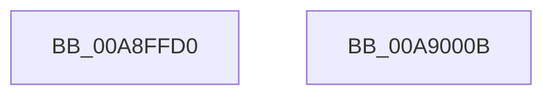

# CcFastCopyRead

- RVA: `0x00A8FFD0`–`0x00A9000C` (길이 `60` bytes)
- VA: `0x0000000140A8FFD0`
- 실행 섹션: `PAGE`
- PDB 이름 있음: `예`; PDB Function 태그: `아니요`
- unwind 정보 RVA: `0x0005CC98`
- 디코드: `15`개 명령, `60/60` bytes 표시
- 미해석 바이트: `0` (있으면 어셈블리에 `.byte`로 보존)

> 이 문서는 커널 이미지의 기계어와 PDB 기호를 분석해 생성했습니다. 4번과 5번은 함수 원형과 자료형을 바이너리 사용 방식에서 추정한 C 해석이며 원본 소스 복구 결과는 아닙니다.

## 1. Dependencies

- 직접 호출 지점: **1**; 고유 호출 대상: **1**
- 직접 호출자로 확인된 함수: **0**
- RIP 상대 이미지 참조: **0**

### Outgoing calls
- `0x00A90001` → [CcCopyReadEx](../../text/45/CcCopyReadEx_function_0045E160.md) (function, `0x0045E160`)

### Direct callers
- 이 함수 시작 RVA로 연결되는 직접 call은 확인되지 않았습니다. 간접 호출은 완전히 역산할 수 없습니다.

### Static image references
- 디코드된 RIP-relative 메모리 참조가 없습니다.

## 2. Other-region calls and transfers

- 다른 실행 섹션으로 향하는 call: **1**
  - `0x00A90001` → [CcCopyReadEx](../../text/45/CcCopyReadEx_function_0045E160.md) (`PAGE` → `.text`)
- 별도 외부 분기/꼬리 이동을 확인하지 못했습니다.

## 3. Assembly (complete function range)

```asm
00A8FFD0  4C 8B DC                        mov r11, rsp
00A8FFD3  48 83 EC 58                     sub rsp, 0x58
00A8FFD7  49 83 63 D8 00                  and qword ptr [r11 - 0x28], 0
00A8FFDC  41 B1 01                        mov r9b, 1
00A8FFDF  8B C2                           mov eax, edx
00A8FFE1  49 8D 53 E8                     lea rdx, [r11 - 0x18]
00A8FFE5  49 89 43 E8                     mov qword ptr [r11 - 0x18], rax
00A8FFE9  48 8B 84 24 88 00 00 00         mov rax, qword ptr [rsp + 0x88]
00A8FFF1  49 89 43 D0                     mov qword ptr [r11 - 0x30], rax
00A8FFF5  48 8B 84 24 80 00 00 00         mov rax, qword ptr [rsp + 0x80]
00A8FFFD  49 89 43 C8                     mov qword ptr [r11 - 0x38], rax
00A90001  E8 5A E1 9C FF                  call 0x14045e160
00A90006  48 83 C4 58                     add rsp, 0x58
00A9000A  C3                              ret
00A9000B  CC                              int3
```

## 4. C-style interpretation (structured pseudocode)

```c
__int64 __fastcall CcFastCopyRead(__int64 a1, int a2, __int64 a3, __int64 a4, __int64 a5, __int64 a6)
{
    __int64 result;
    __int64 v_rsp;

    v_rsp = (v_rsp) - (88);
    *(unsigned __int64 *)(v_rsp - 24) = (unsigned int)(a2);
    *(unsigned __int64 *)(v_rsp - 48) = a6;
    *(unsigned __int64 *)(v_rsp - 56) = a5;
    result = CcCopyReadEx(a1, v_rsp - 24, a3, 1);
    v_rsp = (v_rsp) + (88);
    return result;
}
```

## 5. (Beta) C Style

```c
int64_t CcFastCopyRead(int64_t Arg1, int32_t Arg2, int64_t Arg3, int64_t Arg4, int64_t Arg5, int64_t Arg6)
{
    int64_t result;
    int64_t local_rsp;

    local_rsp = (local_rsp) - (88);
    *(uint64_t *)(local_rsp - 0x18) = (uint32_t)(Arg2);
    *(uint64_t *)(local_rsp - 0x30) = Arg6;
    *(uint64_t *)(local_rsp - 0x38) = Arg5;
    result = CcCopyReadEx(Arg1, local_rsp - 24, Arg3, 1);
    local_rsp = (local_rsp) + (88);
    return result;
}
```

## 6. Execution-region graph

[열기: 2D/3D 그래프와 함수 탐색 컨트롤 패널](../../../control-panel.html?section=page&rva=0x00A8FFD0&view=graph)

- 2D 그래프는 위에서 아래로 흐르고, 3D 그래프는 빈 공간을 드래그해 회전합니다. Shift+드래그는 이동, 휠은 확대·축소, 함수 노드 선택은 대상 보고서 이동입니다.

### Static fallback


