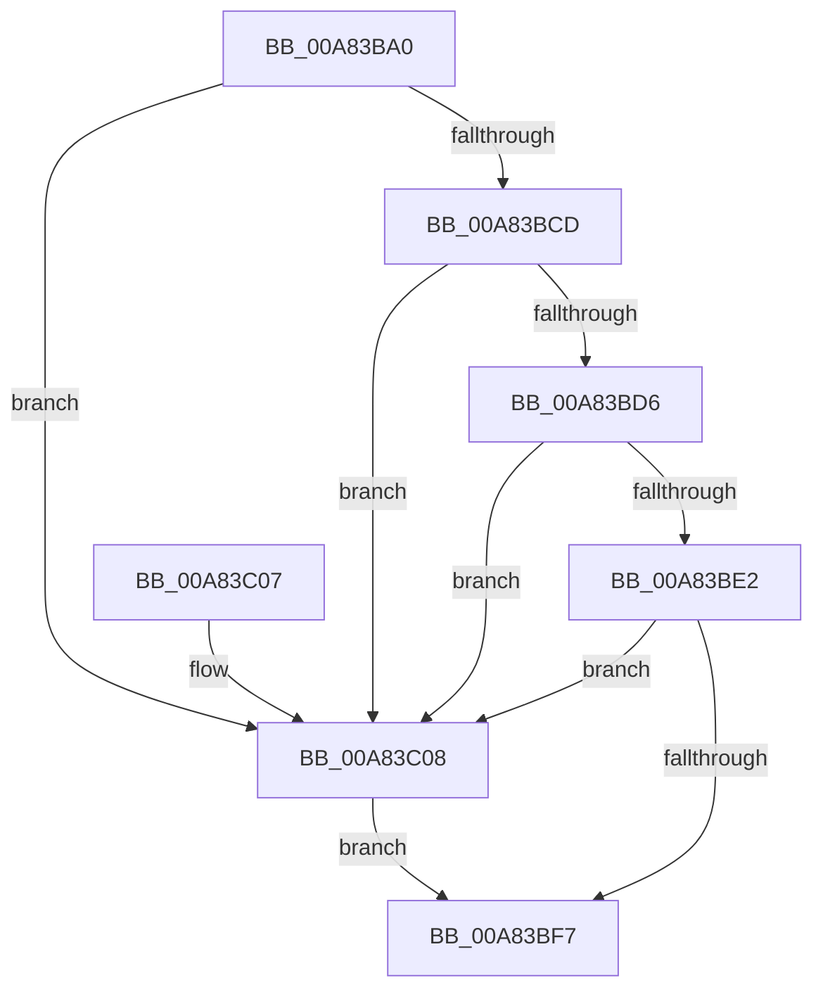

# CcMdlWriteComplete

- RVA: `0x00A83BA0`–`0x00A83C18` (길이 `120` bytes)
- VA: `0x0000000140A83BA0`
- 실행 섹션: `PAGE`
- PDB 이름 있음: `예`; PDB Function 태그: `아니요`
- unwind 정보 RVA: `0x000B752C`
- 디코드: `36`개 명령, `120/120` bytes 표시
- 미해석 바이트: `0` (있으면 어셈블리에 `.byte`로 보존)

> 이 문서는 커널 이미지의 기계어와 PDB 기호를 분석해 생성했습니다. 4번과 5번은 함수 원형과 자료형을 바이너리 사용 방식에서 추정한 C 해석이며 원본 소스 복구 결과는 아닙니다.

## 1. Dependencies

- 직접 호출 지점: **3**; 고유 호출 대상: **3**
- 직접 호출자로 확인된 함수: **0**
- RIP 상대 이미지 참조: **0**

### Outgoing calls
- `0x00A83BB8` → [IoGetRelatedDeviceObject](../../text/29/IoGetRelatedDeviceObject_function_0029B120.md) (function, `0x0029B120`)
- `0x00A83BEE` → [guard_dispatch_icall](../../text/6B/guard_dispatch_icall_function_006BAAD0.md) (function, `0x006BAAD0`)
- `0x00A83C11` → [CcMdlWriteComplete2](../../text/3C/CcMdlWriteComplete2_function_003CA36C.md) (function, `0x003CA36C`)

### Direct callers
- 이 함수 시작 RVA로 연결되는 직접 call은 확인되지 않았습니다. 간접 호출은 완전히 역산할 수 없습니다.

### Static image references
- 디코드된 RIP-relative 메모리 참조가 없습니다.

## 2. Other-region calls and transfers

- 다른 실행 섹션으로 향하는 call: **3**
  - `0x00A83BB8` → [IoGetRelatedDeviceObject](../../text/29/IoGetRelatedDeviceObject_function_0029B120.md) (`PAGE` → `.text`)
  - `0x00A83BEE` → [guard_dispatch_icall](../../text/6B/guard_dispatch_icall_function_006BAAD0.md) (`PAGE` → `.text`)
  - `0x00A83C11` → [CcMdlWriteComplete2](../../text/3C/CcMdlWriteComplete2_function_003CA36C.md) (`PAGE` → `.text`)
- 별도 외부 분기/꼬리 이동을 확인하지 못했습니다.

## 3. Assembly (complete function range)

```asm
00A83BA0  48 89 5C 24 08                  mov qword ptr [rsp + 8], rbx
00A83BA5  48 89 74 24 10                  mov qword ptr [rsp + 0x10], rsi
00A83BAA  57                              push rdi
00A83BAB  48 83 EC 30                     sub rsp, 0x30
00A83BAF  49 8B F8                        mov rdi, r8
00A83BB2  48 8B F2                        mov rsi, rdx
00A83BB5  48 8B D9                        mov rbx, rcx
00A83BB8  E8 63 75 81 FF                  call 0x14029b120
00A83BBD  48 8B C8                        mov rcx, rax
00A83BC0  4C 8B 48 08                     mov r9, qword ptr [rax + 8]
00A83BC4  4D 8B 51 50                     mov r10, qword ptr [r9 + 0x50]
00A83BC8  4D 85 D2                        test r10, r10
00A83BCB  74 3B                           je 0x140a83c08
00A83BCD  41 81 3A 98 00 00 00            cmp dword ptr [r10], 0x98
00A83BD4  76 32                           jbe 0x140a83c08
00A83BD6  49 8B 82 98 00 00 00            mov rax, qword ptr [r10 + 0x98]
00A83BDD  48 85 C0                        test rax, rax
00A83BE0  74 26                           je 0x140a83c08
00A83BE2  4C 8B C9                        mov r9, rcx
00A83BE5  4C 8B C7                        mov r8, rdi
00A83BE8  48 8B CB                        mov rcx, rbx
00A83BEB  48 8B D6                        mov rdx, rsi
00A83BEE  E8 DD 6E C3 FF                  call 0x1406baad0
00A83BF3  84 C0                           test al, al
00A83BF5  74 11                           je 0x140a83c08
00A83BF7  48 8B 5C 24 40                  mov rbx, qword ptr [rsp + 0x40]
00A83BFC  48 8B 74 24 48                  mov rsi, qword ptr [rsp + 0x48]
00A83C01  48 83 C4 30                     add rsp, 0x30
00A83C05  5F                              pop rdi
00A83C06  C3                              ret
00A83C07  CC                              int3
00A83C08  4C 8B C7                        mov r8, rdi
00A83C0B  48 8B D6                        mov rdx, rsi
00A83C0E  48 8B CB                        mov rcx, rbx
00A83C11  E8 56 67 94 FF                  call 0x1403ca36c
00A83C16  EB DF                           jmp 0x140a83bf7
```

## 4. C-style interpretation (structured pseudocode)

```c
__int64 __fastcall CcMdlWriteComplete(__int64 a1, __int64 a2, __int64 a3)
{
    __int64 result;
    __int64 v_rsp;
    unsigned __int64 v_stack_p10;
    unsigned __int64 v_stack_p8;

    v_stack_p8 = v_rbx;
    v_stack_p10 = v_rsi;
    v_rsp = (v_rsp) - (48);
    result = IoGetRelatedDeviceObject(a1, a2, a3, a4);
    if (*(unsigned __int64 *)(*(unsigned __int64 *)(result + 8) + 80) == 0) goto loc_00A83C08;
    if ((*(unsigned int *)(*(unsigned __int64 *)(*(unsigned __int64 *)(result + 8) + 80))) <= 152) goto loc_00A83C08;
    if (*(unsigned __int64 *)(*(unsigned __int64 *)(*(unsigned __int64 *)(result + 8) + 80) + 152) == 0) goto loc_00A83C08;
    result = guard_dispatch_icall(a1, a2, a3, result);
    if ((unsigned __int8)(result) == 0) goto loc_00A83C08;
loc_00A83BF7:
    v_rsp = (v_rsp) + (48);
    return result;
loc_00A83C08:
    result = CcMdlWriteComplete2(v_stack_p8, v_stack_p10, a3, result);
    goto loc_00A83BF7;
}
```

## 5. (Beta) C Style

```c
int64_t CcMdlWriteComplete(int64_t Arg1, int64_t Arg2, int64_t Arg3)
{
    int64_t result;
    int64_t local_rsp;
    uint64_t v_stack_p10;
    uint64_t v_stack_p8;

    v_stack_p8 = local_rbx;
    v_stack_p10 = local_rsi;
    local_rsp = (local_rsp) - (48);
    result = IoGetRelatedDeviceObject(Arg1, Arg2, Arg3, a4);
    if (*(uint64_t *)(*(uint64_t *)(result + 0x8) + 0x50) == 0) goto loc_00A83C08;
    if ((*(uint32_t *)(*(uint64_t *)(*(uint64_t *)(result + 0x8) + 0x50))) <= 152) goto loc_00A83C08;
    if (*(uint64_t *)(*(uint64_t *)(*(uint64_t *)(result + 0x8) + 0x50) + 0x98) == 0) goto loc_00A83C08;
    result = guard_dispatch_icall(Arg1, Arg2, Arg3, result);
    if ((uint8_t)(result) == 0) goto loc_00A83C08;
loc_00A83BF7:
    local_rsp = (local_rsp) + (48);
    return result;
loc_00A83C08:
    result = CcMdlWriteComplete2(v_stack_p8, v_stack_p10, Arg3, result);
    goto loc_00A83BF7;
}
```

## 6. Execution-region graph

[열기: 2D/3D 그래프와 함수 탐색 컨트롤 패널](../../../control-panel.html?section=page&rva=0x00A83BA0&view=graph)

- 2D 그래프는 위에서 아래로 흐르고, 3D 그래프는 빈 공간을 드래그해 회전합니다. Shift+드래그는 이동, 휠은 확대·축소, 함수 노드 선택은 대상 보고서 이동입니다.

### Static fallback


