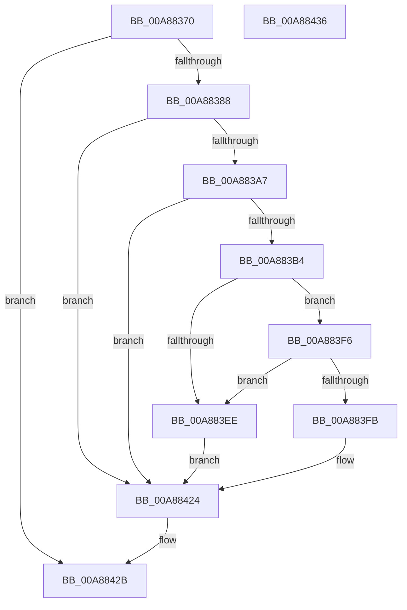

# CcTelemetryPeriodicTimerCallback

- RVA: `0x00A88370`–`0x00A88437` (길이 `199` bytes)
- VA: `0x0000000140A88370`
- 실행 섹션: `PAGE`
- PDB 이름 있음: `예`; PDB Function 태그: `아니요`
- unwind 정보 RVA: `0x000B7FB8`
- 디코드: `47`개 명령, `199/199` bytes 표시
- 미해석 바이트: `0` (있으면 어셈블리에 `.byte`로 보존)

> 이 문서는 커널 이미지의 기계어와 PDB 기호를 분석해 생성했습니다. 4번과 5번은 함수 원형과 자료형을 바이너리 사용 방식에서 추정한 C 해석이며 원본 소스 복구 결과는 아닙니다.

## 1. Dependencies

- 직접 호출 지점: **4**; 고유 호출 대상: **4**
- 직접 호출자로 확인된 함수: **0**
- RIP 상대 이미지 참조: **13**

### Outgoing calls
- `0x00A883C8` → [CcHasGlobalTelemetryChanged](../../text/4B/CcHasGlobalTelemetryChanged_function_004BD3DC.md) (function, `0x004BD3DC`)
- `0x00A883DC` → [CcForEachPartition](../../text/2F/CcForEachPartition_function_002F0828.md) (function, `0x002F0828`)
- `0x00A883E1` → [CcPostVolumeTelemetry](../../text/42/CcPostVolumeTelemetry_function_00420FF8.md) (function, `0x00420FF8`)
- `0x00A8841E` → [KeSetCoalescableTimer](../../text/22/KeSetCoalescableTimer_function_0022FFD0.md) (function, `0x0022FFD0`)

### Direct callers
- 이 함수 시작 RVA로 연결되는 직접 call은 확인되지 않았습니다. 간접 호출은 완전히 역산할 수 없습니다.

### Static image references
- `0x00A8837C` → RVA `0x00F8F260` (`.data`; read)
- `0x00A8838A` → RVA `0x00F8F3C8` (`.data`; read/write)
- `0x00A88397` → RVA `0x00F8F3C0` (`.data`; read/write)
- `0x00A883A9` → RVA `0x00F8F3C4` (`.data`; read)
- `0x00A883B4` → RVA `0x00F8F2B0` (`.data`; read/write)
- `0x00A883BB` → RVA `0x00E65B8C` (`.data`; read)
- `0x00A883C1` → RVA `0x00F8F2B8` (`.data`; read/write)
- `0x00A883D5` → RVA `0x00A95010` (`CcPartitionTelemetryCallback`; read)
- `0x00A883E6` → RVA `0x00F8F2A1` (`.data`; read)
- `0x00A883EE` → RVA `0x00F8F3C4` (`.data`; read/write)
- `0x00A883FB` → RVA `0x00F8F3D0` (`.data`; read)
- `0x00A88410` → RVA `0x00F8F280` (`.data`; read)
- `0x00A88417` → RVA `0x00F8F410` (`.data`; read)

## 2. Other-region calls and transfers

- 다른 실행 섹션으로 향하는 call: **4**
  - `0x00A883C8` → [CcHasGlobalTelemetryChanged](../../text/4B/CcHasGlobalTelemetryChanged_function_004BD3DC.md) (`PAGE` → `.text`)
  - `0x00A883DC` → [CcForEachPartition](../../text/2F/CcForEachPartition_function_002F0828.md) (`PAGE` → `.text`)
  - `0x00A883E1` → [CcPostVolumeTelemetry](../../text/42/CcPostVolumeTelemetry_function_00420FF8.md) (`PAGE` → `.text`)
  - `0x00A8841E` → [KeSetCoalescableTimer](../../text/22/KeSetCoalescableTimer_function_0022FFD0.md) (`PAGE` → `.text`)
- 별도 외부 분기/꼬리 이동을 확인하지 못했습니다.

## 3. Assembly (complete function range)

```asm
00A88370  48 89 5C 24 08                  mov qword ptr [rsp + 8], rbx
00A88375  57                              push rdi
00A88376  48 83 EC 30                     sub rsp, 0x30
00A8837A  33 DB                           xor ebx, ebx
00A8837C  38 1D DE 6E 50 00               cmp byte ptr [rip + 0x506ede], bl
00A88382  0F 84 A3 00 00 00               je 0x140a8842b
00A88388  8B C3                           mov eax, ebx
00A8838A  87 05 38 70 50 00               xchg dword ptr [rip + 0x507038], eax
00A88390  44 8D 43 01                     lea r8d, [rbx + 1]
00A88394  41 8B C0                        mov eax, r8d
00A88397  F0 0F C1 05 21 70 50 00         lock xadd dword ptr [rip + 0x507021], eax
00A8839F  41 03 C0                        add eax, r8d
00A883A2  41 3B C0                        cmp eax, r8d
00A883A5  75 7D                           jne 0x140a88424
00A883A7  33 C0                           xor eax, eax
00A883A9  F0 44 0F B1 05 12 70 50 00      lock cmpxchg dword ptr [rip + 0x507012], r8d
00A883B2  75 70                           jne 0x140a88424
00A883B4  4C 01 05 F5 6E 50 00            add qword ptr [rip + 0x506ef5], r8
00A883BB  8B 05 CB D7 3D 00               mov eax, dword ptr [rip + 0x3dd7cb]
00A883C1  48 01 05 F0 6E 50 00            add qword ptr [rip + 0x506ef0], rax
00A883C8  E8 0F 50 A3 FF                  call 0x1404bd3dc
00A883CD  40 8A F8                        mov dil, al
00A883D0  45 8A C8                        mov r9b, r8b
00A883D3  33 D2                           xor edx, edx
00A883D5  48 8D 0D 34 CC 00 00            lea rcx, [rip + 0xcc34]
00A883DC  E8 47 84 86 FF                  call 0x1402f0828
00A883E1  E8 12 8C 99 FF                  call 0x140420ff8
00A883E6  38 1D B5 6E 50 00               cmp byte ptr [rip + 0x506eb5], bl
00A883EC  74 08                           je 0x140a883f6
00A883EE  87 1D D0 6F 50 00               xchg dword ptr [rip + 0x506fd0], ebx
00A883F4  EB 2E                           jmp 0x140a88424
00A883F6  40 84 FF                        test dil, dil
00A883F9  74 F3                           je 0x140a883ee
00A883FB  48 8D 05 CE 6F 50 00            lea rax, [rip + 0x506fce]
00A88402  48 89 44 24 20                  mov qword ptr [rsp + 0x20], rax
00A88407  41 B9 98 3A 00 00               mov r9d, 0x3a98
00A8840D  45 33 C0                        xor r8d, r8d
00A88410  48 8B 15 69 6E 50 00            mov rdx, qword ptr [rip + 0x506e69]
00A88417  48 8D 0D F2 6F 50 00            lea rcx, [rip + 0x506ff2]
00A8841E  E8 AD 7B 7A FF                  call 0x14022ffd0
00A88423  90                              nop
00A88424  F0 FF 0D 95 6F 50 00            lock dec dword ptr [rip + 0x506f95]
00A8842B  48 8B 5C 24 40                  mov rbx, qword ptr [rsp + 0x40]
00A88430  48 83 C4 30                     add rsp, 0x30
00A88434  5F                              pop rdi
00A88435  C3                              ret
00A88436  CC                              int3
```

## 4. C-style interpretation (structured pseudocode)

```c
__int64 __fastcall CcTelemetryPeriodicTimerCallback(__int64 a1, int a2)
{
    __int64 result;
    __int64 v_rbx;
    __int64 v_rsp;
    unsigned __int64 v_stack_m18;
    unsigned __int64 v_stack_p8;

    v_stack_p8 = v_rbx;
    v_rsp = (v_rsp) - (48);
    v_rbx = 0;
    if ((*(unsigned __int8 *)(v_rip + 5271262)) == 0) goto loc_00A8842B;
    result = (unsigned int)(((unsigned int)((unsigned int)(v_rbx + 1))) + ((unsigned int)(v_rbx + 1)));
    if (((unsigned int)(result)) != ((unsigned int)(v_rbx + 1))) goto loc_00A88424;
    result = 0;
    if (condition_is_not_equal) goto loc_00A88424;
    result = CcHasGlobalTelemetryChanged(a1, a2, v_rbx + 1, a4);
    a2 = 0;
    result = CcForEachPartition(v_rip + 52276, a2, v_rbx + 1, (unsigned __int8)(v_rbx + 1));
    result = CcPostVolumeTelemetry(v_rip + 52276, a2, v_rbx + 1, (unsigned __int8)(v_rbx + 1));
    if ((*(unsigned __int8 *)(v_rip + 5271221)) == 0) goto loc_00A883F6;
loc_00A883EE:
    goto loc_00A88424;
loc_00A883F6:
    if ((unsigned __int8)((unsigned __int8)(result)) == 0) goto loc_00A883EE;
    v_stack_m18 = v_rip + 5271502;
    a3 = 0;
    result = KeSetCoalescableTimer(v_rip + 5271538, *(unsigned __int64 *)(v_rip + 5271145), a3, (unsigned int)(0x3A98ULL));
loc_00A88424:
loc_00A8842B:
    v_rsp = (v_rsp) + (48);
    return result;
}
```

## 5. (Beta) C Style

```c
int64_t CcTelemetryPeriodicTimerCallback(int64_t Arg1, int32_t Arg2)
{
    int64_t result;
    int64_t local_rbx;
    int64_t local_rsp;
    uint64_t v_stack_m18;
    uint64_t v_stack_p8;

    v_stack_p8 = local_rbx;
    local_rsp = (local_rsp) - (48);
    local_rbx = 0;
    if ((*(uint8_t *)(v_rip + 0x506EDE)) == 0) goto loc_00A8842B;
    result = (uint32_t)(((uint32_t)((uint32_t)(local_rbx + 1))) + ((uint32_t)(local_rbx + 1)));
    if (((uint32_t)(result)) != ((uint32_t)(local_rbx + 1))) goto loc_00A88424;
    result = 0;
    if (condition_is_not_equal) goto loc_00A88424;
    result = CcHasGlobalTelemetryChanged(Arg1, Arg2, local_rbx + 1, a4);
    Arg2 = 0;
    result = CcForEachPartition(v_rip + 52276, Arg2, local_rbx + 1, (uint8_t)(local_rbx + 1));
    result = CcPostVolumeTelemetry(v_rip + 52276, Arg2, local_rbx + 1, (uint8_t)(local_rbx + 1));
    if ((*(uint8_t *)(v_rip + 0x506EB5)) == 0) goto loc_00A883F6;
loc_00A883EE:
    goto loc_00A88424;
loc_00A883F6:
    if ((uint8_t)((uint8_t)(result)) == 0) goto loc_00A883EE;
    v_stack_m18 = v_rip + 5271502;
    a3 = 0;
    result = KeSetCoalescableTimer(v_rip + 5271538, *(uint64_t *)(v_rip + 0x506E69), a3, (uint32_t)(0x3A98ULL));
loc_00A88424:
loc_00A8842B:
    local_rsp = (local_rsp) + (48);
    return result;
}
```

## 6. Execution-region graph

[열기: 2D/3D 그래프와 함수 탐색 컨트롤 패널](../../../control-panel.html?section=page&rva=0x00A88370&view=graph)

- 2D 그래프는 위에서 아래로 흐르고, 3D 그래프는 빈 공간을 드래그해 회전합니다. Shift+드래그는 이동, 휠은 확대·축소, 함수 노드 선택은 대상 보고서 이동입니다.

### Static fallback


