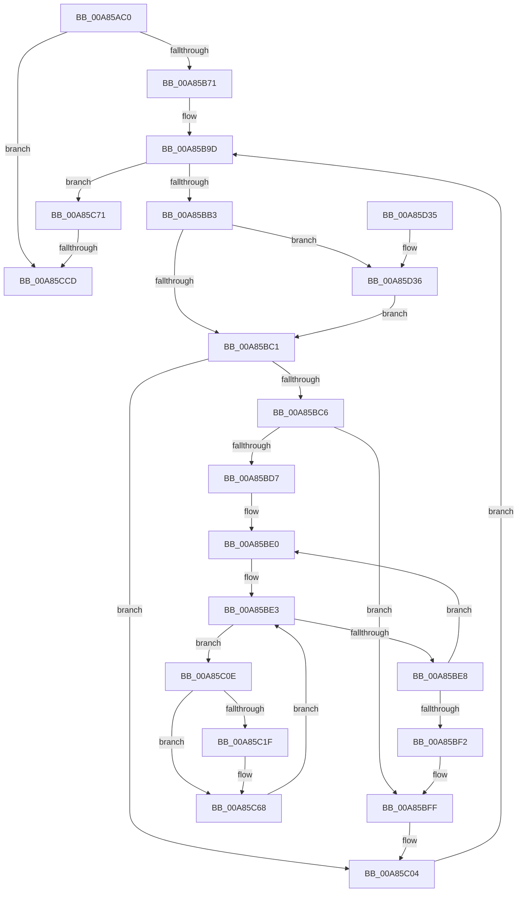

# CmEtwRunDown

- RVA: `0x00A85AC0`–`0x00A85D49` (길이 `649` bytes)
- VA: `0x0000000140A85AC0`
- 실행 섹션: `PAGE`
- PDB 이름 있음: `예`; PDB Function 태그: `예`
- unwind 정보 RVA: `0x000B7A80`
- 디코드: `158`개 명령, `649/649` bytes 표시
- 미해석 바이트: `0` (있으면 어셈블리에 `.byte`로 보존)

> 이 문서는 커널 이미지의 기계어와 PDB 기호를 분석해 생성했습니다. 4번과 5번은 함수 원형과 자료형을 바이너리 사용 방식에서 추정한 C 해석이며 원본 소스 복구 결과는 아닙니다.

## 1. Dependencies

- 직접 호출 지점: **15**; 고유 호출 대상: **14**
- 직접 호출자로 확인된 함수: **1**
- RIP 상대 이미지 참조: **3**

### Outgoing calls
- `0x00A85B5F` → [CmpInitializeThreadInfo](../../text/3F/CmpInitializeThreadInfo_function_003FBE70.md) (function, `0x003FBE70`)
- `0x00A85B75` → [CmpAttachToRegistryProcess](../../pagecmrc/BC/CmpAttachToRegistryProcess_function_00BC98E0.md) (function, `0x00BC98E0`)
- `0x00A85B9D` → [CmpGetNextActiveHive](../84/CmpGetNextActiveHive_function_0084E2A0.md) (function, `0x0084E2A0`)
- `0x00A85BB3` → [CmpLockRegistryExclusive](../84/CmpLockRegistryExclusive_function_0084F9B4.md) (function, `0x0084F9B4`)
- `0x00A85C04` → [CmpUnlockRegistry](../../pagecmrc/BC/CmpUnlockRegistry_function_00BC9A84.md) (function, `0x00BC9A84`)
- `0x00A85C12` → [CmpConstructName](../85/CmpConstructName_function_00856BE0.md) (function, `0x00856BE0`)
- `0x00A85C56` → [EtwTraceSiloDcEvent](../../text/48/EtwTraceSiloDcEvent_function_0048B28C.md) (function, `0x0048B28C`)
- `0x00A85C63` → [CmpFreePoolWithTag](../../text/44/CmpFreePoolWithTag_function_004489E0.md) (function, `0x004489E0`)
- `0x00A85C75` → [CmpDetachFromRegistryProcess](../../pagecmrc/BC/CmpDetachFromRegistryProcess_function_00BC9920.md) (function, `0x00BC9920`)
- `0x00A85C85` → [RtlInitUnicodeString](../../text/42/RtlInitUnicodeString_function_0042A780.md) (function, `0x0042A780`)
- `0x00A85CC0` → [ZwOpenKey](../../text/6A/ZwOpenKey_function_006AD310.md) (function, `0x006AD310`)
- `0x00A85CFE` → [EtwTraceSiloDcEvent](../../text/48/EtwTraceSiloDcEvent_function_0048B28C.md) (function, `0x0048B28C`)
- `0x00A85D07` → [CmCleanupThreadInfo](../../text/41/CmCleanupThreadInfo_function_0041FD50.md) (function, `0x0041FD50`)
- `0x00A85D15` → [_security_check_cookie](../../text/6A/_security_check_cookie_function_006AC640.md) (function, `0x006AC640`)
- `0x00A85D3F` → [CmpLogHiveRundownEvent](../7E/CmpLogHiveRundownEvent_function_007E63DC.md) (function, `0x007E63DC`)

### Direct callers
- [EtwpKernelTraceRundown](../9E/EtwpKernelTraceRundown_function_009E4080.md) at `0x009E417A`

### Static image references
- `0x00A85ADC` → RVA `0x00E0A740` (`.data`; read)
- `0x00A85C7A` → RVA `0x00B095B0` (` ?? ::NNGAKEGL::`string'`; read)
- `0x00A85CCD` → RVA `0x00FDA430` (`PAGEDATA`; read)

## 2. Other-region calls and transfers

- 다른 실행 섹션으로 향하는 call: **11**
  - `0x00A85B5F` → [CmpInitializeThreadInfo](../../text/3F/CmpInitializeThreadInfo_function_003FBE70.md) (`PAGE` → `.text`)
  - `0x00A85B75` → [CmpAttachToRegistryProcess](../../pagecmrc/BC/CmpAttachToRegistryProcess_function_00BC98E0.md) (`PAGE` → `PAGECMRC`)
  - `0x00A85C04` → [CmpUnlockRegistry](../../pagecmrc/BC/CmpUnlockRegistry_function_00BC9A84.md) (`PAGE` → `PAGECMRC`)
  - `0x00A85C56` → [EtwTraceSiloDcEvent](../../text/48/EtwTraceSiloDcEvent_function_0048B28C.md) (`PAGE` → `.text`)
  - `0x00A85C63` → [CmpFreePoolWithTag](../../text/44/CmpFreePoolWithTag_function_004489E0.md) (`PAGE` → `.text`)
  - `0x00A85C75` → [CmpDetachFromRegistryProcess](../../pagecmrc/BC/CmpDetachFromRegistryProcess_function_00BC9920.md) (`PAGE` → `PAGECMRC`)
  - `0x00A85C85` → [RtlInitUnicodeString](../../text/42/RtlInitUnicodeString_function_0042A780.md) (`PAGE` → `.text`)
  - `0x00A85CC0` → [ZwOpenKey](../../text/6A/ZwOpenKey_function_006AD310.md) (`PAGE` → `.text`)
  - `0x00A85CFE` → [EtwTraceSiloDcEvent](../../text/48/EtwTraceSiloDcEvent_function_0048B28C.md) (`PAGE` → `.text`)
  - `0x00A85D07` → [CmCleanupThreadInfo](../../text/41/CmCleanupThreadInfo_function_0041FD50.md) (`PAGE` → `.text`)
  - `0x00A85D15` → [_security_check_cookie](../../text/6A/_security_check_cookie_function_006AC640.md) (`PAGE` → `.text`)
- call이 아닌 외부 분기/꼬리 이동: **1**
  - `0x00A85CC7` → [sub_00B4442A](../B4/Unknown_function_00B4442A.md) (`tail-transfer`)

## 3. Assembly (complete function range)

```asm
00A85AC0  48 89 5C 24 18                  mov qword ptr [rsp + 0x18], rbx
00A85AC5  55                              push rbp
00A85AC6  56                              push rsi
00A85AC7  57                              push rdi
00A85AC8  41 54                           push r12
00A85ACA  41 55                           push r13
00A85ACC  41 56                           push r14
00A85ACE  41 57                           push r15
00A85AD0  48 8D 6C 24 B0                  lea rbp, [rsp - 0x50]
00A85AD5  48 81 EC 50 01 00 00            sub rsp, 0x150
00A85ADC  48 8B 05 5D 4C 38 00            mov rax, qword ptr [rip + 0x384c5d]
00A85AE3  48 33 C4                        xor rax, rsp
00A85AE6  48 89 45 48                     mov qword ptr [rbp + 0x48], rax
00A85AEA  0F 57 C0                        xorps xmm0, xmm0
00A85AED  44 88 4C 24 31                  mov byte ptr [rsp + 0x31], r9b
00A85AF2  33 C0                           xor eax, eax
00A85AF4  44 88 44 24 30                  mov byte ptr [rsp + 0x30], r8b
00A85AF9  45 33 F6                        xor r14d, r14d
00A85AFC  48 89 45 B0                     mov qword ptr [rbp - 0x50], rax
00A85B00  0F 57 C9                        xorps xmm1, xmm1
00A85B03  48 89 44 24 70                  mov qword ptr [rsp + 0x70], rax
00A85B08  4C 8B E1                        mov r12, rcx
00A85B0B  89 44 24 78                     mov dword ptr [rsp + 0x78], eax
00A85B0F  48 8D 4D A0                     lea rcx, [rbp - 0x60]
00A85B13  44 89 74 24 38                  mov dword ptr [rsp + 0x38], r14d
00A85B18  0F 11 45 A0                     movups xmmword ptr [rbp - 0x60], xmm0
00A85B1C  44 89 74 24 3C                  mov dword ptr [rsp + 0x3c], r14d
00A85B21  41 8A F9                        mov dil, r9b
00A85B24  0F 11 44 24 50                  movups xmmword ptr [rsp + 0x50], xmm0
00A85B29  4C 89 74 24 40                  mov qword ptr [rsp + 0x40], r14
00A85B2E  41 8A F0                        mov sil, r8b
00A85B31  0F 11 44 24 60                  movups xmmword ptr [rsp + 0x60], xmm0
00A85B36  66 44 89 74 24 34               mov word ptr [rsp + 0x34], r14w
00A85B3C  44 8B EA                        mov r13d, edx
00A85B3F  0F 11 45 90                     movups xmmword ptr [rbp - 0x70], xmm0
00A85B43  0F 11 4D D8                     movups xmmword ptr [rbp - 0x28], xmm1
00A85B47  0F 11 45 80                     movups xmmword ptr [rbp - 0x80], xmm0
00A85B4B  0F 11 4D B8                     movups xmmword ptr [rbp - 0x48], xmm1
00A85B4F  0F 11 4D C8                     movups xmmword ptr [rbp - 0x38], xmm1
00A85B53  0F 11 45 E8                     movups xmmword ptr [rbp - 0x18], xmm0
00A85B57  0F 11 45 F8                     movups xmmword ptr [rbp - 8], xmm0
00A85B5B  0F 11 45 08                     movups xmmword ptr [rbp + 8], xmm0
00A85B5F  E8 0C 63 97 FF                  call 0x1403fbe70
00A85B64  44 38 B5 B0 00 00 00            cmp byte ptr [rbp + 0xb0], r14b
00A85B6B  0F 85 5C 01 00 00               jne 0x140a85ccd
00A85B71  48 8D 4D E8                     lea rcx, [rbp - 0x18]
00A85B75  E8 66 3D 14 00                  call 0x140bc98e0
00A85B7A  48 8D 45 B8                     lea rax, [rbp - 0x48]
00A85B7E  48 C7 45 20 18 00 00 00         mov qword ptr [rbp + 0x20], 0x18
00A85B86  48 89 45 18                     mov qword ptr [rbp + 0x18], rax
00A85B8A  33 C9                           xor ecx, ecx
00A85B8C  48 8D 44 24 34                  lea rax, [rsp + 0x34]
00A85B91  48 C7 45 40 02 00 00 00         mov qword ptr [rbp + 0x40], 2
00A85B99  48 89 45 38                     mov qword ptr [rbp + 0x38], rax
00A85B9D  E8 FE 86 DC FF                  call 0x14084e2a0
00A85BA2  48 89 44 24 48                  mov qword ptr [rsp + 0x48], rax
00A85BA7  48 8B D8                        mov rbx, rax
00A85BAA  48 85 C0                        test rax, rax
00A85BAD  0F 84 BE 00 00 00               je 0x140a85c71
00A85BB3  E8 FC 9D DC FF                  call 0x14084f9b4
00A85BB8  40 84 FF                        test dil, dil
00A85BBB  0F 85 75 01 00 00               jne 0x140a85d36
00A85BC1  40 84 F6                        test sil, sil
00A85BC4  74 3E                           je 0x140a85c04
00A85BC6  8B 83 78 06 00 00               mov eax, dword ptr [rbx + 0x678]
00A85BCC  48 8B B3 70 06 00 00            mov rsi, qword ptr [rbx + 0x670]
00A85BD3  85 C0                           test eax, eax
00A85BD5  74 28                           je 0x140a85bff
00A85BD7  48 83 C6 10                     add rsi, 0x10
00A85BDB  44 8B F8                        mov r15d, eax
00A85BDE  33 DB                           xor ebx, ebx
00A85BE0  48 8B 3E                        mov rdi, qword ptr [rsi]
00A85BE3  48 85 FF                        test rdi, rdi
00A85BE6  75 26                           jne 0x140a85c0e
00A85BE8  48 83 C6 18                     add rsi, 0x18
00A85BEC  49 83 EF 01                     sub r15, 1
00A85BF0  75 EE                           jne 0x140a85be0
00A85BF2  48 8B 5C 24 48                  mov rbx, qword ptr [rsp + 0x48]
00A85BF7  45 33 F6                        xor r14d, r14d
00A85BFA  40 8A 7C 24 31                  mov dil, byte ptr [rsp + 0x31]
00A85BFF  40 8A 74 24 30                  mov sil, byte ptr [rsp + 0x30]
00A85C04  E8 7B 3E 14 00                  call 0x140bc9a84
00A85C09  48 8B CB                        mov rcx, rbx
00A85C0C  EB 8F                           jmp 0x140a85b9d
00A85C0E  48 8D 4F F0                     lea rcx, [rdi - 0x10]
00A85C12  E8 C9 0F DD FF                  call 0x140856be0
00A85C17  4C 8B F0                        mov r14, rax
00A85C1A  48 85 C0                        test rax, rax
00A85C1D  74 49                           je 0x140a85c68
00A85C1F  0F B7 10                        movzx edx, word ptr [rax]
00A85C22  45 8B CD                        mov r9d, r13d
00A85C25  48 8B 48 08                     mov rcx, qword ptr [rax + 8]
00A85C29  4D 8B C4                        mov r8, r12
00A85C2C  48 89 4D 28                     mov qword ptr [rbp + 0x28], rcx
00A85C30  48 8D 47 F0                     lea rax, [rdi - 0x10]
00A85C34  89 55 30                        mov dword ptr [rbp + 0x30], edx
00A85C37  48 8D 4D 18                     lea rcx, [rbp + 0x18]
00A85C3B  BA 03 00 00 00                  mov edx, 3
00A85C40  C7 44 24 28 02 18 50 00         mov dword ptr [rsp + 0x28], 0x501802
00A85C48  89 5D 34                        mov dword ptr [rbp + 0x34], ebx
00A85C4B  48 89 45 C8                     mov qword ptr [rbp - 0x38], rax
00A85C4F  66 C7 44 24 20 19 09            mov word ptr [rsp + 0x20], 0x919
00A85C56  E8 31 56 A0 FF                  call 0x14048b28c
00A85C5B  BA 43 4D 4E 62                  mov edx, 0x624e4d43
00A85C60  49 8B CE                        mov rcx, r14
00A85C63  E8 78 2D 9C FF                  call 0x1404489e0
00A85C68  48 8B 7F 08                     mov rdi, qword ptr [rdi + 8]
00A85C6C  E9 72 FF FF FF                  jmp 0x140a85be3
00A85C71  48 8D 4D E8                     lea rcx, [rbp - 0x18]
00A85C75  E8 A6 3C 14 00                  call 0x140bc9920
00A85C7A  48 8D 15 2F 39 08 00            lea rdx, [rip + 0x8392f]
00A85C81  48 8D 4D 80                     lea rcx, [rbp - 0x80]
00A85C85  E8 F6 4A 9A FF                  call 0x14042a780
00A85C8A  48 8D 45 80                     lea rax, [rbp - 0x80]
00A85C8E  C7 44 24 50 30 00 00 00         mov dword ptr [rsp + 0x50], 0x30
00A85C96  0F 57 C0                        xorps xmm0, xmm0
00A85C99  48 89 44 24 60                  mov qword ptr [rsp + 0x60], rax
00A85C9E  4C 8D 44 24 50                  lea r8, [rsp + 0x50]
00A85CA3  4C 89 74 24 58                  mov qword ptr [rsp + 0x58], r14
00A85CA8  BA 19 00 02 00                  mov edx, 0x20019
00A85CAD  C7 44 24 68 40 02 00 00         mov dword ptr [rsp + 0x68], 0x240
00A85CB5  48 8D 4C 24 40                  lea rcx, [rsp + 0x40]
00A85CBA  F3 0F 7F 44 24 70               movdqu xmmword ptr [rsp + 0x70], xmm0
00A85CC0  E8 4B 76 C2 FF                  call 0x1406ad310
00A85CC5  85 C0                           test eax, eax
00A85CC7  0F 89 5D E7 0B 00               jns 0x140b4442a
00A85CCD  48 8D 05 5C 47 55 00            lea rax, [rip + 0x55475c]
00A85CD4  C7 44 24 28 02 18 50 00         mov dword ptr [rsp + 0x28], 0x501802
00A85CDC  45 8B CD                        mov r9d, r13d
00A85CDF  48 89 45 18                     mov qword ptr [rbp + 0x18], rax
00A85CE3  4D 8B C4                        mov r8, r12
00A85CE6  48 C7 45 20 58 00 00 00         mov qword ptr [rbp + 0x20], 0x58
00A85CEE  BA 01 00 00 00                  mov edx, 1
00A85CF3  66 C7 44 24 20 22 09            mov word ptr [rsp + 0x20], 0x922
00A85CFA  48 8D 4D 18                     lea rcx, [rbp + 0x18]
00A85CFE  E8 89 55 A0 FF                  call 0x14048b28c
00A85D03  48 8D 4D A0                     lea rcx, [rbp - 0x60]
00A85D07  E8 44 A0 99 FF                  call 0x14041fd50
00A85D0C  33 C0                           xor eax, eax
00A85D0E  48 8B 4D 48                     mov rcx, qword ptr [rbp + 0x48]
00A85D12  48 33 CC                        xor rcx, rsp
00A85D15  E8 26 69 C2 FF                  call 0x1406ac640
00A85D1A  48 8B 9C 24 A0 01 00 00         mov rbx, qword ptr [rsp + 0x1a0]
00A85D22  48 81 C4 50 01 00 00            add rsp, 0x150
00A85D29  41 5F                           pop r15
00A85D2B  41 5E                           pop r14
00A85D2D  41 5D                           pop r13
00A85D2F  41 5C                           pop r12
00A85D31  5F                              pop rdi
00A85D32  5E                              pop rsi
00A85D33  5D                              pop rbp
00A85D34  C3                              ret
00A85D35  CC                              int3
00A85D36  45 8B C5                        mov r8d, r13d
00A85D39  49 8B D4                        mov rdx, r12
00A85D3C  48 8B CB                        mov rcx, rbx
00A85D3F  E8 98 06 D6 FF                  call 0x1407e63dc
00A85D44  E9 78 FE FF FF                  jmp 0x140a85bc1
```

## 4. C-style interpretation (structured pseudocode)

```c
__int64 __fastcall CmEtwRunDown(__int64 a1, int a2, unsigned __int8 a3, unsigned __int8 a4, unsigned __int8 a5)
{
    __int64 result;
    __int64 v_r14;
    __int64 v_r15;
    __int64 v_rbx;
    __int64 v_rsi;
    __int64 v_rsp;
    unsigned __int64 v_stack_m108;
    unsigned int v_stack_m110;
    unsigned __int64 v_stack_m118;
    unsigned int v_stack_m120;
    unsigned __int64 v_stack_m128;
    unsigned __int64 v_stack_m130;
    unsigned __int64 v_stack_m138;
    unsigned __int64 v_stack_m140;
    unsigned __int64 v_stack_m148;
    unsigned int v_stack_m14C;
    unsigned int v_stack_m150;
    unsigned __int16 v_stack_m154;
    unsigned __int8 v_stack_m157;
    unsigned __int8 v_stack_m158;
    unsigned int v_stack_m160;
    unsigned __int16 v_stack_m168;
    unsigned __int64 v_stack_m40;
    unsigned __int64 v_stack_m48;
    unsigned __int64 v_stack_m50;
    unsigned int v_stack_m54;
    unsigned int v_stack_m58;
    unsigned __int64 v_stack_m60;
    unsigned __int64 v_stack_m68;
    unsigned __int64 v_stack_m70;
    unsigned __int64 v_stack_m80;
    unsigned __int64 v_stack_m88;
    unsigned __int64 v_stack_m90;
    unsigned __int64 v_stack_mA0;
    unsigned __int64 v_stack_mB0;
    unsigned __int64 v_stack_mC0;
    unsigned __int64 v_stack_mD0;
    unsigned __int64 v_stack_mD8;
    unsigned __int64 v_stack_mE8;
    unsigned __int64 v_stack_mF8;
    unsigned __int64 v_stack_p18;

    v_stack_p18 = v_rbx;
    v_rsp = (v_rsp) - (336);
    result = (*(unsigned __int64 *)(v_rip + 3689565)) ^ (v_rsp);
    v_stack_m40 = result;
    v_stack_m157 = a4;
    result = 0;
    v_stack_m158 = a3;
    v_r14 = 0;
    v_stack_mD8 = 0;
    v_stack_m118 = 0;
    v_stack_m110 = 0;
    v_stack_m150 = 0;
    v_stack_mE8 = v_xmm0;
    v_stack_m14C = 0;
    v_stack_m138 = v_xmm0;
    v_stack_m148 = 0;
    v_stack_m128 = v_xmm0;
    v_stack_m154 = 0;
    v_stack_mF8 = v_xmm0;
    v_stack_mB0 = v_xmm1;
    v_stack_m108 = v_xmm0;
    v_stack_mD0 = v_xmm1;
    v_stack_mC0 = v_xmm1;
    v_stack_mA0 = v_xmm0;
    v_stack_m90 = v_xmm0;
    v_stack_m80 = v_xmm0;
    result = CmpInitializeThreadInfo(v_stack_mE8, a2, a3, a4);
    if (a5 != 0) goto loc_00A85CCD;
    result = CmpAttachToRegistryProcess(v_stack_mA0, a2, a3, a4);
    v_stack_m68 = 24;
    v_stack_m70 = v_stack_mD0;
    a1 = 0;
    v_stack_m48 = 2;
    v_stack_m50 = v_stack_m154;
loc_00A85B9D:
    result = CmpGetNextActiveHive(a1, a2, a3, a4);
    v_stack_m140 = result;
    if (result == 0) goto loc_00A85C71;
    result = CmpLockRegistryExclusive(a1, a2, a3, a4);
    if (a4 != 0) goto loc_00A85D36;
loc_00A85BC1:
    if (a3 == 0) goto loc_00A85C04;
    if ((unsigned int)((unsigned int)(*(unsigned int *)(result + 1656))) == 0) goto loc_00A85BFF;
    v_rsi = (*(unsigned __int64 *)(result + 1648)) + (16);
    v_rbx = 0;
loc_00A85BE0:
loc_00A85BE3:
    if (*(unsigned __int64 *)(v_rsi) != 0) goto loc_00A85C0E;
    v_rsi = (v_rsi) + (24);
    v_r15 = ((unsigned int)((unsigned int)((unsigned int)(*(unsigned int *)(result + 1656))))) - (1);
    if (condition_is_not_equal) goto loc_00A85BE0;
    v_r14 = 0;
loc_00A85BFF:
loc_00A85C04:
    result = CmpUnlockRegistry(a1, a2, a3, a4);
    goto loc_00A85B9D;
loc_00A85C0E:
    result = CmpConstructName(v_stack_m157 - 16, a2, a3, a4);
    if (result != 0) {
        a2 = *(unsigned __int16 *)(result);
        a4 = (unsigned int)((unsigned int)(a2));
        a1 = *(unsigned __int64 *)(result + 8);
        a3 = a1;
        v_stack_m60 = a1;
        result = v_stack_m157 - 16;
        v_stack_m58 = a2;
        a1 = v_stack_m70;
        a2 = 3;
        v_stack_m160 = 0x501802ULL;
        v_stack_m54 = (unsigned int)(v_stack_m140);
        v_stack_mC0 = result;
        v_stack_m168 = 0x919ULL;
        result = EtwTraceSiloDcEvent(a1, a2, a3, a4);
        a2 = 0x624E4D43ULL;
        a1 = result;
        result = CmpFreePoolWithTag(a1, a2, a3, a4);
    }
    goto loc_00A85BE3;
loc_00A85C71:
    result = CmpDetachFromRegistryProcess(v_stack_mA0, a2, a3, a4);
    result = RtlInitUnicodeString(v_stack_m108, v_rip + 538927, a3, a4);
    v_stack_m138 = 48;
    v_stack_m128 = v_stack_m108;
    v_stack_m130 = result;
    v_stack_m120 = 576;
    v_stack_m118 = v_xmm0;
    result = ZwOpenKey(v_stack_m148, (unsigned int)(0x20019ULL), v_stack_m138, a4);
loc_00A85CCD:
    v_stack_m160 = 0x501802ULL;
    v_stack_m70 = v_rip + 5588828;
    v_stack_m68 = 88;
    v_stack_m168 = 0x922ULL;
    result = EtwTraceSiloDcEvent(v_stack_m70, 1, a1, (unsigned int)((unsigned int)((unsigned int)(a2))));
    result = CmCleanupThreadInfo(v_stack_mE8, 1, a1, (unsigned int)((unsigned int)((unsigned int)(a2))));
    result = 0;
    a1 = (v_stack_m40) ^ (v_rsp);
    result = _security_check_cookie(a1, 1, a1, (unsigned int)((unsigned int)((unsigned int)(a2))));
    v_rsp = (v_rsp) + (336);
    return result;
loc_00A85D36:
    result = CmpLogHiveRundownEvent(v_stack_p18, a1, (unsigned int)((unsigned int)((unsigned int)(a2))), (unsigned int)((unsigned int)((unsigned int)(a2))));
    goto loc_00A85BC1;
}
```

## 5. (Beta) C Style

```c
int64_t CmEtwRunDown(int64_t Arg1, int32_t Arg2, uint8_t Arg3, uint8_t Arg4, uint8_t Arg5)
{
    int64_t result;
    int64_t local_r14;
    int64_t local_r15;
    int64_t local_rbx;
    int64_t local_rsi;
    int64_t local_rsp;
    uint64_t v_stack_m108;
    uint32_t v_stack_m110;
    uint64_t v_stack_m118;
    uint32_t v_stack_m120;
    uint64_t v_stack_m128;
    uint64_t v_stack_m130;
    uint64_t v_stack_m138;
    uint64_t v_stack_m140;
    uint64_t v_stack_m148;
    uint32_t v_stack_m14C;
    uint32_t v_stack_m150;
    uint16_t v_stack_m154;
    uint8_t v_stack_m157;
    uint8_t v_stack_m158;
    uint32_t v_stack_m160;
    uint16_t v_stack_m168;
    uint64_t v_stack_m40;
    uint64_t v_stack_m48;
    uint64_t v_stack_m50;
    uint32_t v_stack_m54;
    uint32_t v_stack_m58;
    uint64_t v_stack_m60;
    uint64_t v_stack_m68;
    uint64_t v_stack_m70;
    uint64_t v_stack_m80;
    uint64_t v_stack_m88;
    uint64_t v_stack_m90;
    uint64_t v_stack_mA0;
    uint64_t v_stack_mB0;
    uint64_t v_stack_mC0;
    uint64_t v_stack_mD0;
    uint64_t v_stack_mD8;
    uint64_t v_stack_mE8;
    uint64_t v_stack_mF8;
    uint64_t v_stack_p18;

    v_stack_p18 = local_rbx;
    local_rsp = (local_rsp) - (336);
    result = (*(uint64_t *)(v_rip + 0x384C5D)) ^ (local_rsp);
    v_stack_m40 = result;
    v_stack_m157 = Arg4;
    result = 0;
    v_stack_m158 = Arg3;
    local_r14 = 0;
    v_stack_mD8 = 0;
    v_stack_m118 = 0;
    v_stack_m110 = 0;
    v_stack_m150 = 0;
    v_stack_mE8 = v_xmm0;
    v_stack_m14C = 0;
    v_stack_m138 = v_xmm0;
    v_stack_m148 = 0;
    v_stack_m128 = v_xmm0;
    v_stack_m154 = 0;
    v_stack_mF8 = v_xmm0;
    v_stack_mB0 = v_xmm1;
    v_stack_m108 = v_xmm0;
    v_stack_mD0 = v_xmm1;
    v_stack_mC0 = v_xmm1;
    v_stack_mA0 = v_xmm0;
    v_stack_m90 = v_xmm0;
    v_stack_m80 = v_xmm0;
    result = CmpInitializeThreadInfo(v_stack_mE8, Arg2, Arg3, Arg4);
    if (Arg5 != 0) goto loc_00A85CCD;
    result = CmpAttachToRegistryProcess(v_stack_mA0, Arg2, Arg3, Arg4);
    v_stack_m68 = 24;
    v_stack_m70 = v_stack_mD0;
    Arg1 = 0;
    v_stack_m48 = 2;
    v_stack_m50 = v_stack_m154;
loc_00A85B9D:
    result = CmpGetNextActiveHive(Arg1, Arg2, Arg3, Arg4);
    v_stack_m140 = result;
    if (result == 0) goto loc_00A85C71;
    result = CmpLockRegistryExclusive(Arg1, Arg2, Arg3, Arg4);
    if (Arg4 != 0) goto loc_00A85D36;
loc_00A85BC1:
    if (Arg3 == 0) goto loc_00A85C04;
    if ((uint32_t)((uint32_t)(*(uint32_t *)(result + 0x678))) == 0) goto loc_00A85BFF;
    local_rsi = (*(uint64_t *)(result + 0x670)) + (16);
    local_rbx = 0;
loc_00A85BE0:
loc_00A85BE3:
    if (*(uint64_t *)(local_rsi) != 0) goto loc_00A85C0E;
    local_rsi = (local_rsi) + (24);
    local_r15 = ((uint32_t)((uint32_t)((uint32_t)(*(uint32_t *)(result + 0x678))))) - (1);
    if (condition_is_not_equal) goto loc_00A85BE0;
    local_r14 = 0;
loc_00A85BFF:
loc_00A85C04:
    result = CmpUnlockRegistry(Arg1, Arg2, Arg3, Arg4);
    goto loc_00A85B9D;
loc_00A85C0E:
    result = CmpConstructName(v_stack_m157 - 16, Arg2, Arg3, Arg4);
    if (result != 0) {
        Arg2 = *(uint16_t *)(result);
        Arg4 = (uint32_t)((uint32_t)(Arg2));
        Arg1 = *(uint64_t *)(result + 0x8);
        Arg3 = Arg1;
        v_stack_m60 = Arg1;
        result = v_stack_m157 - 16;
        v_stack_m58 = Arg2;
        Arg1 = v_stack_m70;
        Arg2 = 3;
        v_stack_m160 = 0x501802ULL;
        v_stack_m54 = (uint32_t)(v_stack_m140);
        v_stack_mC0 = result;
        v_stack_m168 = 0x919ULL;
        result = EtwTraceSiloDcEvent(Arg1, Arg2, Arg3, Arg4);
        Arg2 = 0x624E4D43ULL;
        Arg1 = result;
        result = CmpFreePoolWithTag(Arg1, Arg2, Arg3, Arg4);
    }
    goto loc_00A85BE3;
loc_00A85C71:
    result = CmpDetachFromRegistryProcess(v_stack_mA0, Arg2, Arg3, Arg4);
    result = RtlInitUnicodeString(v_stack_m108, v_rip + 538927, Arg3, Arg4);
    v_stack_m138 = 48;
    v_stack_m128 = v_stack_m108;
    v_stack_m130 = result;
    v_stack_m120 = 576;
    v_stack_m118 = v_xmm0;
    result = ZwOpenKey(v_stack_m148, (uint32_t)(0x20019ULL), v_stack_m138, Arg4);
loc_00A85CCD:
    v_stack_m160 = 0x501802ULL;
    v_stack_m70 = v_rip + 5588828;
    v_stack_m68 = 88;
    v_stack_m168 = 0x922ULL;
    result = EtwTraceSiloDcEvent(v_stack_m70, 1, Arg1, (uint32_t)((uint32_t)((uint32_t)(Arg2))));
    result = CmCleanupThreadInfo(v_stack_mE8, 1, Arg1, (uint32_t)((uint32_t)((uint32_t)(Arg2))));
    result = 0;
    Arg1 = (v_stack_m40) ^ (local_rsp);
    result = _security_check_cookie(Arg1, 1, Arg1, (uint32_t)((uint32_t)((uint32_t)(Arg2))));
    local_rsp = (local_rsp) + (336);
    return result;
loc_00A85D36:
    result = CmpLogHiveRundownEvent(v_stack_p18, Arg1, (uint32_t)((uint32_t)((uint32_t)(Arg2))), (uint32_t)((uint32_t)((uint32_t)(Arg2))));
    goto loc_00A85BC1;
}
```

## 6. Execution-region graph

[열기: 2D/3D 그래프와 함수 탐색 컨트롤 패널](../../../control-panel.html?section=page&rva=0x00A85AC0&view=graph)

- 2D 그래프는 위에서 아래로 흐르고, 3D 그래프는 빈 공간을 드래그해 회전합니다. Shift+드래그는 이동, 휠은 확대·축소, 함수 노드 선택은 대상 보고서 이동입니다.

### Static fallback


