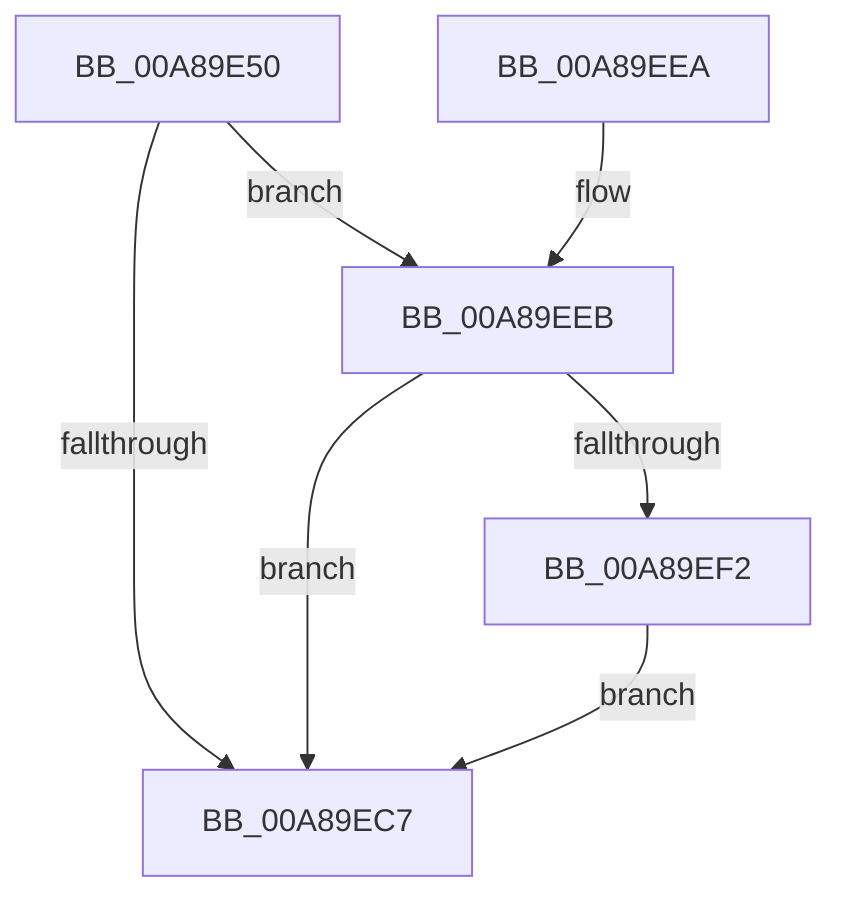

# CmMatchLastKnownParentCallback

- RVA: `0x00A89E50`–`0x00A89F06` (길이 `182` bytes)
- VA: `0x0000000140A89E50`
- 실행 섹션: `PAGE`
- PDB 이름 있음: `예`; PDB Function 태그: `아니요`
- unwind 정보 RVA: `0x000B8480`
- 디코드: `43`개 명령, `182/182` bytes 표시
- 미해석 바이트: `0` (있으면 어셈블리에 `.byte`로 보존)

> 이 문서는 커널 이미지의 기계어와 PDB 기호를 분석해 생성했습니다. 4번과 5번은 함수 원형과 자료형을 바이너리 사용 방식에서 추정한 C 해석이며 원본 소스 복구 결과는 아닙니다.

## 1. Dependencies

- 직접 호출 지점: **3**; 고유 호출 대상: **3**
- 직접 호출자로 확인된 함수: **0**
- RIP 상대 이미지 참조: **2**

### Outgoing calls
- `0x00A89EBE` → [PnpGetObjectProperty](../8E/PnpGetObjectProperty_function_008E2180.md) (function, `0x008E2180`)
- `0x00A89ED4` → [_security_check_cookie](../../text/6A/_security_check_cookie_function_006AC640.md) (function, `0x006AC640`)
- `0x00A89EFA` → [wcsicmp](../../text/50/wcsicmp_function_00500080.md) (function, `0x00500080`)

### Direct callers
- 이 함수 시작 RVA로 연결되는 직접 call은 확인되지 않았습니다. 간접 호출은 완전히 역산할 수 없습니다.

### Static image references
- `0x00A89E5D` → RVA `0x00E0A740` (`.data`; read)
- `0x00A89EA9` → RVA `0x00011F50` (`.rdata`; read)

## 2. Other-region calls and transfers

- 다른 실행 섹션으로 향하는 call: **2**
  - `0x00A89ED4` → [_security_check_cookie](../../text/6A/_security_check_cookie_function_006AC640.md) (`PAGE` → `.text`)
  - `0x00A89EFA` → [wcsicmp](../../text/50/wcsicmp_function_00500080.md) (`PAGE` → `.text`)
- 별도 외부 분기/꼬리 이동을 확인하지 못했습니다.

## 3. Assembly (complete function range)

```asm
00A89E50  48 89 5C 24 18                  mov qword ptr [rsp + 0x18], rbx
00A89E55  57                              push rdi
00A89E56  48 81 EC 10 02 00 00            sub rsp, 0x210
00A89E5D  48 8B 05 DC 08 38 00            mov rax, qword ptr [rip + 0x3808dc]
00A89E64  48 33 C4                        xor rax, rsp
00A89E67  48 89 84 24 00 02 00 00         mov qword ptr [rsp + 0x200], rax
00A89E6F  33 DB                           xor ebx, ebx
00A89E71  48 8D 44 24 64                  lea rax, [rsp + 0x64]
00A89E76  89 5C 24 50                     mov dword ptr [rsp + 0x50], ebx
00A89E7A  49 8B F9                        mov rdi, r9
00A89E7D  48 89 44 24 48                  mov qword ptr [rsp + 0x48], rax
00A89E82  45 33 C9                        xor r9d, r9d
00A89E85  C7 44 24 40 90 01 00 00         mov dword ptr [rsp + 0x40], 0x190
00A89E8D  48 8D 44 24 70                  lea rax, [rsp + 0x70]
00A89E92  48 89 44 24 38                  mov qword ptr [rsp + 0x38], rax
00A89E97  44 8D 43 01                     lea r8d, [rbx + 1]
00A89E9B  48 8D 44 24 60                  lea rax, [rsp + 0x60]
00A89EA0  89 5C 24 60                     mov dword ptr [rsp + 0x60], ebx
00A89EA4  48 89 44 24 30                  mov qword ptr [rsp + 0x30], rax
00A89EA9  48 8D 05 A0 80 58 FF            lea rax, [rip - 0xa77f60]
00A89EB0  48 89 44 24 28                  mov qword ptr [rsp + 0x28], rax
00A89EB5  48 89 5C 24 20                  mov qword ptr [rsp + 0x20], rbx
00A89EBA  89 5C 24 64                     mov dword ptr [rsp + 0x64], ebx
00A89EBE  E8 BD 82 E5 FF                  call 0x1408e2180
00A89EC3  85 C0                           test eax, eax
00A89EC5  79 24                           jns 0x140a89eeb
00A89EC7  8A C3                           mov al, bl
00A89EC9  48 8B 8C 24 00 02 00 00         mov rcx, qword ptr [rsp + 0x200]
00A89ED1  48 33 CC                        xor rcx, rsp
00A89ED4  E8 67 27 C2 FF                  call 0x1406ac640
00A89ED9  48 8B 9C 24 30 02 00 00         mov rbx, qword ptr [rsp + 0x230]
00A89EE1  48 81 C4 10 02 00 00            add rsp, 0x210
00A89EE8  5F                              pop rdi
00A89EE9  C3                              ret
00A89EEA  CC                              int3
00A89EEB  83 7C 24 60 12                  cmp dword ptr [rsp + 0x60], 0x12
00A89EF0  75 D5                           jne 0x140a89ec7
00A89EF2  48 8D 54 24 70                  lea rdx, [rsp + 0x70]
00A89EF7  48 8B CF                        mov rcx, rdi
00A89EFA  E8 81 61 A7 FF                  call 0x140500080
00A89EFF  85 C0                           test eax, eax
00A89F01  0F 94 C3                        sete bl
00A89F04  EB C1                           jmp 0x140a89ec7
```

## 4. C-style interpretation (structured pseudocode)

```c
__int64 __fastcall CmMatchLastKnownParentCallback(__int64 a1, __int64 a2, __int64 a3, __int64 a4)
{
    __int64 result;
    __int64 v_rbx;
    __int64 v_rsp;
    unsigned __int64 v_stack_m18;
    unsigned __int64 v_stack_m1A8;
    unsigned __int64 v_stack_m1B4;
    unsigned __int64 v_stack_m1B8;
    unsigned int v_stack_m1C8;
    unsigned __int64 v_stack_m1D0;
    unsigned int v_stack_m1D8;
    unsigned __int64 v_stack_m1E0;
    unsigned __int64 v_stack_m1E8;
    unsigned __int64 v_stack_m1F0;
    unsigned __int64 v_stack_m1F8;
    unsigned __int64 v_stack_p18;
    unsigned int v_stack_p60;
    unsigned __int64 v_stack_p70;

    v_stack_p18 = v_rbx;
    v_rsp = (v_rsp) - (528);
    result = (*(unsigned __int64 *)(v_rip + 3672284)) ^ (v_rsp);
    v_stack_m18 = result;
    v_rbx = 0;
    v_stack_m1C8 = 0;
    v_stack_m1D0 = v_stack_m1B4;
    a4 = 0;
    v_stack_m1D8 = 400;
    v_stack_m1E0 = v_stack_m1A8;
    v_stack_m1B8 = 0;
    v_stack_m1E8 = v_stack_m1B8;
    v_stack_m1F0 = v_rip - 10977120;
    v_stack_m1F8 = 0;
    v_stack_m1B4 = 0;
    result = PnpGetObjectProperty(a1, a2, v_rbx + 1, a4);
    if (!sign_flag) goto loc_00A89EEB;
loc_00A89EC7:
    a1 = (v_stack_m18) ^ (v_rsp);
    result = _security_check_cookie(a1, a2, v_rbx + 1, a4);
    v_rsp = (v_rsp) + (528);
    return result;
loc_00A89EEB:
    if (v_stack_p60 != 18) goto loc_00A89EC7;
    result = wcsicmp(0, v_stack_p70, v_rbx + 1, a4);
    v_rbx = ((unsigned int)(result) == 0) ? 1 : 0;
    goto loc_00A89EC7;
}
```

## 5. (Beta) C Style

```c
int64_t CmMatchLastKnownParentCallback(int64_t Arg1, int64_t Arg2, int64_t Arg3, int64_t Arg4)
{
    int64_t result;
    int64_t local_rbx;
    int64_t local_rsp;
    uint64_t v_stack_m18;
    uint64_t v_stack_m1A8;
    uint64_t v_stack_m1B4;
    uint64_t v_stack_m1B8;
    uint32_t v_stack_m1C8;
    uint64_t v_stack_m1D0;
    uint32_t v_stack_m1D8;
    uint64_t v_stack_m1E0;
    uint64_t v_stack_m1E8;
    uint64_t v_stack_m1F0;
    uint64_t v_stack_m1F8;
    uint64_t v_stack_p18;
    uint32_t v_stack_p60;
    uint64_t v_stack_p70;

    v_stack_p18 = local_rbx;
    local_rsp = (local_rsp) - (528);
    result = (*(uint64_t *)(v_rip + 0x3808DC)) ^ (local_rsp);
    v_stack_m18 = result;
    local_rbx = 0;
    v_stack_m1C8 = 0;
    v_stack_m1D0 = v_stack_m1B4;
    Arg4 = 0;
    v_stack_m1D8 = 400;
    v_stack_m1E0 = v_stack_m1A8;
    v_stack_m1B8 = 0;
    v_stack_m1E8 = v_stack_m1B8;
    v_stack_m1F0 = v_rip - 10977120;
    v_stack_m1F8 = 0;
    v_stack_m1B4 = 0;
    result = PnpGetObjectProperty(Arg1, Arg2, local_rbx + 1, Arg4);
    if (!sign_flag) goto loc_00A89EEB;
loc_00A89EC7:
    Arg1 = (v_stack_m18) ^ (local_rsp);
    result = _security_check_cookie(Arg1, Arg2, local_rbx + 1, Arg4);
    local_rsp = (local_rsp) + (528);
    return result;
loc_00A89EEB:
    if (v_stack_p60 != 18) goto loc_00A89EC7;
    result = wcsicmp(0, v_stack_p70, local_rbx + 1, Arg4);
    local_rbx = ((uint32_t)(result) == 0) ? 1 : 0;
    goto loc_00A89EC7;
}
```

## 6. Execution-region graph

[열기: 2D/3D 그래프와 함수 탐색 컨트롤 패널](../../../control-panel.html?section=page&rva=0x00A89E50&view=graph)

- 2D 그래프는 위에서 아래로 흐르고, 3D 그래프는 빈 공간을 드래그해 회전합니다. Shift+드래그는 이동, 휠은 확대·축소, 함수 노드 선택은 대상 보고서 이동입니다.

### Static fallback


