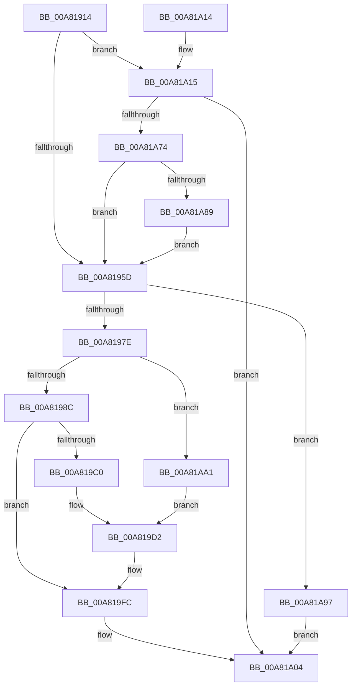

# CmpAddToHiveFileList

- RVA: `0x00A81914`–`0x00A81AAF` (길이 `411` bytes)
- VA: `0x0000000140A81914`
- 실행 섹션: `PAGE`
- PDB 이름 있음: `예`; PDB Function 태그: `아니요`
- unwind 정보 RVA: `0x000B718C`
- 디코드: `103`개 명령, `411/411` bytes 표시
- 미해석 바이트: `0` (있으면 어셈블리에 `.byte`로 보존)

> 이 문서는 커널 이미지의 기계어와 PDB 기호를 분석해 생성했습니다. 4번과 5번은 함수 원형과 자료형을 바이너리 사용 방식에서 추정한 C 해석이며 원본 소스 복구 결과는 아닙니다.

## 1. Dependencies

- 직접 호출 지점: **7**; 고유 호출 대상: **7**
- 직접 호출자로 확인된 함수: **4**
- RIP 상대 이미지 참조: **2**

### Outgoing calls
- `0x00A8196D` → [CmpAllocatePool](../../text/3C/CmpAllocatePool_function_003CD504.md) (function, `0x003CD504`)
- `0x00A819AA` → [ZwQueryObject](../../text/6A/ZwQueryObject_function_006AD2D0.md) (function, `0x006AD2D0`)
- `0x00A819F5` → [ZwSetValueKey](../../text/6A/ZwSetValueKey_function_006ADCD0.md) (function, `0x006ADCD0`)
- `0x00A819FF` → [CmSiFreeMemory](../../text/47/CmSiFreeMemory_function_00475D80.md) (function, `0x00475D80`)
- `0x00A81A20` → [RtlInitUnicodeString](../../text/42/RtlInitUnicodeString_function_0042A780.md) (function, `0x0042A780`)
- `0x00A81A69` → [ZwCreateKey](../../text/6A/ZwCreateKey_function_006AD470.md) (function, `0x006AD470`)
- `0x00A81A8D` → [ZwClose](../../text/6A/ZwClose_function_006AD2B0.md) (function, `0x006AD2B0`)

### Direct callers
- [CmpLoadKeyCommon](../../text/46/CmpLoadKeyCommon_function_0046E9F8.md) at `0x0046ED27`
- [CmpFinishSystemHivesLoad](../7D/CmpFinishSystemHivesLoad_function_007DA210.md) at `0x007DA612`
- [CmpLoadHiveVolatile](../7D/CmpLoadHiveVolatile_function_007DE5F0.md) at `0x007DE9DD`
- [CmInitSystem1](../../init/C5/CmInitSystem1_function_00C559CC.md) at `0x00C5621C`

### Static image references
- `0x00A8192A` → RVA `0x00EEFC50` (`.data`; read)
- `0x00A81A15` → RVA `0x00B09A50` (` ?? ::NNGAKEGL::`string'`; read)

## 2. Other-region calls and transfers

- 다른 실행 섹션으로 향하는 call: **7**
  - `0x00A8196D` → [CmpAllocatePool](../../text/3C/CmpAllocatePool_function_003CD504.md) (`PAGE` → `.text`)
  - `0x00A819AA` → [ZwQueryObject](../../text/6A/ZwQueryObject_function_006AD2D0.md) (`PAGE` → `.text`)
  - `0x00A819F5` → [ZwSetValueKey](../../text/6A/ZwSetValueKey_function_006ADCD0.md) (`PAGE` → `.text`)
  - `0x00A819FF` → [CmSiFreeMemory](../../text/47/CmSiFreeMemory_function_00475D80.md) (`PAGE` → `.text`)
  - `0x00A81A20` → [RtlInitUnicodeString](../../text/42/RtlInitUnicodeString_function_0042A780.md) (`PAGE` → `.text`)
  - `0x00A81A69` → [ZwCreateKey](../../text/6A/ZwCreateKey_function_006AD470.md) (`PAGE` → `.text`)
  - `0x00A81A8D` → [ZwClose](../../text/6A/ZwClose_function_006AD2B0.md) (`PAGE` → `.text`)
- 별도 외부 분기/꼬리 이동을 확인하지 못했습니다.

## 3. Assembly (complete function range)

```asm
00A81914  40 55                           push rbp
00A81916  53                              push rbx
00A81917  56                              push rsi
00A81918  57                              push rdi
00A81919  41 56                           push r14
00A8191B  48 8B EC                        mov rbp, rsp
00A8191E  48 81 EC 80 00 00 00            sub rsp, 0x80
00A81925  45 33 F6                        xor r14d, r14d
00A81928  33 C0                           xor eax, eax
00A8192A  4C 39 35 1F E3 46 00            cmp qword ptr [rip + 0x46e31f], r14
00A81931  0F 57 C0                        xorps xmm0, xmm0
00A81934  48 8B F1                        mov rsi, rcx
00A81937  44 89 75 40                     mov dword ptr [rbp + 0x40], r14d
00A8193B  0F 11 45 C0                     movups xmmword ptr [rbp - 0x40], xmm0
00A8193F  66 44 89 75 38                  mov word ptr [rbp + 0x38], r14w
00A81944  0F 11 45 D0                     movups xmmword ptr [rbp - 0x30], xmm0
00A81948  48 89 45 F0                     mov qword ptr [rbp - 0x10], rax
00A8194C  0F 11 45 E0                     movups xmmword ptr [rbp - 0x20], xmm0
00A81950  89 45 F8                        mov dword ptr [rbp - 8], eax
00A81953  4C 89 75 48                     mov qword ptr [rbp + 0x48], r14
00A81957  0F 84 B8 00 00 00               je 0x140a81a15
00A8195D  BA 02 02 00 00                  mov edx, 0x202
00A81962  B9 00 01 00 00                  mov ecx, 0x100
00A81967  41 B8 43 4D 71 62               mov r8d, 0x62714d43
00A8196D  E8 92 BB 94 FF                  call 0x1403cd504
00A81972  48 8B F8                        mov rdi, rax
00A81975  48 85 C0                        test rax, rax
00A81978  0F 84 19 01 00 00               je 0x140a81a97
00A8197E  8B 86 A0 00 00 00               mov eax, dword ptr [rsi + 0xa0]
00A81984  A8 01                           test al, 1
00A81986  0F 85 15 01 00 00               jne 0x140a81aa1
00A8198C  48 8B 8E 08 06 00 00            mov rcx, qword ptr [rsi + 0x608]
00A81993  48 8D 45 40                     lea rax, [rbp + 0x40]
00A81997  41 B9 00 02 00 00               mov r9d, 0x200
00A8199D  48 89 44 24 20                  mov qword ptr [rsp + 0x20], rax
00A819A2  4C 8B C7                        mov r8, rdi
00A819A5  BA 01 00 00 00                  mov edx, 1
00A819AA  E8 21 B9 C2 FF                  call 0x1406ad2d0
00A819AF  8B D8                           mov ebx, eax
00A819B1  8B 45 40                        mov eax, dword ptr [rbp + 0x40]
00A819B4  83 C0 F0                        add eax, -0x10
00A819B7  8B D0                           mov edx, eax
00A819B9  89 45 40                        mov dword ptr [rbp + 0x40], eax
00A819BC  85 DB                           test ebx, ebx
00A819BE  78 3C                           js 0x140a819fc
00A819C0  48 8B 4F 08                     mov rcx, qword ptr [rdi + 8]
00A819C4  48 D1 EA                        shr rdx, 1
00A819C7  66 44 89 34 51                  mov word ptr [rcx + rdx*2], r14w
00A819CC  8B 45 40                        mov eax, dword ptr [rbp + 0x40]
00A819CF  83 C0 02                        add eax, 2
00A819D2  89 44 24 28                     mov dword ptr [rsp + 0x28], eax
00A819D6  48 8D 96 40 07 00 00            lea rdx, [rsi + 0x740]
00A819DD  48 89 4C 24 20                  mov qword ptr [rsp + 0x20], rcx
00A819E2  41 B9 01 00 00 00               mov r9d, 1
00A819E8  48 8B 0D 61 E2 46 00            mov rcx, qword ptr [rip + 0x46e261]
00A819EF  45 33 C0                        xor r8d, r8d
00A819F2  89 45 40                        mov dword ptr [rbp + 0x40], eax
00A819F5  E8 D6 C2 C2 FF                  call 0x1406adcd0
00A819FA  8B D8                           mov ebx, eax
00A819FC  48 8B CF                        mov rcx, rdi
00A819FF  E8 7C 43 9F FF                  call 0x140475d80
00A81A04  8B C3                           mov eax, ebx
00A81A06  48 81 C4 80 00 00 00            add rsp, 0x80
00A81A0D  41 5E                           pop r14
00A81A0F  5F                              pop rdi
00A81A10  5E                              pop rsi
00A81A11  5B                              pop rbx
00A81A12  5D                              pop rbp
00A81A13  C3                              ret
00A81A14  CC                              int3
00A81A15  48 8D 15 34 80 08 00            lea rdx, [rip + 0x88034]
00A81A1C  48 8D 4D C0                     lea rcx, [rbp - 0x40]
00A81A20  E8 5B 8D 9A FF                  call 0x14042a780
00A81A25  48 8D 45 C0                     lea rax, [rbp - 0x40]
00A81A29  4C 89 74 24 30                  mov qword ptr [rsp + 0x30], r14
00A81A2E  0F 57 C0                        xorps xmm0, xmm0
00A81A31  C7 44 24 28 01 00 00 00         mov dword ptr [rsp + 0x28], 1
00A81A39  45 33 C9                        xor r9d, r9d
00A81A3C  48 89 45 E0                     mov qword ptr [rbp - 0x20], rax
00A81A40  4C 8D 45 D0                     lea r8, [rbp - 0x30]
00A81A44  C7 45 D0 30 00 00 00            mov dword ptr [rbp - 0x30], 0x30
00A81A4B  BA 1F 00 02 00                  mov edx, 0x2001f
00A81A50  4C 89 75 D8                     mov qword ptr [rbp - 0x28], r14
00A81A54  48 8D 4D 48                     lea rcx, [rbp + 0x48]
00A81A58  C7 45 E8 40 02 00 00            mov dword ptr [rbp - 0x18], 0x240
00A81A5F  F3 0F 7F 45 F0                  movdqu xmmword ptr [rbp - 0x10], xmm0
00A81A64  4C 89 74 24 20                  mov qword ptr [rsp + 0x20], r14
00A81A69  E8 02 BA C2 FF                  call 0x1406ad470
00A81A6E  8B D8                           mov ebx, eax
00A81A70  85 C0                           test eax, eax
00A81A72  78 90                           js 0x140a81a04
00A81A74  48 8B 4D 48                     mov rcx, qword ptr [rbp + 0x48]
00A81A78  33 C0                           xor eax, eax
00A81A7A  F0 48 0F B1 0D CD E1 46 00      lock cmpxchg qword ptr [rip + 0x46e1cd], rcx
00A81A83  0F 84 D4 FE FF FF               je 0x140a8195d
00A81A89  48 8B 4D 48                     mov rcx, qword ptr [rbp + 0x48]
00A81A8D  E8 1E B8 C2 FF                  call 0x1406ad2b0
00A81A92  E9 C6 FE FF FF                  jmp 0x140a8195d
00A81A97  BB 17 00 00 C0                  mov ebx, 0xc0000017
00A81A9C  E9 63 FF FF FF                  jmp 0x140a81a04
00A81AA1  48 8D 4D 38                     lea rcx, [rbp + 0x38]
00A81AA5  B8 02 00 00 00                  mov eax, 2
00A81AAA  E9 23 FF FF FF                  jmp 0x140a819d2
```

## 4. C-style interpretation (structured pseudocode)

```c
__int64 __fastcall CmpAddToHiveFileList(__int64 a1)
{
    __int64 result;
    __int64 v_r14;
    __int64 v_rsp;
    unsigned int v_stack_m30;
    unsigned __int64 v_stack_m38;
    unsigned int v_stack_m40;
    unsigned __int64 v_stack_m48;
    unsigned __int64 v_stack_m50;
    unsigned __int64 v_stack_m58;
    unsigned __int64 v_stack_m68;
    unsigned int v_stack_m80;
    unsigned __int64 v_stack_m88;
    unsigned __int16 v_stack_p10;
    unsigned int v_stack_p18;
    unsigned __int64 v_stack_p20;
    unsigned int v_stack_p28;
    unsigned __int64 v_stack_p30;

    v_rsp = (v_rsp) - (128);
    v_r14 = 0;
    result = 0;
    v_stack_p18 = 0;
    v_stack_m68 = v_xmm0;
    v_stack_p10 = 0;
    v_stack_m58 = v_xmm0;
    v_stack_m38 = 0;
    v_stack_m48 = v_xmm0;
    v_stack_m30 = 0;
    v_stack_p20 = 0;
    if ((*(unsigned __int64 *)(v_rip + 4645663)) == 0) goto loc_00A81A15;
loc_00A8195D:
    result = CmpAllocatePool(256, 514, (unsigned int)(0x62714D43ULL), a4);
    if (result == 0) goto loc_00A81A97;
    if ((((unsigned __int8)((unsigned int)(*(unsigned int *)(a1 + 160)))) & (1)) != 0) goto loc_00A81AA1;
    v_stack_m88 = v_stack_p18;
    result = ZwQueryObject(*(unsigned __int64 *)(a1 + 1544), 1, result, 512);
    result = (unsigned int)(((unsigned int)(v_stack_p18)) + (-16));
    v_stack_p18 = (unsigned int)(result);
    if (sign_flag) goto loc_00A819FC;
    a2 = ((unsigned int)((unsigned int)(result))) >> (1);
    *(unsigned __int16 *)(*(unsigned __int64 *)(result + 8) + a2 * 2) = 0;
    result = (unsigned int)(((unsigned int)(v_stack_p18)) + (2));
loc_00A819D2:
    v_stack_m80 = (unsigned int)(result);
    v_stack_m88 = *(unsigned __int64 *)(result + 8);
    a3 = 0;
    v_stack_p18 = (unsigned int)(result);
    result = ZwSetValueKey(*(unsigned __int64 *)(v_rip + 4645473), a1 + 1856, a3, 1);
loc_00A819FC:
    result = CmSiFreeMemory(result, a1 + 1856, a3, 1);
loc_00A81A04:
    v_rsp = (v_rsp) + (128);
    return (unsigned int)((unsigned int)((unsigned int)((unsigned int)(result))));
loc_00A81A15:
    result = RtlInitUnicodeString(v_stack_m68, v_rip + 557108, a3, 1);
    v_stack_p30 = 0;
    v_stack_p28 = 1;
    a4 = 0;
    v_stack_m48 = v_stack_m68;
    v_stack_m58 = 48;
    v_stack_m50 = 0;
    v_stack_m40 = 576;
    v_stack_m38 = v_xmm0;
    v_stack_p20 = 0;
    result = ZwCreateKey(v_stack_p20, (unsigned int)(0x2001FULL), v_stack_m58, a4);
    if (sign_flag) goto loc_00A81A04;
    result = 0;
    if (condition_is_equal) goto loc_00A8195D;
    result = ZwClose(v_stack_p20, (unsigned int)(0x2001FULL), v_stack_m58, a4);
    goto loc_00A8195D;
loc_00A81A97:
    goto loc_00A81A04;
loc_00A81AA1:
    goto loc_00A819D2;
}
```

## 5. (Beta) C Style

```c
int64_t CmpAddToHiveFileList(void *Arg1)
{
    uint8_t *arg1 = (uint8_t *)Arg1;

    int64_t result;
    int64_t local_r14;
    int64_t local_rsp;
    uint32_t v_stack_m30;
    uint64_t v_stack_m38;
    uint32_t v_stack_m40;
    uint64_t v_stack_m48;
    uint64_t v_stack_m50;
    uint64_t v_stack_m58;
    uint64_t v_stack_m68;
    uint32_t v_stack_m80;
    uint64_t v_stack_m88;
    uint16_t v_stack_p10;
    uint32_t v_stack_p18;
    uint64_t v_stack_p20;
    uint32_t v_stack_p28;
    uint64_t v_stack_p30;

    local_rsp = (local_rsp) - (128);
    local_r14 = 0;
    result = 0;
    v_stack_p18 = 0;
    v_stack_m68 = v_xmm0;
    v_stack_p10 = 0;
    v_stack_m58 = v_xmm0;
    v_stack_m38 = 0;
    v_stack_m48 = v_xmm0;
    v_stack_m30 = 0;
    v_stack_p20 = 0;
    if ((*(uint64_t *)(v_rip + 0x46E31F)) == 0) goto loc_00A81A15;
loc_00A8195D:
    result = CmpAllocatePool(256, 514, (uint32_t)(0x62714D43ULL), a4);
    if (result == 0) goto loc_00A81A97;
    if ((((uint8_t)((uint32_t)(*(uint32_t *)(arg1 + 0xA0)))) & (1)) != 0) goto loc_00A81AA1;
    v_stack_m88 = v_stack_p18;
    result = ZwQueryObject(*(uint64_t *)(arg1 + 0x608), 1, result, 512);
    result = (uint32_t)(((uint32_t)(v_stack_p18)) + (-16));
    v_stack_p18 = (uint32_t)(result);
    if (sign_flag) goto loc_00A819FC;
    a2 = ((uint32_t)((uint32_t)(result))) >> (1);
    *(uint16_t *)(*(uint64_t *)(result + 0x8) + a2 * 2) = 0;
    result = (uint32_t)(((uint32_t)(v_stack_p18)) + (2));
loc_00A819D2:
    v_stack_m80 = (uint32_t)(result);
    v_stack_m88 = *(uint64_t *)(result + 0x8);
    a3 = 0;
    v_stack_p18 = (uint32_t)(result);
    result = ZwSetValueKey(*(uint64_t *)(v_rip + 0x46E261), Arg1 + 1856, a3, 1);
loc_00A819FC:
    result = CmSiFreeMemory(result, Arg1 + 1856, a3, 1);
loc_00A81A04:
    local_rsp = (local_rsp) + (128);
    return (uint32_t)((uint32_t)((uint32_t)((uint32_t)(result))));
loc_00A81A15:
    result = RtlInitUnicodeString(v_stack_m68, v_rip + 557108, a3, 1);
    v_stack_p30 = 0;
    v_stack_p28 = 1;
    a4 = 0;
    v_stack_m48 = v_stack_m68;
    v_stack_m58 = 48;
    v_stack_m50 = 0;
    v_stack_m40 = 576;
    v_stack_m38 = v_xmm0;
    v_stack_p20 = 0;
    result = ZwCreateKey(v_stack_p20, (uint32_t)(0x2001FULL), v_stack_m58, a4);
    if (sign_flag) goto loc_00A81A04;
    result = 0;
    if (condition_is_equal) goto loc_00A8195D;
    result = ZwClose(v_stack_p20, (uint32_t)(0x2001FULL), v_stack_m58, a4);
    goto loc_00A8195D;
loc_00A81A97:
    goto loc_00A81A04;
loc_00A81AA1:
    goto loc_00A819D2;
}
```

### 관측된 메모리 오프셋

구조체 형식이 확인되지 않은 접근은 인자 기준의 오프셋으로만 기록했습니다.

| 기준 인자 | 오프셋 표현 | 폭 (bit) | 접근 |
|---|---:|---:|---|
| `Arg1` | `+ 0xA0` | `32` | `R` |
| `Arg1` | `+ 0x608` | `64` | `R` |
| `Arg1` | `+ 0x740` | `64` | `R` |

## 6. Execution-region graph

[열기: 2D/3D 그래프와 함수 탐색 컨트롤 패널](../../../control-panel.html?section=page&rva=0x00A81914&view=graph)

- 2D 그래프는 위에서 아래로 흐르고, 3D 그래프는 빈 공간을 드래그해 회전합니다. Shift+드래그는 이동, 휠은 확대·축소, 함수 노드 선택은 대상 보고서 이동입니다.

### Static fallback


