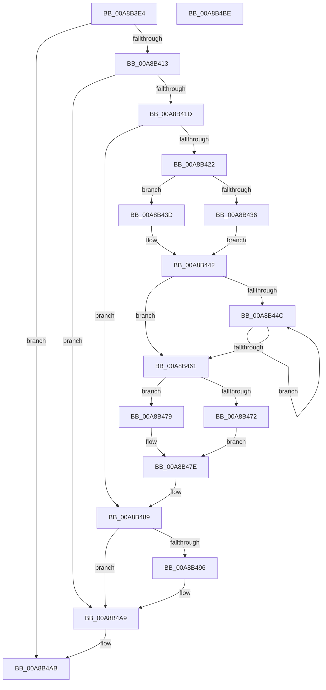

# CmpFreeKeyValues

- RVA: `0x00A8B3E4`–`0x00A8B4BF` (길이 `219` bytes)
- VA: `0x0000000140A8B3E4`
- 실행 섹션: `PAGE`
- PDB 이름 있음: `예`; PDB Function 태그: `아니요`
- unwind 정보 RVA: `0x00098710`
- 디코드: `66`개 명령, `219/219` bytes 표시
- 미해석 바이트: `0` (있으면 어셈블리에 `.byte`로 보존)

> 이 문서는 커널 이미지의 기계어와 PDB 기호를 분석해 생성했습니다. 4번과 5번은 함수 원형과 자료형을 바이너리 사용 방식에서 추정한 C 해석이며 원본 소스 복구 결과는 아닙니다.

## 1. Dependencies

- 직접 호출 지점: **8**; 고유 호출 대상: **7**
- 직접 호출자로 확인된 함수: **2**
- RIP 상대 이미지 참조: **0**

### Outgoing calls
- `0x00A8B406` → [CmpMarkKeyValuesDirty](CmpMarkKeyValuesDirty_function_00A8B4C8.md) (function, `0x00A8B4C8`)
- `0x00A8B436` → [HvpGetCellFlat](../85/HvpGetCellFlat_function_00854C60.md) (function, `0x00854C60`)
- `0x00A8B43D` → [HvpGetCellPaged](../85/HvpGetCellPaged_function_00854CB0.md) (function, `0x00854CB0`)
- `0x00A8B455` → [CmpFreeValue](../84/CmpFreeValue_function_0084AF98.md) (function, `0x0084AF98`)
- `0x00A8B472` → [HvpReleaseCellFlat](../85/HvpReleaseCellFlat_function_0085CC20.md) (function, `0x0085CC20`)
- `0x00A8B479` → [HvpReleaseCellPaged](../85/HvpReleaseCellPaged_function_00855F40.md) (function, `0x00855F40`)
- `0x00A8B484` → [HvFreeCell](../85/HvFreeCell_function_0085A72C.md) (function, `0x0085A72C`)
- `0x00A8B49C` → [HvFreeCell](../85/HvFreeCell_function_0085A72C.md) (function, `0x0085A72C`)

### Direct callers
- [CmDeleteLayeredKey](../../text/41/CmDeleteLayeredKey_function_0041B598.md) at `0x0041B757`
- [CmpSyncKeyValues](../7F/CmpSyncKeyValues_function_007F2DF4.md) at `0x007F2FD8`

### Static image references
- 디코드된 RIP-relative 메모리 참조가 없습니다.

## 2. Other-region calls and transfers

- 다른 실행 섹션으로 향하는 call: **0**
- 별도 외부 분기/꼬리 이동을 확인하지 못했습니다.

## 3. Assembly (complete function range)

```asm
00A8B3E4  48 8B C4                        mov rax, rsp
00A8B3E7  48 89 58 08                     mov qword ptr [rax + 8], rbx
00A8B3EB  48 89 68 10                     mov qword ptr [rax + 0x10], rbp
00A8B3EF  56                              push rsi
00A8B3F0  57                              push rdi
00A8B3F1  41 56                           push r14
00A8B3F3  48 83 EC 20                     sub rsp, 0x20
00A8B3F7  83 48 20 FF                     or dword ptr [rax + 0x20], 0xffffffff
00A8B3FB  33 ED                           xor ebp, ebp
00A8B3FD  89 68 24                        mov dword ptr [rax + 0x24], ebp
00A8B400  49 8B D8                        mov rbx, r8
00A8B403  48 8B F9                        mov rdi, rcx
00A8B406  E8 BD 00 00 00                  call 0x140a8b4c8
00A8B40B  85 C0                           test eax, eax
00A8B40D  0F 88 98 00 00 00               js 0x140a8b4ab
00A8B413  F6 43 02 02                     test byte ptr [rbx + 2], 2
00A8B417  0F 85 8C 00 00 00               jne 0x140a8b4a9
00A8B41D  39 6B 24                        cmp dword ptr [rbx + 0x24], ebp
00A8B420  76 67                           jbe 0x140a8b489
00A8B422  F6 87 8C 00 00 00 01            test byte ptr [rdi + 0x8c], 1
00A8B429  4C 8D 44 24 58                  lea r8, [rsp + 0x58]
00A8B42E  8B 53 28                        mov edx, dword ptr [rbx + 0x28]
00A8B431  48 8B CF                        mov rcx, rdi
00A8B434  74 07                           je 0x140a8b43d
00A8B436  E8 25 98 DC FF                  call 0x140854c60
00A8B43B  EB 05                           jmp 0x140a8b442
00A8B43D  E8 6E 98 DC FF                  call 0x140854cb0
00A8B442  4C 8B F0                        mov r14, rax
00A8B445  8B F5                           mov esi, ebp
00A8B447  39 6B 24                        cmp dword ptr [rbx + 0x24], ebp
00A8B44A  76 15                           jbe 0x140a8b461
00A8B44C  8B D6                           mov edx, esi
00A8B44E  48 8B CF                        mov rcx, rdi
00A8B451  41 8B 14 96                     mov edx, dword ptr [r14 + rdx*4]
00A8B455  E8 3E FB DB FF                  call 0x14084af98
00A8B45A  FF C6                           inc esi
00A8B45C  3B 73 24                        cmp esi, dword ptr [rbx + 0x24]
00A8B45F  72 EB                           jb 0x140a8b44c
00A8B461  F6 87 8C 00 00 00 01            test byte ptr [rdi + 0x8c], 1
00A8B468  48 8D 54 24 58                  lea rdx, [rsp + 0x58]
00A8B46D  48 8B CF                        mov rcx, rdi
00A8B470  74 07                           je 0x140a8b479
00A8B472  E8 A9 17 DD FF                  call 0x14085cc20
00A8B477  EB 05                           jmp 0x140a8b47e
00A8B479  E8 C2 AA DC FF                  call 0x140855f40
00A8B47E  8B 53 28                        mov edx, dword ptr [rbx + 0x28]
00A8B481  48 8B CF                        mov rcx, rdi
00A8B484  E8 A3 F2 DC FF                  call 0x14085a72c
00A8B489  83 4B 28 FF                     or dword ptr [rbx + 0x28], 0xffffffff
00A8B48D  89 6B 24                        mov dword ptr [rbx + 0x24], ebp
00A8B490  66 39 6B 4A                     cmp word ptr [rbx + 0x4a], bp
00A8B494  76 13                           jbe 0x140a8b4a9
00A8B496  8B 53 30                        mov edx, dword ptr [rbx + 0x30]
00A8B499  48 8B CF                        mov rcx, rdi
00A8B49C  E8 8B F2 DC FF                  call 0x14085a72c
00A8B4A1  83 4B 30 FF                     or dword ptr [rbx + 0x30], 0xffffffff
00A8B4A5  66 89 6B 4A                     mov word ptr [rbx + 0x4a], bp
00A8B4A9  8B C5                           mov eax, ebp
00A8B4AB  48 8B 5C 24 40                  mov rbx, qword ptr [rsp + 0x40]
00A8B4B0  48 8B 6C 24 48                  mov rbp, qword ptr [rsp + 0x48]
00A8B4B5  48 83 C4 20                     add rsp, 0x20
00A8B4B9  41 5E                           pop r14
00A8B4BB  5F                              pop rdi
00A8B4BC  5E                              pop rsi
00A8B4BD  C3                              ret
00A8B4BE  CC                              int3
```

## 4. C-style interpretation (structured pseudocode)

```c
__int64 __fastcall CmpFreeKeyValues(__int64 a1, __int64 a2, __int64 a3)
{
    __int64 result;
    __int64 v_rbp;
    __int64 v_rsi;
    __int64 v_rsp;
    unsigned __int64 v_stack_p10;
    unsigned __int64 v_stack_p20;
    unsigned __int64 v_stack_p8;

    *(unsigned __int64 *)(v_rsp + 8) = v_rbx;
    *(unsigned __int64 *)(v_rsp + 16) = v_rbp;
    v_rsp = (v_rsp) - (32);
    v_rbp = 0;
    *(unsigned int *)(v_rsp + 36) = 0;
    result = CmpMarkKeyValuesDirty(a1, a2, a3, a4);
    if (sign_flag) goto loc_00A8B4AB;
    if (((*(unsigned __int8 *)(a3 + 2)) & (2)) != 0) goto loc_00A8B4A9;
    if ((*(unsigned int *)(a3 + 36)) <= 0) goto loc_00A8B489;
    if (((*(unsigned __int8 *)(a1 + 140)) & (1)) == 0) goto loc_00A8B43D;
    result = HvpGetCellFlat(a1, (unsigned int)(*(unsigned int *)(a3 + 40)), v_stack_p20, a4);
    goto loc_00A8B442;
loc_00A8B43D:
    result = HvpGetCellPaged(a1, (unsigned int)(*(unsigned int *)(a3 + 40)), v_stack_p20, a4);
loc_00A8B442:
    if ((*(unsigned int *)(a3 + 36)) <= 0) goto loc_00A8B461;
loc_00A8B44C:
    result = CmpFreeValue(a1, (unsigned int)(*(unsigned int *)(result + 0 * 4)), v_stack_p20, a4);
    v_rsi = (unsigned int)((0) + 1);
    if (((unsigned int)(v_rsi)) < (*(unsigned int *)(a3 + 36))) goto loc_00A8B44C;
loc_00A8B461:
    if (((*(unsigned __int8 *)(a1 + 140)) & (1)) == 0) goto loc_00A8B479;
    result = HvpReleaseCellFlat(a1, v_stack_p20, v_stack_p20, a4);
    goto loc_00A8B47E;
loc_00A8B479:
    result = HvpReleaseCellPaged(a1, v_stack_p20, v_stack_p20, a4);
loc_00A8B47E:
    result = HvFreeCell(a1, (unsigned int)(*(unsigned int *)(a3 + 40)), v_stack_p20, a4);
loc_00A8B489:
    *(unsigned int *)(a3 + 36) = 0;
    if ((*(unsigned __int16 *)(a3 + 74)) >= = 0) {
        a2 = *(unsigned int *)(a3 + 48);
        a1 = a1;
        result = HvFreeCell(a1, a2, v_stack_p20, a4);
        *(unsigned __int16 *)(a3 + 74) = 0;
    }
loc_00A8B4AB:
    v_rsp = (v_rsp) + (32);
    return 0;
}
```

## 5. (Beta) C Style

```c
int64_t CmpFreeKeyValues(void *Arg1, int64_t Arg2, void *Arg3)
{
    uint8_t *arg1 = (uint8_t *)Arg1;
    uint8_t *arg3 = (uint8_t *)Arg3;

    int64_t result;
    int64_t local_rbp;
    int64_t local_rsi;
    int64_t local_rsp;
    uint64_t v_stack_p10;
    uint64_t v_stack_p20;
    uint64_t v_stack_p8;

    *(uint64_t *)(local_rsp + 0x8) = local_rbx;
    *(uint64_t *)(local_rsp + 0x10) = local_rbp;
    local_rsp = (local_rsp) - (32);
    local_rbp = 0;
    *(uint32_t *)(local_rsp + 0x24) = 0;
    result = CmpMarkKeyValuesDirty(Arg1, Arg2, Arg3, a4);
    if (sign_flag) goto loc_00A8B4AB;
    if (((*(uint8_t *)(arg3 + 0x2)) & (2)) != 0) goto loc_00A8B4A9;
    if ((*(uint32_t *)(arg3 + 0x24)) <= 0) goto loc_00A8B489;
    if (((*(uint8_t *)(arg1 + 0x8C)) & (1)) == 0) goto loc_00A8B43D;
    result = HvpGetCellFlat(Arg1, (uint32_t)(*(uint32_t *)(arg3 + 0x28)), v_stack_p20, a4);
    goto loc_00A8B442;
loc_00A8B43D:
    result = HvpGetCellPaged(Arg1, (uint32_t)(*(uint32_t *)(arg3 + 0x28)), v_stack_p20, a4);
loc_00A8B442:
    if ((*(uint32_t *)(arg3 + 0x24)) <= 0) goto loc_00A8B461;
loc_00A8B44C:
    result = CmpFreeValue(Arg1, (uint32_t)(*(uint32_t *)(result + 0x0 * 4)), v_stack_p20, a4);
    local_rsi = (uint32_t)((0) + 1);
    if (((uint32_t)(local_rsi)) < (*(uint32_t *)(arg3 + 0x24))) goto loc_00A8B44C;
loc_00A8B461:
    if (((*(uint8_t *)(arg1 + 0x8C)) & (1)) == 0) goto loc_00A8B479;
    result = HvpReleaseCellFlat(Arg1, v_stack_p20, v_stack_p20, a4);
    goto loc_00A8B47E;
loc_00A8B479:
    result = HvpReleaseCellPaged(Arg1, v_stack_p20, v_stack_p20, a4);
loc_00A8B47E:
    result = HvFreeCell(Arg1, (uint32_t)(*(uint32_t *)(arg3 + 0x28)), v_stack_p20, a4);
loc_00A8B489:
    *(uint32_t *)(arg3 + 0x24) = 0;
    if ((*(uint16_t *)(arg3 + 0x4A)) >= = 0) {
        Arg2 = *(uint32_t *)(arg3 + 0x30);
        Arg1 = Arg1;
        result = HvFreeCell(Arg1, Arg2, v_stack_p20, a4);
        *(uint16_t *)(arg3 + 0x4A) = 0;
    }
loc_00A8B4AB:
    local_rsp = (local_rsp) + (32);
    return 0;
}
```

### 관측된 메모리 오프셋

구조체 형식이 확인되지 않은 접근은 인자 기준의 오프셋으로만 기록했습니다.

| 기준 인자 | 오프셋 표현 | 폭 (bit) | 접근 |
|---|---:|---:|---|
| `Arg1` | `+ 0x8C` | `8` | `R` |
| `Arg3` | `+ 0x2` | `8` | `R` |
| `Arg3` | `+ 0x24` | `32` | `R` |
| `Arg3` | `+ 0x24` | `32` | `W` |
| `Arg3` | `+ 0x28` | `32` | `R` |
| `Arg3` | `+ 0x28` | `32` | `R/W` |
| `Arg3` | `+ 0x30` | `32` | `R` |
| `Arg3` | `+ 0x30` | `32` | `R/W` |
| `Arg3` | `+ 0x4A` | `16` | `R` |
| `Arg3` | `+ 0x4A` | `16` | `W` |

## 6. Execution-region graph

[열기: 2D/3D 그래프와 함수 탐색 컨트롤 패널](../../../control-panel.html?section=page&rva=0x00A8B3E4&view=graph)

- 2D 그래프는 위에서 아래로 흐르고, 3D 그래프는 빈 공간을 드래그해 회전합니다. Shift+드래그는 이동, 휠은 확대·축소, 함수 노드 선택은 대상 보고서 이동입니다.

### Static fallback


