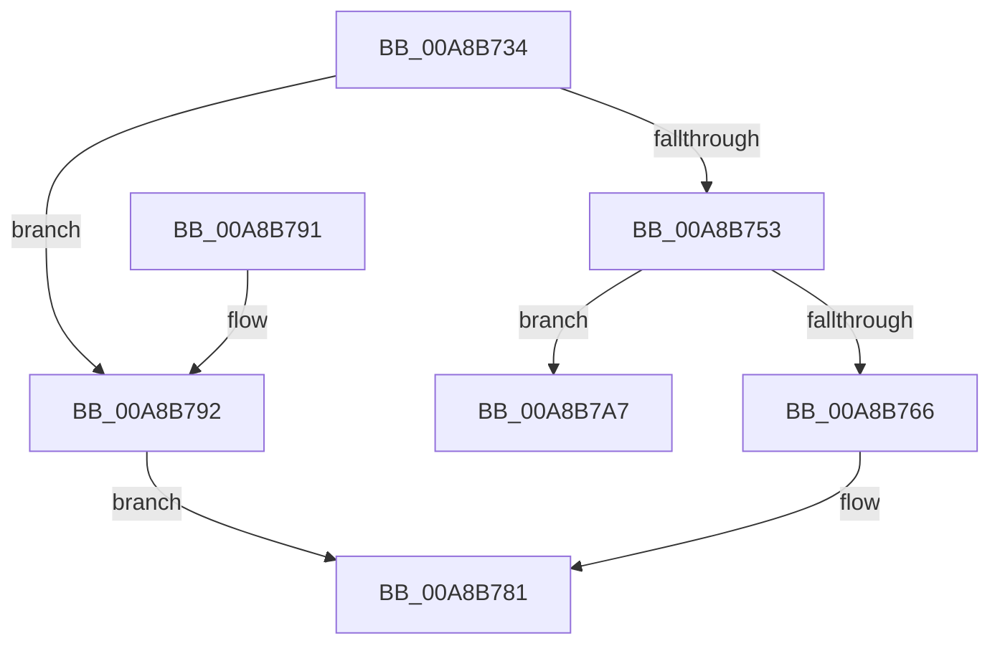

# CmpInitializeKeyNameString

- RVA: `0x00A8B734`–`0x00A8B7B8` (길이 `132` bytes)
- VA: `0x0000000140A8B734`
- 실행 섹션: `PAGE`
- PDB 이름 있음: `예`; PDB Function 태그: `아니요`
- unwind 정보 RVA: `0x0006D260`
- 디코드: `40`개 명령, `132/132` bytes 표시
- 미해석 바이트: `0` (있으면 어셈블리에 `.byte`로 보존)

> 이 문서는 커널 이미지의 기계어와 PDB 기호를 분석해 생성했습니다. 4번과 5번은 함수 원형과 자료형을 바이너리 사용 방식에서 추정한 C 해석이며 원본 소스 복구 결과는 아닙니다.

## 1. Dependencies

- 직접 호출 지점: **2**; 고유 호출 대상: **2**
- 직접 호출자로 확인된 함수: **2**
- RIP 상대 이미지 참조: **0**

### Outgoing calls
- `0x00A8B774` → [CmpCopyCompressedName](../84/CmpCopyCompressedName_function_0084E0D0.md) (function, `0x0084E0D0`)
- `0x00A8B7B2` → [CmSiBugCheck](../../text/66/CmSiBugCheck_function_0066DF38.md) (function, `0x0066DF38`)

### Direct callers
- [CmpCopySyncTree2](../85/CmpCopySyncTree2_function_0085BF78.md) at `0x0085C46F`
- [CmpSyncSubKeysAfterDelete](../AC/CmpSyncSubKeysAfterDelete_function_00AC5980.md) at `0x00AC5A2E`

### Static image references
- 디코드된 RIP-relative 메모리 참조가 없습니다.

## 2. Other-region calls and transfers

- 다른 실행 섹션으로 향하는 call: **1**
  - `0x00A8B7B2` → [CmSiBugCheck](../../text/66/CmSiBugCheck_function_0066DF38.md) (`PAGE` → `.text`)
- 별도 외부 분기/꼬리 이동을 확인하지 못했습니다.

## 3. Assembly (complete function range)

```asm
00A8B734  48 89 5C 24 08                  mov qword ptr [rsp + 8], rbx
00A8B739  48 89 74 24 10                  mov qword ptr [rsp + 0x10], rsi
00A8B73E  57                              push rdi
00A8B73F  48 83 EC 20                     sub rsp, 0x20
00A8B743  F6 41 02 20                     test byte ptr [rcx + 2], 0x20
00A8B747  48 8B DA                        mov rbx, rdx
00A8B74A  0F B7 51 48                     movzx edx, word ptr [rcx + 0x48]
00A8B74E  49 8B F8                        mov rdi, r8
00A8B751  74 3F                           je 0x140a8b792
00A8B753  66 03 D2                        add dx, dx
00A8B756  BE 00 02 00 00                  mov esi, 0x200
00A8B75B  0F B7 C2                        movzx eax, dx
00A8B75E  66 89 13                        mov word ptr [rbx], dx
00A8B761  66 3B C6                        cmp ax, si
00A8B764  77 41                           ja 0x140a8b7a7
00A8B766  44 0F B7 49 48                  movzx r9d, word ptr [rcx + 0x48]
00A8B76B  4C 8D 41 4C                     lea r8, [rcx + 0x4c]
00A8B76F  48 8B CF                        mov rcx, rdi
00A8B772  8B D6                           mov edx, esi
00A8B774  E8 57 29 DC FF                  call 0x14084e0d0
00A8B779  48 89 7B 08                     mov qword ptr [rbx + 8], rdi
00A8B77D  66 89 73 02                     mov word ptr [rbx + 2], si
00A8B781  48 8B 5C 24 30                  mov rbx, qword ptr [rsp + 0x30]
00A8B786  48 8B 74 24 38                  mov rsi, qword ptr [rsp + 0x38]
00A8B78B  48 83 C4 20                     add rsp, 0x20
00A8B78F  5F                              pop rdi
00A8B790  C3                              ret
00A8B791  CC                              int3
00A8B792  48 8D 41 4C                     lea rax, [rcx + 0x4c]
00A8B796  66 89 13                        mov word ptr [rbx], dx
00A8B799  48 89 43 08                     mov qword ptr [rbx + 8], rax
00A8B79D  0F B7 41 34                     movzx eax, word ptr [rcx + 0x34]
00A8B7A1  66 89 43 02                     mov word ptr [rbx + 2], ax
00A8B7A5  EB DA                           jmp 0x140a8b781
00A8B7A7  33 D2                           xor edx, edx
00A8B7A9  4C 8B C1                        mov r8, rcx
00A8B7AC  4C 8B C8                        mov r9, rax
00A8B7AF  8D 4A 31                        lea ecx, [rdx + 0x31]
00A8B7B2  E8 81 27 BE FF                  call 0x14066df38
00A8B7B7  CC                              int3
```

## 4. C-style interpretation (structured pseudocode)

```c
__int64 __fastcall CmpInitializeKeyNameString(__int64 a1, __int64 a2, __int64 a3)
{
    __int64 result;
    __int64 v_rsp;
    unsigned __int64 v_stack_p10;
    unsigned __int64 v_stack_p8;

    v_stack_p8 = v_rbx;
    v_stack_p10 = v_rsi;
    v_rsp = (v_rsp) - (32);
    if (((*(unsigned __int8 *)(a1 + 2)) & (32)) == 0) goto loc_00A8B792;
    a2 = (unsigned __int16)((*(unsigned __int16 *)(a1 + 72)) + ((unsigned __int16)(*(unsigned __int16 *)(a1 + 72))));
    *(unsigned __int16 *)(a2) = (unsigned __int16)(a2);
    if (((unsigned __int16)((unsigned __int16)(a2))) > 512) goto loc_00A8B7A7;
    result = CmpCopyCompressedName(a3, 512, a1 + 76, *(unsigned __int16 *)(a1 + 72));
    *(unsigned __int64 *)(a2 + 8) = a3;
    *(unsigned __int16 *)(a2 + 2) = 512;
loc_00A8B781:
    v_rsp = (v_rsp) + (32);
    return result;
loc_00A8B792:
    *(unsigned __int16 *)(v_stack_p8) = 512;
    *(unsigned __int64 *)(v_stack_p8 + 8) = a3 + 76;
    *(unsigned __int16 *)(v_stack_p8 + 2) = (unsigned __int16)(*(unsigned __int16 *)(a3 + 52));
    goto loc_00A8B781;
loc_00A8B7A7:
    a2 = 0;
    result = CmSiBugCheck(a2 + 49, a2, a3, *(unsigned __int16 *)(a3 + 52));
    return result;
}
```

## 5. (Beta) C Style

```c
int64_t CmpInitializeKeyNameString(void *Arg1, void *Arg2, int64_t Arg3)
{
    uint8_t *arg1 = (uint8_t *)Arg1;
    uint8_t *arg2 = (uint8_t *)Arg2;

    int64_t result;
    int64_t local_rsp;
    uint64_t v_stack_p10;
    uint64_t v_stack_p8;

    v_stack_p8 = local_rbx;
    v_stack_p10 = local_rsi;
    local_rsp = (local_rsp) - (32);
    if (((*(uint8_t *)(arg1 + 0x2)) & (32)) == 0) goto loc_00A8B792;
    Arg2 = (uint16_t)((*(uint16_t *)(arg1 + 0x48)) + ((uint16_t)(*(uint16_t *)(arg1 + 0x48))));
    *(uint16_t *)(arg2) = (uint16_t)(Arg2);
    if (((uint16_t)((uint16_t)(Arg2))) > 512) goto loc_00A8B7A7;
    result = CmpCopyCompressedName(Arg3, 512, Arg1 + 76, *(uint16_t *)(arg1 + 0x48));
    *(uint64_t *)(arg2 + 0x8) = Arg3;
    *(uint16_t *)(arg2 + 0x2) = 512;
loc_00A8B781:
    local_rsp = (local_rsp) + (32);
    return result;
loc_00A8B792:
    *(uint16_t *)(v_stack_p8) = 512;
    *(uint64_t *)(v_stack_p8 + 0x8) = Arg3 + 76;
    *(uint16_t *)(v_stack_p8 + 0x2) = (uint16_t)(*(uint16_t *)(Arg3 + 0x34));
    goto loc_00A8B781;
loc_00A8B7A7:
    Arg2 = 0;
    result = CmSiBugCheck(Arg2 + 49, Arg2, Arg3, *(uint16_t *)(Arg3 + 0x34));
    return result;
}
```

### 관측된 메모리 오프셋

구조체 형식이 확인되지 않은 접근은 인자 기준의 오프셋으로만 기록했습니다.

| 기준 인자 | 오프셋 표현 | 폭 (bit) | 접근 |
|---|---:|---:|---|
| `Arg1` | `+ 0x2` | `8` | `R` |
| `Arg1` | `+ 0x34` | `16` | `R` |
| `Arg1` | `+ 0x48` | `16` | `R` |
| `Arg1` | `+ 0x4C` | `64` | `R` |
| `Arg2` | `+ 0x0` | `16` | `W` |
| `Arg2` | `+ 0x2` | `16` | `W` |
| `Arg2` | `+ 0x8` | `64` | `W` |

## 6. Execution-region graph

[열기: 2D/3D 그래프와 함수 탐색 컨트롤 패널](../../../control-panel.html?section=page&rva=0x00A8B734&view=graph)

- 2D 그래프는 위에서 아래로 흐르고, 3D 그래프는 빈 공간을 드래그해 회전합니다. Shift+드래그는 이동, 휠은 확대·축소, 함수 노드 선택은 대상 보고서 이동입니다.

### Static fallback


