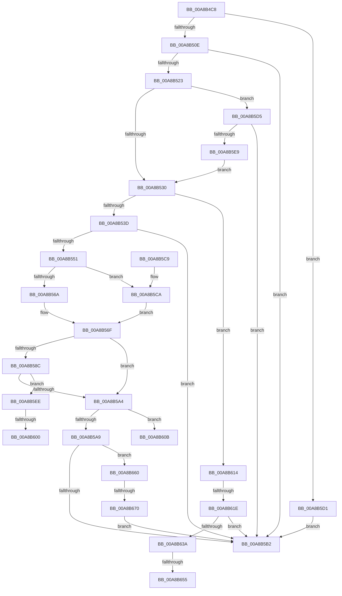

# CmpMarkKeyValuesDirty

- RVA: `0x00A8B4C8`–`0x00A8B67A` (길이 `434` bytes)
- VA: `0x0000000140A8B4C8`
- 실행 섹션: `PAGE`
- PDB 이름 있음: `예`; PDB Function 태그: `예`
- unwind 정보 RVA: `0x000B86C4`
- 디코드: `129`개 명령, `434/434` bytes 표시
- 미해석 바이트: `0` (있으면 어셈블리에 `.byte`로 보존)

> 이 문서는 커널 이미지의 기계어와 PDB 기호를 분석해 생성했습니다. 4번과 5번은 함수 원형과 자료형을 바이너리 사용 방식에서 추정한 C 해석이며 원본 소스 복구 결과는 아닙니다.

## 1. Dependencies

- 직접 호출 지점: **11**; 고유 호출 대상: **4**
- 직접 호출자로 확인된 함수: **1**
- RIP 상대 이미지 참조: **0**

### Outgoing calls
- `0x00A8B514` → [HvpMarkCellDirty](../85/HvpMarkCellDirty_function_00858080.md) (function, `0x00858080`)
- `0x00A8B546` → [HvpMarkCellDirty](../85/HvpMarkCellDirty_function_00858080.md) (function, `0x00858080`)
- `0x00A8B56A` → [HvpGetCellFlat](../85/HvpGetCellFlat_function_00854C60.md) (function, `0x00854C60`)
- `0x00A8B57E` → [HvpMarkCellDirty](../85/HvpMarkCellDirty_function_00858080.md) (function, `0x00858080`)
- `0x00A8B599` → [HvpMarkCellDirty](../85/HvpMarkCellDirty_function_00858080.md) (function, `0x00858080`)
- `0x00A8B5CA` → [HvpGetCellPaged](../85/HvpGetCellPaged_function_00854CB0.md) (function, `0x00854CB0`)
- `0x00A8B5DE` → [HvpMarkCellDirty](../85/HvpMarkCellDirty_function_00858080.md) (function, `0x00858080`)
- `0x00A8B600` → [HvpReleaseCellFlat](../85/HvpReleaseCellFlat_function_0085CC20.md) (function, `0x0085CC20`)
- `0x00A8B62B` → [HvpMarkCellDirty](../85/HvpMarkCellDirty_function_00858080.md) (function, `0x00858080`)
- `0x00A8B655` → [HvpGetCellFlat](../85/HvpGetCellFlat_function_00854C60.md) (function, `0x00854C60`)
- `0x00A8B670` → [HvpReleaseCellFlat](../85/HvpReleaseCellFlat_function_0085CC20.md) (function, `0x0085CC20`)

### Direct callers
- [CmpFreeKeyValues](CmpFreeKeyValues_function_00A8B3E4.md) at `0x00A8B406`

### Static image references
- 디코드된 RIP-relative 메모리 참조가 없습니다.

## 2. Other-region calls and transfers

- 다른 실행 섹션으로 향하는 call: **0**
- call이 아닌 외부 분기/꼬리 이동: **7**
  - `0x00A8B5FA` → [sub_00B46094](../B4/Unknown_function_00B46094.md) (`tail-transfer`)
  - `0x00A8B606` → [sub_00B46094 + 0x5](../B4/Unknown_function_00B46094.md) (`tail-transfer`)
  - `0x00A8B60F` → [sub_00B46094 + 0x10](../B4/Unknown_function_00B46094.md) (`tail-transfer`)
  - `0x00A8B618` → [sub_00B46094 + 0xC9](../B4/Unknown_function_00B46094.md) (`tail-transfer`)
  - `0x00A8B64F` → [sub_00B46094 + 0x27](../B4/Unknown_function_00B46094.md) (`tail-transfer`)
  - `0x00A8B65B` → [sub_00B46094 + 0x2C](../B4/Unknown_function_00B46094.md) (`tail-transfer`)
  - `0x00A8B66A` → [sub_00B46094 + 0xD7](../B4/Unknown_function_00B46094.md) (`tail-transfer`)

## 3. Assembly (complete function range)

```asm
00A8B4C8  48 89 5C 24 08                  mov qword ptr [rsp + 8], rbx
00A8B4CD  55                              push rbp
00A8B4CE  56                              push rsi
00A8B4CF  57                              push rdi
00A8B4D0  41 54                           push r12
00A8B4D2  41 55                           push r13
00A8B4D4  41 56                           push r14
00A8B4D6  41 57                           push r15
00A8B4D8  48 8B EC                        mov rbp, rsp
00A8B4DB  48 83 EC 30                     sub rsp, 0x30
00A8B4DF  33 FF                           xor edi, edi
00A8B4E1  41 83 CC FF                     or r12d, 0xffffffff
00A8B4E5  41 F6 40 02 02                  test byte ptr [r8 + 2], 2
00A8B4EA  4D 8B F8                        mov r15, r8
00A8B4ED  48 8B D9                        mov rbx, rcx
00A8B4F0  44 89 65 F0                     mov dword ptr [rbp - 0x10], r12d
00A8B4F4  89 7D F4                        mov dword ptr [rbp - 0xc], edi
00A8B4F7  44 8B F7                        mov r14d, edi
00A8B4FA  44 89 65 50                     mov dword ptr [rbp + 0x50], r12d
00A8B4FE  89 7D 54                        mov dword ptr [rbp + 0x54], edi
00A8B501  44 89 65 58                     mov dword ptr [rbp + 0x58], r12d
00A8B505  89 7D 5C                        mov dword ptr [rbp + 0x5c], edi
00A8B508  0F 85 C3 00 00 00               jne 0x140a8b5d1
00A8B50E  45 33 C9                        xor r9d, r9d
00A8B511  45 33 C0                        xor r8d, r8d
00A8B514  E8 67 CB DC FF                  call 0x140858080
00A8B519  8B F0                           mov esi, eax
00A8B51B  85 C0                           test eax, eax
00A8B51D  0F 88 8F 00 00 00               js 0x140a8b5b2
00A8B523  41 8B 57 30                     mov edx, dword ptr [r15 + 0x30]
00A8B527  41 3B D4                        cmp edx, r12d
00A8B52A  0F 85 A5 00 00 00               jne 0x140a8b5d5
00A8B530  41 8B 57 2C                     mov edx, dword ptr [r15 + 0x2c]
00A8B534  41 3B D4                        cmp edx, r12d
00A8B537  0F 84 D7 00 00 00               je 0x140a8b614
00A8B53D  45 33 C9                        xor r9d, r9d
00A8B540  45 33 C0                        xor r8d, r8d
00A8B543  48 8B CB                        mov rcx, rbx
00A8B546  E8 35 CB DC FF                  call 0x140858080
00A8B54B  8B F0                           mov esi, eax
00A8B54D  85 C0                           test eax, eax
00A8B54F  78 61                           js 0x140a8b5b2
00A8B551  41 8B 57 2C                     mov edx, dword ptr [r15 + 0x2c]
00A8B555  4C 8D A3 8C 00 00 00            lea r12, [rbx + 0x8c]
00A8B55C  41 F6 04 24 01                  test byte ptr [r12], 1
00A8B561  4C 8D 45 50                     lea r8, [rbp + 0x50]
00A8B565  48 8B CB                        mov rcx, rbx
00A8B568  74 60                           je 0x140a8b5ca
00A8B56A  E8 F1 96 DC FF                  call 0x140854c60
00A8B56F  8B 50 04                        mov edx, dword ptr [rax + 4]
00A8B572  45 33 C9                        xor r9d, r9d
00A8B575  45 33 C0                        xor r8d, r8d
00A8B578  48 8B CB                        mov rcx, rbx
00A8B57B  4C 8B E8                        mov r13, rax
00A8B57E  E8 FD CA DC FF                  call 0x140858080
00A8B583  8B F0                           mov esi, eax
00A8B585  49 8B FC                        mov rdi, r12
00A8B588  85 C0                           test eax, eax
00A8B58A  78 18                           js 0x140a8b5a4
00A8B58C  41 8B 55 08                     mov edx, dword ptr [r13 + 8]
00A8B590  45 33 C9                        xor r9d, r9d
00A8B593  45 33 C0                        xor r8d, r8d
00A8B596  48 8B CB                        mov rcx, rbx
00A8B599  E8 E2 CA DC FF                  call 0x140858080
00A8B59E  8B F0                           mov esi, eax
00A8B5A0  85 C0                           test eax, eax
00A8B5A2  79 4A                           jns 0x140a8b5ee
00A8B5A4  4D 85 ED                        test r13, r13
00A8B5A7  75 62                           jne 0x140a8b60b
00A8B5A9  4D 85 F6                        test r14, r14
00A8B5AC  0F 85 AE 00 00 00               jne 0x140a8b660
00A8B5B2  48 8B 5C 24 70                  mov rbx, qword ptr [rsp + 0x70]
00A8B5B7  8B C6                           mov eax, esi
00A8B5B9  48 83 C4 30                     add rsp, 0x30
00A8B5BD  41 5F                           pop r15
00A8B5BF  41 5E                           pop r14
00A8B5C1  41 5D                           pop r13
00A8B5C3  41 5C                           pop r12
00A8B5C5  5F                              pop rdi
00A8B5C6  5E                              pop rsi
00A8B5C7  5D                              pop rbp
00A8B5C8  C3                              ret
00A8B5C9  CC                              int3
00A8B5CA  E8 E1 96 DC FF                  call 0x140854cb0
00A8B5CF  EB 9E                           jmp 0x140a8b56f
00A8B5D1  8B F7                           mov esi, edi
00A8B5D3  EB DD                           jmp 0x140a8b5b2
00A8B5D5  45 33 C9                        xor r9d, r9d
00A8B5D8  45 33 C0                        xor r8d, r8d
00A8B5DB  48 8B CB                        mov rcx, rbx
00A8B5DE  E8 9D CA DC FF                  call 0x140858080
00A8B5E3  8B F0                           mov esi, eax
00A8B5E5  85 C0                           test eax, eax
00A8B5E7  78 C9                           js 0x140a8b5b2
00A8B5E9  E9 42 FF FF FF                  jmp 0x140a8b530
00A8B5EE  41 F6 04 24 01                  test byte ptr [r12], 1
00A8B5F3  48 8D 55 50                     lea rdx, [rbp + 0x50]
00A8B5F7  48 8B CB                        mov rcx, rbx
00A8B5FA  0F 84 94 AA 0B 00               je 0x140b46094
00A8B600  E8 1B 16 DD FF                  call 0x14085cc20
00A8B605  90                              nop
00A8B606  E9 8E AA 0B 00                  jmp 0x140b46099
00A8B60B  48 8D 55 50                     lea rdx, [rbp + 0x50]
00A8B60F  E9 90 AA 0B 00                  jmp 0x140b460a4
00A8B614  41 39 7F 24                     cmp dword ptr [r15 + 0x24], edi
00A8B618  0F 86 3F AB 0B 00               jbe 0x140b4615d
00A8B61E  41 8B 57 28                     mov edx, dword ptr [r15 + 0x28]
00A8B622  45 33 C9                        xor r9d, r9d
00A8B625  45 33 C0                        xor r8d, r8d
00A8B628  48 8B CB                        mov rcx, rbx
00A8B62B  E8 50 CA DC FF                  call 0x140858080
00A8B630  8B F0                           mov esi, eax
00A8B632  85 C0                           test eax, eax
00A8B634  0F 88 78 FF FF FF               js 0x140a8b5b2
00A8B63A  41 8B 57 28                     mov edx, dword ptr [r15 + 0x28]
00A8B63E  48 8D BB 8C 00 00 00            lea rdi, [rbx + 0x8c]
00A8B645  F6 07 01                        test byte ptr [rdi], 1
00A8B648  4C 8D 45 F0                     lea r8, [rbp - 0x10]
00A8B64C  48 8B CB                        mov rcx, rbx
00A8B64F  0F 84 66 AA 0B 00               je 0x140b460bb
00A8B655  E8 06 96 DC FF                  call 0x140854c60
00A8B65A  90                              nop
00A8B65B  E9 60 AA 0B 00                  jmp 0x140b460c0
00A8B660  F6 07 01                        test byte ptr [rdi], 1
00A8B663  48 8D 55 F0                     lea rdx, [rbp - 0x10]
00A8B667  48 8B CB                        mov rcx, rbx
00A8B66A  0F 84 FB AA 0B 00               je 0x140b4616b
00A8B670  E8 AB 15 DD FF                  call 0x14085cc20
00A8B675  E9 38 FF FF FF                  jmp 0x140a8b5b2
```

## 4. C-style interpretation (structured pseudocode)

```c
__int64 __fastcall CmpMarkKeyValuesDirty(__int64 a1, __int64 a2, __int64 a3, int a4)
{
    __int64 result;
    __int64 v_r12;
    __int64 v_rdi;
    __int64 v_rsp;
    unsigned int v_stack_m44;
    unsigned int v_stack_m48;
    unsigned int v_stack_p18;
    unsigned int v_stack_p1C;
    unsigned int v_stack_p20;
    unsigned int v_stack_p24;
    unsigned __int64 v_stack_p8;

    v_stack_p8 = v_rbx;
    v_rsp = (v_rsp) - (48);
    v_rdi = 0;
    v_r12 = (unsigned int)((v_r12) | (0xFFFFFFFFULL));
    v_stack_m48 = (unsigned int)(v_r12);
    v_stack_m44 = 0;
    v_stack_p18 = (unsigned int)(v_r12);
    v_stack_p1C = 0;
    v_stack_p20 = (unsigned int)(v_r12);
    v_stack_p24 = 0;
    if (((*(unsigned __int8 *)(a3 + 2)) & (2)) != 0) goto loc_00A8B5D1;
    a4 = 0;
    a3 = 0;
    result = HvpMarkCellDirty(a1, a2, a3, a4);
    if (sign_flag) goto loc_00A8B5B2;
    if (((unsigned int)((unsigned int)(*(unsigned int *)(a3 + 48)))) != ((unsigned int)(v_r12))) goto loc_00A8B5D5;
loc_00A8B530:
    if (((unsigned int)((unsigned int)(*(unsigned int *)(a3 + 44)))) == ((unsigned int)(v_r12))) goto loc_00A8B614;
    a4 = 0;
    a3 = 0;
    result = HvpMarkCellDirty(a1, (unsigned int)(*(unsigned int *)(a3 + 44)), a3, a4);
    if (sign_flag) goto loc_00A8B5B2;
    if (((*(unsigned __int8 *)(a1 + 140)) & (1)) == 0) goto loc_00A8B5CA;
    result = HvpGetCellFlat(a1, (unsigned int)(*(unsigned int *)(a3 + 44)), v_stack_p18, a4);
loc_00A8B56F:
    a4 = 0;
    a3 = 0;
    result = HvpMarkCellDirty(a1, (unsigned int)(*(unsigned int *)(result + 4)), a3, a4);
    if (sign_flag) goto loc_00A8B5A4;
    a4 = 0;
    a3 = 0;
    result = HvpMarkCellDirty(a1, (unsigned int)(*(unsigned int *)(result + 8)), a3, a4);
    if (!sign_flag) goto loc_00A8B5EE;
loc_00A8B5A4:
    if (result != 0) goto loc_00A8B60B;
    if (0 != 0) goto loc_00A8B660;
loc_00A8B5B2:
    v_rsp = (v_rsp) + (48);
    return (unsigned int)((unsigned int)((unsigned int)((unsigned int)(result))));
loc_00A8B5CA:
    result = HvpGetCellPaged(a1, (unsigned int)(*(unsigned int *)(result + 8)), a3, a4);
    goto loc_00A8B56F;
loc_00A8B5D1:
    goto loc_00A8B5B2;
loc_00A8B5D5:
    a4 = 0;
    a3 = 0;
    result = HvpMarkCellDirty(v_stack_p8, (unsigned int)(*(unsigned int *)(result + 8)), a3, a4);
    if (sign_flag) goto loc_00A8B5B2;
    goto loc_00A8B530;
loc_00A8B5EE:
    result = HvpReleaseCellFlat(v_stack_p8, v_stack_p18, a3, a4);
loc_00A8B60B:
loc_00A8B614:
    a4 = 0;
    a3 = 0;
    result = HvpMarkCellDirty(v_stack_p8, (unsigned int)(*(unsigned int *)(a3 + 40)), a3, a4);
    if (sign_flag) goto loc_00A8B5B2;
    result = HvpGetCellFlat(v_stack_p8, (unsigned int)(*(unsigned int *)(a3 + 40)), v_stack_m48, a4);
loc_00A8B660:
    result = HvpReleaseCellFlat(v_stack_p8, v_stack_m48, v_stack_m48, a4);
    goto loc_00A8B5B2;
}
```

## 5. (Beta) C Style

```c
int64_t CmpMarkKeyValuesDirty(void *Arg1, int64_t Arg2, void *Arg3, int32_t Arg4)
{
    uint8_t *arg1 = (uint8_t *)Arg1;
    uint8_t *arg3 = (uint8_t *)Arg3;

    int64_t result;
    int64_t local_r12;
    int64_t local_rdi;
    int64_t local_rsp;
    uint32_t v_stack_m44;
    uint32_t v_stack_m48;
    uint32_t v_stack_p18;
    uint32_t v_stack_p1C;
    uint32_t v_stack_p20;
    uint32_t v_stack_p24;
    uint64_t v_stack_p8;

    v_stack_p8 = local_rbx;
    local_rsp = (local_rsp) - (48);
    local_rdi = 0;
    local_r12 = (uint32_t)((local_r12) | (0xFFFFFFFFULL));
    v_stack_m48 = (uint32_t)(local_r12);
    v_stack_m44 = 0;
    v_stack_p18 = (uint32_t)(local_r12);
    v_stack_p1C = 0;
    v_stack_p20 = (uint32_t)(local_r12);
    v_stack_p24 = 0;
    if (((*(uint8_t *)(arg3 + 0x2)) & (2)) != 0) goto loc_00A8B5D1;
    Arg4 = 0;
    Arg3 = 0;
    result = HvpMarkCellDirty(Arg1, Arg2, Arg3, Arg4);
    if (sign_flag) goto loc_00A8B5B2;
    if (((uint32_t)((uint32_t)(*(uint32_t *)(arg3 + 0x30)))) != ((uint32_t)(local_r12))) goto loc_00A8B5D5;
loc_00A8B530:
    if (((uint32_t)((uint32_t)(*(uint32_t *)(arg3 + 0x2C)))) == ((uint32_t)(local_r12))) goto loc_00A8B614;
    Arg4 = 0;
    Arg3 = 0;
    result = HvpMarkCellDirty(Arg1, (uint32_t)(*(uint32_t *)(arg3 + 0x2C)), Arg3, Arg4);
    if (sign_flag) goto loc_00A8B5B2;
    if (((*(uint8_t *)(arg1 + 0x8C)) & (1)) == 0) goto loc_00A8B5CA;
    result = HvpGetCellFlat(Arg1, (uint32_t)(*(uint32_t *)(arg3 + 0x2C)), v_stack_p18, Arg4);
loc_00A8B56F:
    Arg4 = 0;
    Arg3 = 0;
    result = HvpMarkCellDirty(Arg1, (uint32_t)(*(uint32_t *)(result + 0x4)), Arg3, Arg4);
    if (sign_flag) goto loc_00A8B5A4;
    Arg4 = 0;
    Arg3 = 0;
    result = HvpMarkCellDirty(Arg1, (uint32_t)(*(uint32_t *)(result + 0x8)), Arg3, Arg4);
    if (!sign_flag) goto loc_00A8B5EE;
loc_00A8B5A4:
    if (result != 0) goto loc_00A8B60B;
    if (0 != 0) goto loc_00A8B660;
loc_00A8B5B2:
    local_rsp = (local_rsp) + (48);
    return (uint32_t)((uint32_t)((uint32_t)((uint32_t)(result))));
loc_00A8B5CA:
    result = HvpGetCellPaged(Arg1, (uint32_t)(*(uint32_t *)(result + 0x8)), Arg3, Arg4);
    goto loc_00A8B56F;
loc_00A8B5D1:
    goto loc_00A8B5B2;
loc_00A8B5D5:
    Arg4 = 0;
    Arg3 = 0;
    result = HvpMarkCellDirty(v_stack_p8, (uint32_t)(*(uint32_t *)(result + 0x8)), Arg3, Arg4);
    if (sign_flag) goto loc_00A8B5B2;
    goto loc_00A8B530;
loc_00A8B5EE:
    result = HvpReleaseCellFlat(v_stack_p8, v_stack_p18, Arg3, Arg4);
loc_00A8B60B:
loc_00A8B614:
    Arg4 = 0;
    Arg3 = 0;
    result = HvpMarkCellDirty(v_stack_p8, (uint32_t)(*(uint32_t *)(arg3 + 0x28)), Arg3, Arg4);
    if (sign_flag) goto loc_00A8B5B2;
    result = HvpGetCellFlat(v_stack_p8, (uint32_t)(*(uint32_t *)(arg3 + 0x28)), v_stack_m48, Arg4);
loc_00A8B660:
    result = HvpReleaseCellFlat(v_stack_p8, v_stack_m48, v_stack_m48, Arg4);
    goto loc_00A8B5B2;
}
```

### 관측된 메모리 오프셋

구조체 형식이 확인되지 않은 접근은 인자 기준의 오프셋으로만 기록했습니다.

| 기준 인자 | 오프셋 표현 | 폭 (bit) | 접근 |
|---|---:|---:|---|
| `Arg1` | `+ 0x0` | `8` | `R` |
| `Arg1` | `+ 0x8C` | `64` | `R` |
| `Arg3` | `+ 0x2` | `8` | `R` |
| `Arg3` | `+ 0x24` | `32` | `R` |
| `Arg3` | `+ 0x28` | `32` | `R` |
| `Arg3` | `+ 0x2C` | `32` | `R` |
| `Arg3` | `+ 0x30` | `32` | `R` |

## 6. Execution-region graph

[열기: 2D/3D 그래프와 함수 탐색 컨트롤 패널](../../../control-panel.html?section=page&rva=0x00A8B4C8&view=graph)

- 2D 그래프는 위에서 아래로 흐르고, 3D 그래프는 빈 공간을 드래그해 회전합니다. Shift+드래그는 이동, 휠은 확대·축소, 함수 노드 선택은 대상 보고서 이동입니다.

### Static fallback


