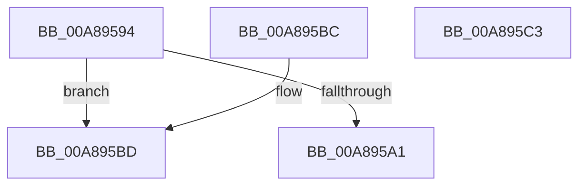

# CmpPopulateKeyCachedInformation

- RVA: `0x00A89594`–`0x00A895C4` (길이 `48` bytes)
- VA: `0x0000000140A89594`
- 실행 섹션: `PAGE`
- PDB 이름 있음: `예`; PDB Function 태그: `아니요`
- unwind 정보 RVA: `0x000DB714`
- 디코드: `15`개 명령, `48/48` bytes 표시
- 미해석 바이트: `0` (있으면 어셈블리에 `.byte`로 보존)

> 이 문서는 커널 이미지의 기계어와 PDB 기호를 분석해 생성했습니다. 4번과 5번은 함수 원형과 자료형을 바이너리 사용 방식에서 추정한 C 해석이며 원본 소스 복구 결과는 아닙니다.

## 1. Dependencies

- 직접 호출 지점: **0**; 고유 호출 대상: **0**
- 직접 호출자로 확인된 함수: **1**
- RIP 상대 이미지 참조: **0**

### Outgoing calls
- 직접 디코드된 call 명령이 없습니다.

### Direct callers
- [CmpQueryKeyDataFromKeyNodeStack](../../text/46/CmpQueryKeyDataFromKeyNodeStack_function_0046AC40.md) at `0x0046AE3B`

### Static image references
- 디코드된 RIP-relative 메모리 참조가 없습니다.

## 2. Other-region calls and transfers

- 다른 실행 섹션으로 향하는 call: **0**
- 별도 외부 분기/꼬리 이동을 확인하지 못했습니다.

## 3. Assembly (complete function range)

```asm
00A89594  41 C7 01 28 00 00 00            mov dword ptr [r9], 0x28
00A8959B  41 83 F8 28                     cmp r8d, 0x28
00A8959F  72 1C                           jb 0x140a895bd
00A895A1  0F 10 01                        movups xmm0, xmmword ptr [rcx]
00A895A4  33 C0                           xor eax, eax
00A895A6  0F 11 02                        movups xmmword ptr [rdx], xmm0
00A895A9  0F 10 49 10                     movups xmm1, xmmword ptr [rcx + 0x10]
00A895AD  0F 11 4A 10                     movups xmmword ptr [rdx + 0x10], xmm1
00A895B1  F2 0F 10 41 20                  movsd xmm0, qword ptr [rcx + 0x20]
00A895B6  F2 0F 11 42 20                  movsd qword ptr [rdx + 0x20], xmm0
00A895BB  C3                              ret
00A895BC  CC                              int3
00A895BD  B8 23 00 00 C0                  mov eax, 0xc0000023
00A895C2  C3                              ret
00A895C3  CC                              int3
```

## 4. C-style interpretation (structured pseudocode)

```c
__int64 __fastcall CmpPopulateKeyCachedInformation(__int64 a1, __int64 a2, int a3, __int64 a4)
{
    __int64 result;

    *(unsigned int *)(a4) = 40;
    if (a3 < 40) goto loc_00A895BD;
    result = 0;
    *(unsigned __int64 *)(a2) = v_xmm0;
    *(unsigned __int64 *)(a2 + 16) = v_xmm1;
    *(unsigned __int64 *)(a2 + 32) = v_xmm0;
    return result;
loc_00A895BD:
    return (unsigned int)(0xC0000023ULL);
}
```

## 5. (Beta) C Style

```c
int64_t CmpPopulateKeyCachedInformation(void *Arg1, void *Arg2, int32_t Arg3, void *Arg4)
{
    uint8_t *arg1 = (uint8_t *)Arg1;
    uint8_t *arg2 = (uint8_t *)Arg2;
    uint8_t *arg4 = (uint8_t *)Arg4;

    int64_t result;

    *(uint32_t *)(arg4) = 40;
    if (Arg3 < 40) goto loc_00A895BD;
    result = 0;
    *(uint64_t *)(arg2) = v_xmm0;
    *(uint64_t *)(arg2 + 0x10) = v_xmm1;
    *(uint64_t *)(arg2 + 0x20) = v_xmm0;
    return result;
loc_00A895BD:
    return (uint32_t)(0xC0000023ULL);
}
```

### 관측된 메모리 오프셋

구조체 형식이 확인되지 않은 접근은 인자 기준의 오프셋으로만 기록했습니다.

| 기준 인자 | 오프셋 표현 | 폭 (bit) | 접근 |
|---|---:|---:|---|
| `Arg1` | `+ 0x0` | `128` | `R` |
| `Arg1` | `+ 0x10` | `128` | `R` |
| `Arg1` | `+ 0x20` | `64` | `R` |
| `Arg2` | `+ 0x0` | `128` | `R` |
| `Arg2` | `+ 0x10` | `128` | `R` |
| `Arg2` | `+ 0x20` | `64` | `W` |
| `Arg4` | `+ 0x0` | `32` | `W` |

## 6. Execution-region graph

[열기: 2D/3D 그래프와 함수 탐색 컨트롤 패널](../../../control-panel.html?section=page&rva=0x00A89594&view=graph)

- 2D 그래프는 위에서 아래로 흐르고, 3D 그래프는 빈 공간을 드래그해 회전합니다. Shift+드래그는 이동, 휠은 확대·축소, 함수 노드 선택은 대상 보고서 이동입니다.

### Static fallback


