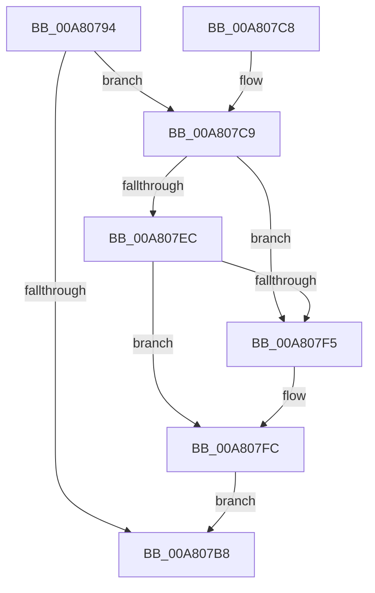

# CmpRemoveFromSecurityCache

- RVA: `0x00A80794`–`0x00A80847` (길이 `179` bytes)
- VA: `0x0000000140A80794`
- 실행 섹션: `PAGE`
- PDB 이름 있음: `예`; PDB Function 태그: `아니요`
- unwind 정보 RVA: `0x000B7098`
- 디코드: `49`개 명령, `179/179` bytes 표시
- 미해석 바이트: `0` (있으면 어셈블리에 `.byte`로 보존)

> 이 문서는 커널 이미지의 기계어와 PDB 기호를 분석해 생성했습니다. 4번과 5번은 함수 원형과 자료형을 바이너리 사용 방식에서 추정한 C 해석이며 원본 소스 복구 결과는 아닙니다.

## 1. Dependencies

- 직접 호출 지점: **3**; 고유 호출 대상: **3**
- 직접 호출자로 확인된 함수: **1**
- RIP 상대 이미지 참조: **0**

### Outgoing calls
- `0x00A807AF` → [CmpFindSecurityCellCacheIndex](../../text/42/CmpFindSecurityCellCacheIndex_function_00428060.md) (function, `0x00428060`)
- `0x00A8080D` → [guard_dispatch_icall](../../text/6B/guard_dispatch_icall_function_006BAAD0.md) (function, `0x006BAAD0`)
- `0x00A80837` → [memcpy](../../text/6C/memcpy_function_006C6840.md) (function, `0x006C6840`)

### Direct callers
- [CmpRemoveSecurityCellList](../../text/4B/CmpRemoveSecurityCellList_function_004BC1FC.md) at `0x004BC2F9`

### Static image references
- 디코드된 RIP-relative 메모리 참조가 없습니다.

## 2. Other-region calls and transfers

- 다른 실행 섹션으로 향하는 call: **3**
  - `0x00A807AF` → [CmpFindSecurityCellCacheIndex](../../text/42/CmpFindSecurityCellCacheIndex_function_00428060.md) (`PAGE` → `.text`)
  - `0x00A8080D` → [guard_dispatch_icall](../../text/6B/guard_dispatch_icall_function_006BAAD0.md) (`PAGE` → `.text`)
  - `0x00A80837` → [memcpy](../../text/6C/memcpy_function_006C6840.md) (`PAGE` → `.text`)
- 별도 외부 분기/꼬리 이동을 확인하지 못했습니다.

## 3. Assembly (complete function range)

```asm
00A80794  48 8B C4                        mov rax, rsp
00A80797  48 89 58 08                     mov qword ptr [rax + 8], rbx
00A8079B  48 89 70 10                     mov qword ptr [rax + 0x10], rsi
00A8079F  57                              push rdi
00A807A0  48 83 EC 20                     sub rsp, 0x20
00A807A4  83 60 18 00                     and dword ptr [rax + 0x18], 0
00A807A8  4C 8D 40 18                     lea r8, [rax + 0x18]
00A807AC  48 8B D9                        mov rbx, rcx
00A807AF  E8 AC 78 9A FF                  call 0x140428060
00A807B4  84 C0                           test al, al
00A807B6  75 11                           jne 0x140a807c9
00A807B8  48 8B 5C 24 30                  mov rbx, qword ptr [rsp + 0x30]
00A807BD  48 8B 74 24 38                  mov rsi, qword ptr [rsp + 0x38]
00A807C2  48 83 C4 20                     add rsp, 0x20
00A807C6  5F                              pop rdi
00A807C7  C3                              ret
00A807C8  CC                              int3
00A807C9  48 8B 83 60 07 00 00            mov rax, qword ptr [rbx + 0x760]
00A807D0  8B 74 24 40                     mov esi, dword ptr [rsp + 0x40]
00A807D4  8B FE                           mov edi, esi
00A807D6  48 C1 E7 04                     shl rdi, 4
00A807DA  48 8B 4C 38 08                  mov rcx, qword ptr [rax + rdi + 8]
00A807DF  48 8D 41 08                     lea rax, [rcx + 8]
00A807E3  4C 8B 00                        mov r8, qword ptr [rax]
00A807E6  49 39 40 08                     cmp qword ptr [r8 + 8], rax
00A807EA  75 09                           jne 0x140a807f5
00A807EC  48 8B 50 08                     mov rdx, qword ptr [rax + 8]
00A807F0  48 39 02                        cmp qword ptr [rdx], rax
00A807F3  74 07                           je 0x140a807fc
00A807F5  B9 03 00 00 00                  mov ecx, 3
00A807FA  CD 29                           int 0x29
00A807FC  4C 89 02                        mov qword ptr [rdx], r8
00A807FF  49 89 50 08                     mov qword ptr [r8 + 8], rdx
00A80803  8B 51 18                        mov edx, dword ptr [rcx + 0x18]
00A80806  48 8B 43 20                     mov rax, qword ptr [rbx + 0x20]
00A8080A  83 C2 20                        add edx, 0x20
00A8080D  E8 BE A2 C3 FF                  call 0x1406baad0
00A80812  44 8B 83 50 07 00 00            mov r8d, dword ptr [rbx + 0x750]
00A80819  8D 56 01                        lea edx, [rsi + 1]
00A8081C  48 8B 8B 60 07 00 00            mov rcx, qword ptr [rbx + 0x760]
00A80823  44 2B C6                        sub r8d, esi
00A80826  48 C1 E2 04                     shl rdx, 4
00A8082A  41 FF C8                        dec r8d
00A8082D  48 03 D1                        add rdx, rcx
00A80830  49 C1 E0 04                     shl r8, 4
00A80834  48 03 CF                        add rcx, rdi
00A80837  E8 04 60 C4 FF                  call 0x1406c6840
00A8083C  FF 8B 50 07 00 00               dec dword ptr [rbx + 0x750]
00A80842  E9 71 FF FF FF                  jmp 0x140a807b8
```

## 4. C-style interpretation (structured pseudocode)

```c
__int64 __fastcall CmpRemoveFromSecurityCache(__int64 a1)
{
    __int64 result;
    __int64 v_rdi;
    __int64 v_rsp;
    unsigned __int64 v_stack_p10;
    unsigned int v_stack_p40;
    unsigned __int64 v_stack_p8;

    *(unsigned __int64 *)(v_rsp + 8) = v_rbx;
    *(unsigned __int64 *)(v_rsp + 16) = v_rsi;
    v_rsp = (v_rsp) - (32);
    result = CmpFindSecurityCellCacheIndex(a1, a2, v_rsp + 24, a4);
    if ((unsigned __int8)(result) != 0) goto loc_00A807C9;
loc_00A807B8:
    v_rsp = (v_rsp) + (32);
    return result;
loc_00A807C9:
    v_rdi = ((unsigned int)((unsigned int)((unsigned int)(v_stack_p40)))) << (4);
    if ((*(unsigned __int64 *)(*(unsigned __int64 *)(*(unsigned __int64 *)(*(unsigned __int64 *)(v_stack_p8 + 1888) + v_rdi * 1 + 8) + 8) + 8)) != (*(unsigned __int64 *)(*(unsigned __int64 *)(v_stack_p8 + 1888) + v_rdi * 1 + 8) + 8)) goto loc_00A807F5;
    if ((*(unsigned __int64 *)(*(unsigned __int64 *)(*(unsigned __int64 *)(*(unsigned __int64 *)(v_stack_p8 + 1888) + v_rdi * 1 + 8) + 8 + 8))) != (*(unsigned __int64 *)(*(unsigned __int64 *)(v_stack_p8 + 1888) + v_rdi * 1 + 8) + 8)) {
        a1 = 3;
    }
    *(unsigned __int64 *)(*(unsigned __int64 *)(*(unsigned __int64 *)(*(unsigned __int64 *)(v_stack_p8 + 1888) + v_rdi * 1 + 8) + 8 + 8)) = *(unsigned __int64 *)(*(unsigned __int64 *)(*(unsigned __int64 *)(v_stack_p8 + 1888) + v_rdi * 1 + 8) + 8);
    *(unsigned __int64 *)(*(unsigned __int64 *)(*(unsigned __int64 *)(*(unsigned __int64 *)(v_stack_p8 + 1888) + v_rdi * 1 + 8) + 8) + 8) = *(unsigned __int64 *)(*(unsigned __int64 *)(*(unsigned __int64 *)(v_stack_p8 + 1888) + v_rdi * 1 + 8) + 8 + 8);
    a2 = (unsigned int)(((unsigned int)(*(unsigned int *)(a1 + 24))) + (32));
    result = guard_dispatch_icall(a1, a2, *(unsigned __int64 *)(*(unsigned __int64 *)(*(unsigned __int64 *)(v_stack_p8 + 1888) + v_rdi * 1 + 8) + 8), a4);
    a3 = (unsigned int)(((unsigned int)(*(unsigned int *)(v_stack_p8 + 1872))) - ((unsigned int)((unsigned int)(v_stack_p40))));
    a2 = ((unsigned int)(v_stack_p40) + 1) << (4);
    a3 = (unsigned int)((a3) - 1);
    a2 = (a2) + (*(unsigned __int64 *)(v_stack_p8 + 1888));
    a3 = (a3) << (4);
    a1 = (*(unsigned __int64 *)(v_stack_p8 + 1888)) + (v_rdi);
    result = memcpy(a1, a2, a3, a4);
    goto loc_00A807B8;
}
```

## 5. (Beta) C Style

```c
int64_t CmpRemoveFromSecurityCache(void *Arg1)
{
    uint8_t *arg1 = (uint8_t *)Arg1;

    int64_t result;
    int64_t local_rdi;
    int64_t local_rsp;
    uint64_t v_stack_p10;
    uint32_t v_stack_p40;
    uint64_t v_stack_p8;

    *(uint64_t *)(local_rsp + 0x8) = local_rbx;
    *(uint64_t *)(local_rsp + 0x10) = local_rsi;
    local_rsp = (local_rsp) - (32);
    result = CmpFindSecurityCellCacheIndex(Arg1, a2, local_rsp + 24, a4);
    if ((uint8_t)(result) != 0) goto loc_00A807C9;
loc_00A807B8:
    local_rsp = (local_rsp) + (32);
    return result;
loc_00A807C9:
    local_rdi = ((uint32_t)((uint32_t)((uint32_t)(v_stack_p40)))) << (4);
    if ((*(uint64_t *)(*(uint64_t *)(*(uint64_t *)(*(uint64_t *)(v_stack_p8 + 0x760) + local_rdi * 1 + 0x8) + 0x8) + 0x8)) != (*(uint64_t *)(*(uint64_t *)(v_stack_p8 + 0x760) + local_rdi * 1 + 0x8) + 8)) goto loc_00A807F5;
    if ((*(uint64_t *)(*(uint64_t *)(*(uint64_t *)(*(uint64_t *)(v_stack_p8 + 0x760) + local_rdi * 1 + 0x8) + 0x8 + 0x8))) != (*(uint64_t *)(*(uint64_t *)(v_stack_p8 + 0x760) + local_rdi * 1 + 0x8) + 8)) {
        Arg1 = 3;
    }
    *(uint64_t *)(*(uint64_t *)(*(uint64_t *)(*(uint64_t *)(v_stack_p8 + 0x760) + local_rdi * 1 + 0x8) + 0x8 + 0x8)) = *(uint64_t *)(*(uint64_t *)(*(uint64_t *)(v_stack_p8 + 0x760) + local_rdi * 1 + 0x8) + 0x8);
    *(uint64_t *)(*(uint64_t *)(*(uint64_t *)(*(uint64_t *)(v_stack_p8 + 0x760) + local_rdi * 1 + 0x8) + 0x8) + 0x8) = *(uint64_t *)(*(uint64_t *)(*(uint64_t *)(v_stack_p8 + 0x760) + local_rdi * 1 + 0x8) + 0x8 + 0x8);
    a2 = (uint32_t)(((uint32_t)(*(uint32_t *)(arg1 + 0x18))) + (32));
    result = guard_dispatch_icall(Arg1, a2, *(uint64_t *)(*(uint64_t *)(*(uint64_t *)(v_stack_p8 + 0x760) + local_rdi * 1 + 0x8) + 0x8), a4);
    a3 = (uint32_t)(((uint32_t)(*(uint32_t *)(v_stack_p8 + 0x750))) - ((uint32_t)((uint32_t)(v_stack_p40))));
    a2 = ((uint32_t)(v_stack_p40) + 1) << (4);
    a3 = (uint32_t)((a3) - 1);
    a2 = (a2) + (*(uint64_t *)(v_stack_p8 + 0x760));
    a3 = (a3) << (4);
    Arg1 = (*(uint64_t *)(v_stack_p8 + 0x760)) + (local_rdi);
    result = memcpy(Arg1, a2, a3, a4);
    goto loc_00A807B8;
}
```

### 관측된 메모리 오프셋

구조체 형식이 확인되지 않은 접근은 인자 기준의 오프셋으로만 기록했습니다.

| 기준 인자 | 오프셋 표현 | 폭 (bit) | 접근 |
|---|---:|---:|---|
| `Arg1` | `+ 0x20` | `64` | `R` |
| `Arg1` | `+ 0x750` | `32` | `R` |
| `Arg1` | `+ 0x750` | `32` | `R/W` |
| `Arg1` | `+ 0x760` | `64` | `R` |

## 6. Execution-region graph

[열기: 2D/3D 그래프와 함수 탐색 컨트롤 패널](../../../control-panel.html?section=page&rva=0x00A80794&view=graph)

- 2D 그래프는 위에서 아래로 흐르고, 3D 그래프는 빈 공간을 드래그해 회전합니다. Shift+드래그는 이동, 휠은 확대·축소, 함수 노드 선택은 대상 보고서 이동입니다.

### Static fallback


