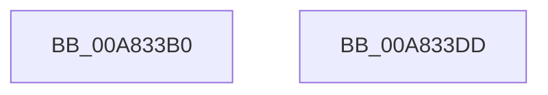

# CmpSortedValueEnumStackInitialize

- RVA: `0x00A833B0`–`0x00A833DE` (길이 `46` bytes)
- VA: `0x0000000140A833B0`
- 실행 섹션: `PAGE`
- PDB 이름 있음: `예`; PDB Function 태그: `아니요`
- unwind 정보 RVA: `0x0005C788`
- 디코드: `14`개 명령, `46/46` bytes 표시
- 미해석 바이트: `0` (있으면 어셈블리에 `.byte`로 보존)

> 이 문서는 커널 이미지의 기계어와 PDB 기호를 분석해 생성했습니다. 4번과 5번은 함수 원형과 자료형을 바이너리 사용 방식에서 추정한 C 해석이며 원본 소스 복구 결과는 아닙니다.

## 1. Dependencies

- 직접 호출 지점: **1**; 고유 호출 대상: **1**
- 직접 호출자로 확인된 함수: **1**
- RIP 상대 이미지 참조: **0**

### Outgoing calls
- `0x00A833D3` → [memset](../../text/6C/memset_function_006C6C40.md) (function, `0x006C6C40`)

### Direct callers
- [CmpGetValueCountForKeyNodeStack](../../text/46/CmpGetValueCountForKeyNodeStack_function_0046B118.md) at `0x0046B16B`
- [CmpGetValueCountForKeyNodeStack](../../text/46/CmpGetValueCountForKeyNodeStack_function_0046B118.md) at `0x0046B2CD`

### Static image references
- 디코드된 RIP-relative 메모리 참조가 없습니다.

## 2. Other-region calls and transfers

- 다른 실행 섹션으로 향하는 call: **1**
  - `0x00A833D3` → [memset](../../text/6C/memset_function_006C6C40.md) (`PAGE` → `.text`)
- 별도 외부 분기/꼬리 이동을 확인하지 못했습니다.

## 3. Assembly (complete function range)

```asm
00A833B0  48 83 EC 28                     sub rsp, 0x28
00A833B4  33 C0                           xor eax, eax
00A833B6  33 D2                           xor edx, edx
00A833B8  48 89 01                        mov qword ptr [rcx], rax
00A833BB  89 41 0A                        mov dword ptr [rcx + 0xa], eax
00A833BE  66 89 41 0E                     mov word ptr [rcx + 0xe], ax
00A833C2  48 89 41 50                     mov qword ptr [rcx + 0x50], rax
00A833C6  44 8D 40 40                     lea r8d, [rax + 0x40]
00A833CA  66 83 49 08 FF                  or word ptr [rcx + 8], 0xffff
00A833CF  48 83 C1 10                     add rcx, 0x10
00A833D3  E8 68 38 C4 FF                  call 0x1406c6c40
00A833D8  48 83 C4 28                     add rsp, 0x28
00A833DC  C3                              ret
00A833DD  CC                              int3
```

## 4. C-style interpretation (structured pseudocode)

```c
__int64 __fastcall CmpSortedValueEnumStackInitialize(__int64 a1, int a2)
{
    __int64 result;
    __int64 v_rsp;

    v_rsp = (v_rsp) - (40);
    result = 0;
    a2 = 0;
    *(unsigned __int64 *)(a1) = 0;
    *(unsigned int *)(a1 + 10) = 0;
    *(unsigned __int16 *)(a1 + 14) = 0;
    *(unsigned __int64 *)(a1 + 80) = 0;
    a1 = (a1) + (16);
    result = memset(a1, a2, result + 64, a4);
    v_rsp = (v_rsp) + (40);
    return result;
}
```

## 5. (Beta) C Style

```c
int64_t CmpSortedValueEnumStackInitialize(void *Arg1, int32_t Arg2)
{
    uint8_t *arg1 = (uint8_t *)Arg1;

    int64_t result;
    int64_t local_rsp;

    local_rsp = (local_rsp) - (40);
    result = 0;
    Arg2 = 0;
    *(uint64_t *)(arg1) = 0;
    *(uint32_t *)(arg1 + 0xA) = 0;
    *(uint16_t *)(arg1 + 0xE) = 0;
    *(uint64_t *)(arg1 + 0x50) = 0;
    Arg1 = (Arg1) + (16);
    result = memset(Arg1, Arg2, result + 64, a4);
    local_rsp = (local_rsp) + (40);
    return result;
}
```

### 관측된 메모리 오프셋

구조체 형식이 확인되지 않은 접근은 인자 기준의 오프셋으로만 기록했습니다.

| 기준 인자 | 오프셋 표현 | 폭 (bit) | 접근 |
|---|---:|---:|---|
| `Arg1` | `+ 0x0` | `64` | `W` |
| `Arg1` | `+ 0x8` | `16` | `R/W` |
| `Arg1` | `+ 0xA` | `32` | `W` |
| `Arg1` | `+ 0xE` | `16` | `W` |
| `Arg1` | `+ 0x50` | `64` | `W` |

## 6. Execution-region graph

[열기: 2D/3D 그래프와 함수 탐색 컨트롤 패널](../../../control-panel.html?section=page&rva=0x00A833B0&view=graph)

- 2D 그래프는 위에서 아래로 흐르고, 3D 그래프는 빈 공간을 드래그해 회전합니다. Shift+드래그는 이동, 휠은 확대·축소, 함수 노드 선택은 대상 보고서 이동입니다.

### Static fallback


