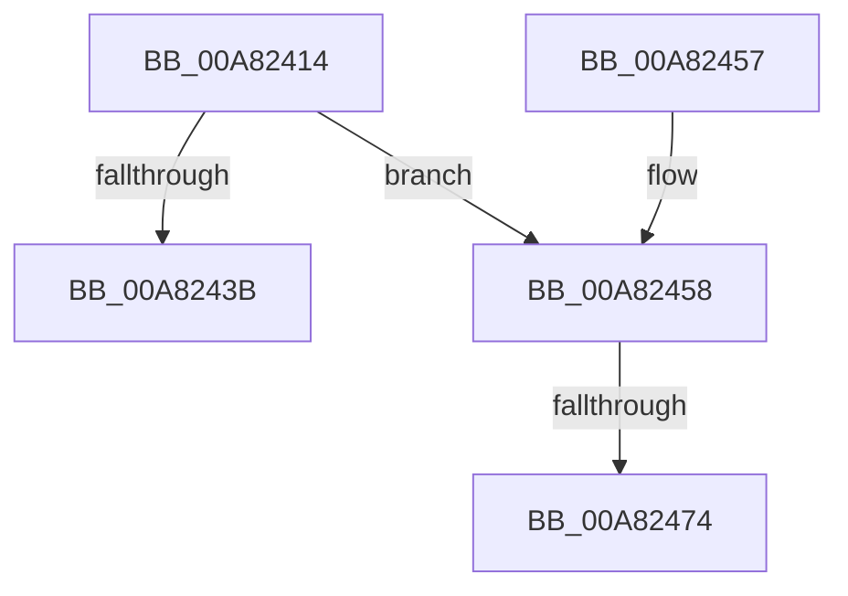

# DbgkOpenProcessDebugPort

- RVA: `0x00A82414`–`0x00A82482` (길이 `110` bytes)
- VA: `0x0000000140A82414`
- 실행 섹션: `PAGE`
- PDB 이름 있음: `예`; PDB Function 태그: `예`
- unwind 정보 RVA: `0x000B72A4`
- 디코드: `28`개 명령, `110/110` bytes 표시
- 미해석 바이트: `0` (있으면 어셈블리에 `.byte`로 보존)

> 이 문서는 커널 이미지의 기계어와 PDB 기호를 분석해 생성했습니다. 4번과 5번은 함수 원형과 자료형을 바이너리 사용 방식에서 추정한 C 해석이며 원본 소스 복구 결과는 아닙니다.

## 1. Dependencies

- 직접 호출 지점: **2**; 고유 호출 대상: **2**
- 직접 호출자로 확인된 함수: **1**
- RIP 상대 이미지 참조: **1**

### Outgoing calls
- `0x00A8245F` → [ExAcquireFastMutex](../../text/20/ExAcquireFastMutex_function_0020E5A0.md) (function, `0x0020E5A0`)
- `0x00A82477` → [ObfReferenceObject](../../text/20/ObfReferenceObject_function_0020FA20.md) (function, `0x0020FA20`)

### Direct callers
- [NtQueryInformationProcess](../9A/NtQueryInformationProcess_function_009AA250.md) at `0x009AD3D1`

### Static image references
- `0x00A82458` → RVA `0x00F8F220` (`.data`; read)

## 2. Other-region calls and transfers

- 다른 실행 섹션으로 향하는 call: **2**
  - `0x00A8245F` → [ExAcquireFastMutex](../../text/20/ExAcquireFastMutex_function_0020E5A0.md) (`PAGE` → `.text`)
  - `0x00A82477` → [ObfReferenceObject](../../text/20/ObfReferenceObject_function_0020FA20.md) (`PAGE` → `.text`)
- call이 아닌 외부 분기/꼬리 이동: **2**
  - `0x00A8246E` → [sub_00B439C4](../B4/Unknown_function_00B439C4.md) (`tail-transfer`)
  - `0x00A8247D` → [sub_00B439C4](../B4/Unknown_function_00B439C4.md) (`tail-transfer`)

## 3. Assembly (complete function range)

```asm
00A82414  48 89 5C 24 08                  mov qword ptr [rsp + 8], rbx
00A82419  48 89 6C 24 10                  mov qword ptr [rsp + 0x10], rbp
00A8241E  48 89 74 24 18                  mov qword ptr [rsp + 0x18], rsi
00A82423  57                              push rdi
00A82424  48 83 EC 40                     sub rsp, 0x40
00A82428  48 83 B9 08 03 00 00 00         cmp qword ptr [rcx + 0x308], 0
00A82430  49 8B E8                        mov rbp, r8
00A82433  40 8A F2                        mov sil, dl
00A82436  48 8B D9                        mov rbx, rcx
00A82439  75 1D                           jne 0x140a82458
00A8243B  BB 53 03 00 C0                  mov ebx, 0xc0000353
00A82440  48 8B 6C 24 58                  mov rbp, qword ptr [rsp + 0x58]
00A82445  8B C3                           mov eax, ebx
00A82447  48 8B 5C 24 50                  mov rbx, qword ptr [rsp + 0x50]
00A8244C  48 8B 74 24 60                  mov rsi, qword ptr [rsp + 0x60]
00A82451  48 83 C4 40                     add rsp, 0x40
00A82455  5F                              pop rdi
00A82456  C3                              ret
00A82457  CC                              int3
00A82458  48 8D 0D C1 CD 50 00            lea rcx, [rip + 0x50cdc1]
00A8245F  E8 3C C1 78 FF                  call 0x14020e5a0
00A82464  48 8B BB 08 03 00 00            mov rdi, qword ptr [rbx + 0x308]
00A8246B  48 85 FF                        test rdi, rdi
00A8246E  0F 84 50 15 0C 00               je 0x140b439c4
00A82474  48 8B CF                        mov rcx, rdi
00A82477  E8 A4 D5 78 FF                  call 0x14020fa20
00A8247C  90                              nop
00A8247D  E9 42 15 0C 00                  jmp 0x140b439c4
```

## 4. C-style interpretation (structured pseudocode)

```c
__int64 __fastcall DbgkOpenProcessDebugPort(__int64 a1, unsigned __int8 a2, __int64 a3)
{
    __int64 result;
    __int64 v_rsp;
    unsigned __int64 v_stack_p10;
    unsigned __int64 v_stack_p18;
    unsigned __int64 v_stack_p8;

    v_stack_p8 = v_rbx;
    v_stack_p10 = v_rbp;
    v_stack_p18 = v_rsi;
    v_rsp = (v_rsp) - (64);
    if ((*(unsigned __int64 *)(a1 + 776)) != 0) goto loc_00A82458;
    v_rsp = (v_rsp) + (64);
    return (unsigned int)((unsigned int)((unsigned int)(0xC0000353ULL)));
loc_00A82458:
    result = ExAcquireFastMutex(v_rip + 5295553, a2, a3, a4);
    result = ObfReferenceObject(*(unsigned __int64 *)(v_stack_p8 + 776), a2, a3, a4);
}
```

## 5. (Beta) C Style

```c
int64_t DbgkOpenProcessDebugPort(void *Arg1, uint8_t Arg2, int64_t Arg3)
{
    uint8_t *arg1 = (uint8_t *)Arg1;

    int64_t result;
    int64_t local_rsp;
    uint64_t v_stack_p10;
    uint64_t v_stack_p18;
    uint64_t v_stack_p8;

    v_stack_p8 = local_rbx;
    v_stack_p10 = local_rbp;
    v_stack_p18 = local_rsi;
    local_rsp = (local_rsp) - (64);
    if ((*(uint64_t *)(arg1 + 0x308)) != 0) goto loc_00A82458;
    local_rsp = (local_rsp) + (64);
    return (uint32_t)((uint32_t)((uint32_t)(0xC0000353ULL)));
loc_00A82458:
    result = ExAcquireFastMutex(v_rip + 5295553, Arg2, Arg3, a4);
    result = ObfReferenceObject(*(uint64_t *)(v_stack_p8 + 0x308), Arg2, Arg3, a4);
}
```

### 관측된 메모리 오프셋

구조체 형식이 확인되지 않은 접근은 인자 기준의 오프셋으로만 기록했습니다.

| 기준 인자 | 오프셋 표현 | 폭 (bit) | 접근 |
|---|---:|---:|---|
| `Arg1` | `+ 0x308` | `64` | `R` |

## 6. Execution-region graph

[열기: 2D/3D 그래프와 함수 탐색 컨트롤 패널](../../../control-panel.html?section=page&rva=0x00A82414&view=graph)

- 2D 그래프는 위에서 아래로 흐르고, 3D 그래프는 빈 공간을 드래그해 회전합니다. Shift+드래그는 이동, 휠은 확대·축소, 함수 노드 선택은 대상 보고서 이동입니다.

### Static fallback


