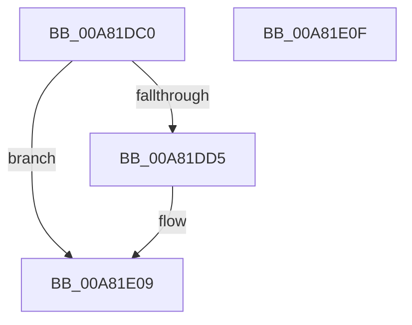

# EtwTimLogProhibitWin32kSystemCalls

- RVA: `0x00A81DC0`–`0x00A81E10` (길이 `80` bytes)
- VA: `0x0000000140A81DC0`
- 실행 섹션: `PAGE`
- PDB 이름 있음: `예`; PDB Function 태그: `아니요`
- unwind 정보 RVA: `0x00064C80`
- 디코드: `19`개 명령, `80/80` bytes 표시
- 미해석 바이트: `0` (있으면 어셈블리에 `.byte`로 보존)

> 이 문서는 커널 이미지의 기계어와 PDB 기호를 분석해 생성했습니다. 4번과 5번은 함수 원형과 자료형을 바이너리 사용 방식에서 추정한 C 해석이며 원본 소스 복구 결과는 아닙니다.

## 1. Dependencies

- 직접 호출 지점: **1**; 고유 호출 대상: **1**
- 직접 호출자로 확인된 함수: **1**
- RIP 상대 이미지 참조: **2**

### Outgoing calls
- `0x00A81DF9` → [EtwpTimLogMitigationForProcess](EtwpTimLogMitigationForProcess_function_00A81E6C.md) (function, `0x00A81E6C`)

### Direct callers
- [PsConvertToGuiThread](../A2/PsConvertToGuiThread_function_00A2F8B0.md) at `0x00A2F952`
- [PsConvertToGuiThread](../A2/PsConvertToGuiThread_function_00A2F8B0.md) at `0x00A2FA16`
- [PsConvertToGuiThread](../A2/PsConvertToGuiThread_function_00A2F8B0.md) at `0x00A2FA25`

### Static image references
- `0x00A81DDD` → RVA `0x0001BC78` (`.rdata`; read)
- `0x00A81DE9` → RVA `0x0001BCA8` (`.rdata`; read)

## 2. Other-region calls and transfers

- 다른 실행 섹션으로 향하는 call: **0**
- 별도 외부 분기/꼬리 이동을 확인하지 못했습니다.

## 3. Assembly (complete function range)

```asm
00A81DC0  40 53                           push rbx
00A81DC2  48 83 EC 30                     sub rsp, 0x30
00A81DC6  F7 82 50 07 00 00 00 20 00 00   test dword ptr [rdx + 0x750], 0x2000
00A81DD0  48 8B DA                        mov rbx, rdx
00A81DD3  74 34                           je 0x140a81e09
00A81DD5  83 F9 01                        cmp ecx, 1
00A81DD8  C6 44 24 20 00                  mov byte ptr [rsp + 0x20], 0
00A81DDD  48 8D 05 94 9E 59 FF            lea rax, [rip - 0xa6616c]
00A81DE4  4C 8B CA                        mov r9, rdx
00A81DE7  8B D1                           mov edx, ecx
00A81DE9  4C 8D 05 B8 9E 59 FF            lea r8, [rip - 0xa66148]
00A81DF0  4C 0F 45 C0                     cmovne r8, rax
00A81DF4  B9 02 00 00 00                  mov ecx, 2
00A81DF9  E8 6E 00 00 00                  call 0x140a81e6c
00A81DFE  F0 81 A3 50 07 00 00 FF DF FF FF  lock and dword ptr [rbx + 0x750], 0xffffdfff
00A81E09  48 83 C4 30                     add rsp, 0x30
00A81E0D  5B                              pop rbx
00A81E0E  C3                              ret
00A81E0F  CC                              int3
```

## 4. C-style interpretation (structured pseudocode)

```c
__int64 __fastcall EtwTimLogProhibitWin32kSystemCalls(int a1, __int64 a2)
{
    __int64 result;
    __int64 v_rsp;
    unsigned __int8 v_stack_m18;

    v_rsp = (v_rsp) - (48);
    if (((*(unsigned int *)(a2 + 1872)) & (0x2000ULL)) != 0) {
        v_stack_m18 = 0;
        result = v_rip - 10903916;
        a4 = a2;
        a2 = a1;
        a3 = v_rip - 10903880;
        if (a1 != 1) { a3 = result; }
        a1 = 2;
        result = EtwpTimLogMitigationForProcess(a1, a2, a3, a4);
    }
    v_rsp = (v_rsp) + (48);
    return result;
}
```

## 5. (Beta) C Style

```c
int64_t EtwTimLogProhibitWin32kSystemCalls(int32_t Arg1, void *Arg2)
{
    uint8_t *arg2 = (uint8_t *)Arg2;

    int64_t result;
    int64_t local_rsp;
    uint8_t v_stack_m18;

    local_rsp = (local_rsp) - (48);
    if (((*(uint32_t *)(arg2 + 0x750)) & (0x2000ULL)) != 0) {
        v_stack_m18 = 0;
        result = v_rip - 10903916;
        a4 = Arg2;
        Arg2 = Arg1;
        a3 = v_rip - 10903880;
        if (Arg1 != 1) { a3 = result; }
        Arg1 = 2;
        result = EtwpTimLogMitigationForProcess(Arg1, Arg2, a3, a4);
    }
    local_rsp = (local_rsp) + (48);
    return result;
}
```

### 관측된 메모리 오프셋

구조체 형식이 확인되지 않은 접근은 인자 기준의 오프셋으로만 기록했습니다.

| 기준 인자 | 오프셋 표현 | 폭 (bit) | 접근 |
|---|---:|---:|---|
| `Arg2` | `+ 0x750` | `32` | `R` |
| `Arg2` | `+ 0x750` | `32` | `R/W` |

## 6. Execution-region graph

[열기: 2D/3D 그래프와 함수 탐색 컨트롤 패널](../../../control-panel.html?section=page&rva=0x00A81DC0&view=graph)

- 2D 그래프는 위에서 아래로 흐르고, 3D 그래프는 빈 공간을 드래그해 회전합니다. Shift+드래그는 이동, 휠은 확대·축소, 함수 노드 선택은 대상 보고서 이동입니다.

### Static fallback


