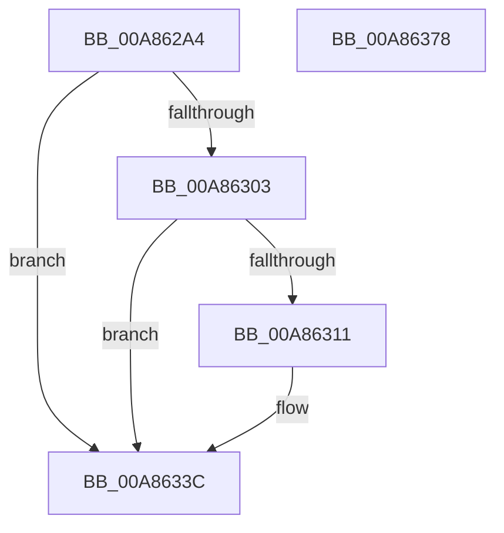

# EtwTraceFreezeThawProcess

- RVA: `0x00A862A4`–`0x00A86379` (길이 `213` bytes)
- VA: `0x0000000140A862A4`
- 실행 섹션: `PAGE`
- PDB 이름 있음: `예`; PDB Function 태그: `아니요`
- unwind 정보 RVA: `0x0007C514`
- 디코드: `48`개 명령, `213/213` bytes 표시
- 미해석 바이트: `0` (있으면 어셈블리에 `.byte`로 보존)

> 이 문서는 커널 이미지의 기계어와 PDB 기호를 분석해 생성했습니다. 4번과 5번은 함수 원형과 자료형을 바이너리 사용 방식에서 추정한 C 해석이며 원본 소스 복구 결과는 아닙니다.

## 1. Dependencies

- 직접 호출 지점: **3**; 고유 호출 대상: **3**
- 직접 호출자로 확인된 함수: **2**
- RIP 상대 이미지 참조: **5**

### Outgoing calls
- `0x00A86337` → [EtwWrite](../../text/41/EtwWrite_function_0041C720.md) (function, `0x0041C720`)
- `0x00A86360` → [EtwTraceKernelEvent](../../text/23/EtwTraceKernelEvent_function_00235350.md) (function, `0x00235350`)
- `0x00A8636D` → [_security_check_cookie](../../text/6A/_security_check_cookie_function_006AC640.md) (function, `0x006AC640`)

### Direct callers
- [PsThawMultiProcess](../../text/45/PsThawMultiProcess_function_0045FFE0.md) at `0x004600CB`
- [PsFreezeProcess](../AA/PsFreezeProcess_function_00AA6D04.md) at `0x00AA6DDD`

### Static image references
- `0x00A862AC` → RVA `0x00E0A740` (`.data`; read)
- `0x00A862EC` → RVA `0x00FC6AA8` (`ALMOSTRO`; read)
- `0x00A86311` → RVA `0x00EFF9E8` (`.data`; read)
- `0x00A86318` → RVA `0x0001BD38` (`.rdata`; read)
- `0x00A86321` → RVA `0x0001BD48` (`.rdata`; read)

## 2. Other-region calls and transfers

- 다른 실행 섹션으로 향하는 call: **3**
  - `0x00A86337` → [EtwWrite](../../text/41/EtwWrite_function_0041C720.md) (`PAGE` → `.text`)
  - `0x00A86360` → [EtwTraceKernelEvent](../../text/23/EtwTraceKernelEvent_function_00235350.md) (`PAGE` → `.text`)
  - `0x00A8636D` → [_security_check_cookie](../../text/6A/_security_check_cookie_function_006AC640.md) (`PAGE` → `.text`)
- 별도 외부 분기/꼬리 이동을 확인하지 못했습니다.

## 3. Assembly (complete function range)

```asm
00A862A4  4C 8B DC                        mov r11, rsp
00A862A7  53                              push rbx
00A862A8  48 83 EC 60                     sub rsp, 0x60
00A862AC  48 8B 05 8D 44 38 00            mov rax, qword ptr [rip + 0x38448d]
00A862B3  48 33 C4                        xor rax, rsp
00A862B6  48 89 44 24 58                  mov qword ptr [rsp + 0x58], rax
00A862BB  8B 81 D0 01 00 00               mov eax, dword ptr [rcx + 0x1d0]
00A862C1  8A DA                           mov bl, dl
00A862C3  89 44 24 30                     mov dword ptr [rsp + 0x30], eax
00A862C7  49 8D 43 C8                     lea rax, [r11 - 0x38]
00A862CB  49 89 43 D0                     mov qword ptr [r11 - 0x30], rax
00A862CF  48 8D 81 F8 01 00 00            lea rax, [rcx + 0x1f8]
00A862D6  83 64 24 44 00                  and dword ptr [rsp + 0x44], 0
00A862DB  C7 44 24 40 04 00 00 00         mov dword ptr [rsp + 0x40], 4
00A862E3  49 89 43 E0                     mov qword ptr [r11 - 0x20], rax
00A862E7  83 64 24 54 00                  and dword ptr [rsp + 0x54], 0
00A862EC  48 8B 05 B5 07 54 00            mov rax, qword ptr [rip + 0x5407b5]
00A862F3  C7 44 24 50 08 00 00 00         mov dword ptr [rsp + 0x50], 8
00A862FB  48 05 CC 12 00 00               add rax, 0x12cc
00A86301  74 39                           je 0x140a8633c
00A86303  8B 40 08                        mov eax, dword ptr [rax + 8]
00A86306  41 B9 02 00 00 00               mov r9d, 2
00A8630C  41 84 C1                        test r9b, al
00A8630F  74 2B                           je 0x140a8633c
00A86311  48 8B 0D D0 96 47 00            mov rcx, qword ptr [rip + 0x4796d0]
00A86318  48 8D 05 19 5A 59 FF            lea rax, [rip - 0xa6a5e7]
00A8631F  84 DB                           test bl, bl
00A86321  48 8D 15 20 5A 59 FF            lea rdx, [rip - 0xa6a5e0]
00A86328  48 0F 44 D0                     cmove rdx, rax
00A8632C  49 8D 43 D0                     lea rax, [r11 - 0x30]
00A86330  45 33 C0                        xor r8d, r8d
00A86333  49 89 43 B8                     mov qword ptr [r11 - 0x48], rax
00A86337  E8 E4 63 99 FF                  call 0x14041c720
00A8633C  F6 DB                           neg bl
00A8633E  C7 44 24 20 02 19 60 00         mov dword ptr [rsp + 0x20], 0x601902
00A86346  BA 01 00 00 00                  mov edx, 1
00A8634B  48 8D 4C 24 38                  lea rcx, [rsp + 0x38]
00A86350  66 45 1B C9                     sbb r9w, r9w
00A86354  41 B8 02 00 00 40               mov r8d, 0x40000002
00A8635A  66 41 81 C1 25 03               add r9w, 0x325
00A86360  E8 EB EF 7A FF                  call 0x140235350
00A86365  48 8B 4C 24 58                  mov rcx, qword ptr [rsp + 0x58]
00A8636A  48 33 CC                        xor rcx, rsp
00A8636D  E8 CE 62 C2 FF                  call 0x1406ac640
00A86372  48 83 C4 60                     add rsp, 0x60
00A86376  5B                              pop rbx
00A86377  C3                              ret
00A86378  CC                              int3
```

## 4. C-style interpretation (structured pseudocode)

```c
__int64 __fastcall EtwTraceFreezeThawProcess(__int64 a1, unsigned __int8 a2, int a3)
{
    __int64 result;
    __int64 v_rbx;
    __int64 v_rsp;
    unsigned __int64 v_stack_m10;
    unsigned int v_stack_m14;
    unsigned int v_stack_m18;
    unsigned int v_stack_m24;
    unsigned int v_stack_m28;
    unsigned __int64 v_stack_m30;
    unsigned int v_stack_m38;
    unsigned int v_stack_m48;

    v_rsp = (v_rsp) - (96);
    result = (*(unsigned __int64 *)(v_rip + 3687565)) ^ (v_rsp);
    v_stack_m10 = result;
    v_stack_m38 = (unsigned int)((unsigned int)(*(unsigned int *)(a1 + 464)));
    *(unsigned __int64 *)(v_rsp - 48) = v_rsp - 56;
    v_stack_m28 = 4;
    *(unsigned __int64 *)(v_rsp - 32) = a1 + 504;
    v_stack_m18 = 8;
    result = (*(unsigned __int64 *)(v_rip + 5506997)) + (0x12CCULL);
    if (condition_is_equal) goto loc_00A8633C;
    result = (unsigned int)(*(unsigned int *)(result + 8));
    if (((2) & ((unsigned __int8)((unsigned int)(*(unsigned int *)(result + 8))))) != 0) {
        a1 = *(unsigned __int64 *)(v_rip + 4691664);
        result = v_rip - 10921447;
        a2 = v_rip - 10921440;
        if (a2 == 0) { a2 = result; }
        result = v_rsp - 48;
        a3 = 0;
        *(unsigned __int64 *)(v_rsp - 72) = result;
        result = EtwWrite(a1, a2, a3, 2);
    }
    v_rbx = (unsigned __int8)(-(a2));
    v_stack_m48 = 0x601902ULL;
    a4 = (unsigned __int16)((2) + (805));
    result = EtwTraceKernelEvent(v_stack_m30, 1, (unsigned int)(0x40000002ULL), a4);
    a1 = (v_stack_m10) ^ (v_rsp);
    result = _security_check_cookie(a1, 1, (unsigned int)(0x40000002ULL), a4);
    v_rsp = (v_rsp) + (96);
    return result;
}
```

## 5. (Beta) C Style

```c
int64_t EtwTraceFreezeThawProcess(void *Arg1, uint8_t Arg2, int32_t Arg3)
{
    uint8_t *arg1 = (uint8_t *)Arg1;

    int64_t result;
    int64_t local_rbx;
    int64_t local_rsp;
    uint64_t v_stack_m10;
    uint32_t v_stack_m14;
    uint32_t v_stack_m18;
    uint32_t v_stack_m24;
    uint32_t v_stack_m28;
    uint64_t v_stack_m30;
    uint32_t v_stack_m38;
    uint32_t v_stack_m48;

    local_rsp = (local_rsp) - (96);
    result = (*(uint64_t *)(v_rip + 0x38448D)) ^ (local_rsp);
    v_stack_m10 = result;
    v_stack_m38 = (uint32_t)((uint32_t)(*(uint32_t *)(arg1 + 0x1D0)));
    *(uint64_t *)(local_rsp - 0x30) = local_rsp - 56;
    v_stack_m28 = 4;
    *(void **)(local_rsp - 0x20) = Arg1 + 504;
    v_stack_m18 = 8;
    result = (*(uint64_t *)(v_rip + 0x5407B5)) + (0x12CCULL);
    if (condition_is_equal) goto loc_00A8633C;
    result = (uint32_t)(*(uint32_t *)(result + 0x8));
    if (((2) & ((uint8_t)((uint32_t)(*(uint32_t *)(result + 0x8))))) != 0) {
        Arg1 = *(uint64_t *)(v_rip + 0x4796D0);
        result = v_rip - 10921447;
        Arg2 = v_rip - 10921440;
        if (Arg2 == 0) { Arg2 = result; }
        result = local_rsp - 48;
        Arg3 = 0;
        *(uint64_t *)(local_rsp - 0x48) = result;
        result = EtwWrite(Arg1, Arg2, Arg3, 2);
    }
    local_rbx = (uint8_t)(-(Arg2));
    v_stack_m48 = 0x601902ULL;
    a4 = (uint16_t)((2) + (805));
    result = EtwTraceKernelEvent(v_stack_m30, 1, (uint32_t)(0x40000002ULL), a4);
    Arg1 = (v_stack_m10) ^ (local_rsp);
    result = _security_check_cookie(Arg1, 1, (uint32_t)(0x40000002ULL), a4);
    local_rsp = (local_rsp) + (96);
    return result;
}
```

### 관측된 메모리 오프셋

구조체 형식이 확인되지 않은 접근은 인자 기준의 오프셋으로만 기록했습니다.

| 기준 인자 | 오프셋 표현 | 폭 (bit) | 접근 |
|---|---:|---:|---|
| `Arg1` | `+ 0x1D0` | `32` | `R` |
| `Arg1` | `+ 0x1F8` | `64` | `R` |

## 6. Execution-region graph

[열기: 2D/3D 그래프와 함수 탐색 컨트롤 패널](../../../control-panel.html?section=page&rva=0x00A862A4&view=graph)

- 2D 그래프는 위에서 아래로 흐르고, 3D 그래프는 빈 공간을 드래그해 회전합니다. Shift+드래그는 이동, 휠은 확대·축소, 함수 노드 선택은 대상 보고서 이동입니다.

### Static fallback


