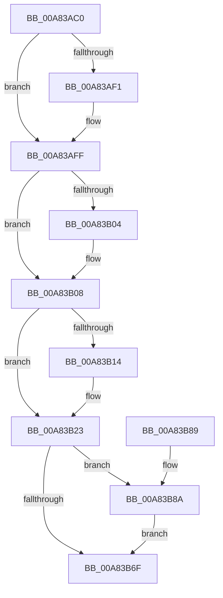

# EtwpAcquireTokenAccessInformation

- RVA: `0x00A83AC0`–`0x00A83B94` (길이 `212` bytes)
- VA: `0x0000000140A83AC0`
- 실행 섹션: `PAGE`
- PDB 이름 있음: `예`; PDB Function 태그: `아니요`
- unwind 정보 RVA: `0x0005C748`
- 디코드: `55`개 명령, `212/212` bytes 표시
- 미해석 바이트: `0` (있으면 어셈블리에 `.byte`로 보존)

> 이 문서는 커널 이미지의 기계어와 PDB 기호를 분석해 생성했습니다. 4번과 5번은 함수 원형과 자료형을 바이너리 사용 방식에서 추정한 C 해석이며 원본 소스 복구 결과는 아닙니다.

## 1. Dependencies

- 직접 호출 지점: **8**; 고유 호출 대상: **8**
- 직접 호출자로 확인된 함수: **1**
- RIP 상대 이미지 참조: **0**

### Outgoing calls
- `0x00A83AE1` → [KeAbPreAcquire](../../text/21/KeAbPreAcquire_function_00210230.md) (function, `0x00210230`)
- `0x00A83AFA` → [ExfAcquirePushLockExclusiveEx](../../text/20/ExfAcquirePushLockExclusiveEx_function_0020FC90.md) (function, `0x0020FC90`)
- `0x00A83B16` → [ExFreePoolWithTag](../../poolcode/B8/ExFreePoolWithTag_function_00B82870.md) (function, `0x00B82870`)
- `0x00A83B38` → [PsReferencePrimaryTokenWithTag](../../text/20/PsReferencePrimaryTokenWithTag_function_0020FF80.md) (function, `0x0020FF80`)
- `0x00A83B4F` → [SeQueryInformationToken](../8B/SeQueryInformationToken_function_008B5090.md) (function, `0x008B5090`)
- `0x00A83B59` → [ObfDereferenceObject](../../text/2F/ObfDereferenceObject_function_002F9350.md) (function, `0x002F9350`)
- `0x00A83B72` → [KeAbPostRelease](../../text/2E/KeAbPostRelease_function_002E1600.md) (function, `0x002E1600`)
- `0x00A83B8D` → [ExfTryToWakePushLock](../../text/26/ExfTryToWakePushLock_function_00265DD0.md) (function, `0x00265DD0`)

### Direct callers
- [EtwpEnableGuid](../A5/EtwpEnableGuid_function_00A5CD28.md) at `0x00A5D16A`

### Static image references
- 디코드된 RIP-relative 메모리 참조가 없습니다.

## 2. Other-region calls and transfers

- 다른 실행 섹션으로 향하는 call: **7**
  - `0x00A83AE1` → [KeAbPreAcquire](../../text/21/KeAbPreAcquire_function_00210230.md) (`PAGE` → `.text`)
  - `0x00A83AFA` → [ExfAcquirePushLockExclusiveEx](../../text/20/ExfAcquirePushLockExclusiveEx_function_0020FC90.md) (`PAGE` → `.text`)
  - `0x00A83B16` → [ExFreePoolWithTag](../../poolcode/B8/ExFreePoolWithTag_function_00B82870.md) (`PAGE` → `POOLCODE`)
  - `0x00A83B38` → [PsReferencePrimaryTokenWithTag](../../text/20/PsReferencePrimaryTokenWithTag_function_0020FF80.md) (`PAGE` → `.text`)
  - `0x00A83B59` → [ObfDereferenceObject](../../text/2F/ObfDereferenceObject_function_002F9350.md) (`PAGE` → `.text`)
  - `0x00A83B72` → [KeAbPostRelease](../../text/2E/KeAbPostRelease_function_002E1600.md) (`PAGE` → `.text`)
  - `0x00A83B8D` → [ExfTryToWakePushLock](../../text/26/ExfTryToWakePushLock_function_00265DD0.md) (`PAGE` → `.text`)
- 별도 외부 분기/꼬리 이동을 확인하지 못했습니다.

## 3. Assembly (complete function range)

```asm
00A83AC0  48 89 5C 24 08                  mov qword ptr [rsp + 8], rbx
00A83AC5  48 89 74 24 10                  mov qword ptr [rsp + 0x10], rsi
00A83ACA  57                              push rdi
00A83ACB  48 83 EC 20                     sub rsp, 0x20
00A83ACF  48 8D B9 B0 02 00 00            lea rdi, [rcx + 0x2b0]
00A83AD6  48 8B F1                        mov rsi, rcx
00A83AD9  48 8B CF                        mov rcx, rdi
00A83ADC  45 33 C0                        xor r8d, r8d
00A83ADF  33 D2                           xor edx, edx
00A83AE1  E8 4A C7 78 FF                  call 0x140210230
00A83AE6  F0 48 0F BA 2F 00               lock bts qword ptr [rdi], 0
00A83AEC  48 8B D8                        mov rbx, rax
00A83AEF  73 0E                           jae 0x140a83aff
00A83AF1  4C 8B C7                        mov r8, rdi
00A83AF4  48 8B D0                        mov rdx, rax
00A83AF7  48 8B CF                        mov rcx, rdi
00A83AFA  E8 91 C1 78 FF                  call 0x14020fc90
00A83AFF  48 85 DB                        test rbx, rbx
00A83B02  74 04                           je 0x140a83b08
00A83B04  C6 43 0A 01                     mov byte ptr [rbx + 0xa], 1
00A83B08  48 8B 8E 08 03 00 00            mov rcx, qword ptr [rsi + 0x308]
00A83B0F  48 85 C9                        test rcx, rcx
00A83B12  74 0F                           je 0x140a83b23
00A83B14  33 D2                           xor edx, edx
00A83B16  E8 55 ED 0F 00                  call 0x140b82870
00A83B1B  48 83 A6 08 03 00 00 00         and qword ptr [rsi + 0x308], 0
00A83B23  65 48 8B 04 25 88 01 00 00      mov rax, qword ptr gs:[0x188]
00A83B2C  BA 44 66 6C 74                  mov edx, 0x746c6644
00A83B31  48 8B 88 B8 00 00 00            mov rcx, qword ptr [rax + 0xb8]
00A83B38  E8 43 C4 78 FF                  call 0x14020ff80
00A83B3D  4C 8D 86 08 03 00 00            lea r8, [rsi + 0x308]
00A83B44  BA 16 00 00 00                  mov edx, 0x16
00A83B49  48 8B C8                        mov rcx, rax
00A83B4C  48 8B D8                        mov rbx, rax
00A83B4F  E8 3C 15 E3 FF                  call 0x1408b5090
00A83B54  48 8B CB                        mov rcx, rbx
00A83B57  8B F0                           mov esi, eax
00A83B59  E8 F2 57 87 FF                  call 0x1402f9350
00A83B5E  48 83 CA FF                     or rdx, 0xffffffffffffffff
00A83B62  F0 48 0F C1 17                  lock xadd qword ptr [rdi], rdx
00A83B67  80 E2 06                        and dl, 6
00A83B6A  80 FA 02                        cmp dl, 2
00A83B6D  74 1B                           je 0x140a83b8a
00A83B6F  48 8B CF                        mov rcx, rdi
00A83B72  E8 89 DA 85 FF                  call 0x1402e1600
00A83B77  48 8B 5C 24 30                  mov rbx, qword ptr [rsp + 0x30]
00A83B7C  8B C6                           mov eax, esi
00A83B7E  48 8B 74 24 38                  mov rsi, qword ptr [rsp + 0x38]
00A83B83  48 83 C4 20                     add rsp, 0x20
00A83B87  5F                              pop rdi
00A83B88  C3                              ret
00A83B89  CC                              int3
00A83B8A  48 8B CF                        mov rcx, rdi
00A83B8D  E8 3E 22 7E FF                  call 0x140265dd0
00A83B92  EB DB                           jmp 0x140a83b6f
```

## 4. C-style interpretation (structured pseudocode)

```c
__int64 __fastcall EtwpAcquireTokenAccessInformation(__int64 a1, int a2, int a3)
{
    __int64 result;
    __int64 v_rsp;
    unsigned __int64 v_stack_p10;
    unsigned __int64 v_stack_p8;

    v_stack_p8 = v_rbx;
    v_stack_p10 = v_rsi;
    v_rsp = (v_rsp) - (32);
    a3 = 0;
    a2 = 0;
    result = KeAbPreAcquire(a1 + 688, a2, a3, a4);
    if (!(condition_is_above_or_equal)) {
        a3 = a1 + 688;
        a2 = result;
        a1 = a1 + 688;
        result = ExfAcquirePushLockExclusiveEx(a1, a2, a3, a4);
    }
    if (result != 0) {
        *(unsigned __int8 *)(result + 10) = 1;
    }
    if (*(unsigned __int64 *)(a1 + 776) != 0) {
        a2 = 0;
        result = ExFreePoolWithTag(*(unsigned __int64 *)(a1 + 776), a2, a3, a4);
    }
    result = PsReferencePrimaryTokenWithTag(*(unsigned __int64 *)(*(unsigned __int64 *)(gs_base + (0 + 392)) + 184), (unsigned int)(0x746C6644ULL), a3, a4);
    result = SeQueryInformationToken(result, 22, a1 + 776, a4);
    result = ObfDereferenceObject(result, 22, a1 + 776, a4);
    a2 = (22) | (-1);
    a2 = (unsigned __int8)((a2) & (6));
    if (((unsigned __int8)(a2)) == 2) goto loc_00A83B8A;
loc_00A83B6F:
    result = KeAbPostRelease(a1 + 688, a2, a1 + 776, a4);
    v_rsp = (v_rsp) + (32);
    return (unsigned int)((unsigned int)((unsigned int)((unsigned int)(result))));
loc_00A83B8A:
    result = ExfTryToWakePushLock(a1 + 688, a2, a1 + 776, a4);
    goto loc_00A83B6F;
}
```

## 5. (Beta) C Style

```c
int64_t EtwpAcquireTokenAccessInformation(void *Arg1, int32_t Arg2, int32_t Arg3)
{
    uint8_t *arg1 = (uint8_t *)Arg1;

    int64_t result;
    int64_t local_rsp;
    uint64_t v_stack_p10;
    uint64_t v_stack_p8;

    v_stack_p8 = local_rbx;
    v_stack_p10 = local_rsi;
    local_rsp = (local_rsp) - (32);
    Arg3 = 0;
    Arg2 = 0;
    result = KeAbPreAcquire(Arg1 + 688, Arg2, Arg3, a4);
    if (!(condition_is_above_or_equal)) {
        Arg3 = Arg1 + 688;
        Arg2 = result;
        Arg1 = Arg1 + 688;
        result = ExfAcquirePushLockExclusiveEx(Arg1, Arg2, Arg3, a4);
    }
    if (result != 0) {
        *(uint8_t *)(result + 0xA) = 1;
    }
    if (*(uint64_t *)(arg1 + 0x308) != 0) {
        Arg2 = 0;
        result = ExFreePoolWithTag(*(uint64_t *)(arg1 + 0x308), Arg2, Arg3, a4);
    }
    result = PsReferencePrimaryTokenWithTag(*(uint64_t *)(*(uint64_t *)(gs_base + (0 + 0x188)) + 0xB8), (uint32_t)(0x746C6644ULL), Arg3, a4);
    result = SeQueryInformationToken(result, 22, Arg1 + 776, a4);
    result = ObfDereferenceObject(result, 22, Arg1 + 776, a4);
    Arg2 = (22) | (-1);
    Arg2 = (uint8_t)((Arg2) & (6));
    if (((uint8_t)(Arg2)) == 2) goto loc_00A83B8A;
loc_00A83B6F:
    result = KeAbPostRelease(Arg1 + 688, Arg2, Arg1 + 776, a4);
    local_rsp = (local_rsp) + (32);
    return (uint32_t)((uint32_t)((uint32_t)((uint32_t)(result))));
loc_00A83B8A:
    result = ExfTryToWakePushLock(Arg1 + 688, Arg2, Arg1 + 776, a4);
    goto loc_00A83B6F;
}
```

### 관측된 메모리 오프셋

구조체 형식이 확인되지 않은 접근은 인자 기준의 오프셋으로만 기록했습니다.

| 기준 인자 | 오프셋 표현 | 폭 (bit) | 접근 |
|---|---:|---:|---|
| `Arg1` | `+ 0x0` | `64` | `R/W` |
| `Arg1` | `+ 0x2B0` | `64` | `R` |
| `Arg1` | `+ 0x308` | `64` | `R` |
| `Arg1` | `+ 0x308` | `64` | `R/W` |

## 6. Execution-region graph

[열기: 2D/3D 그래프와 함수 탐색 컨트롤 패널](../../../control-panel.html?section=page&rva=0x00A83AC0&view=graph)

- 2D 그래프는 위에서 아래로 흐르고, 3D 그래프는 빈 공간을 드래그해 회전합니다. Shift+드래그는 이동, 휠은 확대·축소, 함수 노드 선택은 대상 보고서 이동입니다.

### Static fallback


