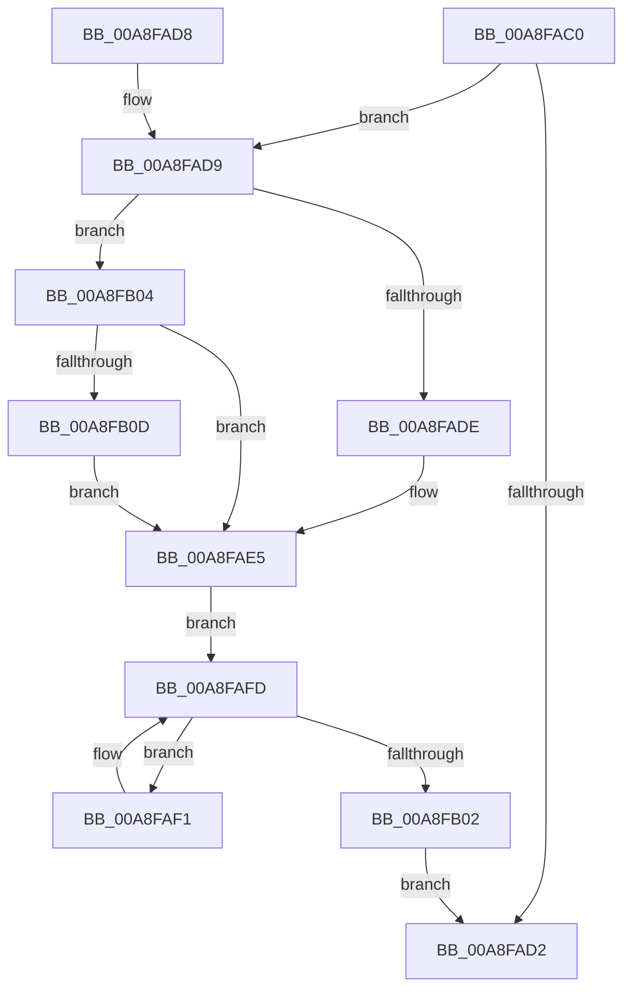

# EtwpCovSampCaptureContextSetPaused

- RVA: `0x00A8FAC0`–`0x00A8FB2A` (길이 `106` bytes)
- VA: `0x0000000140A8FAC0`
- 실행 섹션: `PAGE`
- PDB 이름 있음: `예`; PDB Function 태그: `아니요`
- unwind 정보 RVA: `0x00092CC0`
- 디코드: `29`개 명령, `106/106` bytes 표시
- 미해석 바이트: `0` (있으면 어셈블리에 `.byte`로 보존)

> 이 문서는 커널 이미지의 기계어와 PDB 기호를 분석해 생성했습니다. 4번과 5번은 함수 원형과 자료형을 바이너리 사용 방식에서 추정한 C 해석이며 원본 소스 복구 결과는 아닙니다.

## 1. Dependencies

- 직접 호출 지점: **1**; 고유 호출 대상: **1**
- 직접 호출자로 확인된 함수: **1**
- RIP 상대 이미지 참조: **0**

### Outgoing calls
- `0x00A8FB23` → [KeSetEvent](../../text/33/KeSetEvent_function_0033F310.md) (function, `0x0033F310`)

### Direct callers
- [EtwpCovSampContextAddSamples](../8D/EtwpCovSampContextAddSamples_function_008D7C9C.md) at `0x008D7F02`

### Static image references
- 디코드된 RIP-relative 메모리 참조가 없습니다.

## 2. Other-region calls and transfers

- 다른 실행 섹션으로 향하는 call: **1**
  - `0x00A8FB23` → [KeSetEvent](../../text/33/KeSetEvent_function_0033F310.md) (`PAGE` → `.text`)
- 별도 외부 분기/꼬리 이동을 확인하지 못했습니다.

## 3. Assembly (complete function range)

```asm
00A8FAC0  40 53                           push rbx
00A8FAC2  48 83 EC 20                     sub rsp, 0x20
00A8FAC6  48 8B DA                        mov rbx, rdx
00A8FAC9  44 39 82 04 05 00 00            cmp dword ptr [rdx + 0x504], r8d
00A8FAD0  75 07                           jne 0x140a8fad9
00A8FAD2  48 83 C4 20                     add rsp, 0x20
00A8FAD6  5B                              pop rbx
00A8FAD7  C3                              ret
00A8FAD8  CC                              int3
00A8FAD9  45 85 C0                        test r8d, r8d
00A8FADC  75 26                           jne 0x140a8fb04
00A8FADE  44 21 82 04 05 00 00            and dword ptr [rdx + 0x504], r8d
00A8FAE5  48 8D 93 B0 03 00 00            lea rdx, [rbx + 0x3b0]
00A8FAEC  48 8B 0A                        mov rcx, qword ptr [rdx]
00A8FAEF  EB 0C                           jmp 0x140a8fafd
00A8FAF1  8B 83 04 05 00 00               mov eax, dword ptr [rbx + 0x504]
00A8FAF7  89 41 1C                        mov dword ptr [rcx + 0x1c], eax
00A8FAFA  48 8B 09                        mov rcx, qword ptr [rcx]
00A8FAFD  48 3B CA                        cmp rcx, rdx
00A8FB00  75 EF                           jne 0x140a8faf1
00A8FB02  EB CE                           jmp 0x140a8fad2
00A8FB04  F7 41 18 00 01 00 00            test dword ptr [rcx + 0x18], 0x100
00A8FB0B  75 D8                           jne 0x140a8fae5
00A8FB0D  C7 82 04 05 00 00 01 00 00 00   mov dword ptr [rdx + 0x504], 1
00A8FB17  45 33 C0                        xor r8d, r8d
00A8FB1A  48 8B 89 88 06 00 00            mov rcx, qword ptr [rcx + 0x688]
00A8FB21  33 D2                           xor edx, edx
00A8FB23  E8 E8 F7 8A FF                  call 0x14033f310
00A8FB28  EB BB                           jmp 0x140a8fae5
```

## 4. C-style interpretation (structured pseudocode)

```c
__int64 __fastcall EtwpCovSampCaptureContextSetPaused(__int64 a1, __int64 a2, int a3)
{
    __int64 result;
    __int64 v_rsp;

    v_rsp = (v_rsp) - (32);
    if ((*(unsigned int *)(a2 + 1284)) != a3) goto loc_00A8FAD9;
loc_00A8FAD2:
    v_rsp = (v_rsp) + (32);
    return result;
loc_00A8FAD9:
    if (a3 != 0) goto loc_00A8FB04;
loc_00A8FAE5:
    goto loc_00A8FAFD;
loc_00A8FAF1:
    *(unsigned int *)(*(unsigned __int64 *)(a2 + 944) + 28) = (unsigned int)((unsigned int)(*(unsigned int *)(a2 + 1284)));
loc_00A8FAFD:
    if ((*(unsigned __int64 *)(*(unsigned __int64 *)(a2 + 944))) != (a2 + 944)) goto loc_00A8FAF1;
    goto loc_00A8FAD2;
loc_00A8FB04:
    if (((*(unsigned int *)(*(unsigned __int64 *)(*(unsigned __int64 *)(a2 + 944)) + 24)) & (256)) != 0) goto loc_00A8FAE5;
    *(unsigned int *)(a2 + 944 + 1284) = 1;
    a3 = 0;
    a2 = 0;
    result = KeSetEvent(*(unsigned __int64 *)(*(unsigned __int64 *)(*(unsigned __int64 *)(a2 + 944)) + 1672), a2, a3, a4);
    goto loc_00A8FAE5;
}
```

## 5. (Beta) C Style

```c
int64_t EtwpCovSampCaptureContextSetPaused(void *Arg1, void *Arg2, int32_t Arg3)
{
    uint8_t *arg1 = (uint8_t *)Arg1;
    uint8_t *arg2 = (uint8_t *)Arg2;

    int64_t result;
    int64_t local_rsp;

    local_rsp = (local_rsp) - (32);
    if ((*(uint32_t *)(arg2 + 0x504)) != Arg3) goto loc_00A8FAD9;
loc_00A8FAD2:
    local_rsp = (local_rsp) + (32);
    return result;
loc_00A8FAD9:
    if (Arg3 != 0) goto loc_00A8FB04;
loc_00A8FAE5:
    goto loc_00A8FAFD;
loc_00A8FAF1:
    *(uint32_t *)(*(uint64_t *)(arg2 + 0x3B0) + 0x1C) = (uint32_t)((uint32_t)(*(uint32_t *)(arg2 + 0x504)));
loc_00A8FAFD:
    if ((*(uint64_t *)(*(uint64_t *)(arg2 + 0x3B0))) != (Arg2 + 944)) goto loc_00A8FAF1;
    goto loc_00A8FAD2;
loc_00A8FB04:
    if (((*(uint32_t *)(*(uint64_t *)(*(uint64_t *)(arg2 + 0x3B0)) + 0x18)) & (256)) != 0) goto loc_00A8FAE5;
    *(uint32_t *)(arg2 + 0x3B0 + 0x504) = 1;
    Arg3 = 0;
    Arg2 = 0;
    result = KeSetEvent(*(uint64_t *)(*(uint64_t *)(*(uint64_t *)(arg2 + 0x3B0)) + 0x688), Arg2, Arg3, a4);
    goto loc_00A8FAE5;
}
```

### 관측된 메모리 오프셋

구조체 형식이 확인되지 않은 접근은 인자 기준의 오프셋으로만 기록했습니다.

| 기준 인자 | 오프셋 표현 | 폭 (bit) | 접근 |
|---|---:|---:|---|
| `Arg1` | `+ 0x18` | `32` | `R` |
| `Arg1` | `+ 0x688` | `64` | `R` |
| `Arg2` | `+ 0x0` | `64` | `R` |
| `Arg2` | `+ 0x3B0` | `64` | `R` |
| `Arg2` | `+ 0x504` | `32` | `R` |
| `Arg2` | `+ 0x504` | `32` | `R/W` |
| `Arg2` | `+ 0x504` | `32` | `W` |

## 6. Execution-region graph

[열기: 2D/3D 그래프와 함수 탐색 컨트롤 패널](../../../control-panel.html?section=page&rva=0x00A8FAC0&view=graph)

- 2D 그래프는 위에서 아래로 흐르고, 3D 그래프는 빈 공간을 드래그해 회전합니다. Shift+드래그는 이동, 휠은 확대·축소, 함수 노드 선택은 대상 보고서 이동입니다.

### Static fallback


