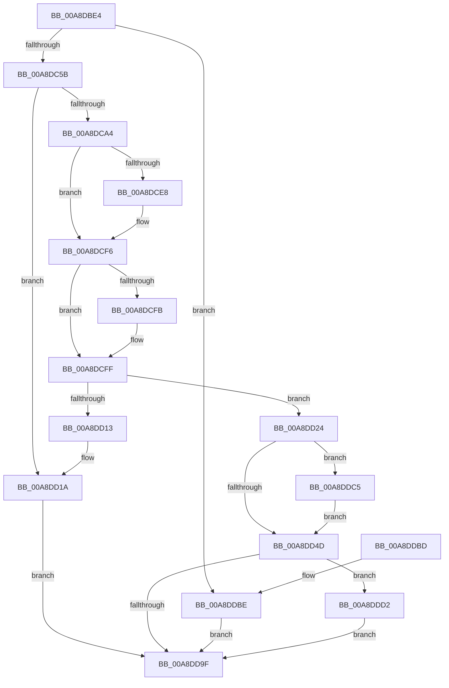

# EtwpCreateUmReplyObject

- RVA: `0x00A8DBE4`–`0x00A8DDD7` (길이 `499` bytes)
- VA: `0x0000000140A8DBE4`
- 실행 섹션: `PAGE`
- PDB 이름 있음: `예`; PDB Function 태그: `아니요`
- unwind 정보 RVA: `0x000B8968`
- 디코드: `132`개 명령, `499/499` bytes 표시
- 미해석 바이트: `0` (있으면 어셈블리에 `.byte`로 보존)

> 이 문서는 커널 이미지의 기계어와 PDB 기호를 분석해 생성했습니다. 4번과 5번은 함수 원형과 자료형을 바이너리 사용 방식에서 추정한 C 해석이며 원본 소스 복구 결과는 아닙니다.

## 1. Dependencies

- 직접 호출 지점: **11**; 고유 호출 대상: **11**
- 직접 호출자로 확인된 함수: **2**
- RIP 상대 이미지 참조: **5**

### Outgoing calls
- `0x00A8DC4A` → [ExAllocatePool2](../../poolcode/B8/ExAllocatePool2_function_00B820F0.md) (function, `0x00B820F0`)
- `0x00A8DC60` → [KeInitializeQueue](../../text/48/KeInitializeQueue_function_00480C90.md) (function, `0x00480C90`)
- `0x00A8DC97` → [ObCreateObjectEx](../89/ObCreateObjectEx_function_0089B1E0.md) (function, `0x0089B1E0`)
- `0x00A8DCAE` → [memset](../../text/6C/memset_function_006C6C40.md) (function, `0x006C6C40`)
- `0x00A8DCC0` → [EtwpReferenceGuidEntry](../8C/EtwpReferenceGuidEntry_function_008C1ED0.md) (function, `0x008C1ED0`)
- `0x00A8DCD8` → [KeAbPreAcquire](../../text/21/KeAbPreAcquire_function_00210230.md) (function, `0x00210230`)
- `0x00A8DCF1` → [ExfAcquirePushLockExclusiveEx](../../text/20/ExfAcquirePushLockExclusiveEx_function_0020FC90.md) (function, `0x0020FC90`)
- `0x00A8DD1D` → [ExFreePoolWithTag](../../poolcode/B8/ExFreePoolWithTag_function_00B82870.md) (function, `0x00B82870`)
- `0x00A8DD50` → [KeAbPostRelease](../../text/2E/KeAbPostRelease_function_002E1600.md) (function, `0x002E1600`)
- `0x00A8DD94` → [ObInsertObjectEx](../8B/ObInsertObjectEx_function_008B97A0.md) (function, `0x008B97A0`)
- `0x00A8DDC8` → [ExfTryToWakePushLock](../../text/26/ExfTryToWakePushLock_function_00265DD0.md) (function, `0x00265DD0`)

### Direct callers
- [EtwpNotifyGuid](../8C/EtwpNotifyGuid_function_008C8110.md) at `0x008C84F4`
- [EtwpEnableGuid](../A5/EtwpEnableGuid_function_00A5CD28.md) at `0x00A5D28E`

### Static image references
- `0x00A8DC6F` → RVA `0x00FC6D30` (`ALMOSTRO`; read)
- `0x00A8DCC5` → RVA `0x00EFF200` (`.data`; read)
- `0x00A8DCFF` → RVA `0x00EFF1F0` (`.data`; read)
- `0x00A8DD33` → RVA `0x00EFF1F0` (`.data`; write)
- `0x00A8DD3E` → RVA `0x00EFF200` (`.data`; read/write)

## 2. Other-region calls and transfers

- 다른 실행 섹션으로 향하는 call: **8**
  - `0x00A8DC4A` → [ExAllocatePool2](../../poolcode/B8/ExAllocatePool2_function_00B820F0.md) (`PAGE` → `POOLCODE`)
  - `0x00A8DC60` → [KeInitializeQueue](../../text/48/KeInitializeQueue_function_00480C90.md) (`PAGE` → `.text`)
  - `0x00A8DCAE` → [memset](../../text/6C/memset_function_006C6C40.md) (`PAGE` → `.text`)
  - `0x00A8DCD8` → [KeAbPreAcquire](../../text/21/KeAbPreAcquire_function_00210230.md) (`PAGE` → `.text`)
  - `0x00A8DCF1` → [ExfAcquirePushLockExclusiveEx](../../text/20/ExfAcquirePushLockExclusiveEx_function_0020FC90.md) (`PAGE` → `.text`)
  - `0x00A8DD1D` → [ExFreePoolWithTag](../../poolcode/B8/ExFreePoolWithTag_function_00B82870.md) (`PAGE` → `POOLCODE`)
  - `0x00A8DD50` → [KeAbPostRelease](../../text/2E/KeAbPostRelease_function_002E1600.md) (`PAGE` → `.text`)
  - `0x00A8DDC8` → [ExfTryToWakePushLock](../../text/26/ExfTryToWakePushLock_function_00265DD0.md) (`PAGE` → `.text`)
- 별도 외부 분기/꼬리 이동을 확인하지 못했습니다.

## 3. Assembly (complete function range)

```asm
00A8DBE4  48 89 5C 24 08                  mov qword ptr [rsp + 8], rbx
00A8DBE9  48 89 74 24 10                  mov qword ptr [rsp + 0x10], rsi
00A8DBEE  55                              push rbp
00A8DBEF  57                              push rdi
00A8DBF0  41 54                           push r12
00A8DBF2  41 56                           push r14
00A8DBF4  41 57                           push r15
00A8DBF6  48 8D 6C 24 C9                  lea rbp, [rsp - 0x37]
00A8DBFB  48 81 EC 90 00 00 00            sub rsp, 0x90
00A8DC02  83 65 1B 00                     and dword ptr [rbp + 0x1b], 0
00A8DC06  B8 40 00 00 00                  mov eax, 0x40
00A8DC0B  48 83 65 F7 00                  and qword ptr [rbp - 9], 0
00A8DC10  4D 8B F0                        mov r14, r8
00A8DC13  48 83 65 7F 00                  and qword ptr [rbp + 0x7f], 0
00A8DC18  4C 8B E2                        mov r12, rdx
00A8DC1B  48 83 65 07 00                  and qword ptr [rbp + 7], 0
00A8DC20  4C 8B F9                        mov r15, rcx
00A8DC23  48 83 65 0F 00                  and qword ptr [rbp + 0xf], 0
00A8DC28  8D 50 08                        lea edx, [rax + 8]
00A8DC2B  0F 57 C0                        xorps xmm0, xmm0
00A8DC2E  48 C7 45 FF 30 00 00 00         mov qword ptr [rbp - 1], 0x30
00A8DC36  83 65 03 00                     and dword ptr [rbp + 3], 0
00A8DC3A  41 B8 45 74 77 71               mov r8d, 0x71777445
00A8DC40  8B C8                           mov ecx, eax
00A8DC42  89 45 17                        mov dword ptr [rbp + 0x17], eax
00A8DC45  F3 0F 7F 45 1F                  movdqu xmmword ptr [rbp + 0x1f], xmm0
00A8DC4A  E8 A1 44 0F 00                  call 0x140b820f0
00A8DC4F  48 8B F8                        mov rdi, rax
00A8DC52  48 85 C0                        test rax, rax
00A8DC55  0F 84 63 01 00 00               je 0x140a8ddbe
00A8DC5B  33 D2                           xor edx, edx
00A8DC5D  48 8B C8                        mov rcx, rax
00A8DC60  E8 2B 30 9F FF                  call 0x140480c90
00A8DC65  48 83 64 24 48 00               and qword ptr [rsp + 0x48], 0
00A8DC6B  48 8D 45 7F                     lea rax, [rbp + 0x7f]
00A8DC6F  48 8B 15 BA 90 53 00            mov rdx, qword ptr [rip + 0x5390ba]
00A8DC76  4C 8D 45 FF                     lea r8, [rbp - 1]
00A8DC7A  48 89 44 24 40                  mov qword ptr [rsp + 0x40], rax
00A8DC7F  BE 78 00 00 00                  mov esi, 0x78
00A8DC84  83 64 24 38 00                  and dword ptr [rsp + 0x38], 0
00A8DC89  41 B1 01                        mov r9b, 1
00A8DC8C  83 64 24 30 00                  and dword ptr [rsp + 0x30], 0
00A8DC91  33 C9                           xor ecx, ecx
00A8DC93  89 74 24 28                     mov dword ptr [rsp + 0x28], esi
00A8DC97  E8 44 D5 E0 FF                  call 0x14089b1e0
00A8DC9C  33 D2                           xor edx, edx
00A8DC9E  8B D8                           mov ebx, eax
00A8DCA0  85 C0                           test eax, eax
00A8DCA2  78 76                           js 0x140a8dd1a
00A8DCA4  44 8B C6                        mov r8d, esi
00A8DCA7  48 8B 75 7F                     mov rsi, qword ptr [rbp + 0x7f]
00A8DCAB  48 8B CE                        mov rcx, rsi
00A8DCAE  E8 8D 8F C3 FF                  call 0x1406c6c40
00A8DCB3  66 C7 46 62 04 00               mov word ptr [rsi + 0x62], 4
00A8DCB9  49 8B CF                        mov rcx, r15
00A8DCBC  48 89 7E 30                     mov qword ptr [rsi + 0x30], rdi
00A8DCC0  E8 0B 42 E3 FF                  call 0x1408c1ed0
00A8DCC5  48 8D 3D 34 15 47 00            lea rdi, [rip + 0x471534]
00A8DCCC  4C 89 7E 20                     mov qword ptr [rsi + 0x20], r15
00A8DCD0  48 8B CF                        mov rcx, rdi
00A8DCD3  45 33 C0                        xor r8d, r8d
00A8DCD6  33 D2                           xor edx, edx
00A8DCD8  E8 53 25 78 FF                  call 0x140210230
00A8DCDD  F0 48 0F BA 2F 00               lock bts qword ptr [rdi], 0
00A8DCE3  48 8B D8                        mov rbx, rax
00A8DCE6  73 0E                           jae 0x140a8dcf6
00A8DCE8  4C 8B C7                        mov r8, rdi
00A8DCEB  48 8B D0                        mov rdx, rax
00A8DCEE  48 8B CF                        mov rcx, rdi
00A8DCF1  E8 9A 1F 78 FF                  call 0x14020fc90
00A8DCF6  48 85 DB                        test rbx, rbx
00A8DCF9  74 04                           je 0x140a8dcff
00A8DCFB  C6 43 0A 01                     mov byte ptr [rbx + 0xa], 1
00A8DCFF  48 8B 0D EA 14 47 00            mov rcx, qword ptr [rip + 0x4714ea]
00A8DD06  48 8D 15 E3 14 47 00            lea rdx, [rip + 0x4714e3]
00A8DD0D  48 39 51 08                     cmp qword ptr [rcx + 8], rdx
00A8DD11  74 11                           je 0x140a8dd24
00A8DD13  B9 03 00 00 00                  mov ecx, 3
00A8DD18  CD 29                           int 0x29
00A8DD1A  48 8B CF                        mov rcx, rdi
00A8DD1D  E8 4E 4B 0F 00                  call 0x140b82870
00A8DD22  EB 7B                           jmp 0x140a8dd9f
00A8DD24  48 8B 45 7F                     mov rax, qword ptr [rbp + 0x7f]
00A8DD28  48 89 08                        mov qword ptr [rax], rcx
00A8DD2B  48 89 50 08                     mov qword ptr [rax + 8], rdx
00A8DD2F  48 89 41 08                     mov qword ptr [rcx + 8], rax
00A8DD33  48 89 05 B6 14 47 00            mov qword ptr [rip + 0x4714b6], rax
00A8DD3A  48 83 C8 FF                     or rax, 0xffffffffffffffff
00A8DD3E  F0 48 0F C1 05 B9 14 47 00      lock xadd qword ptr [rip + 0x4714b9], rax
00A8DD47  24 06                           and al, 6
00A8DD49  3C 02                           cmp al, 2
00A8DD4B  74 78                           je 0x140a8ddc5
00A8DD4D  48 8B CF                        mov rcx, rdi
00A8DD50  E8 AB 38 85 FF                  call 0x1402e1600
00A8DD55  48 8B 45 7F                     mov rax, qword ptr [rbp + 0x7f]
00A8DD59  48 83 C0 10                     add rax, 0x10
00A8DD5D  48 89 40 08                     mov qword ptr [rax + 8], rax
00A8DD61  48 89 00                        mov qword ptr [rax], rax
00A8DD64  B8 40 00 00 00                  mov eax, 0x40
00A8DD69  66 F0 09 46 62                  lock or word ptr [rsi + 0x62], ax
00A8DD6E  48 8B 7D 7F                     mov rdi, qword ptr [rbp + 0x7f]
00A8DD72  48 8D 45 F7                     lea rax, [rbp - 9]
00A8DD76  33 D2                           xor edx, edx
00A8DD78  4C 89 64 24 30                  mov qword ptr [rsp + 0x30], r12
00A8DD7D  48 89 44 24 28                  mov qword ptr [rsp + 0x28], rax
00A8DD82  41 B8 04 08 00 00               mov r8d, 0x804
00A8DD88  83 64 24 20 00                  and dword ptr [rsp + 0x20], 0
00A8DD8D  48 8B CF                        mov rcx, rdi
00A8DD90  44 8D 4A 01                     lea r9d, [rdx + 1]
00A8DD94  E8 07 BA E2 FF                  call 0x1408b97a0
00A8DD99  8B D8                           mov ebx, eax
00A8DD9B  85 C0                           test eax, eax
00A8DD9D  79 33                           jns 0x140a8ddd2
00A8DD9F  4C 8D 9C 24 90 00 00 00         lea r11, [rsp + 0x90]
00A8DDA7  8B C3                           mov eax, ebx
00A8DDA9  49 8B 5B 30                     mov rbx, qword ptr [r11 + 0x30]
00A8DDAD  49 8B 73 38                     mov rsi, qword ptr [r11 + 0x38]
00A8DDB1  49 8B E3                        mov rsp, r11
00A8DDB4  41 5F                           pop r15
00A8DDB6  41 5E                           pop r14
00A8DDB8  41 5C                           pop r12
00A8DDBA  5F                              pop rdi
00A8DDBB  5D                              pop rbp
00A8DDBC  C3                              ret
00A8DDBD  CC                              int3
00A8DDBE  BB 17 00 00 C0                  mov ebx, 0xc0000017
00A8DDC3  EB DA                           jmp 0x140a8dd9f
00A8DDC5  48 8B CF                        mov rcx, rdi
00A8DDC8  E8 03 80 7D FF                  call 0x140265dd0
00A8DDCD  E9 7B FF FF FF                  jmp 0x140a8dd4d
00A8DDD2  49 89 3E                        mov qword ptr [r14], rdi
00A8DDD5  EB C8                           jmp 0x140a8dd9f
```

## 4. C-style interpretation (structured pseudocode)

```c
__int64 __fastcall EtwpCreateUmReplyObject(__int64 a1, __int64 a2, __int64 a3)
{
    __int64 result;
    __int64 v_rsp;
    unsigned __int64 v_stack_m28;
    unsigned __int64 v_stack_m40;
    unsigned int v_stack_m44;
    unsigned int v_stack_m48;
    unsigned __int64 v_stack_m50;
    unsigned __int64 v_stack_m58;
    unsigned int v_stack_m5C;
    unsigned __int64 v_stack_m5F;
    unsigned __int64 v_stack_m60;
    unsigned __int64 v_stack_m68;
    unsigned __int64 v_stack_m70;
    unsigned __int64 v_stack_m78;
    unsigned int v_stack_m80;
    unsigned int v_stack_m88;
    unsigned int v_stack_m90;
    unsigned int v_stack_m98;
    unsigned __int64 v_stack_p10;
    unsigned __int64 v_stack_p20;
    unsigned __int64 v_stack_p8;

    v_stack_p8 = v_rbx;
    v_stack_p10 = v_rsi;
    v_rsp = (v_rsp) - (144);
    v_stack_m60 = 48;
    v_stack_m48 = 64;
    v_stack_m40 = v_xmm0;
    result = ExAllocatePool2(64, 64 + 8, (unsigned int)(0x71777445ULL), a4);
    if (result == 0) goto loc_00A8DDBE;
    a2 = 0;
    result = KeInitializeQueue(result, a2, (unsigned int)(0x71777445ULL), a4);
    v_stack_m78 = v_stack_p20;
    a1 = 0;
    v_stack_m90 = 120;
    result = ObCreateObjectEx(a1, *(unsigned __int64 *)(v_rip + 5476538), v_stack_m60, 1);
    a2 = 0;
    if (sign_flag) goto loc_00A8DD1A;
    result = memset(v_stack_p20, a2, 120, 1);
    *(unsigned __int16 *)(v_stack_p20 + 98) = 4;
    *(unsigned __int64 *)(v_stack_p20 + 48) = result;
    result = EtwpReferenceGuidEntry(0, a2, 120, 1);
    *(unsigned __int64 *)(v_stack_p20 + 32) = 0;
    a3 = 0;
    a2 = 0;
    result = KeAbPreAcquire(v_rip + 4658484, a2, a3, 1);
    if (!(condition_is_above_or_equal)) {
        a3 = v_rip + 4658484;
        a2 = result;
        a1 = v_rip + 4658484;
        result = ExfAcquirePushLockExclusiveEx(a1, a2, a3, 1);
    }
    if (result != 0) {
        *(unsigned __int8 *)(result + 10) = 1;
    }
    if ((*(unsigned __int64 *)(*(unsigned __int64 *)(v_rip + 4658410) + 8)) == (v_rip + 4658403)) goto loc_00A8DD24;
loc_00A8DD1A:
    result = ExFreePoolWithTag(v_rip + 4658484, v_rip + 4658403, a3, 1);
    goto loc_00A8DD9F;
loc_00A8DD24:
    *(unsigned __int64 *)(v_stack_p20) = v_rip + 4658484;
    *(unsigned __int64 *)(v_stack_p20 + 8) = v_rip + 4658403;
    *(unsigned __int64 *)(v_rip + 4658484 + 8) = v_stack_p20;
    *(unsigned __int64 *)(v_rip + 4658358) = v_stack_p20;
    result = (v_stack_p20) | (-1);
    result = (unsigned __int8)((result) & (6));
    if (((unsigned __int8)(result)) == 2) goto loc_00A8DDC5;
loc_00A8DD4D:
    result = KeAbPostRelease(v_rip + 4658484, v_rip + 4658403, a3, 1);
    result = (v_stack_p20) + (16);
    *(unsigned __int64 *)(result + 8) = result;
    *(unsigned __int64 *)(result) = result;
    a2 = 0;
    v_stack_m88 = 0;
    v_stack_m90 = v_stack_m68;
    result = ObInsertObjectEx(v_stack_p20, a2, (unsigned int)(0x804ULL), a2 + 1);
    if (!sign_flag) goto loc_00A8DDD2;
loc_00A8DD9F:
    return (unsigned int)((unsigned int)((unsigned int)((unsigned int)(result))));
loc_00A8DDBE:
    goto loc_00A8DD9F;
loc_00A8DDC5:
    result = ExfTryToWakePushLock(v_stack_p20, a2, (unsigned int)(0x804ULL), a2 + 1);
    goto loc_00A8DD4D;
loc_00A8DDD2:
    *(unsigned __int64 *)(a3) = v_stack_p20;
    goto loc_00A8DD9F;
}
```

## 5. (Beta) C Style

```c
int64_t EtwpCreateUmReplyObject(int64_t Arg1, int64_t Arg2, void *Arg3)
{
    uint8_t *arg3 = (uint8_t *)Arg3;

    int64_t result;
    int64_t local_rsp;
    uint64_t v_stack_m28;
    uint64_t v_stack_m40;
    uint32_t v_stack_m44;
    uint32_t v_stack_m48;
    uint64_t v_stack_m50;
    uint64_t v_stack_m58;
    uint32_t v_stack_m5C;
    uint64_t v_stack_m5F;
    uint64_t v_stack_m60;
    uint64_t v_stack_m68;
    uint64_t v_stack_m70;
    uint64_t v_stack_m78;
    uint32_t v_stack_m80;
    uint32_t v_stack_m88;
    uint32_t v_stack_m90;
    uint32_t v_stack_m98;
    uint64_t v_stack_p10;
    uint64_t v_stack_p20;
    uint64_t v_stack_p8;

    v_stack_p8 = local_rbx;
    v_stack_p10 = local_rsi;
    local_rsp = (local_rsp) - (144);
    v_stack_m60 = 48;
    v_stack_m48 = 64;
    v_stack_m40 = v_xmm0;
    result = ExAllocatePool2(64, 64 + 8, (uint32_t)(0x71777445ULL), a4);
    if (result == 0) goto loc_00A8DDBE;
    Arg2 = 0;
    result = KeInitializeQueue(result, Arg2, (uint32_t)(0x71777445ULL), a4);
    v_stack_m78 = v_stack_p20;
    Arg1 = 0;
    v_stack_m90 = 120;
    result = ObCreateObjectEx(Arg1, *(uint64_t *)(v_rip + 0x5390BA), v_stack_m60, 1);
    Arg2 = 0;
    if (sign_flag) goto loc_00A8DD1A;
    result = memset(v_stack_p20, Arg2, 120, 1);
    *(uint16_t *)(v_stack_p20 + 0x62) = 4;
    *(uint64_t *)(v_stack_p20 + 0x30) = result;
    result = EtwpReferenceGuidEntry(0, Arg2, 120, 1);
    *(uint64_t *)(v_stack_p20 + 0x20) = 0;
    Arg3 = 0;
    Arg2 = 0;
    result = KeAbPreAcquire(v_rip + 4658484, Arg2, Arg3, 1);
    if (!(condition_is_above_or_equal)) {
        Arg3 = v_rip + 4658484;
        Arg2 = result;
        Arg1 = v_rip + 4658484;
        result = ExfAcquirePushLockExclusiveEx(Arg1, Arg2, Arg3, 1);
    }
    if (result != 0) {
        *(uint8_t *)(result + 0xA) = 1;
    }
    if ((*(uint64_t *)(*(uint64_t *)(v_rip + 0x4714EA) + 0x8)) == (v_rip + 4658403)) goto loc_00A8DD24;
loc_00A8DD1A:
    result = ExFreePoolWithTag(v_rip + 4658484, v_rip + 4658403, Arg3, 1);
    goto loc_00A8DD9F;
loc_00A8DD24:
    *(uint64_t *)(v_stack_p20) = v_rip + 4658484;
    *(uint64_t *)(v_stack_p20 + 0x8) = v_rip + 4658403;
    *(uint64_t *)(v_rip + 0x471534 + 0x8) = v_stack_p20;
    *(uint64_t *)(v_rip + 0x4714B6) = v_stack_p20;
    result = (v_stack_p20) | (-1);
    result = (uint8_t)((result) & (6));
    if (((uint8_t)(result)) == 2) goto loc_00A8DDC5;
loc_00A8DD4D:
    result = KeAbPostRelease(v_rip + 4658484, v_rip + 4658403, Arg3, 1);
    result = (v_stack_p20) + (16);
    *(uint64_t *)(result + 0x8) = result;
    *(uint64_t *)(result) = result;
    Arg2 = 0;
    v_stack_m88 = 0;
    v_stack_m90 = v_stack_m68;
    result = ObInsertObjectEx(v_stack_p20, Arg2, (uint32_t)(0x804ULL), Arg2 + 1);
    if (!sign_flag) goto loc_00A8DDD2;
loc_00A8DD9F:
    return (uint32_t)((uint32_t)((uint32_t)((uint32_t)(result))));
loc_00A8DDBE:
    goto loc_00A8DD9F;
loc_00A8DDC5:
    result = ExfTryToWakePushLock(v_stack_p20, Arg2, (uint32_t)(0x804ULL), Arg2 + 1);
    goto loc_00A8DD4D;
loc_00A8DDD2:
    *(uint64_t *)(arg3) = v_stack_p20;
    goto loc_00A8DD9F;
}
```

### 관측된 메모리 오프셋

구조체 형식이 확인되지 않은 접근은 인자 기준의 오프셋으로만 기록했습니다.

| 기준 인자 | 오프셋 표현 | 폭 (bit) | 접근 |
|---|---:|---:|---|
| `Arg3` | `+ 0x0` | `64` | `W` |

## 6. Execution-region graph

[열기: 2D/3D 그래프와 함수 탐색 컨트롤 패널](../../../control-panel.html?section=page&rva=0x00A8DBE4&view=graph)

- 2D 그래프는 위에서 아래로 흐르고, 3D 그래프는 빈 공간을 드래그해 회전합니다. Shift+드래그는 이동, 휠은 확대·축소, 함수 노드 선택은 대상 보고서 이동입니다.

### Static fallback


