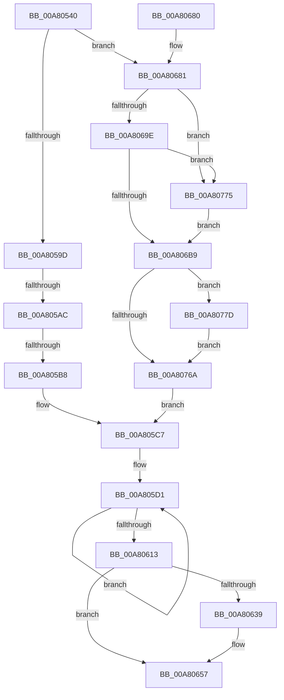

# EtwpCrimsonProvEnableCallback

- RVA: `0x00A80540`–`0x00A8078E` (길이 `590` bytes)
- VA: `0x0000000140A80540`
- 실행 섹션: `PAGE`
- PDB 이름 있음: `예`; PDB Function 태그: `예`
- unwind 정보 RVA: `0x000B7064`
- 디코드: `147`개 명령, `590/590` bytes 표시
- 미해석 바이트: `0` (있으면 어셈블리에 `.byte`로 보존)

> 이 문서는 커널 이미지의 기계어와 PDB 기호를 분석해 생성했습니다. 4번과 5번은 함수 원형과 자료형을 바이너리 사용 방식에서 추정한 C 해석이며 원본 소스 복구 결과는 아닙니다.

## 1. Dependencies

- 직접 호출 지점: **13**; 고유 호출 대상: **8**
- 직접 호출자로 확인된 함수: **0**
- RIP 상대 이미지 참조: **11**

### Outgoing calls
- `0x00A80589` → [KeWaitForSingleObject](../../text/20/KeWaitForSingleObject_function_0020E6B0.md) (function, `0x0020E6B0`)
- `0x00A8061C` → [KeReleaseMutex](../../text/39/KeReleaseMutex_function_00396810.md) (function, `0x00396810`)
- `0x00A8062F` → [ExAllocatePool2](../../poolcode/B8/ExAllocatePool2_function_00B820F0.md) (function, `0x00B820F0`)
- `0x00A80652` → [ExQueueWorkItem](../../text/2F/ExQueueWorkItem_function_002F9520.md) (function, `0x002F9520`)
- `0x00A8065E` → [_security_check_cookie](../../text/6A/_security_check_cookie_function_006AC640.md) (function, `0x006AC640`)
- `0x00A80691` → [EtwEventEnabled](../../text/39/EtwEventEnabled_function_00392450.md) (function, `0x00392450`)
- `0x00A806AC` → [EtwEventEnabled](../../text/39/EtwEventEnabled_function_00392450.md) (function, `0x00392450`)
- `0x00A806C7` → [EtwEventEnabled](../../text/39/EtwEventEnabled_function_00392450.md) (function, `0x00392450`)
- `0x00A806E4` → [EtwEventEnabled](../../text/39/EtwEventEnabled_function_00392450.md) (function, `0x00392450`)
- `0x00A80708` → [EtwEventEnabled](../../text/39/EtwEventEnabled_function_00392450.md) (function, `0x00392450`)
- `0x00A80732` → [EtwProviderEnabled](../../text/3B/EtwProviderEnabled_function_003BA250.md) (function, `0x003BA250`)
- `0x00A80757` → [EtwProviderEnabled](../../text/3B/EtwProviderEnabled_function_003BA250.md) (function, `0x003BA250`)
- `0x00A80787` → [EtwpPsProvCaptureState](../7C/EtwpPsProvCaptureState_function_007C0AD4.md) (function, `0x007C0AD4`)

### Direct callers
- 이 함수 시작 RVA로 연결되는 직접 call은 확인되지 않았습니다. 간접 호출은 완전히 역산할 수 없습니다.

### Static image references
- `0x00A8055E` → RVA `0x00E0A740` (`.data`; read)
- `0x00A80570` → RVA `0x00EFF7E0` (`.data`; read)
- `0x00A805D5` → RVA `0x00FC6AA8` (`ALMOSTRO`; read)
- `0x00A8063D` → RVA `0x00A4F530` (`EtwpUpdateKernelGroupsWork`; read)
- `0x00A80681` → RVA `0x00EFF9E8` (`.data`; read)
- `0x00A80688` → RVA `0x00011170` (`.rdata`; read)
- `0x00A806A5` → RVA `0x0001BC68` (`.rdata`; read)
- `0x00A806C0` → RVA `0x000121E8` (`.rdata`; read)
- `0x00A806D3` → RVA `0x00011410` (`.rdata`; read)
- `0x00A806F0` → RVA `0x0001BC38` (`.rdata`; read)
- `0x00A80780` → RVA `0x00021E48` (`.rdata`; read)

## 2. Other-region calls and transfers

- 다른 실행 섹션으로 향하는 call: **12**
  - `0x00A80589` → [KeWaitForSingleObject](../../text/20/KeWaitForSingleObject_function_0020E6B0.md) (`PAGE` → `.text`)
  - `0x00A8061C` → [KeReleaseMutex](../../text/39/KeReleaseMutex_function_00396810.md) (`PAGE` → `.text`)
  - `0x00A8062F` → [ExAllocatePool2](../../poolcode/B8/ExAllocatePool2_function_00B820F0.md) (`PAGE` → `POOLCODE`)
  - `0x00A80652` → [ExQueueWorkItem](../../text/2F/ExQueueWorkItem_function_002F9520.md) (`PAGE` → `.text`)
  - `0x00A8065E` → [_security_check_cookie](../../text/6A/_security_check_cookie_function_006AC640.md) (`PAGE` → `.text`)
  - `0x00A80691` → [EtwEventEnabled](../../text/39/EtwEventEnabled_function_00392450.md) (`PAGE` → `.text`)
  - `0x00A806AC` → [EtwEventEnabled](../../text/39/EtwEventEnabled_function_00392450.md) (`PAGE` → `.text`)
  - `0x00A806C7` → [EtwEventEnabled](../../text/39/EtwEventEnabled_function_00392450.md) (`PAGE` → `.text`)
  - `0x00A806E4` → [EtwEventEnabled](../../text/39/EtwEventEnabled_function_00392450.md) (`PAGE` → `.text`)
  - `0x00A80708` → [EtwEventEnabled](../../text/39/EtwEventEnabled_function_00392450.md) (`PAGE` → `.text`)
  - `0x00A80732` → [EtwProviderEnabled](../../text/3B/EtwProviderEnabled_function_003BA250.md) (`PAGE` → `.text`)
  - `0x00A80757` → [EtwProviderEnabled](../../text/3B/EtwProviderEnabled_function_003BA250.md) (`PAGE` → `.text`)
- call이 아닌 외부 분기/꼬리 이동: **2**
  - `0x00A805A6` → [sub_00B42FF2](../B4/Unknown_function_00B42FF2.md) (`tail-transfer`)
  - `0x00A805B2` → [sub_00B42FF2 + 0x60](../B4/Unknown_function_00B42FF2.md) (`tail-transfer`)

## 3. Assembly (complete function range)

```asm
00A80540  4C 8B DC                        mov r11, rsp
00A80543  49 89 5B 08                     mov qword ptr [r11 + 8], rbx
00A80547  49 89 73 10                     mov qword ptr [r11 + 0x10], rsi
00A8054B  49 89 7B 18                     mov qword ptr [r11 + 0x18], rdi
00A8054F  55                              push rbp
00A80550  41 56                           push r14
00A80552  41 57                           push r15
00A80554  48 8B EC                        mov rbp, rsp
00A80557  48 81 EC 80 00 00 00            sub rsp, 0x80
00A8055E  48 8B 05 DB A1 38 00            mov rax, qword ptr [rip + 0x38a1db]
00A80565  48 33 C4                        xor rax, rsp
00A80568  48 89 45 F0                     mov qword ptr [rbp - 0x10], rax
00A8056C  48 8B 5D 50                     mov rbx, qword ptr [rbp + 0x50]
00A80570  48 8D 0D 69 F2 47 00            lea rcx, [rip + 0x47f269]
00A80577  49 83 63 88 00                  and qword ptr [r11 - 0x78], 0
00A8057C  4D 8B F1                        mov r14, r9
00A8057F  8B F2                           mov esi, edx
00A80581  45 33 C9                        xor r9d, r9d
00A80584  33 D2                           xor edx, edx
00A80586  45 33 C0                        xor r8d, r8d
00A80589  E8 22 E1 78 FF                  call 0x14020e6b0
00A8058E  41 BF 01 00 00 00               mov r15d, 1
00A80594  41 3B DF                        cmp ebx, r15d
00A80597  0F 84 E4 00 00 00               je 0x140a80681
00A8059D  41 BE 00 00 00 02               mov r14d, 0x2000000
00A805A3  41 3B DE                        cmp ebx, r14d
00A805A6  0F 84 46 2A 0C 00               je 0x140b42ff2
00A805AC  81 FB 01 00 00 20               cmp ebx, 0x20000001
00A805B2  0F 84 9A 2A 0C 00               je 0x140b43052
00A805B8  F7 DE                           neg esi
00A805BA  89 5D B0                        mov dword ptr [rbp - 0x50], ebx
00A805BD  1B C0                           sbb eax, eax
00A805BF  23 C3                           and eax, ebx
00A805C1  89 45 B4                        mov dword ptr [rbp - 0x4c], eax
00A805C4  4D 8B CF                        mov r9, r15
00A805C7  4C 8D 55 B0                     lea r10, [rbp - 0x50]
00A805CB  41 BB FF FF FF 1F               mov r11d, 0x1fffffff
00A805D1  41 8B 4A 04                     mov ecx, dword ptr [r10 + 4]
00A805D5  48 8B 15 CC 64 54 00            mov rdx, qword ptr [rip + 0x5464cc]
00A805DC  8B C1                           mov eax, ecx
00A805DE  48 C1 E8 1D                     shr rax, 0x1d
00A805E2  44 8B C1                        mov r8d, ecx
00A805E5  41 F7 D0                        not r8d
00A805E8  41 23 CB                        and ecx, r11d
00A805EB  45 23 02                        and r8d, dword ptr [r10]
00A805EE  4D 8D 52 08                     lea r10, [r10 + 8]
00A805F2  09 8C 82 CC 12 00 00            or dword ptr [rdx + rax*4 + 0x12cc], ecx
00A805F9  41 8B C0                        mov eax, r8d
00A805FC  45 23 C3                        and r8d, r11d
00A805FF  48 C1 E8 1D                     shr rax, 0x1d
00A80603  41 F7 D0                        not r8d
00A80606  44 21 84 82 CC 12 00 00         and dword ptr [rdx + rax*4 + 0x12cc], r8d
00A8060E  4D 2B CF                        sub r9, r15
00A80611  75 BE                           jne 0x140a805d1
00A80613  33 D2                           xor edx, edx
00A80615  48 8D 0D C4 F1 47 00            lea rcx, [rip + 0x47f1c4]
00A8061C  E8 EF 61 91 FF                  call 0x140396810
00A80621  BA 20 00 00 00                  mov edx, 0x20
00A80626  41 B8 45 74 77 57               mov r8d, 0x57777445
00A8062C  8D 4A 20                        lea ecx, [rdx + 0x20]
00A8062F  E8 BC 1A 10 00                  call 0x140b820f0
00A80634  48 85 C0                        test rax, rax
00A80637  74 1E                           je 0x140a80657
00A80639  48 83 20 00                     and qword ptr [rax], 0
00A8063D  48 8D 0D EC EE FC FF            lea rcx, [rip - 0x31114]
00A80644  48 89 48 10                     mov qword ptr [rax + 0x10], rcx
00A80648  41 8B D7                        mov edx, r15d
00A8064B  48 8B C8                        mov rcx, rax
00A8064E  48 89 40 18                     mov qword ptr [rax + 0x18], rax
00A80652  E8 C9 8E 87 FF                  call 0x1402f9520
00A80657  48 8B 4D F0                     mov rcx, qword ptr [rbp - 0x10]
00A8065B  48 33 CC                        xor rcx, rsp
00A8065E  E8 DD BF C2 FF                  call 0x1406ac640
00A80663  4C 8D 9C 24 80 00 00 00         lea r11, [rsp + 0x80]
00A8066B  49 8B 5B 20                     mov rbx, qword ptr [r11 + 0x20]
00A8066F  49 8B 73 28                     mov rsi, qword ptr [r11 + 0x28]
00A80673  49 8B 7B 30                     mov rdi, qword ptr [r11 + 0x30]
00A80677  49 8B E3                        mov rsp, r11
00A8067A  41 5F                           pop r15
00A8067C  41 5E                           pop r14
00A8067E  5D                              pop rbp
00A8067F  C3                              ret
00A80680  CC                              int3
00A80681  48 8B 0D 60 F3 47 00            mov rcx, qword ptr [rip + 0x47f360]
00A80688  48 8D 15 E1 0A 59 FF            lea rdx, [rip - 0xa6f51f]
00A8068F  33 FF                           xor edi, edi
00A80691  E8 BA 1D 91 FF                  call 0x140392450
00A80696  84 C0                           test al, al
00A80698  0F 85 D7 00 00 00               jne 0x140a80775
00A8069E  48 8B 0D 43 F3 47 00            mov rcx, qword ptr [rip + 0x47f343]
00A806A5  48 8D 15 BC B5 59 FF            lea rdx, [rip - 0xa64a44]
00A806AC  E8 9F 1D 91 FF                  call 0x140392450
00A806B1  84 C0                           test al, al
00A806B3  0F 85 BC 00 00 00               jne 0x140a80775
00A806B9  48 8B 0D 28 F3 47 00            mov rcx, qword ptr [rip + 0x47f328]
00A806C0  48 8D 15 21 1B 59 FF            lea rdx, [rip - 0xa6e4df]
00A806C7  E8 84 1D 91 FF                  call 0x140392450
00A806CC  48 8B 0D 15 F3 47 00            mov rcx, qword ptr [rip + 0x47f315]
00A806D3  48 8D 15 36 0D 59 FF            lea rdx, [rip - 0xa6f2ca]
00A806DA  8B DF                           mov ebx, edi
00A806DC  83 CB 02                        or ebx, 2
00A806DF  84 C0                           test al, al
00A806E1  0F 44 DF                        cmove ebx, edi
00A806E4  E8 67 1D 91 FF                  call 0x140392450
00A806E9  48 8B 0D F8 F2 47 00            mov rcx, qword ptr [rip + 0x47f2f8]
00A806F0  48 8D 15 41 B5 59 FF            lea rdx, [rip - 0xa64abf]
00A806F7  8B FB                           mov edi, ebx
00A806F9  C7 45 B0 07 00 08 00            mov dword ptr [rbp - 0x50], 0x80007
00A80700  83 CF 04                        or edi, 4
00A80703  84 C0                           test al, al
00A80705  0F 44 FB                        cmove edi, ebx
00A80708  E8 43 1D 91 FF                  call 0x140392450
00A8070D  8B CF                           mov ecx, edi
00A8070F  BB 00 20 00 20                  mov ebx, 0x20002000
00A80714  0F BA E9 13                     bts ecx, 0x13
00A80718  89 5D B8                        mov dword ptr [rbp - 0x48], ebx
00A8071B  84 C0                           test al, al
00A8071D  41 B8 80 01 00 00               mov r8d, 0x180
00A80723  0F 44 CF                        cmove ecx, edi
00A80726  33 D2                           xor edx, edx
00A80728  89 4D B4                        mov dword ptr [rbp - 0x4c], ecx
00A8072B  48 8B 0D B6 F2 47 00            mov rcx, qword ptr [rip + 0x47f2b6]
00A80732  E8 19 9B 93 FF                  call 0x1403ba250
00A80737  F6 D8                           neg al
00A80739  41 B8 00 02 00 00               mov r8d, 0x200
00A8073F  1B C9                           sbb ecx, ecx
00A80741  33 D2                           xor edx, edx
00A80743  23 CB                           and ecx, ebx
00A80745  BB 02 00 00 40                  mov ebx, 0x40000002
00A8074A  89 4D BC                        mov dword ptr [rbp - 0x44], ecx
00A8074D  48 8B 0D 94 F2 47 00            mov rcx, qword ptr [rip + 0x47f294]
00A80754  89 5D C0                        mov dword ptr [rbp - 0x40], ebx
00A80757  E8 F4 9A 93 FF                  call 0x1403ba250
00A8075C  F6 D8                           neg al
00A8075E  1B C9                           sbb ecx, ecx
00A80760  23 CB                           and ecx, ebx
00A80762  89 4D C4                        mov dword ptr [rbp - 0x3c], ecx
00A80765  83 FE 02                        cmp esi, 2
00A80768  74 13                           je 0x140a8077d
00A8076A  41 B9 03 00 00 00               mov r9d, 3
00A80770  E9 52 FE FF FF                  jmp 0x140a805c7
00A80775  41 8B FF                        mov edi, r15d
00A80778  E9 3C FF FF FF                  jmp 0x140a806b9
00A8077D  49 8B D6                        mov rdx, r14
00A80780  48 8D 0D C1 16 5A FF            lea rcx, [rip - 0xa5e93f]
00A80787  E8 48 03 D4 FF                  call 0x1407c0ad4
00A8078C  EB DC                           jmp 0x140a8076a
```

## 4. C-style interpretation (structured pseudocode)

```c
__int64 __fastcall EtwpCrimsonProvEnableCallback(__int64 a1, int a2, int a3, __int64 a4, __int64 a5, __int64 a6, __int64 a7)
{
    __int64 result;
    __int64 v_rbx;
    __int64 v_rdi;
    __int64 v_rsi;
    __int64 v_rsp;
    unsigned __int64 v_stack_m18;
    unsigned __int64 v_stack_m28;
    unsigned int v_stack_m54;
    unsigned int v_stack_m58;
    unsigned int v_stack_m5C;
    unsigned int v_stack_m60;
    unsigned int v_stack_m64;
    unsigned int v_stack_m68;

    *(unsigned __int64 *)(v_rsp + 8) = v_rbx;
    *(unsigned __int64 *)(v_rsp + 16) = v_rsi;
    *(unsigned __int64 *)(v_rsp + 24) = v_rdi;
    v_rsp = (v_rsp) - (128);
    result = (*(unsigned __int64 *)(v_rip + 3711451)) ^ (v_rsp);
    v_stack_m28 = result;
    a4 = 0;
    a2 = 0;
    a3 = 0;
    result = KeWaitForSingleObject(v_rip + 4715113, a2, a3, a4);
    if (((unsigned int)(a7)) == 1) goto loc_00A80681;
    v_rsi = (unsigned int)(-((unsigned int)(a2)));
    v_stack_m68 = (unsigned int)(a7);
    result = (unsigned int)((result) & ((unsigned int)(a7)));
    v_stack_m64 = (unsigned int)(result);
loc_00A805C7:
loc_00A805D1:
    result = ((unsigned int)((unsigned int)((unsigned int)(*(unsigned int *)(v_stack_m68 + 4))))) >> (29);
    a3 = (unsigned int)(~((unsigned int)((unsigned int)((unsigned int)(*(unsigned int *)(v_stack_m68 + 4))))));
    a1 = (unsigned int)(((unsigned int)(*(unsigned int *)(v_stack_m68 + 4))) & ((unsigned int)((unsigned int)(0x1FFFFFFFULL))));
    a3 = (unsigned int)((a3) & (*(unsigned int *)(v_stack_m68)));
    a3 = (unsigned int)((a3) & ((unsigned int)((unsigned int)(0x1FFFFFFFULL))));
    result = ((unsigned int)(a3)) >> (29);
    a3 = (unsigned int)(~(a3));
    a4 = (1) - (1);
    if (condition_is_not_equal) goto loc_00A805D1;
    a2 = 0;
    result = KeReleaseMutex(v_rip + 4714948, a2, a3, a4);
    result = ExAllocatePool2(32 + 32, 32, (unsigned int)(0x57777445ULL), a4);
    if (result != 0) {
        a1 = v_rip - 200980;
        *(unsigned __int64 *)(result + 16) = a1;
        a2 = 1;
        a1 = result;
        *(unsigned __int64 *)(result + 24) = result;
        result = ExQueueWorkItem(a1, a2, (unsigned int)(0x57777445ULL), a4);
    }
    a1 = (v_stack_m28) ^ (v_rsp);
    result = _security_check_cookie(a1, a2, (unsigned int)(0x57777445ULL), a4);
    return result;
loc_00A80681:
    v_rdi = 0;
    result = EtwEventEnabled(*(unsigned __int64 *)(v_rip + 4715360), v_rip - 10941727, (unsigned int)(0x57777445ULL), a4);
    if ((unsigned __int8)(result) != 0) goto loc_00A80775;
    result = EtwEventEnabled(*(unsigned __int64 *)(v_rip + 4715331), v_rip - 10897988, (unsigned int)(0x57777445ULL), a4);
    if ((unsigned __int8)(result) != 0) goto loc_00A80775;
loc_00A806B9:
    result = EtwEventEnabled(*(unsigned __int64 *)(v_rip + 4715304), v_rip - 10937567, (unsigned int)(0x57777445ULL), a4);
    v_rbx = (unsigned int)((0) | (2));
    if ((unsigned __int8)(result) == 0) { v_rbx = 0; }
    result = EtwEventEnabled(*(unsigned __int64 *)(v_rip + 4715285), v_rip - 10941130, (unsigned int)(0x57777445ULL), a4);
    v_stack_m68 = 0x80007ULL;
    v_rdi = (unsigned int)(((unsigned int)((unsigned int)(v_rbx))) | (4));
    if ((unsigned __int8)(result) == 0) { v_rdi = (unsigned int)(v_rbx); }
    result = EtwEventEnabled(*(unsigned __int64 *)(v_rip + 4715256), v_rip - 10898111, (unsigned int)(0x57777445ULL), a4);
    v_stack_m60 = (unsigned int)((unsigned int)(0x20002000ULL));
    a1 = (unsigned int)((unsigned int)(v_rdi));
    if ((unsigned __int8)(result) == 0) { a1 = (unsigned int)(v_rdi); }
    a2 = 0;
    v_stack_m64 = (unsigned int)(a1);
    result = EtwProviderEnabled(*(unsigned __int64 *)(v_rip + 4715190), a2, 384, a4);
    result = (unsigned __int8)(-(result));
    a2 = 0;
    a1 = (unsigned int)((*(unsigned __int64 *)(v_rip + 4715190)) & ((unsigned int)((unsigned int)(0x20002000ULL))));
    v_stack_m5C = (unsigned int)(a1);
    v_stack_m58 = (unsigned int)((unsigned int)(0x40000002ULL));
    result = EtwProviderEnabled(*(unsigned __int64 *)(v_rip + 4715156), a2, 512, a4);
    result = (unsigned __int8)(-(result));
    a1 = (unsigned int)((*(unsigned __int64 *)(v_rip + 4715156)) & ((unsigned int)((unsigned int)(0x40000002ULL))));
    v_stack_m54 = (unsigned int)(a1);
    if (((unsigned int)(*(unsigned __int64 *)(v_stack_m18 + 40))) == 2) goto loc_00A8077D;
loc_00A8076A:
    goto loc_00A805C7;
loc_00A80775:
    goto loc_00A806B9;
loc_00A8077D:
    result = EtwpPsProvCaptureState(v_rip - 10873151, (unsigned int)(0x2000000ULL), 512, 3);
    goto loc_00A8076A;
}
```

## 5. (Beta) C Style

```c
int64_t EtwpCrimsonProvEnableCallback(int64_t Arg1, int32_t Arg2, int32_t Arg3, int64_t Arg4, uint64_t Arg5, uint64_t Arg6, int64_t Arg7)
{
    int64_t result;
    int64_t local_rbx;
    int64_t local_rdi;
    int64_t local_rsi;
    int64_t local_rsp;
    uint64_t v_stack_m18;
    uint64_t v_stack_m28;
    uint32_t v_stack_m54;
    uint32_t v_stack_m58;
    uint32_t v_stack_m5C;
    uint32_t v_stack_m60;
    uint32_t v_stack_m64;
    uint32_t v_stack_m68;

    *(uint64_t *)(local_rsp + 0x8) = local_rbx;
    *(uint64_t *)(local_rsp + 0x10) = local_rsi;
    *(uint64_t *)(local_rsp + 0x18) = local_rdi;
    local_rsp = (local_rsp) - (128);
    result = (*(uint64_t *)(v_rip + 0x38A1DB)) ^ (local_rsp);
    v_stack_m28 = result;
    Arg4 = 0;
    Arg2 = 0;
    Arg3 = 0;
    result = KeWaitForSingleObject(v_rip + 4715113, Arg2, Arg3, Arg4);
    if (((uint32_t)(Arg7)) == 1) goto loc_00A80681;
    local_rsi = (uint32_t)(-((uint32_t)(Arg2)));
    v_stack_m68 = (uint32_t)(Arg7);
    result = (uint32_t)((result) & ((uint32_t)(Arg7)));
    v_stack_m64 = (uint32_t)(result);
loc_00A805C7:
loc_00A805D1:
    result = ((uint32_t)((uint32_t)((uint32_t)(*(uint32_t *)(v_stack_m68 + 0x4))))) >> (29);
    Arg3 = (uint32_t)(~((uint32_t)((uint32_t)((uint32_t)(*(uint32_t *)(v_stack_m68 + 0x4))))));
    Arg1 = (uint32_t)(((uint32_t)(*(uint32_t *)(v_stack_m68 + 0x4))) & ((uint32_t)((uint32_t)(0x1FFFFFFFULL))));
    Arg3 = (uint32_t)((Arg3) & (*(uint32_t *)(v_stack_m68)));
    Arg3 = (uint32_t)((Arg3) & ((uint32_t)((uint32_t)(0x1FFFFFFFULL))));
    result = ((uint32_t)(Arg3)) >> (29);
    Arg3 = (uint32_t)(~(Arg3));
    Arg4 = (1) - (1);
    if (condition_is_not_equal) goto loc_00A805D1;
    Arg2 = 0;
    result = KeReleaseMutex(v_rip + 4714948, Arg2, Arg3, Arg4);
    result = ExAllocatePool2(32 + 32, 32, (uint32_t)(0x57777445ULL), Arg4);
    if (result != 0) {
        Arg1 = v_rip - 200980;
        *(uint64_t *)(result + 0x10) = Arg1;
        Arg2 = 1;
        Arg1 = result;
        *(uint64_t *)(result + 0x18) = result;
        result = ExQueueWorkItem(Arg1, Arg2, (uint32_t)(0x57777445ULL), Arg4);
    }
    Arg1 = (v_stack_m28) ^ (local_rsp);
    result = _security_check_cookie(Arg1, Arg2, (uint32_t)(0x57777445ULL), Arg4);
    return result;
loc_00A80681:
    local_rdi = 0;
    result = EtwEventEnabled(*(uint64_t *)(v_rip + 0x47F360), v_rip - 10941727, (uint32_t)(0x57777445ULL), Arg4);
    if ((uint8_t)(result) != 0) goto loc_00A80775;
    result = EtwEventEnabled(*(uint64_t *)(v_rip + 0x47F343), v_rip - 10897988, (uint32_t)(0x57777445ULL), Arg4);
    if ((uint8_t)(result) != 0) goto loc_00A80775;
loc_00A806B9:
    result = EtwEventEnabled(*(uint64_t *)(v_rip + 0x47F328), v_rip - 10937567, (uint32_t)(0x57777445ULL), Arg4);
    local_rbx = (uint32_t)((0) | (2));
    if ((uint8_t)(result) == 0) { local_rbx = 0; }
    result = EtwEventEnabled(*(uint64_t *)(v_rip + 0x47F315), v_rip - 10941130, (uint32_t)(0x57777445ULL), Arg4);
    v_stack_m68 = 0x80007ULL;
    local_rdi = (uint32_t)(((uint32_t)((uint32_t)(local_rbx))) | (4));
    if ((uint8_t)(result) == 0) { local_rdi = (uint32_t)(local_rbx); }
    result = EtwEventEnabled(*(uint64_t *)(v_rip + 0x47F2F8), v_rip - 10898111, (uint32_t)(0x57777445ULL), Arg4);
    v_stack_m60 = (uint32_t)((uint32_t)(0x20002000ULL));
    Arg1 = (uint32_t)((uint32_t)(local_rdi));
    if ((uint8_t)(result) == 0) { Arg1 = (uint32_t)(local_rdi); }
    Arg2 = 0;
    v_stack_m64 = (uint32_t)(Arg1);
    result = EtwProviderEnabled(*(uint64_t *)(v_rip + 0x47F2B6), Arg2, 384, Arg4);
    result = (uint8_t)(-(result));
    Arg2 = 0;
    Arg1 = (uint32_t)((*(uint64_t *)(v_rip + 0x47F2B6)) & ((uint32_t)((uint32_t)(0x20002000ULL))));
    v_stack_m5C = (uint32_t)(Arg1);
    v_stack_m58 = (uint32_t)((uint32_t)(0x40000002ULL));
    result = EtwProviderEnabled(*(uint64_t *)(v_rip + 0x47F294), Arg2, 512, Arg4);
    result = (uint8_t)(-(result));
    Arg1 = (uint32_t)((*(uint64_t *)(v_rip + 0x47F294)) & ((uint32_t)((uint32_t)(0x40000002ULL))));
    v_stack_m54 = (uint32_t)(Arg1);
    if (((uint32_t)(*(uint64_t *)(v_stack_m18 + 0x28))) == 2) goto loc_00A8077D;
loc_00A8076A:
    goto loc_00A805C7;
loc_00A80775:
    goto loc_00A806B9;
loc_00A8077D:
    result = EtwpPsProvCaptureState(v_rip - 10873151, (uint32_t)(0x2000000ULL), 512, 3);
    goto loc_00A8076A;
}
```

## 6. Execution-region graph

[열기: 2D/3D 그래프와 함수 탐색 컨트롤 패널](../../../control-panel.html?section=page&rva=0x00A80540&view=graph)

- 2D 그래프는 위에서 아래로 흐르고, 3D 그래프는 빈 공간을 드래그해 회전합니다. Shift+드래그는 이동, 휠은 확대·축소, 함수 노드 선택은 대상 보고서 이동입니다.

### Static fallback


