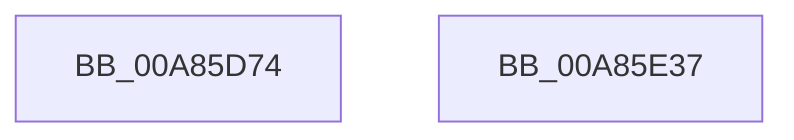

# EtwpEventWriteProviderEnabled

- RVA: `0x00A85D74`–`0x00A85E38` (길이 `196` bytes)
- VA: `0x0000000140A85D74`
- 실행 섹션: `PAGE`
- PDB 이름 있음: `예`; PDB Function 태그: `아니요`
- unwind 정보 RVA: `0x00079278`
- 디코드: `42`개 명령, `196/196` bytes 표시
- 미해석 바이트: `0` (있으면 어셈블리에 `.byte`로 보존)

> 이 문서는 커널 이미지의 기계어와 PDB 기호를 분석해 생성했습니다. 4번과 5번은 함수 원형과 자료형을 바이너리 사용 방식에서 추정한 C 해석이며 원본 소스 복구 결과는 아닙니다.

## 1. Dependencies

- 직접 호출 지점: **2**; 고유 호출 대상: **2**
- 직접 호출자로 확인된 함수: **1**
- RIP 상대 이미지 참조: **3**

### Outgoing calls
- `0x00A85E1D` → [EtwWrite](../../text/41/EtwWrite_function_0041C720.md) (function, `0x0041C720`)
- `0x00A85E29` → [_security_check_cookie](../../text/6A/_security_check_cookie_function_006AC640.md) (function, `0x006AC640`)

### Direct callers
- [EtwpEnableGuid](../A5/EtwpEnableGuid_function_00A5CD28.md) at `0x00A5D079`
- [EtwpEnableGuid](../A5/EtwpEnableGuid_function_00A5CD28.md) at `0x00A5D8F9`

### Static image references
- `0x00A85D82` → RVA `0x00E0A740` (`.data`; read)
- `0x00A85D97` → RVA `0x00EFF840` (`.data`; read)
- `0x00A85DB5` → RVA `0x000105E0` (`.rdata`; read)

## 2. Other-region calls and transfers

- 다른 실행 섹션으로 향하는 call: **2**
  - `0x00A85E1D` → [EtwWrite](../../text/41/EtwWrite_function_0041C720.md) (`PAGE` → `.text`)
  - `0x00A85E29` → [_security_check_cookie](../../text/6A/_security_check_cookie_function_006AC640.md) (`PAGE` → `.text`)
- 별도 외부 분기/꼬리 이동을 확인하지 못했습니다.

## 3. Assembly (complete function range)

```asm
00A85D74  40 55                           push rbp
00A85D76  48 8D 6C 24 D1                  lea rbp, [rsp - 0x2f]
00A85D7B  48 81 EC B0 00 00 00            sub rsp, 0xb0
00A85D82  48 8B 05 B7 49 38 00            mov rax, qword ptr [rip + 0x3849b7]
00A85D89  48 33 C4                        xor rax, rsp
00A85D8C  48 89 45 1F                     mov qword ptr [rbp + 0x1f], rax
00A85D90  48 8B 45 5F                     mov rax, qword ptr [rbp + 0x5f]
00A85D94  45 33 C0                        xor r8d, r8d
00A85D97  48 8B 0D A2 9A 47 00            mov rcx, qword ptr [rip + 0x479aa2]
00A85D9E  48 89 45 AF                     mov qword ptr [rbp - 0x51], rax
00A85DA2  49 8B 41 08                     mov rax, qword ptr [r9 + 8]
00A85DA6  48 89 45 BF                     mov qword ptr [rbp - 0x41], rax
00A85DAA  41 0F B7 01                     movzx eax, word ptr [r9]
00A85DAE  45 8D 48 07                     lea r9d, [r8 + 7]
00A85DB2  89 45 C7                        mov dword ptr [rbp - 0x39], eax
00A85DB5  48 8D 05 24 A8 58 FF            lea rax, [rip - 0xa757dc]
00A85DBC  48 89 45 CF                     mov qword ptr [rbp - 0x31], rax
00A85DC0  48 8D 45 67                     lea rax, [rbp + 0x67]
00A85DC4  48 89 45 DF                     mov qword ptr [rbp - 0x21], rax
00A85DC8  48 8D 45 6F                     lea rax, [rbp + 0x6f]
00A85DCC  48 89 45 EF                     mov qword ptr [rbp - 0x11], rax
00A85DD0  48 8D 45 77                     lea rax, [rbp + 0x77]
00A85DD4  48 89 45 FF                     mov qword ptr [rbp - 1], rax
00A85DD8  48 8D 45 7F                     lea rax, [rbp + 0x7f]
00A85DDC  48 89 45 0F                     mov qword ptr [rbp + 0xf], rax
00A85DE0  48 8D 45 AF                     lea rax, [rbp - 0x51]
00A85DE4  48 89 44 24 20                  mov qword ptr [rsp + 0x20], rax
00A85DE9  48 C7 45 B7 10 00 00 00         mov qword ptr [rbp - 0x49], 0x10
00A85DF1  44 89 45 CB                     mov dword ptr [rbp - 0x35], r8d
00A85DF5  48 C7 45 D7 02 00 00 00         mov qword ptr [rbp - 0x29], 2
00A85DFD  48 C7 45 E7 08 00 00 00         mov qword ptr [rbp - 0x19], 8
00A85E05  48 C7 45 F7 08 00 00 00         mov qword ptr [rbp - 9], 8
00A85E0D  48 C7 45 07 04 00 00 00         mov qword ptr [rbp + 7], 4
00A85E15  48 C7 45 17 01 00 00 00         mov qword ptr [rbp + 0x17], 1
00A85E1D  E8 FE 68 99 FF                  call 0x14041c720
00A85E22  48 8B 4D 1F                     mov rcx, qword ptr [rbp + 0x1f]
00A85E26  48 33 CC                        xor rcx, rsp
00A85E29  E8 12 68 C2 FF                  call 0x1406ac640
00A85E2E  48 81 C4 B0 00 00 00            add rsp, 0xb0
00A85E35  5D                              pop rbp
00A85E36  C3                              ret
00A85E37  CC                              int3
```

## 4. C-style interpretation (structured pseudocode)

```c
__int64 __fastcall EtwpEventWriteProviderEnabled(__int64 a1, __int64 a2, int a3, __int64 a4, __int64 a5, __int64 a6, __int64 a7, __int64 a8, __int64 a9)
{
    __int64 result;
    __int64 v_rsp;
    unsigned __int64 v_stack_m18;
    unsigned __int64 v_stack_m20;
    unsigned __int64 v_stack_m28;
    unsigned __int64 v_stack_m30;
    unsigned __int64 v_stack_m37;
    unsigned __int64 v_stack_m38;
    unsigned __int64 v_stack_m40;
    unsigned __int64 v_stack_m48;
    unsigned __int64 v_stack_m50;
    unsigned __int64 v_stack_m58;
    unsigned __int64 v_stack_m60;
    unsigned __int64 v_stack_m68;
    unsigned int v_stack_m6C;
    unsigned int v_stack_m70;
    unsigned __int64 v_stack_m78;
    unsigned __int64 v_stack_m80;
    unsigned __int64 v_stack_m88;
    unsigned __int64 v_stack_m98;

    v_rsp = (v_rsp) - (176);
    result = (*(unsigned __int64 *)(v_rip + 3688887)) ^ (v_rsp);
    v_stack_m18 = result;
    a3 = 0;
    v_stack_m88 = a5;
    v_stack_m78 = *(unsigned __int64 *)(a4 + 8);
    v_stack_m70 = (unsigned int)(*(unsigned __int16 *)(a4));
    v_stack_m68 = v_rip - 10967004;
    v_stack_m58 = a6;
    v_stack_m48 = a7;
    v_stack_m38 = a8;
    v_stack_m28 = a9;
    v_stack_m98 = v_stack_m88;
    v_stack_m80 = 16;
    v_stack_m6C = 0;
    v_stack_m60 = 2;
    v_stack_m50 = 8;
    v_stack_m40 = 8;
    v_stack_m30 = 4;
    v_stack_m20 = 1;
    result = EtwWrite(*(unsigned __int64 *)(v_rip + 4692642), a2, a3, a3 + 7);
    a1 = (v_stack_m18) ^ (v_rsp);
    result = _security_check_cookie(a1, a2, a3, a3 + 7);
    v_rsp = (v_rsp) + (176);
    return result;
}
```

## 5. (Beta) C Style

```c
int64_t EtwpEventWriteProviderEnabled(int64_t Arg1, int64_t Arg2, int32_t Arg3, void *Arg4, int64_t Arg5, int64_t Arg6, int64_t Arg7, int64_t Arg8, int64_t Arg9)
{
    uint8_t *arg4 = (uint8_t *)Arg4;

    int64_t result;
    int64_t local_rsp;
    uint64_t v_stack_m18;
    uint64_t v_stack_m20;
    uint64_t v_stack_m28;
    uint64_t v_stack_m30;
    uint64_t v_stack_m37;
    uint64_t v_stack_m38;
    uint64_t v_stack_m40;
    uint64_t v_stack_m48;
    uint64_t v_stack_m50;
    uint64_t v_stack_m58;
    uint64_t v_stack_m60;
    uint64_t v_stack_m68;
    uint32_t v_stack_m6C;
    uint32_t v_stack_m70;
    uint64_t v_stack_m78;
    uint64_t v_stack_m80;
    uint64_t v_stack_m88;
    uint64_t v_stack_m98;

    local_rsp = (local_rsp) - (176);
    result = (*(uint64_t *)(v_rip + 0x3849B7)) ^ (local_rsp);
    v_stack_m18 = result;
    Arg3 = 0;
    v_stack_m88 = Arg5;
    v_stack_m78 = *(uint64_t *)(arg4 + 0x8);
    v_stack_m70 = (uint32_t)(*(uint16_t *)(arg4));
    v_stack_m68 = v_rip - 10967004;
    v_stack_m58 = Arg6;
    v_stack_m48 = Arg7;
    v_stack_m38 = Arg8;
    v_stack_m28 = Arg9;
    v_stack_m98 = v_stack_m88;
    v_stack_m80 = 16;
    v_stack_m6C = 0;
    v_stack_m60 = 2;
    v_stack_m50 = 8;
    v_stack_m40 = 8;
    v_stack_m30 = 4;
    v_stack_m20 = 1;
    result = EtwWrite(*(uint64_t *)(v_rip + 0x479AA2), Arg2, Arg3, Arg3 + 7);
    Arg1 = (v_stack_m18) ^ (local_rsp);
    result = _security_check_cookie(Arg1, Arg2, Arg3, Arg3 + 7);
    local_rsp = (local_rsp) + (176);
    return result;
}
```

### 관측된 메모리 오프셋

구조체 형식이 확인되지 않은 접근은 인자 기준의 오프셋으로만 기록했습니다.

| 기준 인자 | 오프셋 표현 | 폭 (bit) | 접근 |
|---|---:|---:|---|
| `Arg4` | `+ 0x0` | `16` | `R` |
| `Arg4` | `+ 0x8` | `64` | `R` |

## 6. Execution-region graph

[열기: 2D/3D 그래프와 함수 탐색 컨트롤 패널](../../../control-panel.html?section=page&rva=0x00A85D74&view=graph)

- 2D 그래프는 위에서 아래로 흐르고, 3D 그래프는 빈 공간을 드래그해 회전합니다. Shift+드래그는 이동, 휠은 확대·축소, 함수 노드 선택은 대상 보고서 이동입니다.

### Static fallback


