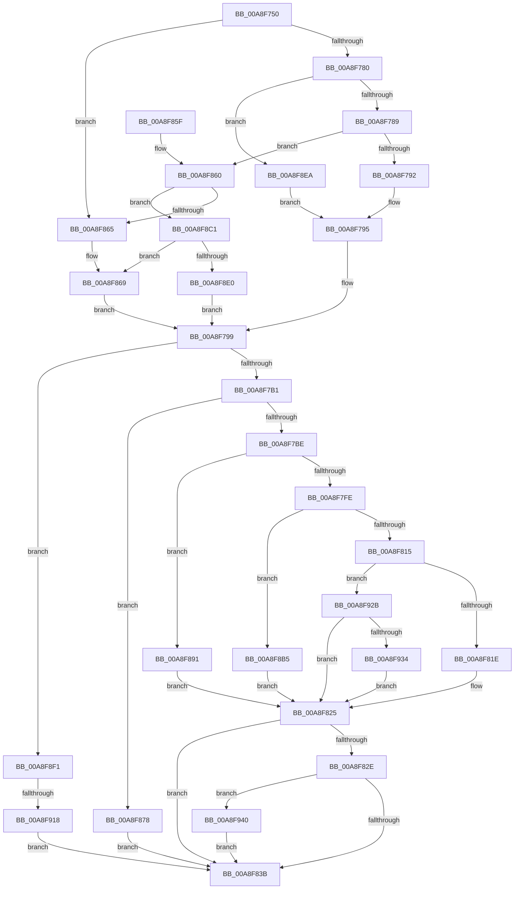

# EtwpInitializeTimeStamp

- RVA: `0x00A8F750`–`0x00A8F94F` (길이 `511` bytes)
- VA: `0x0000000140A8F750`
- 실행 섹션: `PAGE`
- PDB 이름 있음: `예`; PDB Function 태그: `예`
- unwind 정보 RVA: `0x000B8C4C`
- 디코드: `114`개 명령, `511/511` bytes 표시
- 미해석 바이트: `0` (있으면 어셈블리에 `.byte`로 보존)

> 이 문서는 커널 이미지의 기계어와 PDB 기호를 분석해 생성했습니다. 4번과 5번은 함수 원형과 자료형을 바이너리 사용 방식에서 추정한 C 해석이며 원본 소스 복구 결과는 아닙니다.

## 1. Dependencies

- 직접 호출 지점: **6**; 고유 호출 대상: **4**
- 직접 호출자로 확인된 함수: **1**
- RIP 상대 이미지 참조: **4**

### Outgoing calls
- `0x00A8F7DE` → [RtlGetMultiTimePrecise](../../text/4A/RtlGetMultiTimePrecise_function_004A1A30.md) (function, `0x004A1A30`)
- `0x00A8F87B` → [EtwpGetLoggerTimeStamp](../../text/37/EtwpGetLoggerTimeStamp_function_0037E690.md) (function, `0x0037E690`)
- `0x00A8F88A` → [KeQuerySystemTimePrecise](../../text/37/KeQuerySystemTimePrecise_function_0037DA40.md) (function, `0x0037DA40`)
- `0x00A8F894` → [EtwpGetLoggerTimeStamp](../../text/37/EtwpGetLoggerTimeStamp_function_0037E690.md) (function, `0x0037E690`)
- `0x00A8F8A3` → [KeQuerySystemTimePrecise](../../text/37/KeQuerySystemTimePrecise_function_0037DA40.md) (function, `0x0037DA40`)
- `0x00A8F8D7` → [guard_dispatch_icall](../../text/6B/guard_dispatch_icall_function_006BAAD0.md) (function, `0x006BAAD0`)

### Direct callers
- [EtwpStartLogger](../A9/EtwpStartLogger_function_00A99D80.md) at `0x00A9AA53`

### Static image references
- `0x00A8F8C1` → RVA `0x00E00C40` (`.data`; read)
- `0x00A8F8F1` → RVA `0x00EFFA00` (`.data`; read)
- `0x00A8F901` → RVA `0x00EFFA18` (`.data`; read)
- `0x00A8F918` → RVA `0x00EFFA08` (`.data`; read)

## 2. Other-region calls and transfers

- 다른 실행 섹션으로 향하는 call: **6**
  - `0x00A8F7DE` → [RtlGetMultiTimePrecise](../../text/4A/RtlGetMultiTimePrecise_function_004A1A30.md) (`PAGE` → `.text`)
  - `0x00A8F87B` → [EtwpGetLoggerTimeStamp](../../text/37/EtwpGetLoggerTimeStamp_function_0037E690.md) (`PAGE` → `.text`)
  - `0x00A8F88A` → [KeQuerySystemTimePrecise](../../text/37/KeQuerySystemTimePrecise_function_0037DA40.md) (`PAGE` → `.text`)
  - `0x00A8F894` → [EtwpGetLoggerTimeStamp](../../text/37/EtwpGetLoggerTimeStamp_function_0037E690.md) (`PAGE` → `.text`)
  - `0x00A8F8A3` → [KeQuerySystemTimePrecise](../../text/37/KeQuerySystemTimePrecise_function_0037DA40.md) (`PAGE` → `.text`)
  - `0x00A8F8D7` → [guard_dispatch_icall](../../text/6B/guard_dispatch_icall_function_006BAAD0.md) (`PAGE` → `.text`)
- call이 아닌 외부 분기/꼬리 이동: **1**
  - `0x00A8F912` → [sub_00B46730](../B4/Unknown_function_00B46730.md) (`tail-transfer`)

## 3. Assembly (complete function range)

```asm
00A8F750  48 89 5C 24 10                  mov qword ptr [rsp + 0x10], rbx
00A8F755  48 89 6C 24 18                  mov qword ptr [rsp + 0x18], rbp
00A8F75A  48 89 74 24 20                  mov qword ptr [rsp + 0x20], rsi
00A8F75F  57                              push rdi
00A8F760  41 56                           push r14
00A8F762  41 57                           push r15
00A8F764  48 83 EC 40                     sub rsp, 0x40
00A8F768  48 8B D9                        mov rbx, rcx
00A8F76B  41 BF 01 00 00 00               mov r15d, 1
00A8F771  8B 89 C8 00 00 00               mov ecx, dword ptr [rcx + 0xc8]
00A8F777  41 2B CF                        sub ecx, r15d
00A8F77A  0F 84 E5 00 00 00               je 0x140a8f865
00A8F780  41 2B CF                        sub ecx, r15d
00A8F783  0F 84 61 01 00 00               je 0x140a8f8ea
00A8F789  41 2B CF                        sub ecx, r15d
00A8F78C  0F 85 CE 00 00 00               jne 0x140a8f860
00A8F792  8D 41 03                        lea eax, [rcx + 3]
00A8F795  48 8D 7B 18                     lea rdi, [rbx + 0x18]
00A8F799  48 89 07                        mov qword ptr [rdi], rax
00A8F79C  48 8D BB 30 01 00 00            lea rdi, [rbx + 0x130]
00A8F7A3  8B 83 30 03 00 00               mov eax, dword ptr [rbx + 0x330]
00A8F7A9  A8 02                           test al, 2
00A8F7AB  0F 85 40 01 00 00               jne 0x140a8f8f1
00A8F7B1  83 BB C8 00 00 00 03            cmp dword ptr [rbx + 0xc8], 3
00A8F7B8  0F 84 BA 00 00 00               je 0x140a8f878
00A8F7BE  33 C0                           xor eax, eax
00A8F7C0  4C 8D 44 24 60                  lea r8, [rsp + 0x60]
00A8F7C5  21 44 24 60                     and dword ptr [rsp + 0x60], eax
00A8F7C9  48 8D 4C 24 20                  lea rcx, [rsp + 0x20]
00A8F7CE  0F 57 C0                        xorps xmm0, xmm0
00A8F7D1  48 89 44 24 30                  mov qword ptr [rsp + 0x30], rax
00A8F7D6  0F 11 44 24 20                  movups xmmword ptr [rsp + 0x20], xmm0
00A8F7DB  8D 50 07                        lea edx, [rax + 7]
00A8F7DE  E8 4D 22 A1 FF                  call 0x1404a1a30
00A8F7E3  8B 6C 24 60                     mov ebp, dword ptr [rsp + 0x60]
00A8F7E7  8B C5                           mov eax, ebp
00A8F7E9  48 8B 74 24 28                  mov rsi, qword ptr [rsp + 0x28]
00A8F7EE  83 E0 05                        and eax, 5
00A8F7F1  4C 8B 74 24 20                  mov r14, qword ptr [rsp + 0x20]
00A8F7F6  3C 05                           cmp al, 5
00A8F7F8  0F 85 93 00 00 00               jne 0x140a8f891
00A8F7FE  48 8B 4C 24 30                  mov rcx, qword ptr [rsp + 0x30]
00A8F803  8B 83 C8 00 00 00               mov eax, dword ptr [rbx + 0xc8]
00A8F809  48 89 0F                        mov qword ptr [rdi], rcx
00A8F80C  83 F8 02                        cmp eax, 2
00A8F80F  0F 84 A0 00 00 00               je 0x140a8f8b5
00A8F815  41 3B C7                        cmp eax, r15d
00A8F818  0F 85 0D 01 00 00               jne 0x140a8f92b
00A8F81E  4C 89 B3 38 01 00 00            mov qword ptr [rbx + 0x138], r14
00A8F825  83 BB C8 00 00 00 04            cmp dword ptr [rbx + 0xc8], 4
00A8F82C  74 0D                           je 0x140a8f83b
00A8F82E  83 E5 03                        and ebp, 3
00A8F831  40 80 FD 03                     cmp bpl, 3
00A8F835  0F 84 05 01 00 00               je 0x140a8f940
00A8F83B  0F 10 07                        movups xmm0, xmmword ptr [rdi]
00A8F83E  48 8B 6C 24 70                  mov rbp, qword ptr [rsp + 0x70]
00A8F843  48 8B 74 24 78                  mov rsi, qword ptr [rsp + 0x78]
00A8F848  F3 0F 7F 83 B0 01 00 00         movdqu xmmword ptr [rbx + 0x1b0], xmm0
00A8F850  48 8B 5C 24 68                  mov rbx, qword ptr [rsp + 0x68]
00A8F855  48 83 C4 40                     add rsp, 0x40
00A8F859  41 5F                           pop r15
00A8F85B  41 5E                           pop r14
00A8F85D  5F                              pop rdi
00A8F85E  C3                              ret
00A8F85F  CC                              int3
00A8F860  41 3B CF                        cmp ecx, r15d
00A8F863  74 5C                           je 0x140a8f8c1
00A8F865  48 8D 7B 18                     lea rdi, [rbx + 0x18]
00A8F869  49 8B C7                        mov rax, r15
00A8F86C  44 89 BB C8 00 00 00            mov dword ptr [rbx + 0xc8], r15d
00A8F873  E9 21 FF FF FF                  jmp 0x140a8f799
00A8F878  48 8B CB                        mov rcx, rbx
00A8F87B  E8 10 EE 8E FF                  call 0x14037e690
00A8F880  48 8B CF                        mov rcx, rdi
00A8F883  48 89 83 38 01 00 00            mov qword ptr [rbx + 0x138], rax
00A8F88A  E8 B1 E1 8E FF                  call 0x14037da40
00A8F88F  EB AA                           jmp 0x140a8f83b
00A8F891  48 8B CB                        mov rcx, rbx
00A8F894  E8 F7 ED 8E FF                  call 0x14037e690
00A8F899  48 8B CF                        mov rcx, rdi
00A8F89C  48 89 83 38 01 00 00            mov qword ptr [rbx + 0x138], rax
00A8F8A3  E8 98 E1 8E FF                  call 0x14037da40
00A8F8A8  0F BA B3 30 03 00 00 1B         btr dword ptr [rbx + 0x330], 0x1b
00A8F8B0  E9 70 FF FF FF                  jmp 0x140a8f825
00A8F8B5  48 89 8B 38 01 00 00            mov qword ptr [rbx + 0x138], rcx
00A8F8BC  E9 64 FF FF FF                  jmp 0x140a8f825
00A8F8C1  48 8B 05 78 13 37 00            mov rax, qword ptr [rip + 0x371378]
00A8F8C8  48 8D 4C 24 60                  lea rcx, [rsp + 0x60]
00A8F8CD  48 83 64 24 60 00               and qword ptr [rsp + 0x60], 0
00A8F8D3  48 8D 7B 18                     lea rdi, [rbx + 0x18]
00A8F8D7  E8 F4 B1 C2 FF                  call 0x1406baad0
00A8F8DC  85 C0                           test eax, eax
00A8F8DE  78 89                           js 0x140a8f869
00A8F8E0  B8 02 00 00 00                  mov eax, 2
00A8F8E5  E9 AF FE FF FF                  jmp 0x140a8f799
00A8F8EA  33 C0                           xor eax, eax
00A8F8EC  E9 A4 FE FF FF                  jmp 0x140a8f795
00A8F8F1  48 8B 05 08 01 47 00            mov rax, qword ptr [rip + 0x470108]
00A8F8F8  8B 93 C8 00 00 00               mov edx, dword ptr [rbx + 0xc8]
00A8F8FE  48 89 07                        mov qword ptr [rdi], rax
00A8F901  48 8B 05 10 01 47 00            mov rax, qword ptr [rip + 0x470110]
00A8F908  48 89 83 18 06 00 00            mov qword ptr [rbx + 0x618], rax
00A8F90F  83 FA 03                        cmp edx, 3
00A8F912  0F 85 18 6E 0B 00               jne 0x140b46730
00A8F918  48 8B 05 E9 00 47 00            mov rax, qword ptr [rip + 0x4700e9]
00A8F91F  48 89 83 38 01 00 00            mov qword ptr [rbx + 0x138], rax
00A8F926  E9 10 FF FF FF                  jmp 0x140a8f83b
00A8F92B  83 F8 04                        cmp eax, 4
00A8F92E  0F 85 F1 FE FF FF               jne 0x140a8f825
00A8F934  48 89 B3 38 01 00 00            mov qword ptr [rbx + 0x138], rsi
00A8F93B  E9 E5 FE FF FF                  jmp 0x140a8f825
00A8F940  49 2B F6                        sub rsi, r14
00A8F943  48 89 B3 18 06 00 00            mov qword ptr [rbx + 0x618], rsi
00A8F94A  E9 EC FE FF FF                  jmp 0x140a8f83b
```

## 4. C-style interpretation (structured pseudocode)

```c
__int64 __fastcall EtwpInitializeTimeStamp(__int64 a1)
{
    __int64 result;
    __int64 v_rbp;
    __int64 v_rsi;
    __int64 v_rsp;
    unsigned __int64 v_stack_m28;
    unsigned __int64 v_stack_m30;
    unsigned __int64 v_stack_m38;
    unsigned __int64 v_stack_p10;
    unsigned __int64 v_stack_p18;
    unsigned __int64 v_stack_p20;
    unsigned __int64 v_stack_p60;
    unsigned __int64 v_stack_p8;

    v_stack_p10 = v_rbx;
    v_stack_p18 = v_rbp;
    v_stack_p20 = v_rsi;
    v_rsp = (v_rsp) - (64);
    a1 = (unsigned int)(((unsigned int)(*(unsigned int *)(a1 + 200))) - (1));
    if (condition_is_equal) goto loc_00A8F865;
    a1 = (unsigned int)((a1) - (1));
    if (condition_is_equal) goto loc_00A8F8EA;
    a1 = (unsigned int)((a1) - (1));
    if (condition_is_not_equal) goto loc_00A8F860;
loc_00A8F795:
loc_00A8F799:
    *(unsigned __int64 *)(a1 + 24) = a1 + 3;
    if ((((unsigned __int8)((unsigned int)(*(unsigned int *)(a1 + 816)))) & (2)) != 0) goto loc_00A8F8F1;
    if ((*(unsigned int *)(a1 + 200)) == 3) goto loc_00A8F878;
    result = 0;
    v_stack_m28 = 0;
    v_stack_m38 = v_xmm0;
    result = RtlGetMultiTimePrecise(v_stack_m38, result + 7, v_stack_p8, a4);
    result = (unsigned int)(((unsigned int)((unsigned int)((unsigned int)(v_stack_p8)))) & (5));
    if (((unsigned __int8)(result)) != 5) goto loc_00A8F891;
    *(unsigned __int64 *)(a1 + 304) = v_stack_m28;
    if (((unsigned int)((unsigned int)(*(unsigned int *)(a1 + 200)))) == 2) goto loc_00A8F8B5;
    if (((unsigned int)((unsigned int)(*(unsigned int *)(a1 + 200)))) != 1) goto loc_00A8F92B;
    *(unsigned __int64 *)(a1 + 312) = v_stack_m38;
loc_00A8F825:
    if ((*(unsigned int *)(a1 + 200)) == 4) goto loc_00A8F83B;
    v_rbp = (unsigned int)(((unsigned int)(v_stack_p8)) & (3));
    if (((unsigned __int8)(v_rbp)) == 3) goto loc_00A8F940;
loc_00A8F83B:
    *(unsigned __int64 *)(a1 + 432) = v_xmm0;
    v_rsp = (v_rsp) + (64);
    return (unsigned int)(*(unsigned int *)(a1 + 200));
loc_00A8F860:
    if (((unsigned int)(v_stack_m28)) == 1) goto loc_00A8F8C1;
loc_00A8F865:
loc_00A8F869:
    *(unsigned int *)(v_stack_p10 + 200) = 1;
    goto loc_00A8F799;
loc_00A8F878:
    result = EtwpGetLoggerTimeStamp(v_stack_p10, result + 7, v_stack_p8, a4);
    *(unsigned __int64 *)(v_stack_p10 + 312) = result;
    result = KeQuerySystemTimePrecise(v_stack_p10 + 24, result + 7, v_stack_p8, a4);
    goto loc_00A8F83B;
loc_00A8F891:
    result = EtwpGetLoggerTimeStamp(v_stack_p10, result + 7, v_stack_p8, a4);
    *(unsigned __int64 *)(v_stack_p10 + 312) = result;
    result = KeQuerySystemTimePrecise(v_stack_p10 + 24, result + 7, v_stack_p8, a4);
    goto loc_00A8F825;
loc_00A8F8B5:
    *(unsigned __int64 *)(v_stack_p10 + 312) = v_stack_p10 + 24;
    goto loc_00A8F825;
loc_00A8F8C1:
    result = guard_dispatch_icall(v_stack_p60, result + 7, v_stack_p8, a4);
    if (sign_flag) goto loc_00A8F869;
    goto loc_00A8F799;
loc_00A8F8EA:
    result = 0;
    goto loc_00A8F795;
loc_00A8F8F1:
    *(unsigned __int64 *)(v_stack_p10 + 24) = *(unsigned __int64 *)(v_rip + 4653320);
    *(unsigned __int64 *)(v_stack_p10 + 1560) = *(unsigned __int64 *)(v_rip + 4653328);
    *(unsigned __int64 *)(v_stack_p10 + 312) = *(unsigned __int64 *)(v_rip + 4653289);
    goto loc_00A8F83B;
loc_00A8F92B:
    if (((unsigned int)(*(unsigned __int64 *)(v_rip + 4653289))) != 4) goto loc_00A8F825;
    *(unsigned __int64 *)(v_stack_p10 + 312) = v_stack_p20;
    goto loc_00A8F825;
loc_00A8F940:
    v_rsi = (v_stack_p20) - (v_stack_m38);
    *(unsigned __int64 *)(v_stack_p10 + 1560) = v_rsi;
    goto loc_00A8F83B;
}
```

## 5. (Beta) C Style

```c
int64_t EtwpInitializeTimeStamp(void *Arg1)
{
    uint8_t *arg1 = (uint8_t *)Arg1;

    int64_t result;
    int64_t local_rbp;
    int64_t local_rsi;
    int64_t local_rsp;
    uint64_t v_stack_m28;
    uint64_t v_stack_m30;
    uint64_t v_stack_m38;
    uint64_t v_stack_p10;
    uint64_t v_stack_p18;
    uint64_t v_stack_p20;
    uint64_t v_stack_p60;
    uint64_t v_stack_p8;

    v_stack_p10 = local_rbx;
    v_stack_p18 = local_rbp;
    v_stack_p20 = local_rsi;
    local_rsp = (local_rsp) - (64);
    Arg1 = (uint32_t)(((uint32_t)(*(uint32_t *)(arg1 + 0xC8))) - (1));
    if (condition_is_equal) goto loc_00A8F865;
    Arg1 = (uint32_t)((Arg1) - (1));
    if (condition_is_equal) goto loc_00A8F8EA;
    Arg1 = (uint32_t)((Arg1) - (1));
    if (condition_is_not_equal) goto loc_00A8F860;
loc_00A8F795:
loc_00A8F799:
    *(void **)(arg1 + 0x18) = Arg1 + 3;
    if ((((uint8_t)((uint32_t)(*(uint32_t *)(arg1 + 0x330)))) & (2)) != 0) goto loc_00A8F8F1;
    if ((*(uint32_t *)(arg1 + 0xC8)) == 3) goto loc_00A8F878;
    result = 0;
    v_stack_m28 = 0;
    v_stack_m38 = v_xmm0;
    result = RtlGetMultiTimePrecise(v_stack_m38, result + 7, v_stack_p8, a4);
    result = (uint32_t)(((uint32_t)((uint32_t)((uint32_t)(v_stack_p8)))) & (5));
    if (((uint8_t)(result)) != 5) goto loc_00A8F891;
    *(uint64_t *)(arg1 + 0x130) = v_stack_m28;
    if (((uint32_t)((uint32_t)(*(uint32_t *)(arg1 + 0xC8)))) == 2) goto loc_00A8F8B5;
    if (((uint32_t)((uint32_t)(*(uint32_t *)(arg1 + 0xC8)))) != 1) goto loc_00A8F92B;
    *(uint64_t *)(arg1 + 0x138) = v_stack_m38;
loc_00A8F825:
    if ((*(uint32_t *)(arg1 + 0xC8)) == 4) goto loc_00A8F83B;
    local_rbp = (uint32_t)(((uint32_t)(v_stack_p8)) & (3));
    if (((uint8_t)(local_rbp)) == 3) goto loc_00A8F940;
loc_00A8F83B:
    *(uint64_t *)(arg1 + 0x1B0) = v_xmm0;
    local_rsp = (local_rsp) + (64);
    return (uint32_t)(*(uint32_t *)(arg1 + 0xC8));
loc_00A8F860:
    if (((uint32_t)(v_stack_m28)) == 1) goto loc_00A8F8C1;
loc_00A8F865:
loc_00A8F869:
    *(uint32_t *)(v_stack_p10 + 0xC8) = 1;
    goto loc_00A8F799;
loc_00A8F878:
    result = EtwpGetLoggerTimeStamp(v_stack_p10, result + 7, v_stack_p8, a4);
    *(uint64_t *)(v_stack_p10 + 0x138) = result;
    result = KeQuerySystemTimePrecise(v_stack_p10 + 24, result + 7, v_stack_p8, a4);
    goto loc_00A8F83B;
loc_00A8F891:
    result = EtwpGetLoggerTimeStamp(v_stack_p10, result + 7, v_stack_p8, a4);
    *(uint64_t *)(v_stack_p10 + 0x138) = result;
    result = KeQuerySystemTimePrecise(v_stack_p10 + 24, result + 7, v_stack_p8, a4);
    goto loc_00A8F825;
loc_00A8F8B5:
    *(uint64_t *)(v_stack_p10 + 0x138) = v_stack_p10 + 24;
    goto loc_00A8F825;
loc_00A8F8C1:
    result = guard_dispatch_icall(v_stack_p60, result + 7, v_stack_p8, a4);
    if (sign_flag) goto loc_00A8F869;
    goto loc_00A8F799;
loc_00A8F8EA:
    result = 0;
    goto loc_00A8F795;
loc_00A8F8F1:
    *(uint64_t *)(v_stack_p10 + 0x18) = *(uint64_t *)(v_rip + 0x470108);
    *(uint64_t *)(v_stack_p10 + 0x618) = *(uint64_t *)(v_rip + 0x470110);
    *(uint64_t *)(v_stack_p10 + 0x138) = *(uint64_t *)(v_rip + 0x4700E9);
    goto loc_00A8F83B;
loc_00A8F92B:
    if (((uint32_t)(*(uint64_t *)(v_rip + 0x4700E9))) != 4) goto loc_00A8F825;
    *(uint64_t *)(v_stack_p10 + 0x138) = v_stack_p20;
    goto loc_00A8F825;
loc_00A8F940:
    local_rsi = (v_stack_p20) - (v_stack_m38);
    *(uint64_t *)(v_stack_p10 + 0x618) = local_rsi;
    goto loc_00A8F83B;
}
```

### 관측된 메모리 오프셋

구조체 형식이 확인되지 않은 접근은 인자 기준의 오프셋으로만 기록했습니다.

| 기준 인자 | 오프셋 표현 | 폭 (bit) | 접근 |
|---|---:|---:|---|
| `Arg1` | `+ 0x0` | `64` | `W` |
| `Arg1` | `+ 0x0` | `128` | `R` |
| `Arg1` | `+ 0x18` | `64` | `R` |
| `Arg1` | `+ 0xC8` | `32` | `R` |
| `Arg1` | `+ 0xC8` | `32` | `W` |
| `Arg1` | `+ 0x130` | `64` | `R` |
| `Arg1` | `+ 0x138` | `64` | `W` |
| `Arg1` | `+ 0x1B0` | `128` | `W` |
| `Arg1` | `+ 0x330` | `32` | `R` |
| `Arg1` | `+ 0x330` | `32` | `R/W` |
| `Arg1` | `+ 0x618` | `64` | `W` |

## 6. Execution-region graph

[열기: 2D/3D 그래프와 함수 탐색 컨트롤 패널](../../../control-panel.html?section=page&rva=0x00A8F750&view=graph)

- 2D 그래프는 위에서 아래로 흐르고, 3D 그래프는 빈 공간을 드래그해 회전합니다. Shift+드래그는 이동, 휠은 확대·축소, 함수 노드 선택은 대상 보고서 이동입니다.

### Static fallback


