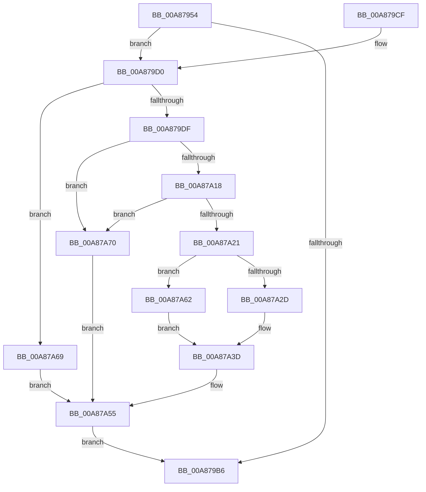

# EtwpReceiveReplyDataBlock

- RVA: `0x00A87954`–`0x00A87A74` (길이 `288` bytes)
- VA: `0x0000000140A87954`
- 실행 섹션: `PAGE`
- PDB 이름 있음: `예`; PDB Function 태그: `아니요`
- unwind 정보 RVA: `0x000B7EF8`
- 디코드: `81`개 명령, `288/288` bytes 표시
- 미해석 바이트: `0` (있으면 어셈블리에 `.byte`로 보존)

> 이 문서는 커널 이미지의 기계어와 PDB 기호를 분석해 생성했습니다. 4번과 5번은 함수 원형과 자료형을 바이너리 사용 방식에서 추정한 C 해석이며 원본 소스 복구 결과는 아닙니다.

## 1. Dependencies

- 직접 호출 지점: **6**; 고유 호출 대상: **6**
- 직접 호출자로 확인된 함수: **1**
- RIP 상대 이미지 참조: **2**

### Outgoing calls
- `0x00A879AB` → [ObReferenceObjectByHandle](../86/ObReferenceObjectByHandle_function_00868DB0.md) (function, `0x00868DB0`)
- `0x00A87A05` → [KeRemoveQueueEx](../../text/20/KeRemoveQueueEx_function_0020BD30.md) (function, `0x0020BD30`)
- `0x00A87A36` → [memcpy](../../text/6C/memcpy_function_006C6840.md) (function, `0x006C6840`)
- `0x00A87A46` → [EtwpUnreferenceDataBlock](../8B/EtwpUnreferenceDataBlock_function_008BFC5C.md) (function, `0x008BFC5C`)
- `0x00A87A50` → [ExFreePoolWithTag](../../poolcode/B8/ExFreePoolWithTag_function_00B82870.md) (function, `0x00B82870`)
- `0x00A87A58` → [ObfDereferenceObject](../../text/2F/ObfDereferenceObject_function_002F9350.md) (function, `0x002F9350`)

### Direct callers
- [NtTraceControl](../A9/NtTraceControl_function_00A9ED40.md) at `0x00A9F186`

### Static image references
- `0x00A8797F` → RVA `0x00FC6D30` (`ALMOSTRO`; read)
- `0x00A87992` → RVA `0x00010FF0` (`.rdata`; read)

## 2. Other-region calls and transfers

- 다른 실행 섹션으로 향하는 call: **4**
  - `0x00A87A05` → [KeRemoveQueueEx](../../text/20/KeRemoveQueueEx_function_0020BD30.md) (`PAGE` → `.text`)
  - `0x00A87A36` → [memcpy](../../text/6C/memcpy_function_006C6840.md) (`PAGE` → `.text`)
  - `0x00A87A50` → [ExFreePoolWithTag](../../poolcode/B8/ExFreePoolWithTag_function_00B82870.md) (`PAGE` → `POOLCODE`)
  - `0x00A87A58` → [ObfDereferenceObject](../../text/2F/ObfDereferenceObject_function_002F9350.md) (`PAGE` → `.text`)
- 별도 외부 분기/꼬리 이동을 확인하지 못했습니다.

## 3. Assembly (complete function range)

```asm
00A87954  4C 8B DC                        mov r11, rsp
00A87957  49 89 5B 10                     mov qword ptr [r11 + 0x10], rbx
00A8795B  49 89 6B 20                     mov qword ptr [r11 + 0x20], rbp
00A8795F  56                              push rsi
00A87960  57                              push rdi
00A87961  41 54                           push r12
00A87963  41 56                           push r14
00A87965  41 57                           push r15
00A87967  48 83 EC 30                     sub rsp, 0x30
00A8796B  41 83 20 00                     and dword ptr [r8], 0
00A8796F  4C 8B F1                        mov r14, rcx
00A87972  49 83 63 D0 00                  and qword ptr [r11 - 0x30], 0
00A87977  4D 8B F8                        mov r15, r8
00A8797A  8B 09                           mov ecx, dword ptr [rcx]
00A8797C  44 8B E2                        mov r12d, edx
00A8797F  4C 8B 05 AA F3 53 00            mov r8, qword ptr [rip + 0x53f3aa]
00A87986  41 B1 01                        mov r9b, 1
00A87989  41 8B 46 04                     mov eax, dword ptr [r14 + 4]
00A8798D  BA 04 00 00 00                  mov edx, 4
00A87992  48 0F AF 05 56 96 58 FF         imul rax, qword ptr [rip - 0xa769aa]
00A8799A  49 83 63 08 00                  and qword ptr [r11 + 8], 0
00A8799F  49 89 43 18                     mov qword ptr [r11 + 0x18], rax
00A879A3  49 8D 43 08                     lea rax, [r11 + 8]
00A879A7  49 89 43 C8                     mov qword ptr [r11 - 0x38], rax
00A879AB  E8 00 14 DE FF                  call 0x140868db0
00A879B0  8B D8                           mov ebx, eax
00A879B2  85 C0                           test eax, eax
00A879B4  79 1A                           jns 0x140a879d0
00A879B6  48 8B 6C 24 78                  mov rbp, qword ptr [rsp + 0x78]
00A879BB  8B C3                           mov eax, ebx
00A879BD  48 8B 5C 24 68                  mov rbx, qword ptr [rsp + 0x68]
00A879C2  48 83 C4 30                     add rsp, 0x30
00A879C6  41 5F                           pop r15
00A879C8  41 5E                           pop r14
00A879CA  41 5C                           pop r12
00A879CC  5F                              pop rdi
00A879CD  5E                              pop rsi
00A879CE  C3                              ret
00A879CF  CC                              int3
00A879D0  48 8B 6C 24 60                  mov rbp, qword ptr [rsp + 0x60]
00A879D5  F6 45 62 04                     test byte ptr [rbp + 0x62], 4
00A879D9  0F 84 8A 00 00 00               je 0x140a87a69
00A879DF  48 8B 4D 30                     mov rcx, qword ptr [rbp + 0x30]
00A879E3  48 8D 44 24 60                  lea rax, [rsp + 0x60]
00A879E8  48 83 64 24 60 00               and qword ptr [rsp + 0x60], 0
00A879EE  4C 8D 4C 24 70                  lea r9, [rsp + 0x70]
00A879F3  C7 44 24 28 01 00 00 00         mov dword ptr [rsp + 0x28], 1
00A879FB  45 33 C0                        xor r8d, r8d
00A879FE  B2 01                           mov dl, 1
00A87A00  48 89 44 24 20                  mov qword ptr [rsp + 0x20], rax
00A87A05  E8 26 43 78 FF                  call 0x14020bd30
00A87A0A  48 8B 7C 24 60                  mov rdi, qword ptr [rsp + 0x60]
00A87A0F  48 81 FF 02 01 00 00            cmp rdi, 0x102
00A87A16  74 58                           je 0x140a87a70
00A87A18  48 81 FF C0 00 00 00            cmp rdi, 0xc0
00A87A1F  74 4F                           je 0x140a87a70
00A87A21  48 8B 77 10                     mov rsi, qword ptr [rdi + 0x10]
00A87A25  8B 46 04                        mov eax, dword ptr [rsi + 4]
00A87A28  41 3B C4                        cmp eax, r12d
00A87A2B  77 35                           ja 0x140a87a62
00A87A2D  44 8B C0                        mov r8d, eax
00A87A30  48 8B D6                        mov rdx, rsi
00A87A33  49 8B CE                        mov rcx, r14
00A87A36  E8 05 EE C3 FF                  call 0x1406c6840
00A87A3B  33 DB                           xor ebx, ebx
00A87A3D  8B 46 04                        mov eax, dword ptr [rsi + 4]
00A87A40  48 8B CE                        mov rcx, rsi
00A87A43  41 89 07                        mov dword ptr [r15], eax
00A87A46  E8 11 82 E3 FF                  call 0x1408bfc5c
00A87A4B  33 D2                           xor edx, edx
00A87A4D  48 8B CF                        mov rcx, rdi
00A87A50  E8 1B AE 0F 00                  call 0x140b82870
00A87A55  48 8B CD                        mov rcx, rbp
00A87A58  E8 F3 18 87 FF                  call 0x1402f9350
00A87A5D  E9 54 FF FF FF                  jmp 0x140a879b6
00A87A62  BB 23 00 00 C0                  mov ebx, 0xc0000023
00A87A67  EB D4                           jmp 0x140a87a3d
00A87A69  BB 08 00 00 C0                  mov ebx, 0xc0000008
00A87A6E  EB E5                           jmp 0x140a87a55
00A87A70  8B DF                           mov ebx, edi
00A87A72  EB E1                           jmp 0x140a87a55
```

## 4. C-style interpretation (structured pseudocode)

```c
__int64 __fastcall EtwpReceiveReplyDataBlock(__int64 a1, int a2, __int64 a3)
{
    __int64 result;
    __int64 v_rbx;
    __int64 v_rsp;
    unsigned __int64 v_stack_p10;
    unsigned __int64 v_stack_p20;
    unsigned int v_stack_p28;
    unsigned __int64 v_stack_p60;
    unsigned __int64 v_stack_p70;

    *(unsigned __int64 *)(v_rsp + 16) = v_rbx;
    *(unsigned __int64 *)(v_rsp + 32) = v_rbp;
    v_rsp = (v_rsp) - (48);
    result = ((unsigned int)(*(unsigned int *)(a1 + 4))) * (*(unsigned __int64 *)(v_rip - 10971562));
    *(unsigned __int64 *)(v_rsp + 24) = result;
    *(unsigned __int64 *)(v_rsp - 56) = v_rsp + 8;
    result = ObReferenceObjectByHandle((unsigned int)(*(unsigned int *)(a1)), 4, *(unsigned __int64 *)(v_rip + 5501866), 1);
    if (!sign_flag) goto loc_00A879D0;
loc_00A879B6:
    v_rsp = (v_rsp) + (48);
    return (unsigned int)((unsigned int)((unsigned int)((unsigned int)(result))));
loc_00A879D0:
    if (((*(unsigned __int8 *)(v_stack_p60 + 98)) & (4)) == 0) goto loc_00A87A69;
    v_stack_p28 = 1;
    a3 = 0;
    v_stack_p20 = v_stack_p60;
    result = KeRemoveQueueEx(*(unsigned __int64 *)(v_stack_p60 + 48), 1, a3, v_stack_p70);
    if (v_stack_p60 == 258) goto loc_00A87A70;
    if (v_stack_p60 == 192) goto loc_00A87A70;
    if (((unsigned int)((unsigned int)(*(unsigned int *)(*(unsigned __int64 *)(v_stack_p60 + 16) + 4)))) > ((unsigned int)((unsigned int)(a2)))) goto loc_00A87A62;
    result = memcpy(a1, *(unsigned __int64 *)(v_stack_p60 + 16), (unsigned int)((unsigned int)((unsigned int)(*(unsigned int *)(*(unsigned __int64 *)(v_stack_p60 + 16) + 4)))), v_stack_p70);
    v_rbx = 0;
loc_00A87A3D:
    *(unsigned int *)(a3) = (unsigned int)((unsigned int)(*(unsigned int *)(*(unsigned __int64 *)(v_stack_p60 + 16) + 4)));
    result = EtwpUnreferenceDataBlock(*(unsigned __int64 *)(v_stack_p60 + 16), *(unsigned __int64 *)(v_stack_p60 + 16), (unsigned int)((unsigned int)((unsigned int)(*(unsigned int *)(*(unsigned __int64 *)(v_stack_p60 + 16) + 4)))), v_stack_p70);
    a2 = 0;
    result = ExFreePoolWithTag(v_stack_p60, a2, (unsigned int)((unsigned int)((unsigned int)(*(unsigned int *)(*(unsigned __int64 *)(v_stack_p60 + 16) + 4)))), v_stack_p70);
loc_00A87A55:
    result = ObfDereferenceObject(v_stack_p60, a2, (unsigned int)((unsigned int)((unsigned int)(*(unsigned int *)(*(unsigned __int64 *)(v_stack_p60 + 16) + 4)))), v_stack_p70);
    goto loc_00A879B6;
loc_00A87A62:
    goto loc_00A87A3D;
loc_00A87A69:
    goto loc_00A87A55;
loc_00A87A70:
    goto loc_00A87A55;
}
```

## 5. (Beta) C Style

```c
int64_t EtwpReceiveReplyDataBlock(void *Arg1, int32_t Arg2, void *Arg3)
{
    uint8_t *arg1 = (uint8_t *)Arg1;
    uint8_t *arg3 = (uint8_t *)Arg3;

    int64_t result;
    int64_t local_rbx;
    int64_t local_rsp;
    uint64_t v_stack_p10;
    uint64_t v_stack_p20;
    uint32_t v_stack_p28;
    uint64_t v_stack_p60;
    uint64_t v_stack_p70;

    *(uint64_t *)(local_rsp + 0x10) = local_rbx;
    *(uint64_t *)(local_rsp + 0x20) = local_rbp;
    local_rsp = (local_rsp) - (48);
    result = ((uint32_t)(*(uint32_t *)(arg1 + 0x4))) * (*(uint64_t *)(v_rip - 0xA769AA));
    *(uint64_t *)(local_rsp + 0x18) = result;
    *(uint64_t *)(local_rsp - 0x38) = local_rsp + 8;
    result = ObReferenceObjectByHandle((uint32_t)(*(uint32_t *)(arg1)), 4, *(uint64_t *)(v_rip + 0x53F3AA), 1);
    if (!sign_flag) goto loc_00A879D0;
loc_00A879B6:
    local_rsp = (local_rsp) + (48);
    return (uint32_t)((uint32_t)((uint32_t)((uint32_t)(result))));
loc_00A879D0:
    if (((*(uint8_t *)(v_stack_p60 + 0x62)) & (4)) == 0) goto loc_00A87A69;
    v_stack_p28 = 1;
    Arg3 = 0;
    v_stack_p20 = v_stack_p60;
    result = KeRemoveQueueEx(*(uint64_t *)(v_stack_p60 + 0x30), 1, Arg3, v_stack_p70);
    if (v_stack_p60 == 258) goto loc_00A87A70;
    if (v_stack_p60 == 192) goto loc_00A87A70;
    if (((uint32_t)((uint32_t)(*(uint32_t *)(*(uint64_t *)(v_stack_p60 + 0x10) + 0x4)))) > ((uint32_t)((uint32_t)(Arg2)))) goto loc_00A87A62;
    result = memcpy(Arg1, *(uint64_t *)(v_stack_p60 + 0x10), (uint32_t)((uint32_t)((uint32_t)(*(uint32_t *)(*(uint64_t *)(v_stack_p60 + 0x10) + 0x4)))), v_stack_p70);
    local_rbx = 0;
loc_00A87A3D:
    *(uint32_t *)(arg3) = (uint32_t)((uint32_t)(*(uint32_t *)(*(uint64_t *)(v_stack_p60 + 0x10) + 0x4)));
    result = EtwpUnreferenceDataBlock(*(uint64_t *)(v_stack_p60 + 0x10), *(uint64_t *)(v_stack_p60 + 0x10), (uint32_t)((uint32_t)((uint32_t)(*(uint32_t *)(*(uint64_t *)(v_stack_p60 + 0x10) + 0x4)))), v_stack_p70);
    Arg2 = 0;
    result = ExFreePoolWithTag(v_stack_p60, Arg2, (uint32_t)((uint32_t)((uint32_t)(*(uint32_t *)(*(uint64_t *)(v_stack_p60 + 0x10) + 0x4)))), v_stack_p70);
loc_00A87A55:
    result = ObfDereferenceObject(v_stack_p60, Arg2, (uint32_t)((uint32_t)((uint32_t)(*(uint32_t *)(*(uint64_t *)(v_stack_p60 + 0x10) + 0x4)))), v_stack_p70);
    goto loc_00A879B6;
loc_00A87A62:
    goto loc_00A87A3D;
loc_00A87A69:
    goto loc_00A87A55;
loc_00A87A70:
    goto loc_00A87A55;
}
```

### 관측된 메모리 오프셋

구조체 형식이 확인되지 않은 접근은 인자 기준의 오프셋으로만 기록했습니다.

| 기준 인자 | 오프셋 표현 | 폭 (bit) | 접근 |
|---|---:|---:|---|
| `Arg1` | `+ 0x0` | `32` | `R` |
| `Arg1` | `+ 0x4` | `32` | `R` |
| `Arg3` | `+ 0x0` | `32` | `R/W` |
| `Arg3` | `+ 0x0` | `32` | `W` |

## 6. Execution-region graph

[열기: 2D/3D 그래프와 함수 탐색 컨트롤 패널](../../../control-panel.html?section=page&rva=0x00A87954&view=graph)

- 2D 그래프는 위에서 아래로 흐르고, 3D 그래프는 빈 공간을 드래그해 회전합니다. Shift+드래그는 이동, 휠은 확대·축소, 함수 노드 선택은 대상 보고서 이동입니다.

### Static fallback


