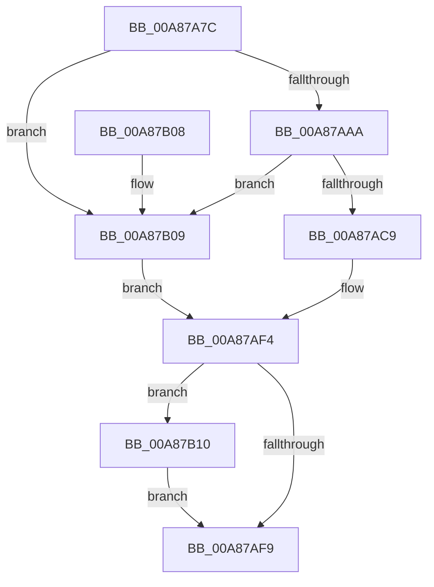

# EtwpTiQueryTokenIdentity

- RVA: `0x00A87A7C`–`0x00A87B19` (길이 `157` bytes)
- VA: `0x0000000140A87A7C`
- 실행 섹션: `PAGE`
- PDB 이름 있음: `예`; PDB Function 태그: `아니요`
- unwind 정보 RVA: `0x000B7F14`
- 디코드: `48`개 명령, `157/157` bytes 표시
- 미해석 바이트: `0` (있으면 어셈블리에 `.byte`로 보존)

> 이 문서는 커널 이미지의 기계어와 PDB 기호를 분석해 생성했습니다. 4번과 5번은 함수 원형과 자료형을 바이너리 사용 방식에서 추정한 C 해석이며 원본 소스 복구 결과는 아닙니다.

## 1. Dependencies

- 직접 호출 지점: **3**; 고유 호출 대상: **3**
- 직접 호출자로 확인된 함수: **1**
- RIP 상대 이미지 참조: **0**

### Outgoing calls
- `0x00A87A9F` → [SeQueryInformationToken](../8B/SeQueryInformationToken_function_008B5090.md) (function, `0x008B5090`)
- `0x00A87ABE` → [EtwpTiSerializeTokenGroups](EtwpTiSerializeTokenGroups_function_00A87B20.md) (function, `0x00A87B20`)
- `0x00A87B12` → [ExFreePoolWithTag](../../poolcode/B8/ExFreePoolWithTag_function_00B82870.md) (function, `0x00B82870`)

### Direct callers
- [EtwTiLogImpersonateClient](../8C/EtwTiLogImpersonateClient_function_008CC9D0.md) at `0x008CCB3D`
- [EtwTiLogImpersonateClient](../8C/EtwTiLogImpersonateClient_function_008CC9D0.md) at `0x008CCB52`

### Static image references
- 디코드된 RIP-relative 메모리 참조가 없습니다.

## 2. Other-region calls and transfers

- 다른 실행 섹션으로 향하는 call: **1**
  - `0x00A87B12` → [ExFreePoolWithTag](../../poolcode/B8/ExFreePoolWithTag_function_00B82870.md) (`PAGE` → `POOLCODE`)
- 별도 외부 분기/꼬리 이동을 확인하지 못했습니다.

## 3. Assembly (complete function range)

```asm
00A87A7C  48 89 5C 24 10                  mov qword ptr [rsp + 0x10], rbx
00A87A81  57                              push rdi
00A87A82  48 83 EC 20                     sub rsp, 0x20
00A87A86  48 83 64 24 30 00               and qword ptr [rsp + 0x30], 0
00A87A8C  4C 8D 44 24 30                  lea r8, [rsp + 0x30]
00A87A91  48 8B C2                        mov rax, rdx
00A87A94  48 8B F9                        mov rdi, rcx
00A87A97  48 8B C8                        mov rcx, rax
00A87A9A  BA 31 00 00 00                  mov edx, 0x31
00A87A9F  E8 EC D5 E2 FF                  call 0x1408b5090
00A87AA4  8B D8                           mov ebx, eax
00A87AA6  85 C0                           test eax, eax
00A87AA8  78 5F                           js 0x140a87b09
00A87AAA  48 8B 4C 24 30                  mov rcx, qword ptr [rsp + 0x30]
00A87AAF  4C 8D 4F 18                     lea r9, [rdi + 0x18]
00A87AB3  4C 8D 47 20                     lea r8, [rdi + 0x20]
00A87AB7  8B 51 40                        mov edx, dword ptr [rcx + 0x40]
00A87ABA  48 8B 49 48                     mov rcx, qword ptr [rcx + 0x48]
00A87ABE  E8 5D 00 00 00                  call 0x140a87b20
00A87AC3  8B D8                           mov ebx, eax
00A87AC5  85 C0                           test eax, eax
00A87AC7  78 40                           js 0x140a87b09
00A87AC9  4C 8B 44 24 30                  mov r8, qword ptr [rsp + 0x30]
00A87ACE  49 8B 40 38                     mov rax, qword ptr [r8 + 0x38]
00A87AD2  48 8B C8                        mov rcx, rax
00A87AD5  4C 89 47 08                     mov qword ptr [rdi + 8], r8
00A87AD9  48 C1 E9 20                     shr rcx, 0x20
00A87ADD  48 63 D1                        movsxd rdx, ecx
00A87AE0  48 C1 E2 20                     shl rdx, 0x20
00A87AE4  8B C8                           mov ecx, eax
00A87AE6  48 03 D1                        add rdx, rcx
00A87AE9  33 C9                           xor ecx, ecx
00A87AEB  48 89 57 10                     mov qword ptr [rdi + 0x10], rdx
00A87AEF  48 89 4C 24 30                  mov qword ptr [rsp + 0x30], rcx
00A87AF4  48 85 C9                        test rcx, rcx
00A87AF7  75 17                           jne 0x140a87b10
00A87AF9  89 1F                           mov dword ptr [rdi], ebx
00A87AFB  8B C3                           mov eax, ebx
00A87AFD  48 8B 5C 24 38                  mov rbx, qword ptr [rsp + 0x38]
00A87B02  48 83 C4 20                     add rsp, 0x20
00A87B06  5F                              pop rdi
00A87B07  C3                              ret
00A87B08  CC                              int3
00A87B09  48 8B 4C 24 30                  mov rcx, qword ptr [rsp + 0x30]
00A87B0E  EB E4                           jmp 0x140a87af4
00A87B10  33 D2                           xor edx, edx
00A87B12  E8 59 AD 0F 00                  call 0x140b82870
00A87B17  EB E0                           jmp 0x140a87af9
```

## 4. C-style interpretation (structured pseudocode)

```c
__int64 __fastcall EtwpTiQueryTokenIdentity(__int64 a1, __int64 a2)
{
    __int64 result;
    __int64 v_rsp;
    unsigned __int64 v_stack_p10;
    unsigned __int64 v_stack_p30;
    unsigned __int64 v_stack_p8;

    v_stack_p10 = v_rbx;
    v_rsp = (v_rsp) - (32);
    result = SeQueryInformationToken(a2, 49, v_stack_p8, a4);
    if (sign_flag) goto loc_00A87B09;
    result = EtwpTiSerializeTokenGroups(*(unsigned __int64 *)(v_stack_p8 + 72), (unsigned int)(*(unsigned int *)(v_stack_p8 + 64)), a1 + 32, a1 + 24);
    if (sign_flag) goto loc_00A87B09;
    *(unsigned __int64 *)(a1 + 8) = v_stack_p8;
    a1 = (*(unsigned __int64 *)(v_stack_p8 + 56)) >> (32);
    a2 = ((int)((unsigned int)(a1))) << (32);
    a2 = (a2) + ((unsigned int)((unsigned int)(*(unsigned __int64 *)(v_stack_p8 + 56))));
    a1 = 0;
    *(unsigned __int64 *)(a1 + 16) = a2;
    v_stack_p8 = 0;
loc_00A87AF4:
    if (0 != 0) goto loc_00A87B10;
loc_00A87AF9:
    *(unsigned int *)(a1) = (unsigned int)((unsigned int)((unsigned int)(result)));
    v_rsp = (v_rsp) + (32);
    return (unsigned int)((unsigned int)((unsigned int)((unsigned int)(result))));
loc_00A87B09:
    goto loc_00A87AF4;
loc_00A87B10:
    a2 = 0;
    result = ExFreePoolWithTag(v_stack_p30, a2, v_stack_p8, a1 + 24);
    goto loc_00A87AF9;
}
```

## 5. (Beta) C Style

```c
int64_t EtwpTiQueryTokenIdentity(void *Arg1, int64_t Arg2)
{
    uint8_t *arg1 = (uint8_t *)Arg1;

    int64_t result;
    int64_t local_rsp;
    uint64_t v_stack_p10;
    uint64_t v_stack_p30;
    uint64_t v_stack_p8;

    v_stack_p10 = local_rbx;
    local_rsp = (local_rsp) - (32);
    result = SeQueryInformationToken(Arg2, 49, v_stack_p8, a4);
    if (sign_flag) goto loc_00A87B09;
    result = EtwpTiSerializeTokenGroups(*(uint64_t *)(v_stack_p8 + 0x48), (uint32_t)(*(uint32_t *)(v_stack_p8 + 0x40)), Arg1 + 32, Arg1 + 24);
    if (sign_flag) goto loc_00A87B09;
    *(uint64_t *)(arg1 + 0x8) = v_stack_p8;
    Arg1 = (*(uint64_t *)(v_stack_p8 + 0x38)) >> (32);
    Arg2 = ((int32_t)((uint32_t)(Arg1))) << (32);
    Arg2 = (Arg2) + ((uint32_t)((uint32_t)(*(uint64_t *)(v_stack_p8 + 0x38))));
    Arg1 = 0;
    *(uint64_t *)(arg1 + 0x10) = Arg2;
    v_stack_p8 = 0;
loc_00A87AF4:
    if (0 != 0) goto loc_00A87B10;
loc_00A87AF9:
    *(uint32_t *)(arg1) = (uint32_t)((uint32_t)((uint32_t)(result)));
    local_rsp = (local_rsp) + (32);
    return (uint32_t)((uint32_t)((uint32_t)((uint32_t)(result))));
loc_00A87B09:
    goto loc_00A87AF4;
loc_00A87B10:
    Arg2 = 0;
    result = ExFreePoolWithTag(v_stack_p30, Arg2, v_stack_p8, Arg1 + 24);
    goto loc_00A87AF9;
}
```

### 관측된 메모리 오프셋

구조체 형식이 확인되지 않은 접근은 인자 기준의 오프셋으로만 기록했습니다.

| 기준 인자 | 오프셋 표현 | 폭 (bit) | 접근 |
|---|---:|---:|---|
| `Arg1` | `+ 0x0` | `32` | `W` |
| `Arg1` | `+ 0x8` | `64` | `W` |
| `Arg1` | `+ 0x10` | `64` | `W` |
| `Arg1` | `+ 0x18` | `64` | `R` |
| `Arg1` | `+ 0x20` | `64` | `R` |

## 6. Execution-region graph

[열기: 2D/3D 그래프와 함수 탐색 컨트롤 패널](../../../control-panel.html?section=page&rva=0x00A87A7C&view=graph)

- 2D 그래프는 위에서 아래로 흐르고, 3D 그래프는 빈 공간을 드래그해 회전합니다. Shift+드래그는 이동, 휠은 확대·축소, 함수 노드 선택은 대상 보고서 이동입니다.

### Static fallback


