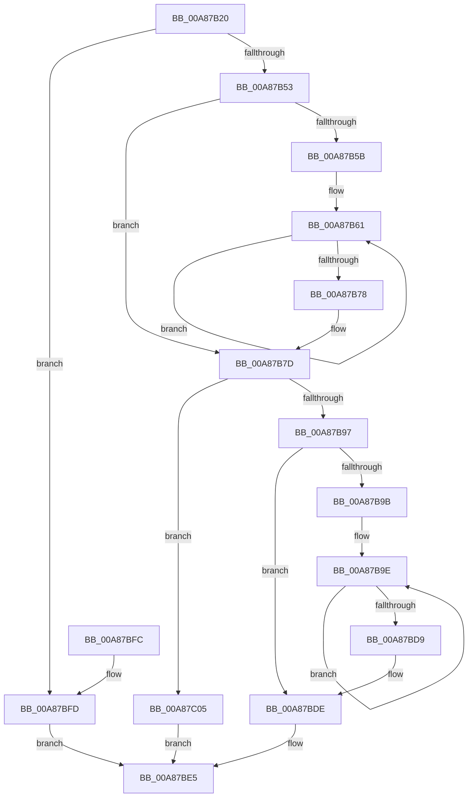

# EtwpTiSerializeTokenGroups

- RVA: `0x00A87B20`–`0x00A87C0C` (길이 `236` bytes)
- VA: `0x0000000140A87B20`
- 실행 섹션: `PAGE`
- PDB 이름 있음: `예`; PDB Function 태그: `아니요`
- unwind 정보 RVA: `0x000B7F24`
- 디코드: `78`개 명령, `236/236` bytes 표시
- 미해석 바이트: `0` (있으면 어셈블리에 `.byte`로 보존)

> 이 문서는 커널 이미지의 기계어와 PDB 기호를 분석해 생성했습니다. 4번과 5번은 함수 원형과 자료형을 바이너리 사용 방식에서 추정한 C 해석이며 원본 소스 복구 결과는 아닙니다.

## 1. Dependencies

- 직접 호출 지점: **5**; 고유 호출 대상: **3**
- 직접 호출자로 확인된 함수: **1**
- RIP 상대 이미지 참조: **0**

### Outgoing calls
- `0x00A87B64` → [RtlLengthSid](../../text/45/RtlLengthSid_function_0045D270.md) (function, `0x0045D270`)
- `0x00A87B8A` → [ExAllocatePool2](../../poolcode/B8/ExAllocatePool2_function_00B820F0.md) (function, `0x00B820F0`)
- `0x00A87BAC` → [RtlLengthSid](../../text/45/RtlLengthSid_function_0045D270.md) (function, `0x0045D270`)
- `0x00A87BBB` → [memcpy](../../text/6C/memcpy_function_006C6840.md) (function, `0x006C6840`)
- `0x00A87BC4` → [RtlLengthSid](../../text/45/RtlLengthSid_function_0045D270.md) (function, `0x0045D270`)

### Direct callers
- [EtwpTiQueryTokenIdentity](EtwpTiQueryTokenIdentity_function_00A87A7C.md) at `0x00A87ABE`

### Static image references
- 디코드된 RIP-relative 메모리 참조가 없습니다.

## 2. Other-region calls and transfers

- 다른 실행 섹션으로 향하는 call: **5**
  - `0x00A87B64` → [RtlLengthSid](../../text/45/RtlLengthSid_function_0045D270.md) (`PAGE` → `.text`)
  - `0x00A87B8A` → [ExAllocatePool2](../../poolcode/B8/ExAllocatePool2_function_00B820F0.md) (`PAGE` → `POOLCODE`)
  - `0x00A87BAC` → [RtlLengthSid](../../text/45/RtlLengthSid_function_0045D270.md) (`PAGE` → `.text`)
  - `0x00A87BBB` → [memcpy](../../text/6C/memcpy_function_006C6840.md) (`PAGE` → `.text`)
  - `0x00A87BC4` → [RtlLengthSid](../../text/45/RtlLengthSid_function_0045D270.md) (`PAGE` → `.text`)
- 별도 외부 분기/꼬리 이동을 확인하지 못했습니다.

## 3. Assembly (complete function range)

```asm
00A87B20  48 89 5C 24 10                  mov qword ptr [rsp + 0x10], rbx
00A87B25  4C 89 4C 24 20                  mov qword ptr [rsp + 0x20], r9
00A87B2A  48 89 4C 24 08                  mov qword ptr [rsp + 8], rcx
00A87B2F  55                              push rbp
00A87B30  56                              push rsi
00A87B31  57                              push rdi
00A87B32  41 54                           push r12
00A87B34  41 55                           push r13
00A87B36  41 56                           push r14
00A87B38  41 57                           push r15
00A87B3A  48 83 EC 20                     sub rsp, 0x20
00A87B3E  33 FF                           xor edi, edi
00A87B40  8B DA                           mov ebx, edx
00A87B42  4D 8B F9                        mov r15, r9
00A87B45  4D 8B E0                        mov r12, r8
00A87B48  4C 8B E9                        mov r13, rcx
00A87B4B  85 D2                           test edx, edx
00A87B4D  0F 84 AA 00 00 00               je 0x140a87bfd
00A87B53  8B EF                           mov ebp, edi
00A87B55  8B F3                           mov esi, ebx
00A87B57  85 D2                           test edx, edx
00A87B59  74 22                           je 0x140a87b7d
00A87B5B  4C 8B F1                        mov r14, rcx
00A87B5E  44 8B EB                        mov r13d, ebx
00A87B61  49 8B 0E                        mov rcx, qword ptr [r14]
00A87B64  E8 07 57 9D FF                  call 0x14045d270
00A87B69  83 C5 04                        add ebp, 4
00A87B6C  4D 8D 76 10                     lea r14, [r14 + 0x10]
00A87B70  03 E8                           add ebp, eax
00A87B72  49 83 ED 01                     sub r13, 1
00A87B76  75 E9                           jne 0x140a87b61
00A87B78  4C 8B 6C 24 60                  mov r13, qword ptr [rsp + 0x60]
00A87B7D  8B D5                           mov edx, ebp
00A87B7F  B9 00 01 00 00                  mov ecx, 0x100
00A87B84  41 B8 54 49 73 6E               mov r8d, 0x6e734954
00A87B8A  E8 61 A5 0F 00                  call 0x140b820f0
00A87B8F  4C 8B F0                        mov r14, rax
00A87B92  48 85 C0                        test rax, rax
00A87B95  74 6E                           je 0x140a87c05
00A87B97  85 DB                           test ebx, ebx
00A87B99  74 43                           je 0x140a87bde
00A87B9B  4C 8B F8                        mov r15, rax
00A87B9E  41 8B 45 08                     mov eax, dword ptr [r13 + 8]
00A87BA2  41 89 07                        mov dword ptr [r15], eax
00A87BA5  49 8B 5D 00                     mov rbx, qword ptr [r13]
00A87BA9  48 8B CB                        mov rcx, rbx
00A87BAC  E8 BF 56 9D FF                  call 0x14045d270
00A87BB1  44 8B C0                        mov r8d, eax
00A87BB4  49 8D 4F 04                     lea rcx, [r15 + 4]
00A87BB8  48 8B D3                        mov rdx, rbx
00A87BBB  E8 80 EC C3 FF                  call 0x1406c6840
00A87BC0  49 8B 4D 00                     mov rcx, qword ptr [r13]
00A87BC4  E8 A7 56 9D FF                  call 0x14045d270
00A87BC9  4D 8D 6D 10                     lea r13, [r13 + 0x10]
00A87BCD  8D 48 04                        lea ecx, [rax + 4]
00A87BD0  4C 03 F9                        add r15, rcx
00A87BD3  48 83 EE 01                     sub rsi, 1
00A87BD7  75 C5                           jne 0x140a87b9e
00A87BD9  4C 8B 7C 24 78                  mov r15, qword ptr [rsp + 0x78]
00A87BDE  41 89 2C 24                     mov dword ptr [r12], ebp
00A87BE2  4D 89 37                        mov qword ptr [r15], r14
00A87BE5  48 8B 5C 24 68                  mov rbx, qword ptr [rsp + 0x68]
00A87BEA  8B C7                           mov eax, edi
00A87BEC  48 83 C4 20                     add rsp, 0x20
00A87BF0  41 5F                           pop r15
00A87BF2  41 5E                           pop r14
00A87BF4  41 5D                           pop r13
00A87BF6  41 5C                           pop r12
00A87BF8  5F                              pop rdi
00A87BF9  5E                              pop rsi
00A87BFA  5D                              pop rbp
00A87BFB  C3                              ret
00A87BFC  CC                              int3
00A87BFD  41 89 38                        mov dword ptr [r8], edi
00A87C00  49 89 39                        mov qword ptr [r9], rdi
00A87C03  EB E0                           jmp 0x140a87be5
00A87C05  BF 17 00 00 C0                  mov edi, 0xc0000017
00A87C0A  EB D9                           jmp 0x140a87be5
```

## 4. C-style interpretation (structured pseudocode)

```c
__int64 __fastcall EtwpTiSerializeTokenGroups(__int64 a1, int a2, __int64 a3, __int64 a4)
{
    __int64 result;
    __int64 v_r13;
    __int64 v_r15;
    __int64 v_rbp;
    __int64 v_rdi;
    __int64 v_rsi;
    __int64 v_rsp;
    unsigned __int64 v_stack_p10;
    unsigned __int64 v_stack_p20;
    unsigned __int64 v_stack_p8;

    v_stack_p10 = v_rbx;
    v_stack_p20 = a4;
    v_stack_p8 = a1;
    v_rsp = (v_rsp) - (32);
    v_rdi = 0;
    if (a2 == 0) goto loc_00A87BFD;
    if (a2 == 0) goto loc_00A87B7D;
loc_00A87B61:
    result = RtlLengthSid(*(unsigned __int64 *)(a1), a2, a3, a4);
    v_rbp = (unsigned int)((0) + (4));
    v_rbp = (unsigned int)((v_rbp) + ((unsigned int)(result)));
    v_r13 = ((unsigned int)((unsigned int)((unsigned int)(a2)))) - (1);
    if (condition_is_not_equal) goto loc_00A87B61;
loc_00A87B7D:
    result = ExAllocatePool2(256, (unsigned int)((unsigned int)(v_rbp)), (unsigned int)(0x6E734954ULL), a4);
    if (result == 0) goto loc_00A87C05;
    if ((unsigned int)((unsigned int)(a2)) == 0) goto loc_00A87BDE;
loc_00A87B9E:
    *(unsigned int *)(result) = (unsigned int)((unsigned int)(*(unsigned int *)(v_stack_p8 + 8)));
    result = RtlLengthSid(*(unsigned __int64 *)(v_stack_p8), (unsigned int)((unsigned int)(v_rbp)), (unsigned int)(0x6E734954ULL), a4);
    result = memcpy(result + 4, *(unsigned __int64 *)(v_stack_p8), (unsigned int)((unsigned int)(result)), a4);
    result = RtlLengthSid(*(unsigned __int64 *)(v_stack_p8), *(unsigned __int64 *)(v_stack_p8), (unsigned int)((unsigned int)(result)), a4);
    v_r15 = (result) + (result + 4);
    v_rsi = ((unsigned int)((unsigned int)((unsigned int)(a2)))) - (1);
    if (condition_is_not_equal) goto loc_00A87B9E;
loc_00A87BDE:
    *(unsigned int *)(a3) = (unsigned int)(v_rbp);
    *(unsigned __int64 *)(v_stack_p20) = result;
loc_00A87BE5:
    v_rsp = (v_rsp) + (32);
    return 0;
loc_00A87BFD:
    *(unsigned int *)((unsigned int)((unsigned int)(result))) = 0;
    *(unsigned __int64 *)(a4) = 0;
    goto loc_00A87BE5;
loc_00A87C05:
    goto loc_00A87BE5;
}
```

## 5. (Beta) C Style

```c
int64_t EtwpTiSerializeTokenGroups(void *Arg1, int32_t Arg2, void *Arg3, void *Arg4)
{
    uint8_t *arg1 = (uint8_t *)Arg1;
    uint8_t *arg3 = (uint8_t *)Arg3;
    uint8_t *arg4 = (uint8_t *)Arg4;

    int64_t result;
    int64_t local_r13;
    int64_t local_r15;
    int64_t local_rbp;
    int64_t local_rdi;
    int64_t local_rsi;
    int64_t local_rsp;
    uint64_t v_stack_p10;
    uint64_t v_stack_p20;
    uint64_t v_stack_p8;

    v_stack_p10 = local_rbx;
    v_stack_p20 = Arg4;
    v_stack_p8 = Arg1;
    local_rsp = (local_rsp) - (32);
    local_rdi = 0;
    if (Arg2 == 0) goto loc_00A87BFD;
    if (Arg2 == 0) goto loc_00A87B7D;
loc_00A87B61:
    result = RtlLengthSid(*(uint64_t *)(arg1), Arg2, Arg3, Arg4);
    local_rbp = (uint32_t)((0) + (4));
    local_rbp = (uint32_t)((local_rbp) + ((uint32_t)(result)));
    local_r13 = ((uint32_t)((uint32_t)((uint32_t)(Arg2)))) - (1);
    if (condition_is_not_equal) goto loc_00A87B61;
loc_00A87B7D:
    result = ExAllocatePool2(256, (uint32_t)((uint32_t)(local_rbp)), (uint32_t)(0x6E734954ULL), Arg4);
    if (result == 0) goto loc_00A87C05;
    if ((uint32_t)((uint32_t)(Arg2)) == 0) goto loc_00A87BDE;
loc_00A87B9E:
    *(uint32_t *)(result) = (uint32_t)((uint32_t)(*(uint32_t *)(v_stack_p8 + 0x8)));
    result = RtlLengthSid(*(uint64_t *)(v_stack_p8), (uint32_t)((uint32_t)(local_rbp)), (uint32_t)(0x6E734954ULL), Arg4);
    result = memcpy(result + 4, *(uint64_t *)(v_stack_p8), (uint32_t)((uint32_t)(result)), Arg4);
    result = RtlLengthSid(*(uint64_t *)(v_stack_p8), *(uint64_t *)(v_stack_p8), (uint32_t)((uint32_t)(result)), Arg4);
    local_r15 = (result) + (result + 4);
    local_rsi = ((uint32_t)((uint32_t)((uint32_t)(Arg2)))) - (1);
    if (condition_is_not_equal) goto loc_00A87B9E;
loc_00A87BDE:
    *(uint32_t *)(arg3) = (uint32_t)(local_rbp);
    *(uint64_t *)(v_stack_p20) = result;
loc_00A87BE5:
    local_rsp = (local_rsp) + (32);
    return 0;
loc_00A87BFD:
    *(uint32_t *)((uint32_t)((uint32_t)(result))) = 0;
    *(uint64_t *)(arg4) = 0;
    goto loc_00A87BE5;
loc_00A87C05:
    goto loc_00A87BE5;
}
```

### 관측된 메모리 오프셋

구조체 형식이 확인되지 않은 접근은 인자 기준의 오프셋으로만 기록했습니다.

| 기준 인자 | 오프셋 표현 | 폭 (bit) | 접근 |
|---|---:|---:|---|
| `Arg1` | `+ 0x0` | `64` | `R` |
| `Arg1` | `+ 0x10` | `64` | `R` |
| `Arg3` | `+ 0x0` | `32` | `W` |
| `Arg4` | `+ 0x0` | `64` | `W` |

## 6. Execution-region graph

[열기: 2D/3D 그래프와 함수 탐색 컨트롤 패널](../../../control-panel.html?section=page&rva=0x00A87B20&view=graph)

- 2D 그래프는 위에서 아래로 흐르고, 3D 그래프는 빈 공간을 드래그해 회전합니다. Shift+드래그는 이동, 휠은 확대·축소, 함수 노드 선택은 대상 보고서 이동입니다.

### Static fallback


