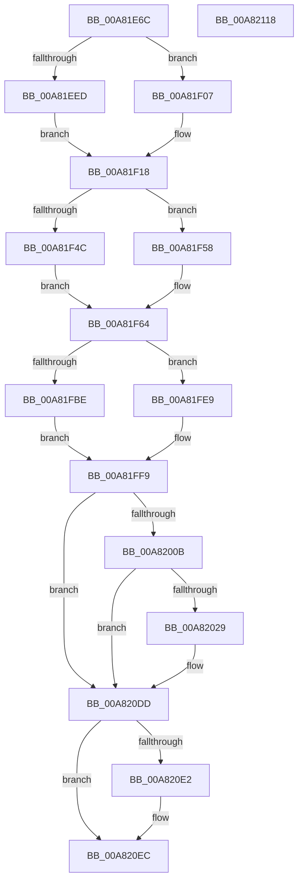

# EtwpTimLogMitigationForProcess

- RVA: `0x00A81E6C`–`0x00A82119` (길이 `685` bytes)
- VA: `0x0000000140A81E6C`
- 실행 섹션: `PAGE`
- PDB 이름 있음: `예`; PDB Function 태그: `아니요`
- unwind 정보 RVA: `0x000B71D8`
- 디코드: `161`개 명령, `685/685` bytes 표시
- 미해석 바이트: `0` (있으면 어셈블리에 `.byte`로 보존)

> 이 문서는 커널 이미지의 기계어와 PDB 기호를 분석해 생성했습니다. 4번과 5번은 함수 원형과 자료형을 바이너리 사용 방식에서 추정한 C 해석이며 원본 소스 복구 결과는 아닙니다.

## 1. Dependencies

- 직접 호출 지점: **10**; 고유 호출 대상: **10**
- 직접 호출자로 확인된 함수: **5**
- RIP 상대 이미지 참조: **6**

### Outgoing calls
- `0x00A81F2A` → [EtwpQueryProcessCommandLine](../8A/EtwpQueryProcessCommandLine_function_008A5C20.md) (function, `0x008A5C20`)
- `0x00A81F7F` → [EtwpTiFillProcessIdentity](../../text/3B/EtwpTiFillProcessIdentity_function_003B8F30.md) (function, `0x003B8F30`)
- `0x00A81F9D` → [EtwpTiFillThreadIdentity](../../text/47/EtwpTiFillThreadIdentity_function_00471C1C.md) (function, `0x00471C1C`)
- `0x00A81FA4` → [Feature_ThreatintDeadlockFix__private_IsEnabledDeviceUsageNoInline](../../text/4F/Feature_ThreatintDeadlockFix__private_IsEnabledDeviceUsageNoInline_function_004F77F4.md) (function, `0x004F77F4`)
- `0x00A81FE2` → [EtwWriteEx](../../text/25/EtwWriteEx_function_0025F0D0.md) (function, `0x0025F0D0`)
- `0x00A81FF4` → [EtwWrite](../../text/41/EtwWrite_function_0041C720.md) (function, `0x0041C720`)
- `0x00A8201C` → [tlgKeywordOn](../../text/42/tlgKeywordOn_function_0042EAA0.md) (function, `0x0042EAA0`)
- `0x00A820D8` → [tlgWriteTransfer_EtwWriteTransfer](../../text/42/tlgWriteTransfer_EtwWriteTransfer_function_004260E0.md) (function, `0x004260E0`)
- `0x00A820E7` → [ExFreePoolWithTag](../../poolcode/B8/ExFreePoolWithTag_function_00B82870.md) (function, `0x00B82870`)
- `0x00A820F6` → [_security_check_cookie](../../text/6A/_security_check_cookie_function_006AC640.md) (function, `0x006AC640`)

### Direct callers
- [MiAllowImageMap](../8C/MiAllowImageMap_function_008C8B10.md) at `0x008C8C19`
- [MiArbitraryCodeBlocked](../97/MiArbitraryCodeBlocked_function_0097D7CC.md) at `0x0097D856`
- [EtwTimLogProhibitWin32kSystemCalls](EtwTimLogProhibitWin32kSystemCalls_function_00A81DC0.md) at `0x00A81DF9`
- [EtwTimLogProhibitFsctlSystemCalls](EtwTimLogProhibitFsctlSystemCalls_function_00A81E18.md) at `0x00A81E56`
- [EtwTimLogProhibitDynamicCode](EtwTimLogProhibitDynamicCode_function_00A8E9DC.md) at `0x00A8EA19`

### Static image references
- `0x00A81E8E` → RVA `0x00E0A740` (`.data`; read)
- `0x00A81EA6` → RVA `0x00002F28` (`.rdata`; read)
- `0x00A81ECA` → RVA `0x00B076E0` (` ?? ::NNGAKEGL::`string'`; read)
- `0x00A81FA9` → RVA `0x00EFF828` (`.data`; read)
- `0x00A81FF9` → RVA `0x00E09168` (`.data`; read)
- `0x00A82037` → RVA `0x0005501E` (`.rdata`; read)

## 2. Other-region calls and transfers

- 다른 실행 섹션으로 향하는 call: **9**
  - `0x00A81F7F` → [EtwpTiFillProcessIdentity](../../text/3B/EtwpTiFillProcessIdentity_function_003B8F30.md) (`PAGE` → `.text`)
  - `0x00A81F9D` → [EtwpTiFillThreadIdentity](../../text/47/EtwpTiFillThreadIdentity_function_00471C1C.md) (`PAGE` → `.text`)
  - `0x00A81FA4` → [Feature_ThreatintDeadlockFix__private_IsEnabledDeviceUsageNoInline](../../text/4F/Feature_ThreatintDeadlockFix__private_IsEnabledDeviceUsageNoInline_function_004F77F4.md) (`PAGE` → `.text`)
  - `0x00A81FE2` → [EtwWriteEx](../../text/25/EtwWriteEx_function_0025F0D0.md) (`PAGE` → `.text`)
  - `0x00A81FF4` → [EtwWrite](../../text/41/EtwWrite_function_0041C720.md) (`PAGE` → `.text`)
  - `0x00A8201C` → [tlgKeywordOn](../../text/42/tlgKeywordOn_function_0042EAA0.md) (`PAGE` → `.text`)
  - `0x00A820D8` → [tlgWriteTransfer_EtwWriteTransfer](../../text/42/tlgWriteTransfer_EtwWriteTransfer_function_004260E0.md) (`PAGE` → `.text`)
  - `0x00A820E7` → [ExFreePoolWithTag](../../poolcode/B8/ExFreePoolWithTag_function_00B82870.md) (`PAGE` → `POOLCODE`)
  - `0x00A820F6` → [_security_check_cookie](../../text/6A/_security_check_cookie_function_006AC640.md) (`PAGE` → `.text`)
- 별도 외부 분기/꼬리 이동을 확인하지 못했습니다.

## 3. Assembly (complete function range)

```asm
00A81E6C  48 89 74 24 08                  mov qword ptr [rsp + 8], rsi
00A81E71  48 89 7C 24 10                  mov qword ptr [rsp + 0x10], rdi
00A81E76  55                              push rbp
00A81E77  41 54                           push r12
00A81E79  41 55                           push r13
00A81E7B  41 56                           push r14
00A81E7D  41 57                           push r15
00A81E7F  48 8D AC 24 30 FF FF FF         lea rbp, [rsp - 0xd0]
00A81E87  48 81 EC D0 01 00 00            sub rsp, 0x1d0
00A81E8E  48 8B 05 AB 88 38 00            mov rax, qword ptr [rip + 0x3888ab]
00A81E95  48 33 C4                        xor rax, rsp
00A81E98  48 89 85 C0 00 00 00            mov qword ptr [rbp + 0xc0], rax
00A81E9F  49 8B 81 50 03 00 00            mov rax, qword ptr [r9 + 0x350]
00A81EA6  48 8D 35 7B 10 58 FF            lea rsi, [rip - 0xa7ef85]
00A81EAD  44 8B E2                        mov r12d, edx
00A81EB0  0F 57 C0                        xorps xmm0, xmm0
00A81EB3  33 D2                           xor edx, edx
00A81EB5  4D 8B F8                        mov r15, r8
00A81EB8  48 85 C0                        test rax, rax
00A81EBB  48 89 54 24 50                  mov qword ptr [rsp + 0x50], rdx
00A81EC0  44 8B E9                        mov r13d, ecx
00A81EC3  4D 8B F1                        mov r14, r9
00A81EC6  48 0F 45 F0                     cmovne rsi, rax
00A81ECA  48 8D 0D 0F 58 08 00            lea rcx, [rip + 0x8580f]
00A81ED1  0F 11 44 24 58                  movups xmmword ptr [rsp + 0x58], xmm0
00A81ED6  8D 7A 0C                        lea edi, [rdx + 0xc]
00A81ED9  44 8D 42 06                     lea r8d, [rdx + 6]
00A81EDD  0F B7 06                        movzx eax, word ptr [rsi]
00A81EE0  48 C7 45 08 02 00 00 00         mov qword ptr [rbp + 8], 2
00A81EE8  66 85 C0                        test ax, ax
00A81EEB  74 1A                           je 0x140a81f07
00A81EED  66 D1 E8                        shr ax, 1
00A81EF0  66 89 44 24 40                  mov word ptr [rsp + 0x40], ax
00A81EF5  48 8D 44 24 40                  lea rax, [rsp + 0x40]
00A81EFA  48 89 45 00                     mov qword ptr [rbp], rax
00A81EFE  0F B7 06                        movzx eax, word ptr [rsi]
00A81F01  48 8B 4E 08                     mov rcx, qword ptr [rsi + 8]
00A81F05  EB 11                           jmp 0x140a81f18
00A81F07  48 8D 44 24 40                  lea rax, [rsp + 0x40]
00A81F0C  66 44 89 44 24 40               mov word ptr [rsp + 0x40], r8w
00A81F12  48 89 45 00                     mov qword ptr [rbp], rax
00A81F16  8B C7                           mov eax, edi
00A81F18  48 89 4D 10                     mov qword ptr [rbp + 0x10], rcx
00A81F1C  49 8B CE                        mov rcx, r14
00A81F1F  89 55 1C                        mov dword ptr [rbp + 0x1c], edx
00A81F22  48 8D 54 24 58                  lea rdx, [rsp + 0x58]
00A81F27  89 45 18                        mov dword ptr [rbp + 0x18], eax
00A81F2A  E8 F1 3C E2 FF                  call 0x1408a5c20
00A81F2F  0F B7 4C 24 58                  movzx ecx, word ptr [rsp + 0x58]
00A81F34  48 8D 44 24 44                  lea rax, [rsp + 0x44]
00A81F39  33 D2                           xor edx, edx
00A81F3B  48 C7 45 28 02 00 00 00         mov qword ptr [rbp + 0x28], 2
00A81F43  48 89 45 20                     mov qword ptr [rbp + 0x20], rax
00A81F47  66 85 C9                        test cx, cx
00A81F4A  74 0C                           je 0x140a81f58
00A81F4C  48 8B 44 24 60                  mov rax, qword ptr [rsp + 0x60]
00A81F51  8B F9                           mov edi, ecx
00A81F53  66 D1 E9                        shr cx, 1
00A81F56  EB 0C                           jmp 0x140a81f64
00A81F58  48 8D 05 81 57 08 00            lea rax, [rip + 0x85781]
00A81F5F  B9 06 00 00 00                  mov ecx, 6
00A81F64  66 89 4C 24 44                  mov word ptr [rsp + 0x44], cx
00A81F69  4C 8D 44 24 50                  lea r8, [rsp + 0x50]
00A81F6E  89 55 3C                        mov dword ptr [rbp + 0x3c], edx
00A81F71  48 8D 4D 40                     lea rcx, [rbp + 0x40]
00A81F75  49 8B D6                        mov rdx, r14
00A81F78  48 89 45 30                     mov qword ptr [rbp + 0x30], rax
00A81F7C  89 7D 38                        mov dword ptr [rbp + 0x38], edi
00A81F7F  E8 AC 6F 93 FF                  call 0x1403b8f30
00A81F84  65 48 8B 14 25 88 01 00 00      mov rdx, qword ptr gs:[0x188]
00A81F8D  48 8D 4D 00                     lea rcx, [rbp]
00A81F91  8D 78 04                        lea edi, [rax + 4]
00A81F94  8B C7                           mov eax, edi
00A81F96  48 C1 E0 04                     shl rax, 4
00A81F9A  48 03 C8                        add rcx, rax
00A81F9D  E8 7A FC 9E FF                  call 0x140471c1c
00A81FA2  03 F8                           add edi, eax
00A81FA4  E8 4B 58 A7 FF                  call 0x1404f77f4
00A81FA9  48 8B 0D 78 D8 47 00            mov rcx, qword ptr [rip + 0x47d878]
00A81FB0  45 33 F6                        xor r14d, r14d
00A81FB3  85 C0                           test eax, eax
00A81FB5  49 8B D7                        mov rdx, r15
00A81FB8  48 8D 45 00                     lea rax, [rbp]
00A81FBC  74 2B                           je 0x140a81fe9
00A81FBE  44 38 B5 20 01 00 00            cmp byte ptr [rbp + 0x120], r14b
00A81FC5  45 8B CE                        mov r9d, r14d
00A81FC8  48 89 44 24 38                  mov qword ptr [rsp + 0x38], rax
00A81FCD  41 0F 95 C1                     setne r9b
00A81FD1  89 7C 24 30                     mov dword ptr [rsp + 0x30], edi
00A81FD5  45 33 C0                        xor r8d, r8d
00A81FD8  4C 89 74 24 28                  mov qword ptr [rsp + 0x28], r14
00A81FDD  4C 89 74 24 20                  mov qword ptr [rsp + 0x20], r14
00A81FE2  E8 E9 D0 7D FF                  call 0x14025f0d0
00A81FE7  EB 10                           jmp 0x140a81ff9
00A81FE9  44 8B CF                        mov r9d, edi
00A81FEC  48 89 44 24 20                  mov qword ptr [rsp + 0x20], rax
00A81FF1  45 33 C0                        xor r8d, r8d
00A81FF4  E8 27 A7 99 FF                  call 0x14041c720
00A81FF9  83 3D 68 71 38 00 05            cmp dword ptr [rip + 0x387168], 5
00A82000  48 8B 7C 24 60                  mov rdi, qword ptr [rsp + 0x60]
00A82005  0F 86 D2 00 00 00               jbe 0x140a820dd
00A8200B  48 BA 00 00 00 00 00 20 00 00   movabs rdx, 0x200000000000
00A82015  48 8D 0D 4C 71 38 00            lea rcx, [rip + 0x38714c]
00A8201C  E8 7F CA 9A FF                  call 0x14042eaa0
00A82021  84 C0                           test al, al
00A82023  0F 84 B4 00 00 00               je 0x140a820dd
00A82029  48 8D 44 24 48                  lea rax, [rsp + 0x48]
00A8202E  44 89 6C 24 48                  mov dword ptr [rsp + 0x48], r13d
00A82033  48 89 45 90                     mov qword ptr [rbp - 0x70], rax
00A82037  48 8D 15 E0 2F 5D FF            lea rdx, [rip - 0xa2d020]
00A8203E  48 8D 44 24 4C                  lea rax, [rsp + 0x4c]
00A82043  48 C7 45 98 04 00 00 00         mov qword ptr [rbp - 0x68], 4
00A8204B  48 89 45 A0                     mov qword ptr [rbp - 0x60], rax
00A8204F  48 8D 0D 12 71 38 00            lea rcx, [rip + 0x387112]
00A82056  48 8D 45 C8                     lea rax, [rbp - 0x38]
00A8205A  44 89 64 24 4C                  mov dword ptr [rsp + 0x4c], r12d
00A8205F  48 89 45 B0                     mov qword ptr [rbp - 0x50], rax
00A82063  45 33 C9                        xor r9d, r9d
00A82066  48 8B 46 08                     mov rax, qword ptr [rsi + 8]
00A8206A  45 33 C0                        xor r8d, r8d
00A8206D  48 89 45 C0                     mov qword ptr [rbp - 0x40], rax
00A82071  0F B7 06                        movzx eax, word ptr [rsi]
00A82074  89 45 C8                        mov dword ptr [rbp - 0x38], eax
00A82077  48 8D 45 E8                     lea rax, [rbp - 0x18]
00A8207B  48 89 45 D0                     mov qword ptr [rbp - 0x30], rax
00A8207F  0F B7 44 24 58                  movzx eax, word ptr [rsp + 0x58]
00A82084  89 45 E8                        mov dword ptr [rbp - 0x18], eax
00A82087  48 8B 44 24 50                  mov rax, qword ptr [rsp + 0x50]
00A8208C  48 89 44 24 68                  mov qword ptr [rsp + 0x68], rax
00A82091  48 8D 44 24 68                  lea rax, [rsp + 0x68]
00A82096  48 89 45 F0                     mov qword ptr [rbp - 0x10], rax
00A8209A  48 8D 44 24 70                  lea rax, [rsp + 0x70]
00A8209F  48 89 44 24 28                  mov qword ptr [rsp + 0x28], rax
00A820A4  C7 44 24 20 09 00 00 00         mov dword ptr [rsp + 0x20], 9
00A820AC  48 C7 45 A8 04 00 00 00         mov qword ptr [rbp - 0x58], 4
00A820B4  48 C7 45 B8 02 00 00 00         mov qword ptr [rbp - 0x48], 2
00A820BC  44 89 75 CC                     mov dword ptr [rbp - 0x34], r14d
00A820C0  48 C7 45 D8 02 00 00 00         mov qword ptr [rbp - 0x28], 2
00A820C8  48 89 7D E0                     mov qword ptr [rbp - 0x20], rdi
00A820CC  44 89 75 EC                     mov dword ptr [rbp - 0x14], r14d
00A820D0  48 C7 45 F8 08 00 00 00         mov qword ptr [rbp - 8], 8
00A820D8  E8 03 40 9A FF                  call 0x1404260e0
00A820DD  48 85 FF                        test rdi, rdi
00A820E0  74 0A                           je 0x140a820ec
00A820E2  33 D2                           xor edx, edx
00A820E4  48 8B CF                        mov rcx, rdi
00A820E7  E8 84 07 10 00                  call 0x140b82870
00A820EC  48 8B 8D C0 00 00 00            mov rcx, qword ptr [rbp + 0xc0]
00A820F3  48 33 CC                        xor rcx, rsp
00A820F6  E8 45 A5 C2 FF                  call 0x1406ac640
00A820FB  4C 8D 9C 24 D0 01 00 00         lea r11, [rsp + 0x1d0]
00A82103  49 8B 73 30                     mov rsi, qword ptr [r11 + 0x30]
00A82107  49 8B 7B 38                     mov rdi, qword ptr [r11 + 0x38]
00A8210B  49 8B E3                        mov rsp, r11
00A8210E  41 5F                           pop r15
00A82110  41 5E                           pop r14
00A82112  41 5D                           pop r13
00A82114  41 5C                           pop r12
00A82116  5D                              pop rbp
00A82117  C3                              ret
00A82118  CC                              int3
```

## 4. C-style interpretation (structured pseudocode)

```c
__int64 __fastcall EtwpTimLogMitigationForProcess(int a1, int a2, __int64 a3, __int64 a4, unsigned __int8 a5)
{
    __int64 result;
    __int64 v_r14;
    __int64 v_rdi;
    __int64 v_rsi;
    __int64 v_rsp;
    unsigned __int64 v_stack_m100;
    unsigned __int64 v_stack_m108;
    unsigned int v_stack_m10C;
    unsigned __int64 v_stack_m110;
    unsigned __int64 v_stack_m118;
    unsigned __int64 v_stack_m120;
    unsigned __int64 v_stack_m128;
    unsigned int v_stack_m12C;
    unsigned __int64 v_stack_m130;
    unsigned __int64 v_stack_m138;
    unsigned __int64 v_stack_m140;
    unsigned __int64 v_stack_m148;
    unsigned __int64 v_stack_m150;
    unsigned __int64 v_stack_m158;
    unsigned __int64 v_stack_m160;
    unsigned __int64 v_stack_m168;
    unsigned __int64 v_stack_m188;
    unsigned __int64 v_stack_m190;
    unsigned __int64 v_stack_m198;
    unsigned __int64 v_stack_m1A0;
    unsigned __int64 v_stack_m1A8;
    unsigned __int64 v_stack_m1AC;
    unsigned __int64 v_stack_m1B0;
    unsigned __int64 v_stack_m1B4;
    unsigned __int16 v_stack_m1B8;
    unsigned __int64 v_stack_m1C0;
    unsigned int v_stack_m1C8;
    unsigned __int64 v_stack_m1D0;
    unsigned __int64 v_stack_m1D8;
    unsigned __int64 v_stack_m28;
    unsigned __int64 v_stack_m38;
    unsigned __int64 v_stack_mB8;
    unsigned int v_stack_mBC;
    unsigned int v_stack_mC0;
    unsigned __int64 v_stack_mC8;
    unsigned __int64 v_stack_mD0;
    unsigned __int64 v_stack_mD8;
    unsigned int v_stack_mDC;
    unsigned int v_stack_mE0;
    unsigned __int64 v_stack_mE8;
    unsigned __int64 v_stack_mF0;
    unsigned __int64 v_stack_mF8;
    unsigned __int64 v_stack_p10;
    unsigned __int64 v_stack_p8;

    v_stack_p8 = v_rsi;
    v_stack_p10 = v_rdi;
    v_rsp = (v_rsp) - (464);
    result = (*(unsigned __int64 *)(v_rip + 3705003)) ^ (v_rsp);
    v_stack_m38 = result;
    a2 = 0;
    v_stack_m1A8 = 0;
    v_rsi = v_rip - 11005829;
    if (*(unsigned __int64 *)(a4 + 848) != 0) { v_rsi = *(unsigned __int64 *)(a4 + 848); }
    v_stack_m1A0 = v_xmm0;
    v_stack_mF0 = 2;
    if ((unsigned __int16)(*(unsigned __int16 *)(v_rsi)) == 0) goto loc_00A81F07;
    result = (unsigned __int16)((*(unsigned __int16 *)(v_rsi)) >> (1));
    v_stack_m1B8 = (unsigned __int16)(result);
    v_stack_mF8 = v_stack_m1B8;
    goto loc_00A81F18;
loc_00A81F07:
    v_stack_m1B8 = (unsigned __int16)(a2 + 6);
    v_stack_mF8 = v_stack_m1B8;
loc_00A81F18:
    v_stack_mE8 = *(unsigned __int64 *)(v_rsi + 8);
    v_stack_mDC = 0;
    v_stack_mE0 = (unsigned int)((unsigned int)((unsigned int)(a2 + 12)));
    result = EtwpQueryProcessCommandLine(a4, v_stack_m1A0, a2 + 6, a4);
    a2 = 0;
    v_stack_mD0 = 2;
    v_stack_mD8 = v_stack_m1B4;
    if ((unsigned __int16)(v_stack_m1A0) == 0) goto loc_00A81F58;
    a1 = (unsigned __int16)((v_stack_m1A0) >> (1));
    goto loc_00A81F64;
loc_00A81F58:
loc_00A81F64:
    v_stack_m1B4 = 6;
    v_stack_mBC = 0;
    v_stack_mC8 = v_rip + 546689;
    v_stack_mC0 = (unsigned int)((unsigned int)((unsigned int)(v_stack_m1A0)));
    result = EtwpTiFillProcessIdentity(v_stack_mB8, a4, v_stack_m1A8, a4);
    result = ((unsigned int)((unsigned int)(result + 4))) << (4);
    a1 = (v_stack_mF8) + (result);
    result = EtwpTiFillThreadIdentity(a1, *(unsigned __int64 *)(gs_base + (0 + 392)), v_stack_m1A8, a4);
    v_rdi = (unsigned int)((result + 4) + ((unsigned int)(result)));
    result = Feature_ThreatintDeadlockFix__private_IsEnabledDeviceUsageNoInline(a1, *(unsigned __int64 *)(gs_base + (0 + 392)), v_stack_m1A8, a4);
    v_r14 = 0;
    if ((unsigned int)(result) == 0) goto loc_00A81FE9;
    v_stack_m1C0 = v_stack_mF8;
    a4 = (a5 != 0) ? 1 : 0;
    v_stack_m1C8 = (unsigned int)(v_rdi);
    a3 = 0;
    v_stack_m1D0 = 0;
    v_stack_m1D8 = 0;
    result = EtwWriteEx(*(unsigned __int64 *)(v_rip + 4708472), a3, a3, a4);
    goto loc_00A81FF9;
loc_00A81FE9:
    v_stack_m1D8 = result;
    a3 = 0;
    result = EtwWrite(*(unsigned __int64 *)(v_rip + 4708472), a3, a3, (unsigned int)((unsigned int)(v_rdi)));
loc_00A81FF9:
    if ((*(unsigned int *)(v_rip + 3699048)) <= 5) goto loc_00A820DD;
    result = tlgKeywordOn(v_rip + 3699020, a3, a3, (unsigned int)((unsigned int)(v_rdi)));
    if ((unsigned __int8)(result) != 0) {
        result = v_stack_m1B0;
        v_stack_m1B0 = (unsigned int)((unsigned int)(a1));
        v_stack_m168 = result;
        a2 = v_rip - 10670112;
        result = v_stack_m1AC;
        v_stack_m160 = 4;
        v_stack_m158 = result;
        a1 = v_rip + 3698962;
        result = v_stack_m130;
        v_stack_m1AC = (unsigned int)((unsigned int)(a2));
        v_stack_m148 = result;
        a4 = 0;
        result = *(unsigned __int64 *)(v_rsi + 8);
        a3 = 0;
        v_stack_m138 = result;
        result = *(unsigned __int16 *)(v_rsi);
        v_stack_m130 = (unsigned int)(result);
        result = v_stack_m110;
        v_stack_m128 = result;
        result = v_stack_m1A0;
        v_stack_m110 = (unsigned int)(result);
        result = v_stack_m1A8;
        v_stack_m190 = result;
        result = v_stack_m190;
        v_stack_m108 = result;
        result = v_stack_m188;
        v_stack_m1D0 = result;
        v_stack_m1D8 = 9;
        v_stack_m150 = 4;
        v_stack_m140 = 2;
        v_stack_m12C = 0;
        v_stack_m120 = 2;
        v_stack_m118 = v_stack_m198;
        v_stack_m10C = 0;
        v_stack_m100 = 8;
        result = tlgWriteTransfer_EtwWriteTransfer(a1, a2, a3, a4);
    }
    if (v_stack_m198 != 0) {
        a2 = 0;
        a1 = v_stack_m198;
        result = ExFreePoolWithTag(a1, a2, a3, a4);
    }
    a1 = (v_stack_m38) ^ (v_rsp);
    result = _security_check_cookie(a1, a2, a3, a4);
    return result;
}
```

## 5. (Beta) C Style

```c
int64_t EtwpTimLogMitigationForProcess(int32_t Arg1, int32_t Arg2, int64_t Arg3, void *Arg4, uint8_t Arg5)
{
    uint8_t *arg4 = (uint8_t *)Arg4;

    int64_t result;
    int64_t local_r14;
    int64_t local_rdi;
    int64_t local_rsi;
    int64_t local_rsp;
    uint64_t v_stack_m100;
    uint64_t v_stack_m108;
    uint32_t v_stack_m10C;
    uint64_t v_stack_m110;
    uint64_t v_stack_m118;
    uint64_t v_stack_m120;
    uint64_t v_stack_m128;
    uint32_t v_stack_m12C;
    uint64_t v_stack_m130;
    uint64_t v_stack_m138;
    uint64_t v_stack_m140;
    uint64_t v_stack_m148;
    uint64_t v_stack_m150;
    uint64_t v_stack_m158;
    uint64_t v_stack_m160;
    uint64_t v_stack_m168;
    uint64_t v_stack_m188;
    uint64_t v_stack_m190;
    uint64_t v_stack_m198;
    uint64_t v_stack_m1A0;
    uint64_t v_stack_m1A8;
    uint64_t v_stack_m1AC;
    uint64_t v_stack_m1B0;
    uint64_t v_stack_m1B4;
    uint16_t v_stack_m1B8;
    uint64_t v_stack_m1C0;
    uint32_t v_stack_m1C8;
    uint64_t v_stack_m1D0;
    uint64_t v_stack_m1D8;
    uint64_t v_stack_m28;
    uint64_t v_stack_m38;
    uint64_t v_stack_mB8;
    uint32_t v_stack_mBC;
    uint32_t v_stack_mC0;
    uint64_t v_stack_mC8;
    uint64_t v_stack_mD0;
    uint64_t v_stack_mD8;
    uint32_t v_stack_mDC;
    uint32_t v_stack_mE0;
    uint64_t v_stack_mE8;
    uint64_t v_stack_mF0;
    uint64_t v_stack_mF8;
    uint64_t v_stack_p10;
    uint64_t v_stack_p8;

    v_stack_p8 = local_rsi;
    v_stack_p10 = local_rdi;
    local_rsp = (local_rsp) - (464);
    result = (*(uint64_t *)(v_rip + 0x3888AB)) ^ (local_rsp);
    v_stack_m38 = result;
    Arg2 = 0;
    v_stack_m1A8 = 0;
    local_rsi = v_rip - 11005829;
    if (*(uint64_t *)(arg4 + 0x350) != 0) { local_rsi = *(uint64_t *)(arg4 + 0x350); }
    v_stack_m1A0 = v_xmm0;
    v_stack_mF0 = 2;
    if ((uint16_t)(*(uint16_t *)(local_rsi)) == 0) goto loc_00A81F07;
    result = (uint16_t)((*(uint16_t *)(local_rsi)) >> (1));
    v_stack_m1B8 = (uint16_t)(result);
    v_stack_mF8 = v_stack_m1B8;
    goto loc_00A81F18;
loc_00A81F07:
    v_stack_m1B8 = (uint16_t)(Arg2 + 6);
    v_stack_mF8 = v_stack_m1B8;
loc_00A81F18:
    v_stack_mE8 = *(uint64_t *)(local_rsi + 0x8);
    v_stack_mDC = 0;
    v_stack_mE0 = (uint32_t)((uint32_t)((uint32_t)(Arg2 + 12)));
    result = EtwpQueryProcessCommandLine(Arg4, v_stack_m1A0, Arg2 + 6, Arg4);
    Arg2 = 0;
    v_stack_mD0 = 2;
    v_stack_mD8 = v_stack_m1B4;
    if ((uint16_t)(v_stack_m1A0) == 0) goto loc_00A81F58;
    Arg1 = (uint16_t)((v_stack_m1A0) >> (1));
    goto loc_00A81F64;
loc_00A81F58:
loc_00A81F64:
    v_stack_m1B4 = 6;
    v_stack_mBC = 0;
    v_stack_mC8 = v_rip + 546689;
    v_stack_mC0 = (uint32_t)((uint32_t)((uint32_t)(v_stack_m1A0)));
    result = EtwpTiFillProcessIdentity(v_stack_mB8, Arg4, v_stack_m1A8, Arg4);
    result = ((uint32_t)((uint32_t)(result + 4))) << (4);
    Arg1 = (v_stack_mF8) + (result);
    result = EtwpTiFillThreadIdentity(Arg1, *(uint64_t *)(gs_base + (0 + 0x188)), v_stack_m1A8, Arg4);
    local_rdi = (uint32_t)((result + 4) + ((uint32_t)(result)));
    result = Feature_ThreatintDeadlockFix__private_IsEnabledDeviceUsageNoInline(Arg1, *(uint64_t *)(gs_base + (0 + 0x188)), v_stack_m1A8, Arg4);
    local_r14 = 0;
    if ((uint32_t)(result) == 0) goto loc_00A81FE9;
    v_stack_m1C0 = v_stack_mF8;
    Arg4 = (Arg5 != 0) ? 1 : 0;
    v_stack_m1C8 = (uint32_t)(local_rdi);
    Arg3 = 0;
    v_stack_m1D0 = 0;
    v_stack_m1D8 = 0;
    result = EtwWriteEx(*(uint64_t *)(v_rip + 0x47D878), Arg3, Arg3, Arg4);
    goto loc_00A81FF9;
loc_00A81FE9:
    v_stack_m1D8 = result;
    Arg3 = 0;
    result = EtwWrite(*(uint64_t *)(v_rip + 0x47D878), Arg3, Arg3, (uint32_t)((uint32_t)(local_rdi)));
loc_00A81FF9:
    if ((*(uint32_t *)(v_rip + 0x387168)) <= 5) goto loc_00A820DD;
    result = tlgKeywordOn(v_rip + 3699020, Arg3, Arg3, (uint32_t)((uint32_t)(local_rdi)));
    if ((uint8_t)(result) != 0) {
        result = v_stack_m1B0;
        v_stack_m1B0 = (uint32_t)((uint32_t)(Arg1));
        v_stack_m168 = result;
        Arg2 = v_rip - 10670112;
        result = v_stack_m1AC;
        v_stack_m160 = 4;
        v_stack_m158 = result;
        Arg1 = v_rip + 3698962;
        result = v_stack_m130;
        v_stack_m1AC = (uint32_t)((uint32_t)(Arg2));
        v_stack_m148 = result;
        Arg4 = 0;
        result = *(uint64_t *)(local_rsi + 0x8);
        Arg3 = 0;
        v_stack_m138 = result;
        result = *(uint16_t *)(local_rsi);
        v_stack_m130 = (uint32_t)(result);
        result = v_stack_m110;
        v_stack_m128 = result;
        result = v_stack_m1A0;
        v_stack_m110 = (uint32_t)(result);
        result = v_stack_m1A8;
        v_stack_m190 = result;
        result = v_stack_m190;
        v_stack_m108 = result;
        result = v_stack_m188;
        v_stack_m1D0 = result;
        v_stack_m1D8 = 9;
        v_stack_m150 = 4;
        v_stack_m140 = 2;
        v_stack_m12C = 0;
        v_stack_m120 = 2;
        v_stack_m118 = v_stack_m198;
        v_stack_m10C = 0;
        v_stack_m100 = 8;
        result = tlgWriteTransfer_EtwWriteTransfer(Arg1, Arg2, Arg3, Arg4);
    }
    if (v_stack_m198 != 0) {
        Arg2 = 0;
        Arg1 = v_stack_m198;
        result = ExFreePoolWithTag(Arg1, Arg2, Arg3, Arg4);
    }
    Arg1 = (v_stack_m38) ^ (local_rsp);
    result = _security_check_cookie(Arg1, Arg2, Arg3, Arg4);
    return result;
}
```

### 관측된 메모리 오프셋

구조체 형식이 확인되지 않은 접근은 인자 기준의 오프셋으로만 기록했습니다.

| 기준 인자 | 오프셋 표현 | 폭 (bit) | 접근 |
|---|---:|---:|---|
| `Arg4` | `+ 0x350` | `64` | `R` |

## 6. Execution-region graph

[열기: 2D/3D 그래프와 함수 탐색 컨트롤 패널](../../../control-panel.html?section=page&rva=0x00A81E6C&view=graph)

- 2D 그래프는 위에서 아래로 흐르고, 3D 그래프는 빈 공간을 드래그해 회전합니다. Shift+드래그는 이동, 휠은 확대·축소, 함수 노드 선택은 대상 보고서 이동입니다.

### Static fallback


