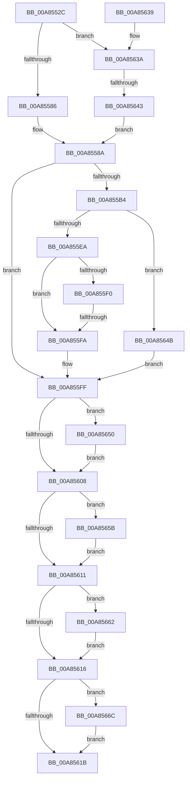

# ExpQueryCodeIntegrityCertificateInfo

- RVA: `0x00A8552C`–`0x00A85676` (길이 `330` bytes)
- VA: `0x0000000140A8552C`
- 실행 섹션: `PAGE`
- PDB 이름 있음: `예`; PDB Function 태그: `예`
- unwind 정보 RVA: `0x000B79D0`
- 디코드: `95`개 명령, `330/330` bytes 표시
- 미해석 바이트: `0` (있으면 어셈블리에 `.byte`로 보존)

> 이 문서는 커널 이미지의 기계어와 PDB 기호를 분석해 생성했습니다. 4번과 5번은 함수 원형과 자료형을 바이너리 사용 방식에서 추정한 C 해석이며 원본 소스 복구 결과는 아닙니다.

## 1. Dependencies

- 직접 호출 지점: **6**; 고유 호출 대상: **5**
- 직접 호출자로 확인된 함수: **1**
- RIP 상대 이미지 참조: **1**

### Outgoing calls
- `0x00A855A9` → [IoConvertFileHandleToKernelHandle](IoConvertFileHandleToKernelHandle_function_00A85680.md) (function, `0x00A85680`)
- `0x00A855DB` → [ObReferenceObjectByHandle](../86/ObReferenceObjectByHandle_function_00868DB0.md) (function, `0x00868DB0`)
- `0x00A85654` → [ZwUnmapViewOfSection](../../text/6A/ZwUnmapViewOfSection_function_006AD610.md) (function, `0x006AD610`)
- `0x00A8565B` → [ZwClose](../../text/6A/ZwClose_function_006AD2B0.md) (function, `0x006AD2B0`)
- `0x00A85665` → [ObfDereferenceObject](../../text/2F/ObfDereferenceObject_function_002F9350.md) (function, `0x002F9350`)
- `0x00A8566F` → [ZwClose](../../text/6A/ZwClose_function_006AD2B0.md) (function, `0x006AD2B0`)

### Direct callers
- [ExpQuerySystemInformation](../A5/ExpQuerySystemInformation_function_00A57858.md) at `0x00A5AC27`

### Static image references
- `0x00A855BC` → RVA `0x00FC6AE0` (`ALMOSTRO`; read)

## 2. Other-region calls and transfers

- 다른 실행 섹션으로 향하는 call: **4**
  - `0x00A85654` → [ZwUnmapViewOfSection](../../text/6A/ZwUnmapViewOfSection_function_006AD610.md) (`PAGE` → `.text`)
  - `0x00A8565B` → [ZwClose](../../text/6A/ZwClose_function_006AD2B0.md) (`PAGE` → `.text`)
  - `0x00A85665` → [ObfDereferenceObject](../../text/2F/ObfDereferenceObject_function_002F9350.md) (`PAGE` → `.text`)
  - `0x00A8566F` → [ZwClose](../../text/6A/ZwClose_function_006AD2B0.md) (`PAGE` → `.text`)
- call이 아닌 외부 분기/꼬리 이동: **2**
  - `0x00A855F4` → [sub_00B4433C + 0x13](../B4/Unknown_function_00B4433C.md) (`tail-transfer`)
  - `0x00A8563D` → [sub_00B4433C](../B4/Unknown_function_00B4433C.md) (`tail-transfer`)

## 3. Assembly (complete function range)

```asm
00A8552C  48 89 5C 24 08                  mov qword ptr [rsp + 8], rbx
00A85531  48 89 74 24 10                  mov qword ptr [rsp + 0x10], rsi
00A85536  55                              push rbp
00A85537  57                              push rdi
00A85538  41 54                           push r12
00A8553A  41 55                           push r13
00A8553C  41 56                           push r14
00A8553E  48 8D 6C 24 C9                  lea rbp, [rsp - 0x37]
00A85543  48 81 EC A0 00 00 00            sub rsp, 0xa0
00A8554A  45 33 ED                        xor r13d, r13d
00A8554D  33 C0                           xor eax, eax
00A8554F  48 89 45 27                     mov qword ptr [rbp + 0x27], rax
00A85553  0F 57 C0                        xorps xmm0, xmm0
00A85556  89 45 2F                        mov dword ptr [rbp + 0x2f], eax
00A85559  41 8B F5                        mov esi, r13d
00A8555C  4C 89 6D F7                     mov qword ptr [rbp - 9], r13
00A85560  45 8B F5                        mov r14d, r13d
00A85563  4C 89 6D FF                     mov qword ptr [rbp - 1], r13
00A85567  8D 58 02                        lea ebx, [rax + 2]
00A8556A  4C 89 6D E7                     mov qword ptr [rbp - 0x19], r13
00A8556E  4C 89 6D 7F                     mov qword ptr [rbp + 0x7f], r13
00A85572  4C 89 6D 77                     mov qword ptr [rbp + 0x77], r13
00A85576  0F 11 45 07                     movups xmmword ptr [rbp + 7], xmm0
00A8557A  0F 11 45 17                     movups xmmword ptr [rbp + 0x17], xmm0
00A8557E  85 D2                           test edx, edx
00A85580  0F 85 B4 00 00 00               jne 0x140a8563a
00A85586  44 8D 60 01                     lea r12d, [rax + 1]
00A8558A  65 48 8B 04 25 88 01 00 00      mov rax, qword ptr gs:[0x188]
00A85593  45 33 C9                        xor r9d, r9d
00A85596  8A 90 32 02 00 00               mov dl, byte ptr [rax + 0x232]
00A8559C  45 8D 41 01                     lea r8d, [r9 + 1]
00A855A0  48 8D 45 E7                     lea rax, [rbp - 0x19]
00A855A4  48 89 44 24 20                  mov qword ptr [rsp + 0x20], rax
00A855A9  E8 D2 00 00 00                  call 0x140a85680
00A855AE  8B F8                           mov edi, eax
00A855B0  85 C0                           test eax, eax
00A855B2  78 4B                           js 0x140a855ff
00A855B4  4C 8B 75 E7                     mov r14, qword ptr [rbp - 0x19]
00A855B8  48 8D 45 EF                     lea rax, [rbp - 0x11]
00A855BC  4C 8B 05 1D 15 54 00            mov r8, qword ptr [rip + 0x54151d]
00A855C3  45 33 C9                        xor r9d, r9d
00A855C6  4C 89 6C 24 28                  mov qword ptr [rsp + 0x28], r13
00A855CB  49 8B CE                        mov rcx, r14
00A855CE  4C 89 6D EF                     mov qword ptr [rbp - 0x11], r13
00A855D2  48 89 44 24 20                  mov qword ptr [rsp + 0x20], rax
00A855D7  41 8D 51 01                     lea edx, [r9 + 1]
00A855DB  E8 D0 37 DE FF                  call 0x140868db0
00A855E0  48 8B 75 EF                     mov rsi, qword ptr [rbp - 0x11]
00A855E4  8B F8                           mov edi, eax
00A855E6  85 C0                           test eax, eax
00A855E8  78 61                           js 0x140a8564b
00A855EA  44 38 6E 4E                     cmp byte ptr [rsi + 0x4e], r13b
00A855EE  75 0A                           jne 0x140a855fa
00A855F0  44 38 6E 4B                     cmp byte ptr [rsi + 0x4b], r13b
00A855F4  0F 84 55 ED 0B 00               je 0x140b4434f
00A855FA  BF 43 00 00 C0                  mov edi, 0xc0000043
00A855FF  48 8B 55 77                     mov rdx, qword ptr [rbp + 0x77]
00A85603  48 85 D2                        test rdx, rdx
00A85606  75 48                           jne 0x140a85650
00A85608  48 8B 4D 7F                     mov rcx, qword ptr [rbp + 0x7f]
00A8560C  48 85 C9                        test rcx, rcx
00A8560F  75 4A                           jne 0x140a8565b
00A85611  48 85 F6                        test rsi, rsi
00A85614  75 4C                           jne 0x140a85662
00A85616  4D 85 F6                        test r14, r14
00A85619  75 51                           jne 0x140a8566c
00A8561B  4C 8D 9C 24 A0 00 00 00         lea r11, [rsp + 0xa0]
00A85623  8B C7                           mov eax, edi
00A85625  49 8B 5B 30                     mov rbx, qword ptr [r11 + 0x30]
00A85629  49 8B 73 38                     mov rsi, qword ptr [r11 + 0x38]
00A8562D  49 8B E3                        mov rsp, r11
00A85630  41 5E                           pop r14
00A85632  41 5D                           pop r13
00A85634  41 5C                           pop r12
00A85636  5F                              pop rdi
00A85637  5D                              pop rbp
00A85638  C3                              ret
00A85639  CC                              int3
00A8563A  83 FA 01                        cmp edx, 1
00A8563D  0F 85 F9 EC 0B 00               jne 0x140b4433c
00A85643  44 8B E3                        mov r12d, ebx
00A85646  E9 3F FF FF FF                  jmp 0x140a8558a
00A8564B  49 8B F5                        mov rsi, r13
00A8564E  EB AF                           jmp 0x140a855ff
00A85650  48 83 C9 FF                     or rcx, 0xffffffffffffffff
00A85654  E8 B7 7F C2 FF                  call 0x1406ad610
00A85659  EB AD                           jmp 0x140a85608
00A8565B  E8 50 7C C2 FF                  call 0x1406ad2b0
00A85660  EB AF                           jmp 0x140a85611
00A85662  48 8B CE                        mov rcx, rsi
00A85665  E8 E6 3C 87 FF                  call 0x1402f9350
00A8566A  EB AA                           jmp 0x140a85616
00A8566C  49 8B CE                        mov rcx, r14
00A8566F  E8 3C 7C C2 FF                  call 0x1406ad2b0
00A85674  EB A5                           jmp 0x140a8561b
```

## 4. C-style interpretation (structured pseudocode)

```c
__int64 __fastcall ExpQueryCodeIntegrityCertificateInfo(__int64 a1, int a2, __int64 a3, int a4)
{
    __int64 result;
    __int64 v_r13;
    __int64 v_rsp;
    unsigned __int64 v_stack_m28;
    unsigned int v_stack_m30;
    unsigned __int64 v_stack_m38;
    unsigned __int64 v_stack_m48;
    unsigned __int64 v_stack_m58;
    unsigned __int64 v_stack_m5F;
    unsigned __int64 v_stack_m60;
    unsigned __int64 v_stack_m68;
    unsigned __int64 v_stack_m70;
    unsigned __int64 v_stack_m78;
    unsigned __int64 v_stack_mA0;
    unsigned __int64 v_stack_mA8;
    unsigned __int64 v_stack_p10;
    unsigned __int64 v_stack_p18;
    unsigned __int64 v_stack_p20;
    unsigned __int64 v_stack_p8;

    v_stack_p8 = v_rbx;
    v_stack_p10 = v_rsi;
    v_rsp = (v_rsp) - (160);
    v_r13 = 0;
    result = 0;
    v_stack_m38 = 0;
    v_stack_m30 = 0;
    v_stack_m68 = 0;
    v_stack_m60 = 0;
    v_stack_m78 = 0;
    v_stack_p20 = 0;
    v_stack_p18 = 0;
    v_stack_m58 = v_xmm0;
    v_stack_m48 = v_xmm0;
    if (a2 != 0) goto loc_00A8563A;
loc_00A8558A:
    a4 = 0;
    v_stack_mA8 = v_stack_m78;
    result = IoConvertFileHandleToKernelHandle(a1, *(unsigned __int8 *)(*(unsigned __int64 *)(gs_base + (0 + 392)) + 562), a4 + 1, a4);
    if (sign_flag) goto loc_00A855FF;
    a4 = 0;
    v_stack_mA0 = 0;
    v_stack_m70 = 0;
    v_stack_mA8 = v_stack_m70;
    result = ObReferenceObjectByHandle(v_stack_m78, a4 + 1, *(unsigned __int64 *)(v_rip + 5510429), a4);
    if (sign_flag) goto loc_00A8564B;
    if ((*(unsigned __int8 *)(v_stack_m70 + 78)) != 0) goto loc_00A855FA;
loc_00A855FA:
loc_00A855FF:
    if (v_stack_p18 != 0) goto loc_00A85650;
loc_00A85608:
    if (v_stack_p20 != 0) goto loc_00A8565B;
loc_00A85611:
    if (v_stack_m70 != 0) goto loc_00A85662;
loc_00A85616:
    if (v_stack_m78 != 0) goto loc_00A8566C;
loc_00A8561B:
    return (unsigned int)((unsigned int)((unsigned int)(0xC0000043ULL)));
loc_00A8563A:
    goto loc_00A8558A;
loc_00A8564B:
    goto loc_00A855FF;
loc_00A85650:
    a1 = (v_stack_p20) | (-1);
    result = ZwUnmapViewOfSection(a1, v_stack_p18, *(unsigned __int64 *)(v_rip + 5510429), a4);
    goto loc_00A85608;
loc_00A8565B:
    result = ZwClose(a1, v_stack_p18, *(unsigned __int64 *)(v_rip + 5510429), a4);
    goto loc_00A85611;
loc_00A85662:
    result = ObfDereferenceObject(0, v_stack_p18, *(unsigned __int64 *)(v_rip + 5510429), a4);
    goto loc_00A85616;
loc_00A8566C:
    result = ZwClose(v_stack_m78, v_stack_p18, *(unsigned __int64 *)(v_rip + 5510429), a4);
    goto loc_00A8561B;
}
```

## 5. (Beta) C Style

```c
int64_t ExpQueryCodeIntegrityCertificateInfo(int64_t Arg1, int32_t Arg2, int64_t Arg3, int32_t Arg4)
{
    int64_t result;
    int64_t local_r13;
    int64_t local_rsp;
    uint64_t v_stack_m28;
    uint32_t v_stack_m30;
    uint64_t v_stack_m38;
    uint64_t v_stack_m48;
    uint64_t v_stack_m58;
    uint64_t v_stack_m5F;
    uint64_t v_stack_m60;
    uint64_t v_stack_m68;
    uint64_t v_stack_m70;
    uint64_t v_stack_m78;
    uint64_t v_stack_mA0;
    uint64_t v_stack_mA8;
    uint64_t v_stack_p10;
    uint64_t v_stack_p18;
    uint64_t v_stack_p20;
    uint64_t v_stack_p8;

    v_stack_p8 = local_rbx;
    v_stack_p10 = local_rsi;
    local_rsp = (local_rsp) - (160);
    local_r13 = 0;
    result = 0;
    v_stack_m38 = 0;
    v_stack_m30 = 0;
    v_stack_m68 = 0;
    v_stack_m60 = 0;
    v_stack_m78 = 0;
    v_stack_p20 = 0;
    v_stack_p18 = 0;
    v_stack_m58 = v_xmm0;
    v_stack_m48 = v_xmm0;
    if (Arg2 != 0) goto loc_00A8563A;
loc_00A8558A:
    Arg4 = 0;
    v_stack_mA8 = v_stack_m78;
    result = IoConvertFileHandleToKernelHandle(Arg1, *(uint8_t *)(*(uint64_t *)(gs_base + (0 + 0x188)) + 0x232), Arg4 + 1, Arg4);
    if (sign_flag) goto loc_00A855FF;
    Arg4 = 0;
    v_stack_mA0 = 0;
    v_stack_m70 = 0;
    v_stack_mA8 = v_stack_m70;
    result = ObReferenceObjectByHandle(v_stack_m78, Arg4 + 1, *(uint64_t *)(v_rip + 0x54151D), Arg4);
    if (sign_flag) goto loc_00A8564B;
    if ((*(uint8_t *)(v_stack_m70 + 0x4E)) != 0) goto loc_00A855FA;
loc_00A855FA:
loc_00A855FF:
    if (v_stack_p18 != 0) goto loc_00A85650;
loc_00A85608:
    if (v_stack_p20 != 0) goto loc_00A8565B;
loc_00A85611:
    if (v_stack_m70 != 0) goto loc_00A85662;
loc_00A85616:
    if (v_stack_m78 != 0) goto loc_00A8566C;
loc_00A8561B:
    return (uint32_t)((uint32_t)((uint32_t)(0xC0000043ULL)));
loc_00A8563A:
    goto loc_00A8558A;
loc_00A8564B:
    goto loc_00A855FF;
loc_00A85650:
    Arg1 = (v_stack_p20) | (-1);
    result = ZwUnmapViewOfSection(Arg1, v_stack_p18, *(uint64_t *)(v_rip + 0x54151D), Arg4);
    goto loc_00A85608;
loc_00A8565B:
    result = ZwClose(Arg1, v_stack_p18, *(uint64_t *)(v_rip + 0x54151D), Arg4);
    goto loc_00A85611;
loc_00A85662:
    result = ObfDereferenceObject(0, v_stack_p18, *(uint64_t *)(v_rip + 0x54151D), Arg4);
    goto loc_00A85616;
loc_00A8566C:
    result = ZwClose(v_stack_m78, v_stack_p18, *(uint64_t *)(v_rip + 0x54151D), Arg4);
    goto loc_00A8561B;
}
```

## 6. Execution-region graph

[열기: 2D/3D 그래프와 함수 탐색 컨트롤 패널](../../../control-panel.html?section=page&rva=0x00A8552C&view=graph)

- 2D 그래프는 위에서 아래로 흐르고, 3D 그래프는 빈 공간을 드래그해 회전합니다. Shift+드래그는 이동, 휠은 확대·축소, 함수 노드 선택은 대상 보고서 이동입니다.

### Static fallback


