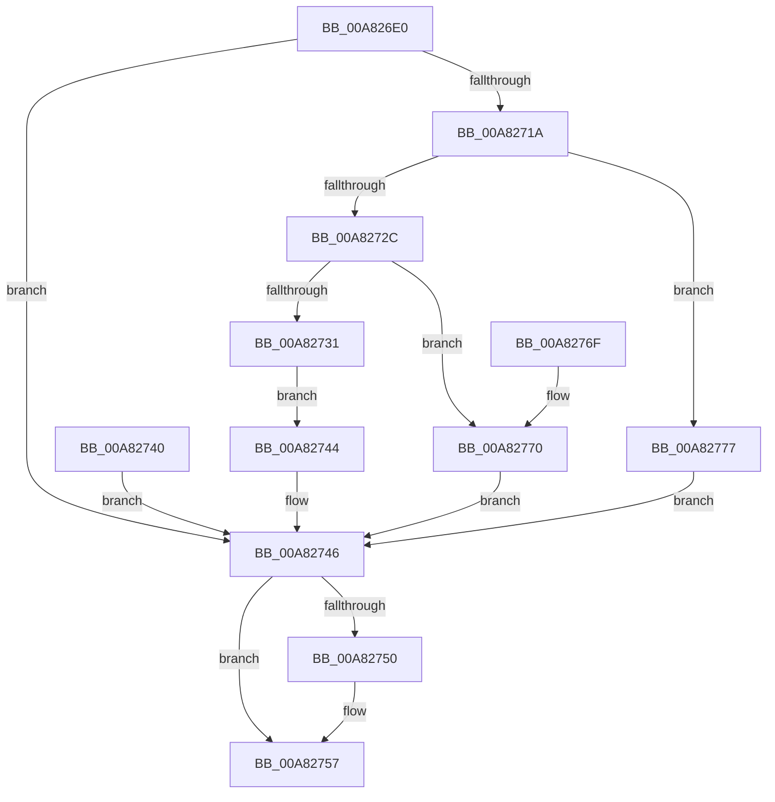

# ExpQueryMemoryTopologyInformation

- RVA: `0x00A826E0`–`0x00A8277E` (길이 `158` bytes)
- VA: `0x0000000140A826E0`
- 실행 섹션: `PAGE`
- PDB 이름 있음: `예`; PDB Function 태그: `아니요`
- unwind 정보 RVA: `0x000B72E8`
- 디코드: `48`개 명령, `158/158` bytes 표시
- 미해석 바이트: `0` (있으면 어셈블리에 `.byte`로 보존)

> 이 문서는 커널 이미지의 기계어와 PDB 기호를 분석해 생성했습니다. 4번과 5번은 함수 원형과 자료형을 바이너리 사용 방식에서 추정한 C 해석이며 원본 소스 복구 결과는 아닙니다.

## 1. Dependencies

- 직접 호출 지점: **3**; 고유 호출 대상: **3**
- 직접 호출자로 확인된 함수: **1**
- RIP 상대 이미지 참조: **0**

### Outgoing calls
- `0x00A8270F` → [MmGetNodeChannelRanges](MmGetNodeChannelRanges_function_00A82784.md) (function, `0x00A82784`)
- `0x00A82739` → [memcpy](../../text/6C/memcpy_function_006C6840.md) (function, `0x006C6840`)
- `0x00A82752` → [ExFreePoolWithTag](../../poolcode/B8/ExFreePoolWithTag_function_00B82870.md) (function, `0x00B82870`)

### Direct callers
- [ExpQuerySystemInformation](../A5/ExpQuerySystemInformation_function_00A57858.md) at `0x00A59F9C`

### Static image references
- 디코드된 RIP-relative 메모리 참조가 없습니다.

## 2. Other-region calls and transfers

- 다른 실행 섹션으로 향하는 call: **2**
  - `0x00A82739` → [memcpy](../../text/6C/memcpy_function_006C6840.md) (`PAGE` → `.text`)
  - `0x00A82752` → [ExFreePoolWithTag](../../poolcode/B8/ExFreePoolWithTag_function_00B82870.md) (`PAGE` → `POOLCODE`)
- 별도 외부 분기/꼬리 이동을 확인하지 못했습니다.

## 3. Assembly (complete function range)

```asm
00A826E0  48 8B C4                        mov rax, rsp
00A826E3  48 89 58 08                     mov qword ptr [rax + 8], rbx
00A826E7  48 89 70 10                     mov qword ptr [rax + 0x10], rsi
00A826EB  48 89 78 18                     mov qword ptr [rax + 0x18], rdi
00A826EF  41 56                           push r14
00A826F1  48 83 EC 40                     sub rsp, 0x40
00A826F5  49 8B F0                        mov rsi, r8
00A826F8  8B FA                           mov edi, edx
00A826FA  4C 8B F1                        mov r14, rcx
00A826FD  48 83 60 E0 00                  and qword ptr [rax - 0x20], 0
00A82702  48 83 60 20 00                  and qword ptr [rax + 0x20], 0
00A82707  48 8D 50 E0                     lea rdx, [rax - 0x20]
00A8270B  48 8D 48 20                     lea rcx, [rax + 0x20]
00A8270F  E8 70 00 00 00                  call 0x140a82784
00A82714  8B D8                           mov ebx, eax
00A82716  85 C0                           test eax, eax
00A82718  78 2C                           js 0x140a82746
00A8271A  4C 8B 44 24 28                  mov r8, qword ptr [rsp + 0x28]
00A8271F  44 89 06                        mov dword ptr [rsi], r8d
00A82722  B8 FF FF FF FF                  mov eax, 0xffffffff
00A82727  4C 3B C0                        cmp r8, rax
00A8272A  77 4B                           ja 0x140a82777
00A8272C  4C 3B C7                        cmp r8, rdi
00A8272F  77 3F                           ja 0x140a82770
00A82731  48 8B 54 24 68                  mov rdx, qword ptr [rsp + 0x68]
00A82736  49 8B CE                        mov rcx, r14
00A82739  E8 02 41 C4 FF                  call 0x1406c6840
00A8273E  EB 04                           jmp 0x140a82744
00A82740  8B D8                           mov ebx, eax
00A82742  EB 02                           jmp 0x140a82746
00A82744  33 DB                           xor ebx, ebx
00A82746  48 8B 4C 24 68                  mov rcx, qword ptr [rsp + 0x68]
00A8274B  48 85 C9                        test rcx, rcx
00A8274E  74 07                           je 0x140a82757
00A82750  33 D2                           xor edx, edx
00A82752  E8 19 01 10 00                  call 0x140b82870
00A82757  8B C3                           mov eax, ebx
00A82759  48 8B 5C 24 50                  mov rbx, qword ptr [rsp + 0x50]
00A8275E  48 8B 74 24 58                  mov rsi, qword ptr [rsp + 0x58]
00A82763  48 8B 7C 24 60                  mov rdi, qword ptr [rsp + 0x60]
00A82768  48 83 C4 40                     add rsp, 0x40
00A8276C  41 5E                           pop r14
00A8276E  C3                              ret
00A8276F  CC                              int3
00A82770  BB 23 00 00 C0                  mov ebx, 0xc0000023
00A82775  EB CF                           jmp 0x140a82746
00A82777  BB 9A 00 00 C0                  mov ebx, 0xc000009a
00A8277C  EB C8                           jmp 0x140a82746
```

## 4. C-style interpretation (structured pseudocode)

```c
__int64 __fastcall ExpQueryMemoryTopologyInformation(__int64 a1, int a2, __int64 a3)
{
    __int64 result;
    __int64 v_rbx;
    __int64 v_rsp;
    unsigned __int64 v_stack_m20;
    unsigned __int64 v_stack_p10;
    unsigned __int64 v_stack_p18;
    unsigned __int64 v_stack_p20;
    unsigned __int64 v_stack_p8;

    *(unsigned __int64 *)(v_rsp + 8) = v_rbx;
    *(unsigned __int64 *)(v_rsp + 16) = v_rsi;
    *(unsigned __int64 *)(v_rsp + 24) = v_rdi;
    v_rsp = (v_rsp) - (64);
    result = MmGetNodeChannelRanges(v_rsp + 32, v_rsp - 32, a3, a4);
    if (sign_flag) goto loc_00A82746;
    *(unsigned int *)(a3) = (unsigned int)(v_stack_m20);
    if (v_stack_m20 > ((unsigned int)(0xFFFFFFFFULL))) goto loc_00A82777;
    if (v_stack_m20 > ((unsigned int)(a2))) goto loc_00A82770;
    result = memcpy(a1, v_stack_p20, v_stack_m20, a4);
    goto loc_00A82744;
loc_00A82744:
    v_rbx = 0;
loc_00A82746:
    if (v_stack_p20 != 0) {
        a2 = 0;
        result = ExFreePoolWithTag(v_stack_p20, a2, v_stack_m20, a4);
    }
    v_rsp = (v_rsp) + (64);
    return 0;
loc_00A82770:
    goto loc_00A82746;
loc_00A82777:
    goto loc_00A82746;
}
```

## 5. (Beta) C Style

```c
int64_t ExpQueryMemoryTopologyInformation(int64_t Arg1, int32_t Arg2, void *Arg3)
{
    uint8_t *arg3 = (uint8_t *)Arg3;

    int64_t result;
    int64_t local_rbx;
    int64_t local_rsp;
    uint64_t v_stack_m20;
    uint64_t v_stack_p10;
    uint64_t v_stack_p18;
    uint64_t v_stack_p20;
    uint64_t v_stack_p8;

    *(uint64_t *)(local_rsp + 0x8) = local_rbx;
    *(uint64_t *)(local_rsp + 0x10) = local_rsi;
    *(uint64_t *)(local_rsp + 0x18) = local_rdi;
    local_rsp = (local_rsp) - (64);
    result = MmGetNodeChannelRanges(local_rsp + 32, local_rsp - 32, Arg3, a4);
    if (sign_flag) goto loc_00A82746;
    *(uint32_t *)(arg3) = (uint32_t)(v_stack_m20);
    if (v_stack_m20 > ((uint32_t)(0xFFFFFFFFULL))) goto loc_00A82777;
    if (v_stack_m20 > ((uint32_t)(Arg2))) goto loc_00A82770;
    result = memcpy(Arg1, v_stack_p20, v_stack_m20, a4);
    goto loc_00A82744;
loc_00A82744:
    local_rbx = 0;
loc_00A82746:
    if (v_stack_p20 != 0) {
        Arg2 = 0;
        result = ExFreePoolWithTag(v_stack_p20, Arg2, v_stack_m20, a4);
    }
    local_rsp = (local_rsp) + (64);
    return 0;
loc_00A82770:
    goto loc_00A82746;
loc_00A82777:
    goto loc_00A82746;
}
```

### 관측된 메모리 오프셋

구조체 형식이 확인되지 않은 접근은 인자 기준의 오프셋으로만 기록했습니다.

| 기준 인자 | 오프셋 표현 | 폭 (bit) | 접근 |
|---|---:|---:|---|
| `Arg3` | `+ 0x0` | `32` | `W` |

## 6. Execution-region graph

[열기: 2D/3D 그래프와 함수 탐색 컨트롤 패널](../../../control-panel.html?section=page&rva=0x00A826E0&view=graph)

- 2D 그래프는 위에서 아래로 흐르고, 3D 그래프는 빈 공간을 드래그해 회전합니다. Shift+드래그는 이동, 휠은 확대·축소, 함수 노드 선택은 대상 보고서 이동입니다.

### Static fallback


