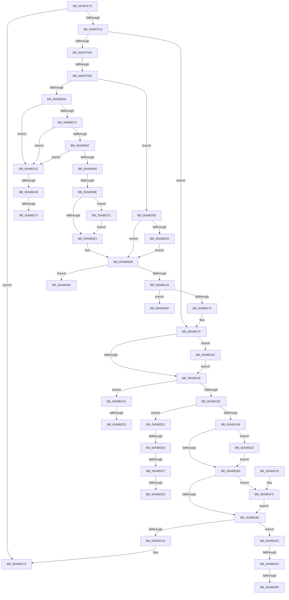

# ExpSetPendingUILanguage

- RVA: `0x00A87E70`–`0x00A8835B` (길이 `1,259` bytes)
- VA: `0x0000000140A87E70`
- 실행 섹션: `PAGE`
- PDB 이름 있음: `예`; PDB Function 태그: `예`
- unwind 정보 RVA: `0x000B7F60`
- 디코드: `282`개 명령, `1,259/1,259` bytes 표시
- 미해석 바이트: `0` (있으면 어셈블리에 `.byte`로 보존)

> 이 문서는 커널 이미지의 기계어와 PDB 기호를 분석해 생성했습니다. 4번과 5번은 함수 원형과 자료형을 바이너리 사용 방식에서 추정한 C 해석이며 원본 소스 복구 결과는 아닙니다.

## 1. Dependencies

- 직접 호출 지점: **31**; 고유 호출 대상: **14**
- 직접 호출자로 확인된 함수: **1**
- RIP 상대 이미지 참조: **10**

### Outgoing calls
- `0x00A87EE0` → [memset](../../text/6C/memset_function_006C6C40.md) (function, `0x006C6C40`)
- `0x00A87F06` → [OpenGlobalizationUserSettingsKey](../../text/4D/OpenGlobalizationUserSettingsKey_function_004D5B3C.md) (function, `0x004D5B3C`)
- `0x00A87F1E` → [RtlInitUnicodeString](../../text/42/RtlInitUnicodeString_function_0042A780.md) (function, `0x0042A780`)
- `0x00A87F5B` → [ZwOpenKey](../../text/6A/ZwOpenKey_function_006AD310.md) (function, `0x006AD310`)
- `0x00A87F78` → [RtlInitUnicodeString](../../text/42/RtlInitUnicodeString_function_0042A780.md) (function, `0x0042A780`)
- `0x00A87FA7` → [ZwQueryValueKey](../../text/6A/ZwQueryValueKey_function_006AD3B0.md) (function, `0x006AD3B0`)
- `0x00A87FBF` → [RtlInitUnicodeString](../../text/42/RtlInitUnicodeString_function_0042A780.md) (function, `0x0042A780`)
- `0x00A87FF0` → [ZwOpenKey](../../text/6A/ZwOpenKey_function_006AD310.md) (function, `0x006AD310`)
- `0x00A88000` → [RtlInitUnicodeString](../../text/42/RtlInitUnicodeString_function_0042A780.md) (function, `0x0042A780`)
- `0x00A8802D` → [ZwOpenKey](../../text/6A/ZwOpenKey_function_006AD310.md) (function, `0x006AD310`)
- `0x00A88045` → [RtlInitUnicodeString](../../text/42/RtlInitUnicodeString_function_0042A780.md) (function, `0x0042A780`)
- `0x00A8806D` → [ZwQueryValueKey](../../text/6A/ZwQueryValueKey_function_006AD3B0.md) (function, `0x006AD3B0`)
- `0x00A880A9` → [RtlInitUnicodeString](../../text/42/RtlInitUnicodeString_function_0042A780.md) (function, `0x0042A780`)
- `0x00A880D5` → [ZwSetValueKey](../../text/6A/ZwSetValueKey_function_006ADCD0.md) (function, `0x006ADCD0`)
- `0x00A880E6` → [ZwClose](../../text/6A/ZwClose_function_006AD2B0.md) (function, `0x006AD2B0`)
- `0x00A880F6` → [RtlInitUnicodeString](../../text/42/RtlInitUnicodeString_function_0042A780.md) (function, `0x0042A780`)
- `0x00A88127` → [ZwOpenKey](../../text/6A/ZwOpenKey_function_006AD310.md) (function, `0x006AD310`)
- `0x00A8813F` → [RtlInitUnicodeString](../../text/42/RtlInitUnicodeString_function_0042A780.md) (function, `0x0042A780`)
- `0x00A8816C` → [ZwOpenKey](../../text/6A/ZwOpenKey_function_006AD310.md) (function, `0x006AD310`)
- `0x00A881D2` → [_security_check_cookie](../../text/6A/_security_check_cookie_function_006AC640.md) (function, `0x006AC640`)
- `0x00A881F9` → [ZwClose](../../text/6A/ZwClose_function_006AD2B0.md) (function, `0x006AD2B0`)
- `0x00A88215` → [RtlInitUnicodeString](../../text/42/RtlInitUnicodeString_function_0042A780.md) (function, `0x0042A780`)
- `0x00A88222` → [ZwDeleteValueKey](../../text/6A/ZwDeleteValueKey_function_006AECB0.md) (function, `0x006AECB0`)
- `0x00A8823C` → [NtQueryInstallUILanguage](../A7/NtQueryInstallUILanguage_function_00A74B30.md) (function, `0x00A74B30`)
- `0x00A8825F` → [DownLevelLangIDToLanguageName](../../text/4B/DownLevelLangIDToLanguageName_function_004BBAA8.md) (function, `0x004BBAA8`)
- `0x00A88288` → [DbgPrintEx](../../text/35/DbgPrintEx_function_00359290.md) (function, `0x00359290`)
- `0x00A882A2` → [ZwClose](../../text/6A/ZwClose_function_006AD2B0.md) (function, `0x006AD2B0`)
- `0x00A882C2` → [ZwEnumerateValueKey](../../text/6A/ZwEnumerateValueKey_function_006AD330.md) (function, `0x006AD330`)
- `0x00A882D6` → [ZwDeleteKey](../../text/6A/ZwDeleteKey_function_006AEC50.md) (function, `0x006AEC50`)
- `0x00A8830D` → [ZwEnumerateValueKey](../../text/6A/ZwEnumerateValueKey_function_006AD330.md) (function, `0x006AD330`)
- `0x00A88322` → [ZwClose](../../text/6A/ZwClose_function_006AD2B0.md) (function, `0x006AD2B0`)

### Direct callers
- [NtSetDefaultUILanguage](NtSetDefaultUILanguage_function_00A87E50.md) at `0x00A87E59`

### Static image references
- `0x00A87E98` → RVA `0x00E0A740` (`.data`; read)
- `0x00A87F13` → RVA `0x00B08280` (` ?? ::NNGAKEGL::`string'`; read)
- `0x00A87F6D` → RVA `0x00B08360` (` ?? ::NNGAKEGL::`string'`; read)
- `0x00A87FB4` → RVA `0x00B08240` (` ?? ::NNGAKEGL::`string'`; read)
- `0x00A87FF5` → RVA `0x00B081C0` (` ?? ::NNGAKEGL::`string'`; read)
- `0x00A8803A` → RVA `0x00B08330` (` ?? ::NNGAKEGL::`string'`; read)
- `0x00A8809E` → RVA `0x00B08040` (` ?? ::NNGAKEGL::`string'`; read)
- `0x00A880EB` → RVA `0x00B08080` (` ?? ::NNGAKEGL::`string'`; read)
- `0x00A88134` → RVA `0x00B08480` (` ?? ::NNGAKEGL::`string'`; read)
- `0x00A8827C` → RVA `0x00B080C0` (` ?? ::NNGAKEGL::`string'`; read)

## 2. Other-region calls and transfers

- 다른 실행 섹션으로 향하는 call: **30**
  - `0x00A87EE0` → [memset](../../text/6C/memset_function_006C6C40.md) (`PAGE` → `.text`)
  - `0x00A87F06` → [OpenGlobalizationUserSettingsKey](../../text/4D/OpenGlobalizationUserSettingsKey_function_004D5B3C.md) (`PAGE` → `.text`)
  - `0x00A87F1E` → [RtlInitUnicodeString](../../text/42/RtlInitUnicodeString_function_0042A780.md) (`PAGE` → `.text`)
  - `0x00A87F5B` → [ZwOpenKey](../../text/6A/ZwOpenKey_function_006AD310.md) (`PAGE` → `.text`)
  - `0x00A87F78` → [RtlInitUnicodeString](../../text/42/RtlInitUnicodeString_function_0042A780.md) (`PAGE` → `.text`)
  - `0x00A87FA7` → [ZwQueryValueKey](../../text/6A/ZwQueryValueKey_function_006AD3B0.md) (`PAGE` → `.text`)
  - `0x00A87FBF` → [RtlInitUnicodeString](../../text/42/RtlInitUnicodeString_function_0042A780.md) (`PAGE` → `.text`)
  - `0x00A87FF0` → [ZwOpenKey](../../text/6A/ZwOpenKey_function_006AD310.md) (`PAGE` → `.text`)
  - `0x00A88000` → [RtlInitUnicodeString](../../text/42/RtlInitUnicodeString_function_0042A780.md) (`PAGE` → `.text`)
  - `0x00A8802D` → [ZwOpenKey](../../text/6A/ZwOpenKey_function_006AD310.md) (`PAGE` → `.text`)
  - `0x00A88045` → [RtlInitUnicodeString](../../text/42/RtlInitUnicodeString_function_0042A780.md) (`PAGE` → `.text`)
  - `0x00A8806D` → [ZwQueryValueKey](../../text/6A/ZwQueryValueKey_function_006AD3B0.md) (`PAGE` → `.text`)
  - `0x00A880A9` → [RtlInitUnicodeString](../../text/42/RtlInitUnicodeString_function_0042A780.md) (`PAGE` → `.text`)
  - `0x00A880D5` → [ZwSetValueKey](../../text/6A/ZwSetValueKey_function_006ADCD0.md) (`PAGE` → `.text`)
  - `0x00A880E6` → [ZwClose](../../text/6A/ZwClose_function_006AD2B0.md) (`PAGE` → `.text`)
  - `0x00A880F6` → [RtlInitUnicodeString](../../text/42/RtlInitUnicodeString_function_0042A780.md) (`PAGE` → `.text`)
  - `0x00A88127` → [ZwOpenKey](../../text/6A/ZwOpenKey_function_006AD310.md) (`PAGE` → `.text`)
  - `0x00A8813F` → [RtlInitUnicodeString](../../text/42/RtlInitUnicodeString_function_0042A780.md) (`PAGE` → `.text`)
  - `0x00A8816C` → [ZwOpenKey](../../text/6A/ZwOpenKey_function_006AD310.md) (`PAGE` → `.text`)
  - `0x00A881D2` → [_security_check_cookie](../../text/6A/_security_check_cookie_function_006AC640.md) (`PAGE` → `.text`)
  - `0x00A881F9` → [ZwClose](../../text/6A/ZwClose_function_006AD2B0.md) (`PAGE` → `.text`)
  - `0x00A88215` → [RtlInitUnicodeString](../../text/42/RtlInitUnicodeString_function_0042A780.md) (`PAGE` → `.text`)
  - `0x00A88222` → [ZwDeleteValueKey](../../text/6A/ZwDeleteValueKey_function_006AECB0.md) (`PAGE` → `.text`)
  - `0x00A8825F` → [DownLevelLangIDToLanguageName](../../text/4B/DownLevelLangIDToLanguageName_function_004BBAA8.md) (`PAGE` → `.text`)
  - `0x00A88288` → [DbgPrintEx](../../text/35/DbgPrintEx_function_00359290.md) (`PAGE` → `.text`)
  - `0x00A882A2` → [ZwClose](../../text/6A/ZwClose_function_006AD2B0.md) (`PAGE` → `.text`)
  - `0x00A882C2` → [ZwEnumerateValueKey](../../text/6A/ZwEnumerateValueKey_function_006AD330.md) (`PAGE` → `.text`)
  - `0x00A882D6` → [ZwDeleteKey](../../text/6A/ZwDeleteKey_function_006AEC50.md) (`PAGE` → `.text`)
  - `0x00A8830D` → [ZwEnumerateValueKey](../../text/6A/ZwEnumerateValueKey_function_006AD330.md) (`PAGE` → `.text`)
  - `0x00A88322` → [ZwClose](../../text/6A/ZwClose_function_006AD2B0.md) (`PAGE` → `.text`)
- call이 아닌 외부 분기/꼬리 이동: **16**
  - `0x00A87FAE` → [sub_00B44C1A](../B4/Unknown_function_00B44C1A.md) (`tail-transfer`)
  - `0x00A88098` → [sub_00B44C1A + 0x230](../B4/Unknown_function_00B44C1A.md) (`tail-transfer`)
  - `0x00A88245` → [sub_00B44C1A + 0x1F8](../B4/Unknown_function_00B44C1A.md) (`tail-transfer`)
  - `0x00A8826C` → [sub_00B44C1A + 0x1F0](../B4/Unknown_function_00B44C1A.md) (`tail-transfer`)
  - `0x00A88277` → [sub_00B44C1A + 0x200](../B4/Unknown_function_00B44C1A.md) (`tail-transfer`)
  - `0x00A88295` → [sub_00B44C1A + 0x298](../B4/Unknown_function_00B44C1A.md) (`tail-transfer`)
  - `0x00A8829D` → [sub_00B44C1A + 0x31C](../B4/Unknown_function_00B44C1A.md) (`tail-transfer`)
  - `0x00A882CC` → [sub_00B44C1A + 0x4F0](../B4/Unknown_function_00B44C1A.md) (`tail-transfer`)
  - `0x00A882DC` → [sub_00B44C1A + 0x4F0](../B4/Unknown_function_00B44C1A.md) (`tail-transfer`)
  - `0x00A882E8` → [sub_00B44C1A + 0x4FF](../B4/Unknown_function_00B44C1A.md) (`tail-transfer`)
  - `0x00A882F1` → [sub_00B44C1A + 0x53C](../B4/Unknown_function_00B44C1A.md) (`tail-transfer`)
  - `0x00A88317` → [sub_00B44C1A + 0x4FF](../B4/Unknown_function_00B44C1A.md) (`tail-transfer`)
  - `0x00A8831D` → [sub_00B44C1A + 0x53C](../B4/Unknown_function_00B44C1A.md) (`tail-transfer`)
  - `0x00A8833C` → [sub_00B44C1A + 0x54B](../B4/Unknown_function_00B44C1A.md) (`tail-transfer`)
  - `0x00A88349` → [sub_00B44C1A + 0x54B](../B4/Unknown_function_00B44C1A.md) (`tail-transfer`)
  - `0x00A88356` → [sub_00B44C1A + 0x54E](../B4/Unknown_function_00B44C1A.md) (`tail-transfer`)

## 3. Assembly (complete function range)

```asm
00A87E70  48 8B C4                        mov rax, rsp
00A87E73  48 89 58 08                     mov qword ptr [rax + 8], rbx
00A87E77  48 89 70 10                     mov qword ptr [rax + 0x10], rsi
00A87E7B  4C 89 60 18                     mov qword ptr [rax + 0x18], r12
00A87E7F  4C 89 68 20                     mov qword ptr [rax + 0x20], r13
00A87E83  55                              push rbp
00A87E84  41 56                           push r14
00A87E86  41 57                           push r15
00A87E88  48 81 EC F0 04 00 00            sub rsp, 0x4f0
00A87E8F  48 8D 6C 24 60                  lea rbp, [rsp + 0x60]
00A87E94  48 83 E5 E0                     and rbp, 0xffffffffffffffe0
00A87E98  48 8B 05 A1 28 38 00            mov rax, qword ptr [rip + 0x3828a1]
00A87E9F  48 33 C4                        xor rax, rsp
00A87EA2  48 89 85 80 04 00 00            mov qword ptr [rbp + 0x480], rax
00A87EA9  45 33 F6                        xor r14d, r14d
00A87EAC  44 89 75 34                     mov dword ptr [rbp + 0x34], r14d
00A87EB0  44 89 75 4C                     mov dword ptr [rbp + 0x4c], r14d
00A87EB4  0F 57 C0                        xorps xmm0, xmm0
00A87EB7  0F 11 45 20                     movups xmmword ptr [rbp + 0x20], xmm0
00A87EBB  0F 57 C9                        xorps xmm1, xmm1
00A87EBE  0F 11 4D 60                     movups xmmword ptr [rbp + 0x60], xmm1
00A87EC2  0F 11 85 88 00 00 00            movups xmmword ptr [rbp + 0x88], xmm0
00A87EC9  4C 89 75 70                     mov qword ptr [rbp + 0x70], r14
00A87ECD  4C 89 75 10                     mov qword ptr [rbp + 0x10], r14
00A87ED1  33 D2                           xor edx, edx
00A87ED3  41 B8 AA 00 00 00               mov r8d, 0xaa
00A87ED9  48 8D 8D A0 01 00 00            lea rcx, [rbp + 0x1a0]
00A87EE0  E8 5B ED C3 FF                  call 0x1406c6c40
00A87EE5  44 89 75 04                     mov dword ptr [rbp + 4], r14d
00A87EE9  4C 89 B5 80 00 00 00            mov qword ptr [rbp + 0x80], r14
00A87EF0  4C 89 75 78                     mov qword ptr [rbp + 0x78], r14
00A87EF4  4C 89 75 08                     mov qword ptr [rbp + 8], r14
00A87EF8  4C 89 75 18                     mov qword ptr [rbp + 0x18], r14
00A87EFC  41 B4 01                        mov r12b, 1
00A87EFF  45 8A EE                        mov r13b, r14b
00A87F02  4C 8D 45 70                     lea r8, [rbp + 0x70]
00A87F06  E8 31 DC A4 FF                  call 0x1404d5b3c
00A87F0B  85 C0                           test eax, eax
00A87F0D  0F 88 B5 02 00 00               js 0x140a881c8
00A87F13  48 8D 15 66 03 08 00            lea rdx, [rip + 0x80366]
00A87F1A  48 8D 4D 20                     lea rcx, [rbp + 0x20]
00A87F1E  E8 5D 28 9A FF                  call 0x14042a780
00A87F23  45 8D 7E 30                     lea r15d, [r14 + 0x30]
00A87F27  44 89 7D 30                     mov dword ptr [rbp + 0x30], r15d
00A87F2B  48 8B 45 70                     mov rax, qword ptr [rbp + 0x70]
00A87F2F  48 89 45 38                     mov qword ptr [rbp + 0x38], rax
00A87F33  BE 40 06 00 00                  mov esi, 0x640
00A87F38  89 75 48                        mov dword ptr [rbp + 0x48], esi
00A87F3B  48 8D 45 20                     lea rax, [rbp + 0x20]
00A87F3F  48 89 45 40                     mov qword ptr [rbp + 0x40], rax
00A87F43  0F 57 C0                        xorps xmm0, xmm0
00A87F46  F3 0F 7F 45 50                  movdqu xmmword ptr [rbp + 0x50], xmm0
00A87F4B  4C 8D 45 30                     lea r8, [rbp + 0x30]
00A87F4F  BA 00 00 00 40                  mov edx, 0x40000000
00A87F54  48 8D 8D 80 00 00 00            lea rcx, [rbp + 0x80]
00A87F5B  E8 B0 53 C2 FF                  call 0x1406ad310
00A87F60  8B D8                           mov ebx, eax
00A87F62  89 45 00                        mov dword ptr [rbp], eax
00A87F65  85 C0                           test eax, eax
00A87F67  0F 88 12 02 00 00               js 0x140a8817f
00A87F6D  48 8D 15 EC 03 08 00            lea rdx, [rip + 0x803ec]
00A87F74  48 8D 4D 60                     lea rcx, [rbp + 0x60]
00A87F78  E8 03 28 9A FF                  call 0x14042a780
00A87F7D  48 8D 45 04                     lea rax, [rbp + 4]
00A87F81  48 89 44 24 28                  mov qword ptr [rsp + 0x28], rax
00A87F86  C7 44 24 20 00 01 00 00         mov dword ptr [rsp + 0x20], 0x100
00A87F8E  4C 8D 8D A0 00 00 00            lea r9, [rbp + 0xa0]
00A87F95  41 8D 5E 02                     lea ebx, [r14 + 2]
00A87F99  44 8B C3                        mov r8d, ebx
00A87F9C  48 8D 55 60                     lea rdx, [rbp + 0x60]
00A87FA0  48 8B 8D 80 00 00 00            mov rcx, qword ptr [rbp + 0x80]
00A87FA7  E8 04 54 C2 FF                  call 0x1406ad3b0
00A87FAC  85 C0                           test eax, eax
00A87FAE  0F 89 66 CC 0B 00               jns 0x140b44c1a
00A87FB4  48 8D 15 85 02 08 00            lea rdx, [rip + 0x80285]
00A87FBB  48 8D 4D 20                     lea rcx, [rbp + 0x20]
00A87FBF  E8 BC 27 9A FF                  call 0x14042a780
00A87FC4  44 89 7D 30                     mov dword ptr [rbp + 0x30], r15d
00A87FC8  48 8B 45 70                     mov rax, qword ptr [rbp + 0x70]
00A87FCC  48 89 45 38                     mov qword ptr [rbp + 0x38], rax
00A87FD0  89 75 48                        mov dword ptr [rbp + 0x48], esi
00A87FD3  48 8D 45 20                     lea rax, [rbp + 0x20]
00A87FD7  48 89 45 40                     mov qword ptr [rbp + 0x40], rax
00A87FDB  0F 57 C0                        xorps xmm0, xmm0
00A87FDE  F3 0F 7F 45 50                  movdqu xmmword ptr [rbp + 0x50], xmm0
00A87FE3  4C 8D 45 30                     lea r8, [rbp + 0x30]
00A87FE7  BA 00 00 00 40                  mov edx, 0x40000000
00A87FEC  48 8D 4D 08                     lea rcx, [rbp + 8]
00A87FF0  E8 1B 53 C2 FF                  call 0x1406ad310
00A87FF5  48 8D 15 C4 01 08 00            lea rdx, [rip + 0x801c4]
00A87FFC  48 8D 4D 20                     lea rcx, [rbp + 0x20]
00A88000  E8 7B 27 9A FF                  call 0x14042a780
00A88005  44 89 7D 30                     mov dword ptr [rbp + 0x30], r15d
00A88009  4C 89 75 38                     mov qword ptr [rbp + 0x38], r14
00A8800D  89 75 48                        mov dword ptr [rbp + 0x48], esi
00A88010  48 8D 45 20                     lea rax, [rbp + 0x20]
00A88014  48 89 45 40                     mov qword ptr [rbp + 0x40], rax
00A88018  0F 57 C0                        xorps xmm0, xmm0
00A8801B  F3 0F 7F 45 50                  movdqu xmmword ptr [rbp + 0x50], xmm0
00A88020  4C 8D 45 30                     lea r8, [rbp + 0x30]
00A88024  BA 00 00 00 80                  mov edx, 0x80000000
00A88029  48 8D 4D 10                     lea rcx, [rbp + 0x10]
00A8802D  E8 DE 52 C2 FF                  call 0x1406ad310
00A88032  85 C0                           test eax, eax
00A88034  0F 88 C6 01 00 00               js 0x140a88200
00A8803A  48 8D 15 EF 02 08 00            lea rdx, [rip + 0x802ef]
00A88041  48 8D 4D 60                     lea rcx, [rbp + 0x60]
00A88045  E8 36 27 9A FF                  call 0x14042a780
00A8804A  48 8D 45 04                     lea rax, [rbp + 4]
00A8804E  48 89 44 24 28                  mov qword ptr [rsp + 0x28], rax
00A88053  C7 44 24 20 00 01 00 00         mov dword ptr [rsp + 0x20], 0x100
00A8805B  4C 8D 8D A0 00 00 00            lea r9, [rbp + 0xa0]
00A88062  44 8B C3                        mov r8d, ebx
00A88065  48 8D 55 60                     lea rdx, [rbp + 0x60]
00A88069  48 8B 4D 10                     mov rcx, qword ptr [rbp + 0x10]
00A8806D  E8 3E 53 C2 FF                  call 0x1406ad3b0
00A88072  85 C0                           test eax, eax
00A88074  0F 88 B2 01 00 00               js 0x140a8822c
00A8807A  83 BD A8 00 00 00 04            cmp dword ptr [rbp + 0xa8], 4
00A88081  0F 82 A5 01 00 00               jb 0x140a8822c
00A88087  83 BD A4 00 00 00 07            cmp dword ptr [rbp + 0xa4], 7
00A8808E  0F 85 98 01 00 00               jne 0x140a8822c
00A88094  4C 39 75 08                     cmp qword ptr [rbp + 8], r14
00A88098  0F 84 AC CD 0B 00               je 0x140b44e4a
00A8809E  48 8D 15 9B FF 07 00            lea rdx, [rip + 0x7ff9b]
00A880A5  48 8D 4D 60                     lea rcx, [rbp + 0x60]
00A880A9  E8 D2 26 9A FF                  call 0x14042a780
00A880AE  8B 85 A8 00 00 00               mov eax, dword ptr [rbp + 0xa8]
00A880B4  89 44 24 28                     mov dword ptr [rsp + 0x28], eax
00A880B8  48 8D 85 AC 00 00 00            lea rax, [rbp + 0xac]
00A880BF  48 89 44 24 20                  mov qword ptr [rsp + 0x20], rax
00A880C4  41 B9 07 00 00 00               mov r9d, 7
00A880CA  45 33 C0                        xor r8d, r8d
00A880CD  48 8D 55 60                     lea rdx, [rbp + 0x60]
00A880D1  48 8B 4D 08                     mov rcx, qword ptr [rbp + 8]
00A880D5  E8 F6 5B C2 FF                  call 0x1406adcd0
00A880DA  85 C0                           test eax, eax
00A880DC  0F 88 9A 01 00 00               js 0x140a8827c
00A880E2  48 8B 4D 10                     mov rcx, qword ptr [rbp + 0x10]
00A880E6  E8 C5 51 C2 FF                  call 0x1406ad2b0
00A880EB  48 8D 15 8E FF 07 00            lea rdx, [rip + 0x7ff8e]
00A880F2  48 8D 4D 20                     lea rcx, [rbp + 0x20]
00A880F6  E8 85 26 9A FF                  call 0x14042a780
00A880FB  44 89 7D 30                     mov dword ptr [rbp + 0x30], r15d
00A880FF  48 8B 45 08                     mov rax, qword ptr [rbp + 8]
00A88103  48 89 45 38                     mov qword ptr [rbp + 0x38], rax
00A88107  89 75 48                        mov dword ptr [rbp + 0x48], esi
00A8810A  48 8D 45 20                     lea rax, [rbp + 0x20]
00A8810E  48 89 45 40                     mov qword ptr [rbp + 0x40], rax
00A88112  0F 57 C0                        xorps xmm0, xmm0
00A88115  F3 0F 7F 45 50                  movdqu xmmword ptr [rbp + 0x50], xmm0
00A8811A  4C 8D 45 30                     lea r8, [rbp + 0x30]
00A8811E  BA 00 00 00 40                  mov edx, 0x40000000
00A88123  48 8D 4D 18                     lea rcx, [rbp + 0x18]
00A88127  E8 E4 51 C2 FF                  call 0x1406ad310
00A8812C  85 C0                           test eax, eax
00A8812E  0F 89 5E 01 00 00               jns 0x140a88292
00A88134  48 8D 15 45 03 08 00            lea rdx, [rip + 0x80345]
00A8813B  48 8D 4D 20                     lea rcx, [rbp + 0x20]
00A8813F  E8 3C 26 9A FF                  call 0x14042a780
00A88144  44 89 7D 30                     mov dword ptr [rbp + 0x30], r15d
00A88148  4C 89 75 38                     mov qword ptr [rbp + 0x38], r14
00A8814C  89 75 48                        mov dword ptr [rbp + 0x48], esi
00A8814F  48 8D 45 20                     lea rax, [rbp + 0x20]
00A88153  48 89 45 40                     mov qword ptr [rbp + 0x40], rax
00A88157  0F 57 C0                        xorps xmm0, xmm0
00A8815A  F3 0F 7F 45 50                  movdqu xmmword ptr [rbp + 0x50], xmm0
00A8815F  4C 8D 45 30                     lea r8, [rbp + 0x30]
00A88163  BA 00 00 00 80                  mov edx, 0x80000000
00A88168  48 8D 4D 10                     lea rcx, [rbp + 0x10]
00A8816C  E8 9F 51 C2 FF                  call 0x1406ad310
00A88171  85 C0                           test eax, eax
00A88173  0F 89 21 01 00 00               jns 0x140a8829a
00A88179  41 8B DE                        mov ebx, r14d
00A8817C  89 5D 00                        mov dword ptr [rbp], ebx
00A8817F  48 8B 8D 80 00 00 00            mov rcx, qword ptr [rbp + 0x80]
00A88186  48 85 C9                        test rcx, rcx
00A88189  0F 85 13 01 00 00               jne 0x140a882a2
00A8818F  48 8B 4D 78                     mov rcx, qword ptr [rbp + 0x78]
00A88193  48 85 C9                        test rcx, rcx
00A88196  0F 85 10 01 00 00               jne 0x140a882ac
00A8819C  4C 39 75 08                     cmp qword ptr [rbp + 8], r14
00A881A0  0F 85 3B 01 00 00               jne 0x140a882e1
00A881A6  48 8B 4D 18                     mov rcx, qword ptr [rbp + 0x18]
00A881AA  48 85 C9                        test rcx, rcx
00A881AD  0F 85 6F 01 00 00               jne 0x140a88322
00A881B3  48 8B 4D 70                     mov rcx, qword ptr [rbp + 0x70]
00A881B7  48 85 C9                        test rcx, rcx
00A881BA  75 3D                           jne 0x140a881f9
00A881BC  41 80 FD 01                     cmp r13b, 1
00A881C0  0F 84 66 01 00 00               je 0x140a8832c
00A881C6  8B C3                           mov eax, ebx
00A881C8  48 8B 8D 80 04 00 00            mov rcx, qword ptr [rbp + 0x480]
00A881CF  48 33 CC                        xor rcx, rsp
00A881D2  E8 69 44 C2 FF                  call 0x1406ac640
00A881D7  4C 8D 9C 24 F0 04 00 00         lea r11, [rsp + 0x4f0]
00A881DF  49 8B 5B 20                     mov rbx, qword ptr [r11 + 0x20]
00A881E3  49 8B 73 28                     mov rsi, qword ptr [r11 + 0x28]
00A881E7  4D 8B 63 30                     mov r12, qword ptr [r11 + 0x30]
00A881EB  4D 8B 6B 38                     mov r13, qword ptr [r11 + 0x38]
00A881EF  49 8B E3                        mov rsp, r11
00A881F2  41 5F                           pop r15
00A881F4  41 5E                           pop r14
00A881F6  5D                              pop rbp
00A881F7  C3                              ret
00A881F8  CC                              int3
00A881F9  E8 B2 50 C2 FF                  call 0x1406ad2b0
00A881FE  EB BC                           jmp 0x140a881bc
00A88200  4C 39 75 08                     cmp qword ptr [rbp + 8], r14
00A88204  0F 84 E1 FE FF FF               je 0x140a880eb
00A8820A  48 8D 15 2F FE 07 00            lea rdx, [rip + 0x7fe2f]
00A88211  48 8D 4D 60                     lea rcx, [rbp + 0x60]
00A88215  E8 66 25 9A FF                  call 0x14042a780
00A8821A  48 8D 55 60                     lea rdx, [rbp + 0x60]
00A8821E  48 8B 4D 08                     mov rcx, qword ptr [rbp + 8]
00A88222  E8 89 6A C2 FF                  call 0x1406aecb0
00A88227  E9 BF FE FF FF                  jmp 0x140a880eb
00A8822C  66 44 89 75 00                  mov word ptr [rbp], r14w
00A88231  44 89 B5 A8 00 00 00            mov dword ptr [rbp + 0xa8], r14d
00A88238  48 8D 4D 00                     lea rcx, [rbp]
00A8823C  E8 EF C8 FE FF                  call 0x140a74b30
00A88241  8B D8                           mov ebx, eax
00A88243  85 C0                           test eax, eax
00A88245  0F 88 C7 CB 0B 00               js 0x140b44e12
00A8824B  45 33 C9                        xor r9d, r9d
00A8824E  41 B8 80 00 00 00               mov r8d, 0x80
00A88254  48 8D 95 AC 00 00 00            lea rdx, [rbp + 0xac]
00A8825B  0F B7 4D 00                     movzx ecx, word ptr [rbp]
00A8825F  E8 44 38 A3 FF                  call 0x1404bbaa8
00A88264  89 85 A8 00 00 00               mov dword ptr [rbp + 0xa8], eax
00A8826A  85 C0                           test eax, eax
00A8826C  0F 85 98 CB 0B 00               jne 0x140b44e0a
00A88272  BB 01 00 00 C0                  mov ebx, 0xc0000001
00A88277  E9 9E CB 0B 00                  jmp 0x140b44e1a
00A8827C  4C 8D 05 3D FE 07 00            lea r8, [rip + 0x7fe3d]
00A88283  33 D2                           xor edx, edx
00A88285  83 C9 FF                        or ecx, 0xffffffff
00A88288  E8 03 10 8D FF                  call 0x140359290
00A8828D  E9 50 FE FF FF                  jmp 0x140a880e2
00A88292  41 8B DE                        mov ebx, r14d
00A88295  E9 18 CC 0B 00                  jmp 0x140b44eb2
00A8829A  45 8B FE                        mov r15d, r14d
00A8829D  E9 94 CC 0B 00                  jmp 0x140b44f36
00A882A2  E8 09 50 C2 FF                  call 0x1406ad2b0
00A882A7  E9 E3 FE FF FF                  jmp 0x140a8818f
00A882AC  48 8D 45 04                     lea rax, [rbp + 4]
00A882B0  48 89 44 24 28                  mov qword ptr [rsp + 0x28], rax
00A882B5  44 89 74 24 20                  mov dword ptr [rsp + 0x20], r14d
00A882BA  45 33 C9                        xor r9d, r9d
00A882BD  45 33 C0                        xor r8d, r8d
00A882C0  33 D2                           xor edx, edx
00A882C2  E8 69 50 C2 FF                  call 0x1406ad330
00A882C7  3D 1A 00 00 80                  cmp eax, 0x8000001a
00A882CC  0F 85 38 CE 0B 00               jne 0x140b4510a
00A882D2  48 8B 4D 78                     mov rcx, qword ptr [rbp + 0x78]
00A882D6  E8 75 69 C2 FF                  call 0x1406aec50
00A882DB  90                              nop
00A882DC  E9 29 CE 0B 00                  jmp 0x140b4510a
00A882E1  48 8B 4D 18                     mov rcx, qword ptr [rbp + 0x18]
00A882E5  48 85 C9                        test rcx, rcx
00A882E8  0F 84 2B CE 0B 00               je 0x140b45119
00A882EE  45 84 E4                        test r12b, r12b
00A882F1  0F 84 5F CE 0B 00               je 0x140b45156
00A882F7  48 8D 45 04                     lea rax, [rbp + 4]
00A882FB  48 89 44 24 28                  mov qword ptr [rsp + 0x28], rax
00A88300  44 89 74 24 20                  mov dword ptr [rsp + 0x20], r14d
00A88305  45 33 C9                        xor r9d, r9d
00A88308  45 33 C0                        xor r8d, r8d
00A8830B  33 D2                           xor edx, edx
00A8830D  E8 1E 50 C2 FF                  call 0x1406ad330
00A88312  3D 1A 00 00 80                  cmp eax, 0x8000001a
00A88317  0F 84 FC CD 0B 00               je 0x140b45119
00A8831D  E9 34 CE 0B 00                  jmp 0x140b45156
00A88322  E8 89 4F C2 FF                  call 0x1406ad2b0
00A88327  E9 87 FE FF FF                  jmp 0x140a881b3
00A8832C  65 48 8B 0C 25 88 01 00 00      mov rcx, qword ptr gs:[0x188]
00A88335  F7 41 74 00 04 00 00            test dword ptr [rcx + 0x74], 0x400
00A8833C  0F 85 23 CE 0B 00               jne 0x140b45165
00A88342  80 B9 4A 02 00 00 01            cmp byte ptr [rcx + 0x24a], 1
00A88349  0F 84 16 CE 0B 00               je 0x140b45165
00A8834F  48 8B 81 F0 00 00 00            mov rax, qword ptr [rcx + 0xf0]
00A88356  E9 0D CE 0B 00                  jmp 0x140b45168
```

## 4. C-style interpretation (structured pseudocode)

```c
__int64 __fastcall ExpSetPendingUILanguage(__int64 a1, int a2)
{
    __int64 result;
    __int64 v_r14;
    __int64 v_rbp;
    __int64 v_rsp;
    unsigned __int64 v_stack_m18;
    unsigned __int64 v_stack_m28;
    unsigned __int64 v_stack_m308;
    unsigned __int64 v_stack_m3FC;
    unsigned int v_stack_m400;
    unsigned int v_stack_m404;
    unsigned __int64 v_stack_m408;
    unsigned __int64 v_stack_m420;
    unsigned __int64 v_stack_m428;
    unsigned __int64 v_stack_m430;
    unsigned __int64 v_stack_m438;
    unsigned __int64 v_stack_m448;
    unsigned __int64 v_stack_m458;
    unsigned int v_stack_m45C;
    unsigned int v_stack_m460;
    unsigned __int64 v_stack_m468;
    unsigned __int64 v_stack_m470;
    unsigned int v_stack_m474;
    unsigned int v_stack_m478;
    unsigned __int64 v_stack_m488;
    unsigned __int64 v_stack_m490;
    unsigned __int64 v_stack_m498;
    unsigned __int64 v_stack_m4A0;
    unsigned int v_stack_m4A4;
    unsigned __int64 v_stack_m4A8;
    unsigned __int64 v_stack_m4C8;
    unsigned int v_stack_m4D0;
    unsigned __int64 v_stack_m4E0;
    unsigned int v_stack_m4E8;

    *(unsigned __int64 *)(v_rsp + 8) = v_rbx;
    *(unsigned __int64 *)(v_rsp + 16) = v_rsi;
    *(unsigned __int64 *)(v_rsp + 24) = v_r12;
    *(unsigned __int64 *)(v_rsp + 32) = v_r13;
    v_rsp = (v_rsp) - (0x4F0ULL);
    v_rbp = (v_stack_m4A8) & (-32);
    result = (*(unsigned __int64 *)(v_rip + 3680417)) ^ (v_rsp);
    v_stack_m28 = result;
    v_r14 = 0;
    v_stack_m474 = 0;
    v_stack_m45C = 0;
    v_stack_m488 = v_xmm0;
    v_stack_m448 = v_xmm1;
    v_stack_m420 = v_xmm0;
    v_stack_m438 = 0;
    v_stack_m498 = 0;
    a2 = 0;
    result = memset(v_stack_m308, a2, 170, a4);
    v_stack_m4A4 = 0;
    v_stack_m428 = 0;
    v_stack_m430 = 0;
    v_stack_m4A0 = 0;
    v_stack_m490 = 0;
    result = OpenGlobalizationUserSettingsKey(v_stack_m308, a2, v_stack_m438, a4);
    if (sign_flag) goto loc_00A881C8;
    result = RtlInitUnicodeString(v_stack_m488, v_rip + 525158, v_stack_m438, a4);
    v_stack_m478 = (unsigned int)(v_r14 + 48);
    v_stack_m470 = v_stack_m438;
    v_stack_m460 = (unsigned int)((unsigned int)(0x640ULL));
    v_stack_m468 = v_stack_m488;
    v_stack_m458 = v_xmm0;
    result = ZwOpenKey(v_stack_m428, (unsigned int)(0x40000000ULL), v_stack_m478, a4);
    v_stack_m4A8 = (unsigned int)(result);
    if (sign_flag) goto loc_00A8817F;
    result = RtlInitUnicodeString(v_stack_m448, v_rip + 525292, v_stack_m478, a4);
    v_stack_m4E0 = v_stack_m4A4;
    v_stack_m4E8 = 256;
    result = ZwQueryValueKey(v_stack_m428, v_stack_m448, (unsigned int)((unsigned int)(v_r14 + 2)), v_stack_m408);
    result = RtlInitUnicodeString(v_stack_m488, v_rip + 524933, (unsigned int)((unsigned int)(v_r14 + 2)), v_stack_m408);
    v_stack_m478 = (unsigned int)(v_r14 + 48);
    v_stack_m470 = v_stack_m438;
    v_stack_m460 = (unsigned int)((unsigned int)(0x640ULL));
    v_stack_m468 = v_stack_m488;
    v_stack_m458 = v_xmm0;
    result = ZwOpenKey(v_stack_m4A0, (unsigned int)(0x40000000ULL), v_stack_m478, v_stack_m408);
    result = RtlInitUnicodeString(v_stack_m488, v_rip + 524740, v_stack_m478, v_stack_m408);
    v_stack_m478 = (unsigned int)(v_r14 + 48);
    v_stack_m470 = 0;
    v_stack_m460 = (unsigned int)((unsigned int)(0x640ULL));
    v_stack_m468 = v_stack_m488;
    v_stack_m458 = v_xmm0;
    result = ZwOpenKey(v_stack_m498, (unsigned int)(0x80000000ULL), v_stack_m478, v_stack_m408);
    if (sign_flag) goto loc_00A88200;
    result = RtlInitUnicodeString(v_stack_m448, v_rip + 525039, v_stack_m478, v_stack_m408);
    v_stack_m4E0 = v_stack_m4A4;
    v_stack_m4E8 = 256;
    result = ZwQueryValueKey(v_stack_m498, v_stack_m448, (unsigned int)((unsigned int)(v_r14 + 2)), v_stack_m408);
    if (sign_flag) goto loc_00A8822C;
    if (v_stack_m400 < 4) goto loc_00A8822C;
    if (v_stack_m404 != 7) goto loc_00A8822C;
    result = RtlInitUnicodeString(v_stack_m448, v_rip + 524187, (unsigned int)((unsigned int)(v_r14 + 2)), v_stack_m408);
    v_stack_m4E0 = (unsigned int)((unsigned int)(v_stack_m400));
    v_stack_m4E8 = v_stack_m3FC;
    a3 = 0;
    result = ZwSetValueKey(v_stack_m4A0, v_stack_m448, a3, 7);
    if (sign_flag) goto loc_00A8827C;
loc_00A880E2:
    result = ZwClose(v_stack_m498, v_stack_m448, a3, 7);
loc_00A880EB:
    result = RtlInitUnicodeString(v_stack_m488, v_rip + 524174, a3, 7);
    v_stack_m478 = (unsigned int)(v_r14 + 48);
    v_stack_m470 = v_stack_m4A0;
    v_stack_m460 = (unsigned int)((unsigned int)(0x640ULL));
    v_stack_m468 = v_stack_m488;
    v_stack_m458 = v_xmm0;
    result = ZwOpenKey(v_stack_m490, (unsigned int)(0x40000000ULL), v_stack_m478, 7);
    if (!sign_flag) goto loc_00A88292;
    result = RtlInitUnicodeString(v_stack_m488, v_rip + 525125, v_stack_m478, 7);
    v_stack_m478 = (unsigned int)(v_r14 + 48);
    v_stack_m470 = 0;
    v_stack_m460 = (unsigned int)((unsigned int)(0x640ULL));
    v_stack_m468 = v_stack_m488;
    v_stack_m458 = v_xmm0;
    result = ZwOpenKey(v_stack_m498, (unsigned int)(0x80000000ULL), v_stack_m478, 7);
    if (!sign_flag) goto loc_00A8829A;
    v_stack_m4A8 = 0;
loc_00A8817F:
    if (v_stack_m428 != 0) goto loc_00A882A2;
loc_00A8818F:
    if (v_stack_m430 != 0) goto loc_00A882AC;
    if (v_stack_m4A0 != 0) goto loc_00A882E1;
    if (v_stack_m490 != 0) goto loc_00A88322;
loc_00A881B3:
    if (v_stack_m438 != 0) goto loc_00A881F9;
loc_00A881BC:
    if (0 == 1) goto loc_00A8832C;
loc_00A881C8:
    a1 = (v_stack_m28) ^ (v_rsp);
    result = _security_check_cookie(a1, (unsigned int)(0x80000000ULL), v_stack_m478, 7);
    return result;
loc_00A881F9:
    result = ZwClose(a1, (unsigned int)(0x80000000ULL), v_stack_m478, 7);
    goto loc_00A881BC;
loc_00A88200:
    if (v_stack_m4A0 == 0) goto loc_00A880EB;
    result = RtlInitUnicodeString(v_stack_m448, v_rip + 523823, v_stack_m478, 7);
    result = ZwDeleteValueKey(v_stack_m4A0, v_stack_m448, v_stack_m478, 7);
    goto loc_00A880EB;
loc_00A8822C:
    v_stack_m4A8 = 0;
    v_stack_m400 = 0;
    result = NtQueryInstallUILanguage(v_stack_m4A8, v_stack_m448, v_stack_m478, 7);
    a4 = 0;
    result = DownLevelLangIDToLanguageName(v_stack_m4A8, v_stack_m3FC, 128, a4);
    v_stack_m400 = (unsigned int)(result);
loc_00A8827C:
    a2 = 0;
    a1 = (unsigned int)((v_stack_m4A8) | (0xFFFFFFFFULL));
    result = DbgPrintEx(a1, a2, v_rip + 523837, a4);
    goto loc_00A880E2;
loc_00A88292:
loc_00A8829A:
loc_00A882A2:
    result = ZwClose(a1, a2, v_rip + 523837, a4);
    goto loc_00A8818F;
loc_00A882AC:
    v_stack_m4C8 = v_stack_m4A4;
    v_stack_m4D0 = 0;
    a4 = 0;
    a3 = 0;
    a2 = 0;
    result = ZwEnumerateValueKey(a1, a2, a3, a4);
    result = ZwDeleteKey(v_stack_m430, a2, a3, a4);
loc_00A882E1:
    v_stack_m4C8 = v_stack_m4A4;
    v_stack_m4D0 = 0;
    a4 = 0;
    a3 = 0;
    a2 = 0;
    result = ZwEnumerateValueKey(v_stack_m490, a2, a3, a4);
loc_00A88322:
    result = ZwClose(v_stack_m490, a2, a3, a4);
    goto loc_00A881B3;
loc_00A8832C:
}
```

## 5. (Beta) C Style

```c
int64_t ExpSetPendingUILanguage(int64_t Arg1, int32_t Arg2)
{
    int64_t result;
    int64_t local_r14;
    int64_t local_rbp;
    int64_t local_rsp;
    uint64_t v_stack_m18;
    uint64_t v_stack_m28;
    uint64_t v_stack_m308;
    uint64_t v_stack_m3FC;
    uint32_t v_stack_m400;
    uint32_t v_stack_m404;
    uint64_t v_stack_m408;
    uint64_t v_stack_m420;
    uint64_t v_stack_m428;
    uint64_t v_stack_m430;
    uint64_t v_stack_m438;
    uint64_t v_stack_m448;
    uint64_t v_stack_m458;
    uint32_t v_stack_m45C;
    uint32_t v_stack_m460;
    uint64_t v_stack_m468;
    uint64_t v_stack_m470;
    uint32_t v_stack_m474;
    uint32_t v_stack_m478;
    uint64_t v_stack_m488;
    uint64_t v_stack_m490;
    uint64_t v_stack_m498;
    uint64_t v_stack_m4A0;
    uint32_t v_stack_m4A4;
    uint64_t v_stack_m4A8;
    uint64_t v_stack_m4C8;
    uint32_t v_stack_m4D0;
    uint64_t v_stack_m4E0;
    uint32_t v_stack_m4E8;

    *(uint64_t *)(local_rsp + 0x8) = local_rbx;
    *(uint64_t *)(local_rsp + 0x10) = local_rsi;
    *(uint64_t *)(local_rsp + 0x18) = local_r12;
    *(uint64_t *)(local_rsp + 0x20) = local_r13;
    local_rsp = (local_rsp) - (0x4F0ULL);
    local_rbp = (v_stack_m4A8) & (-32);
    result = (*(uint64_t *)(v_rip + 0x3828A1)) ^ (local_rsp);
    v_stack_m28 = result;
    local_r14 = 0;
    v_stack_m474 = 0;
    v_stack_m45C = 0;
    v_stack_m488 = v_xmm0;
    v_stack_m448 = v_xmm1;
    v_stack_m420 = v_xmm0;
    v_stack_m438 = 0;
    v_stack_m498 = 0;
    Arg2 = 0;
    result = memset(v_stack_m308, Arg2, 170, a4);
    v_stack_m4A4 = 0;
    v_stack_m428 = 0;
    v_stack_m430 = 0;
    v_stack_m4A0 = 0;
    v_stack_m490 = 0;
    result = OpenGlobalizationUserSettingsKey(v_stack_m308, Arg2, v_stack_m438, a4);
    if (sign_flag) goto loc_00A881C8;
    result = RtlInitUnicodeString(v_stack_m488, v_rip + 525158, v_stack_m438, a4);
    v_stack_m478 = (uint32_t)(local_r14 + 48);
    v_stack_m470 = v_stack_m438;
    v_stack_m460 = (uint32_t)((uint32_t)(0x640ULL));
    v_stack_m468 = v_stack_m488;
    v_stack_m458 = v_xmm0;
    result = ZwOpenKey(v_stack_m428, (uint32_t)(0x40000000ULL), v_stack_m478, a4);
    v_stack_m4A8 = (uint32_t)(result);
    if (sign_flag) goto loc_00A8817F;
    result = RtlInitUnicodeString(v_stack_m448, v_rip + 525292, v_stack_m478, a4);
    v_stack_m4E0 = v_stack_m4A4;
    v_stack_m4E8 = 256;
    result = ZwQueryValueKey(v_stack_m428, v_stack_m448, (uint32_t)((uint32_t)(local_r14 + 2)), v_stack_m408);
    result = RtlInitUnicodeString(v_stack_m488, v_rip + 524933, (uint32_t)((uint32_t)(local_r14 + 2)), v_stack_m408);
    v_stack_m478 = (uint32_t)(local_r14 + 48);
    v_stack_m470 = v_stack_m438;
    v_stack_m460 = (uint32_t)((uint32_t)(0x640ULL));
    v_stack_m468 = v_stack_m488;
    v_stack_m458 = v_xmm0;
    result = ZwOpenKey(v_stack_m4A0, (uint32_t)(0x40000000ULL), v_stack_m478, v_stack_m408);
    result = RtlInitUnicodeString(v_stack_m488, v_rip + 524740, v_stack_m478, v_stack_m408);
    v_stack_m478 = (uint32_t)(local_r14 + 48);
    v_stack_m470 = 0;
    v_stack_m460 = (uint32_t)((uint32_t)(0x640ULL));
    v_stack_m468 = v_stack_m488;
    v_stack_m458 = v_xmm0;
    result = ZwOpenKey(v_stack_m498, (uint32_t)(0x80000000ULL), v_stack_m478, v_stack_m408);
    if (sign_flag) goto loc_00A88200;
    result = RtlInitUnicodeString(v_stack_m448, v_rip + 525039, v_stack_m478, v_stack_m408);
    v_stack_m4E0 = v_stack_m4A4;
    v_stack_m4E8 = 256;
    result = ZwQueryValueKey(v_stack_m498, v_stack_m448, (uint32_t)((uint32_t)(local_r14 + 2)), v_stack_m408);
    if (sign_flag) goto loc_00A8822C;
    if (v_stack_m400 < 4) goto loc_00A8822C;
    if (v_stack_m404 != 7) goto loc_00A8822C;
    result = RtlInitUnicodeString(v_stack_m448, v_rip + 524187, (uint32_t)((uint32_t)(local_r14 + 2)), v_stack_m408);
    v_stack_m4E0 = (uint32_t)((uint32_t)(v_stack_m400));
    v_stack_m4E8 = v_stack_m3FC;
    a3 = 0;
    result = ZwSetValueKey(v_stack_m4A0, v_stack_m448, a3, 7);
    if (sign_flag) goto loc_00A8827C;
loc_00A880E2:
    result = ZwClose(v_stack_m498, v_stack_m448, a3, 7);
loc_00A880EB:
    result = RtlInitUnicodeString(v_stack_m488, v_rip + 524174, a3, 7);
    v_stack_m478 = (uint32_t)(local_r14 + 48);
    v_stack_m470 = v_stack_m4A0;
    v_stack_m460 = (uint32_t)((uint32_t)(0x640ULL));
    v_stack_m468 = v_stack_m488;
    v_stack_m458 = v_xmm0;
    result = ZwOpenKey(v_stack_m490, (uint32_t)(0x40000000ULL), v_stack_m478, 7);
    if (!sign_flag) goto loc_00A88292;
    result = RtlInitUnicodeString(v_stack_m488, v_rip + 525125, v_stack_m478, 7);
    v_stack_m478 = (uint32_t)(local_r14 + 48);
    v_stack_m470 = 0;
    v_stack_m460 = (uint32_t)((uint32_t)(0x640ULL));
    v_stack_m468 = v_stack_m488;
    v_stack_m458 = v_xmm0;
    result = ZwOpenKey(v_stack_m498, (uint32_t)(0x80000000ULL), v_stack_m478, 7);
    if (!sign_flag) goto loc_00A8829A;
    v_stack_m4A8 = 0;
loc_00A8817F:
    if (v_stack_m428 != 0) goto loc_00A882A2;
loc_00A8818F:
    if (v_stack_m430 != 0) goto loc_00A882AC;
    if (v_stack_m4A0 != 0) goto loc_00A882E1;
    if (v_stack_m490 != 0) goto loc_00A88322;
loc_00A881B3:
    if (v_stack_m438 != 0) goto loc_00A881F9;
loc_00A881BC:
    if (0 == 1) goto loc_00A8832C;
loc_00A881C8:
    Arg1 = (v_stack_m28) ^ (local_rsp);
    result = _security_check_cookie(Arg1, (uint32_t)(0x80000000ULL), v_stack_m478, 7);
    return result;
loc_00A881F9:
    result = ZwClose(Arg1, (uint32_t)(0x80000000ULL), v_stack_m478, 7);
    goto loc_00A881BC;
loc_00A88200:
    if (v_stack_m4A0 == 0) goto loc_00A880EB;
    result = RtlInitUnicodeString(v_stack_m448, v_rip + 523823, v_stack_m478, 7);
    result = ZwDeleteValueKey(v_stack_m4A0, v_stack_m448, v_stack_m478, 7);
    goto loc_00A880EB;
loc_00A8822C:
    v_stack_m4A8 = 0;
    v_stack_m400 = 0;
    result = NtQueryInstallUILanguage(v_stack_m4A8, v_stack_m448, v_stack_m478, 7);
    a4 = 0;
    result = DownLevelLangIDToLanguageName(v_stack_m4A8, v_stack_m3FC, 128, a4);
    v_stack_m400 = (uint32_t)(result);
loc_00A8827C:
    Arg2 = 0;
    Arg1 = (uint32_t)((v_stack_m4A8) | (0xFFFFFFFFULL));
    result = DbgPrintEx(Arg1, Arg2, v_rip + 523837, a4);
    goto loc_00A880E2;
loc_00A88292:
loc_00A8829A:
loc_00A882A2:
    result = ZwClose(Arg1, Arg2, v_rip + 523837, a4);
    goto loc_00A8818F;
loc_00A882AC:
    v_stack_m4C8 = v_stack_m4A4;
    v_stack_m4D0 = 0;
    a4 = 0;
    a3 = 0;
    Arg2 = 0;
    result = ZwEnumerateValueKey(Arg1, Arg2, a3, a4);
    result = ZwDeleteKey(v_stack_m430, Arg2, a3, a4);
loc_00A882E1:
    v_stack_m4C8 = v_stack_m4A4;
    v_stack_m4D0 = 0;
    a4 = 0;
    a3 = 0;
    Arg2 = 0;
    result = ZwEnumerateValueKey(v_stack_m490, Arg2, a3, a4);
loc_00A88322:
    result = ZwClose(v_stack_m490, Arg2, a3, a4);
    goto loc_00A881B3;
loc_00A8832C:
}
```

## 6. Execution-region graph

[열기: 2D/3D 그래프와 함수 탐색 컨트롤 패널](../../../control-panel.html?section=page&rva=0x00A87E70&view=graph)

- 2D 그래프는 위에서 아래로 흐르고, 3D 그래프는 빈 공간을 드래그해 회전합니다. Shift+드래그는 이동, 휠은 확대·축소, 함수 노드 선택은 대상 보고서 이동입니다.

### Static fallback


