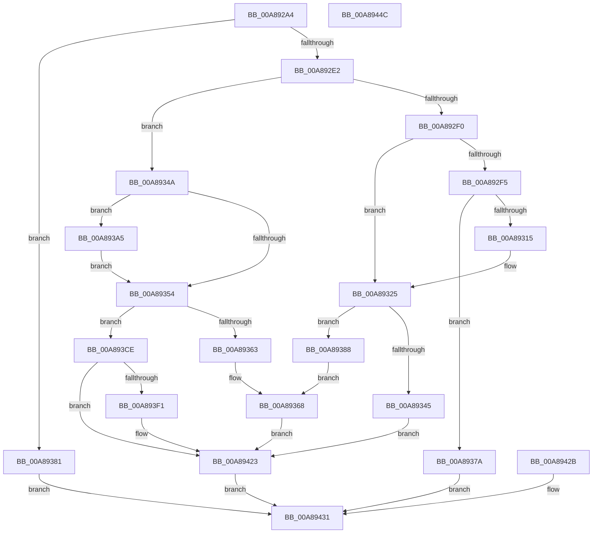

# FsRtlNotifyUpdateBuffer

- RVA: `0x00A892A4`–`0x00A8944D` (길이 `425` bytes)
- VA: `0x0000000140A892A4`
- 실행 섹션: `PAGE`
- PDB 이름 있음: `예`; PDB Function 태그: `아니요`
- unwind 정보 RVA: `0x000B8290`
- 디코드: `115`개 명령, `425/425` bytes 표시
- 미해석 바이트: `0` (있으면 어셈블리에 `.byte`로 보존)

> 이 문서는 커널 이미지의 기계어와 PDB 기호를 분석해 생성했습니다. 4번과 5번은 함수 원형과 자료형을 바이너리 사용 방식에서 추정한 C 해석이며 원본 소스 복구 결과는 아닙니다.

## 1. Dependencies

- 직접 호출 지점: **6**; 고유 호출 대상: **2**
- 직접 호출자로 확인된 함수: **1**
- RIP 상대 이미지 참조: **0**

### Outgoing calls
- `0x00A89300` → [memcpy](../../text/6C/memcpy_function_006C6840.md) (function, `0x006C6840`)
- `0x00A89336` → [memcpy](../../text/6C/memcpy_function_006C6840.md) (function, `0x006C6840`)
- `0x00A89370` → [memcpy](../../text/6C/memcpy_function_006C6840.md) (function, `0x006C6840`)
- `0x00A893B6` → [RtlOemToUnicodeN](../90/RtlOemToUnicodeN_function_0090F330.md) (function, `0x0090F330`)
- `0x00A893E2` → [RtlOemToUnicodeN](../90/RtlOemToUnicodeN_function_0090F330.md) (function, `0x0090F330`)
- `0x00A8941E` → [RtlOemToUnicodeN](../90/RtlOemToUnicodeN_function_0090F330.md) (function, `0x0090F330`)

### Direct callers
- [FsRtlNotifyFilterReportChange](../A1/FsRtlNotifyFilterReportChange_function_00A1E880.md) at `0x00A1F209`

### Static image references
- 디코드된 RIP-relative 메모리 참조가 없습니다.

## 2. Other-region calls and transfers

- 다른 실행 섹션으로 향하는 call: **3**
  - `0x00A89300` → [memcpy](../../text/6C/memcpy_function_006C6840.md) (`PAGE` → `.text`)
  - `0x00A89336` → [memcpy](../../text/6C/memcpy_function_006C6840.md) (`PAGE` → `.text`)
  - `0x00A89370` → [memcpy](../../text/6C/memcpy_function_006C6840.md) (`PAGE` → `.text`)
- 별도 외부 분기/꼬리 이동을 확인하지 못했습니다.

## 3. Assembly (complete function range)

```asm
00A892A4  48 8B C4                        mov rax, rsp
00A892A7  48 89 58 08                     mov qword ptr [rax + 8], rbx
00A892AB  48 89 70 10                     mov qword ptr [rax + 0x10], rsi
00A892AF  48 89 78 18                     mov qword ptr [rax + 0x18], rdi
00A892B3  4C 89 70 20                     mov qword ptr [rax + 0x20], r14
00A892B7  41 57                           push r15
00A892B9  48 83 EC 40                     sub rsp, 0x40
00A892BD  4D 8B F1                        mov r14, r9
00A892C0  49 8B F0                        mov rsi, r8
00A892C3  48 8B D9                        mov rbx, rcx
00A892C6  45 33 FF                        xor r15d, r15d
00A892C9  41 8B FF                        mov edi, r15d
00A892CC  44 89 39                        mov dword ptr [rcx], r15d
00A892CF  89 51 04                        mov dword ptr [rcx + 4], edx
00A892D2  8B 94 24 80 00 00 00            mov edx, dword ptr [rsp + 0x80]
00A892D9  83 C2 F4                        add edx, -0xc
00A892DC  0F 84 9F 00 00 00               je 0x140a89381
00A892E2  89 51 08                        mov dword ptr [rcx + 8], edx
00A892E5  41 0F B7 00                     movzx eax, word ptr [r8]
00A892E9  44 38 7C 24 78                  cmp byte ptr [rsp + 0x78], r15b
00A892EE  74 5A                           je 0x140a8934a
00A892F0  66 85 C0                        test ax, ax
00A892F3  74 30                           je 0x140a89325
00A892F5  44 8B C0                        mov r8d, eax
00A892F8  48 83 C1 0C                     add rcx, 0xc
00A892FC  48 8B 56 08                     mov rdx, qword ptr [rsi + 8]
00A89300  E8 3B D5 C3 FF                  call 0x1406c6840
00A89305  44 0F B7 06                     movzx r8d, word ptr [rsi]
00A89309  49 8D 48 02                     lea rcx, [r8 + 2]
00A8930D  8B 43 08                        mov eax, dword ptr [rbx + 8]
00A89310  48 3B C1                        cmp rax, rcx
00A89313  72 65                           jb 0x140a8937a
00A89315  41 8D 57 5C                     lea edx, [r15 + 0x5c]
00A89319  66 41 89 54 18 0C               mov word ptr [r8 + rbx + 0xc], dx
00A8931F  0F B7 3E                        movzx edi, word ptr [rsi]
00A89322  83 C7 02                        add edi, 2
00A89325  45 0F B7 06                     movzx r8d, word ptr [r14]
00A89329  8B CF                           mov ecx, edi
00A8932B  48 83 C1 0C                     add rcx, 0xc
00A8932F  48 03 CB                        add rcx, rbx
00A89332  49 8B 56 08                     mov rdx, qword ptr [r14 + 8]
00A89336  E8 05 D5 C3 FF                  call 0x1406c6840
00A8933B  48 8B 54 24 70                  mov rdx, qword ptr [rsp + 0x70]
00A89340  48 85 D2                        test rdx, rdx
00A89343  75 43                           jne 0x140a89388
00A89345  E9 D9 00 00 00                  jmp 0x140a89423
00A8934A  44 89 7C 24 34                  mov dword ptr [rsp + 0x34], r15d
00A8934F  66 85 C0                        test ax, ax
00A89352  75 51                           jne 0x140a893a5
00A89354  8B CF                           mov ecx, edi
00A89356  48 83 C1 0C                     add rcx, 0xc
00A8935A  48 03 CB                        add rcx, rbx
00A8935D  66 44 39 3E                     cmp word ptr [rsi], r15w
00A89361  75 6B                           jne 0x140a893ce
00A89363  48 8B 54 24 70                  mov rdx, qword ptr [rsp + 0x70]
00A89368  44 0F B7 02                     movzx r8d, word ptr [rdx]
00A8936C  48 8B 52 08                     mov rdx, qword ptr [rdx + 8]
00A89370  E8 CB D4 C3 FF                  call 0x1406c6840
00A89375  E9 A9 00 00 00                  jmp 0x140a89423
00A8937A  32 C0                           xor al, al
00A8937C  E9 B0 00 00 00                  jmp 0x140a89431
00A89381  32 C0                           xor al, al
00A89383  E9 A9 00 00 00                  jmp 0x140a89431
00A89388  41 0F B7 06                     movzx eax, word ptr [r14]
00A8938C  03 F8                           add edi, eax
00A8938E  8B C7                           mov eax, edi
00A89390  41 B8 3A 00 00 00               mov r8d, 0x3a
00A89396  66 44 89 44 1F 0C               mov word ptr [rdi + rbx + 0xc], r8w
00A8939C  48 8D 4B 0E                     lea rcx, [rbx + 0xe]
00A893A0  48 03 C8                        add rcx, rax
00A893A3  EB C3                           jmp 0x140a89368
00A893A5  48 83 C1 0C                     add rcx, 0xc
00A893A9  89 44 24 20                     mov dword ptr [rsp + 0x20], eax
00A893AD  4D 8B 48 08                     mov r9, qword ptr [r8 + 8]
00A893B1  4C 8D 44 24 34                  lea r8, [rsp + 0x34]
00A893B6  E8 75 5F E8 FF                  call 0x14090f330
00A893BB  8B 4C 24 34                     mov ecx, dword ptr [rsp + 0x34]
00A893BF  BA 5C 00 00 00                  mov edx, 0x5c
00A893C4  66 89 54 19 0C                  mov word ptr [rcx + rbx + 0xc], dx
00A893C9  8D 79 02                        lea edi, [rcx + 2]
00A893CC  EB 86                           jmp 0x140a89354
00A893CE  41 0F B7 06                     movzx eax, word ptr [r14]
00A893D2  89 44 24 20                     mov dword ptr [rsp + 0x20], eax
00A893D6  4D 8B 4E 08                     mov r9, qword ptr [r14 + 8]
00A893DA  4C 8D 44 24 34                  lea r8, [rsp + 0x34]
00A893DF  8B 53 08                        mov edx, dword ptr [rbx + 8]
00A893E2  E8 49 5F E8 FF                  call 0x14090f330
00A893E7  4C 8B 4C 24 70                  mov r9, qword ptr [rsp + 0x70]
00A893EC  4D 85 C9                        test r9, r9
00A893EF  74 32                           je 0x140a89423
00A893F1  03 7C 24 34                     add edi, dword ptr [rsp + 0x34]
00A893F5  8B CF                           mov ecx, edi
00A893F7  41 B8 3A 00 00 00               mov r8d, 0x3a
00A893FD  66 44 89 44 1F 0C               mov word ptr [rdi + rbx + 0xc], r8w
00A89403  41 0F B7 01                     movzx eax, word ptr [r9]
00A89407  48 83 C1 0E                     add rcx, 0xe
00A8940B  48 03 CB                        add rcx, rbx
00A8940E  89 44 24 20                     mov dword ptr [rsp + 0x20], eax
00A89412  4D 8B 49 08                     mov r9, qword ptr [r9 + 8]
00A89416  4C 8D 44 24 34                  lea r8, [rsp + 0x34]
00A8941B  8B 53 08                        mov edx, dword ptr [rbx + 8]
00A8941E  E8 0D 5F E8 FF                  call 0x14090f330
00A89423  B0 01                           mov al, 1
00A89425  88 44 24 30                     mov byte ptr [rsp + 0x30], al
00A89429  EB 06                           jmp 0x140a89431
00A8942B  32 C0                           xor al, al
00A8942D  88 44 24 30                     mov byte ptr [rsp + 0x30], al
00A89431  48 8B 5C 24 50                  mov rbx, qword ptr [rsp + 0x50]
00A89436  48 8B 74 24 58                  mov rsi, qword ptr [rsp + 0x58]
00A8943B  48 8B 7C 24 60                  mov rdi, qword ptr [rsp + 0x60]
00A89440  4C 8B 74 24 68                  mov r14, qword ptr [rsp + 0x68]
00A89445  48 83 C4 40                     add rsp, 0x40
00A89449  41 5F                           pop r15
00A8944B  C3                              ret
00A8944C  CC                              int3
```

## 4. C-style interpretation (structured pseudocode)

```c
__int64 __fastcall FsRtlNotifyUpdateBuffer(__int64 a1, int a2, __int64 a3, __int64 a4, __int64 a5, unsigned __int8 a6, unsigned int a7)
{
    __int64 result;
    __int64 v_r15;
    __int64 v_rdi;
    __int64 v_rsp;
    unsigned int v_stack_m14;
    unsigned __int8 v_stack_m18;
    unsigned int v_stack_m28;
    unsigned __int64 v_stack_p10;
    unsigned __int64 v_stack_p18;
    unsigned __int64 v_stack_p20;
    unsigned __int64 v_stack_p8;

    *(unsigned __int64 *)(v_rsp + 8) = v_rbx;
    *(unsigned __int64 *)(v_rsp + 16) = v_rsi;
    *(unsigned __int64 *)(v_rsp + 24) = v_rdi;
    *(unsigned __int64 *)(v_rsp + 32) = v_r14;
    v_rsp = (v_rsp) - (64);
    v_r15 = 0;
    *(unsigned int *)(a1) = 0;
    *(unsigned int *)(a1 + 4) = a2;
    a2 = (unsigned int)(((unsigned int)(a7)) + (-12));
    if (condition_is_equal) goto loc_00A89381;
    *(unsigned int *)(a1 + 8) = a2;
    if (a6 == 0) goto loc_00A8934A;
    if ((unsigned __int16)(*(unsigned __int16 *)(a3)) == 0) goto loc_00A89325;
    a1 = (a1) + (12);
    result = memcpy(a1, *(unsigned __int64 *)(a3 + 8), (unsigned int)((unsigned int)(*(unsigned __int16 *)(a3))), a4);
    if (((unsigned int)(*(unsigned int *)(a1 + 8))) < (*(unsigned __int16 *)(a3) + 2)) goto loc_00A8937A;
    *(unsigned __int16 *)(*(unsigned __int16 *)(a3) + a1 * 1 + 12) = (unsigned __int16)(v_r15 + 92);
    v_rdi = (unsigned int)((*(unsigned __int16 *)(a3)) + (2));
loc_00A89325:
    a1 = ((unsigned int)((unsigned int)(v_rdi))) + (12);
    a1 = (a1) + (a1);
    result = memcpy(a1, *(unsigned __int64 *)(a4 + 8), *(unsigned __int16 *)(a4), a4);
    if (a5 != 0) goto loc_00A89388;
    goto loc_00A89423;
loc_00A8934A:
    v_stack_m14 = 0;
    if ((unsigned __int16)(result) != 0) goto loc_00A893A5;
loc_00A89354:
    a1 = ((unsigned int)((unsigned int)(v_rdi))) + (12);
    a1 = (a1) + (a1);
    if ((*(unsigned __int16 *)(a3)) != 0) goto loc_00A893CE;
loc_00A89368:
    result = memcpy(a1, *(unsigned __int64 *)(a5 + 8), *(unsigned __int16 *)(a5), a4);
    goto loc_00A89423;
loc_00A8937A:
    result = 0;
    goto loc_00A89431;
loc_00A89381:
    result = 0;
    goto loc_00A89431;
loc_00A89388:
    v_rdi = (unsigned int)((v_rdi) + ((unsigned int)(*(unsigned __int16 *)(a4))));
    *(unsigned __int16 *)(v_rdi + a1 * 1 + 12) = 58;
    a1 = (a1 + 14) + ((unsigned int)((unsigned int)(v_rdi)));
    goto loc_00A89368;
loc_00A893A5:
    a1 = (a1) + (12);
    v_stack_m28 = (unsigned int)((unsigned int)((unsigned int)(v_rdi)));
    result = RtlOemToUnicodeN(a1, *(unsigned __int64 *)(a5 + 8), v_stack_m14, *(unsigned __int64 *)(58 + 8));
    *(unsigned __int16 *)((unsigned int)(v_stack_m14) + a1 * 1 + 12) = 92;
    goto loc_00A89354;
loc_00A893CE:
    v_stack_m28 = (unsigned int)(*(unsigned __int16 *)(a4));
    result = RtlOemToUnicodeN((unsigned int)(v_stack_m14), (unsigned int)(*(unsigned int *)(a1 + 8)), v_stack_m14, *(unsigned __int64 *)(a4 + 8));
    v_rdi = (unsigned int)(v_stack_m14) + 2;
    if (a5 != 0) {
        v_rdi = (unsigned int)(((unsigned int)(v_stack_m14) + 2) + (v_stack_m14));
        a1 = (unsigned int)(v_rdi);
        a3 = 58;
        *(unsigned __int16 *)(v_rdi + a1 * 1 + 12) = (unsigned __int16)(a3);
        result = *(unsigned __int16 *)(a5);
        a1 = (a1) + (14);
        a1 = (a1) + (a1);
        v_stack_m28 = (unsigned int)(result);
        a4 = *(unsigned __int64 *)(a5 + 8);
        a3 = v_stack_m14;
        a2 = *(unsigned int *)(a1 + 8);
        result = RtlOemToUnicodeN(a1, a2, a3, a4);
    }
    v_stack_m18 = 1;
    goto loc_00A89431;
loc_00A89431:
    v_rsp = (v_rsp) + (64);
    return 1;
}
```

## 5. (Beta) C Style

```c
int64_t FsRtlNotifyUpdateBuffer(void *Arg1, int32_t Arg2, void *Arg3, void *Arg4, int64_t Arg5, uint8_t Arg6, uint32_t Arg7)
{
    uint8_t *arg1 = (uint8_t *)Arg1;
    uint8_t *arg3 = (uint8_t *)Arg3;
    uint8_t *arg4 = (uint8_t *)Arg4;

    int64_t result;
    int64_t local_r15;
    int64_t local_rdi;
    int64_t local_rsp;
    uint32_t v_stack_m14;
    uint8_t v_stack_m18;
    uint32_t v_stack_m28;
    uint64_t v_stack_p10;
    uint64_t v_stack_p18;
    uint64_t v_stack_p20;
    uint64_t v_stack_p8;

    *(uint64_t *)(local_rsp + 0x8) = local_rbx;
    *(uint64_t *)(local_rsp + 0x10) = local_rsi;
    *(uint64_t *)(local_rsp + 0x18) = local_rdi;
    *(uint64_t *)(local_rsp + 0x20) = local_r14;
    local_rsp = (local_rsp) - (64);
    local_r15 = 0;
    *(uint32_t *)(arg1) = 0;
    *(uint32_t *)(arg1 + 0x4) = Arg2;
    Arg2 = (uint32_t)(((uint32_t)(Arg7)) + (-12));
    if (condition_is_equal) goto loc_00A89381;
    *(uint32_t *)(arg1 + 0x8) = Arg2;
    if (Arg6 == 0) goto loc_00A8934A;
    if ((uint16_t)(*(uint16_t *)(arg3)) == 0) goto loc_00A89325;
    Arg1 = (Arg1) + (12);
    result = memcpy(Arg1, *(uint64_t *)(arg3 + 0x8), (uint32_t)((uint32_t)(*(uint16_t *)(arg3))), Arg4);
    if (((uint32_t)(*(uint32_t *)(arg1 + 0x8))) < (*(uint16_t *)(arg3) + 2)) goto loc_00A8937A;
    *(uint16_t *)(*(uint16_t *)(arg3) + arg1 * 1 + 0xC) = (uint16_t)(local_r15 + 92);
    local_rdi = (uint32_t)((*(uint16_t *)(arg3)) + (2));
loc_00A89325:
    Arg1 = ((uint32_t)((uint32_t)(local_rdi))) + (12);
    Arg1 = (Arg1) + (Arg1);
    result = memcpy(Arg1, *(uint64_t *)(arg4 + 0x8), *(uint16_t *)(arg4), Arg4);
    if (Arg5 != 0) goto loc_00A89388;
    goto loc_00A89423;
loc_00A8934A:
    v_stack_m14 = 0;
    if ((uint16_t)(result) != 0) goto loc_00A893A5;
loc_00A89354:
    Arg1 = ((uint32_t)((uint32_t)(local_rdi))) + (12);
    Arg1 = (Arg1) + (Arg1);
    if ((*(uint16_t *)(arg3)) != 0) goto loc_00A893CE;
loc_00A89368:
    result = memcpy(Arg1, *(uint64_t *)(Arg5 + 0x8), *(uint16_t *)(Arg5), Arg4);
    goto loc_00A89423;
loc_00A8937A:
    result = 0;
    goto loc_00A89431;
loc_00A89381:
    result = 0;
    goto loc_00A89431;
loc_00A89388:
    local_rdi = (uint32_t)((local_rdi) + ((uint32_t)(*(uint16_t *)(arg4))));
    *(uint16_t *)(local_rdi + arg1 * 1 + 0xC) = 58;
    Arg1 = (Arg1 + 14) + ((uint32_t)((uint32_t)(local_rdi)));
    goto loc_00A89368;
loc_00A893A5:
    Arg1 = (Arg1) + (12);
    v_stack_m28 = (uint32_t)((uint32_t)((uint32_t)(local_rdi)));
    result = RtlOemToUnicodeN(Arg1, *(uint64_t *)(Arg5 + 0x8), v_stack_m14, *(uint64_t *)(58 + 0x8));
    *(uint16_t *)((uint32_t)(v_stack_m14) + arg1 * 1 + 0xC) = 92;
    goto loc_00A89354;
loc_00A893CE:
    v_stack_m28 = (uint32_t)(*(uint16_t *)(arg4));
    result = RtlOemToUnicodeN((uint32_t)(v_stack_m14), (uint32_t)(*(uint32_t *)(arg1 + 0x8)), v_stack_m14, *(uint64_t *)(arg4 + 0x8));
    local_rdi = (uint32_t)(v_stack_m14) + 2;
    if (Arg5 != 0) {
        local_rdi = (uint32_t)(((uint32_t)(v_stack_m14) + 2) + (v_stack_m14));
        Arg1 = (uint32_t)(local_rdi);
        Arg3 = 58;
        *(uint16_t *)(local_rdi + arg1 * 1 + 0xC) = (uint16_t)(Arg3);
        result = *(uint16_t *)(Arg5);
        Arg1 = (Arg1) + (14);
        Arg1 = (Arg1) + (Arg1);
        v_stack_m28 = (uint32_t)(result);
        Arg4 = *(uint64_t *)(Arg5 + 0x8);
        Arg3 = v_stack_m14;
        Arg2 = *(uint32_t *)(arg1 + 0x8);
        result = RtlOemToUnicodeN(Arg1, Arg2, Arg3, Arg4);
    }
    v_stack_m18 = 1;
    goto loc_00A89431;
loc_00A89431:
    local_rsp = (local_rsp) + (64);
    return 1;
}
```

### 관측된 메모리 오프셋

구조체 형식이 확인되지 않은 접근은 인자 기준의 오프셋으로만 기록했습니다.

| 기준 인자 | 오프셋 표현 | 폭 (bit) | 접근 |
|---|---:|---:|---|
| `Arg1` | `+ 0x0` | `32` | `W` |
| `Arg1` | `+ 0x4` | `32` | `W` |
| `Arg1` | `+ 0x8` | `32` | `R` |
| `Arg1` | `+ 0x8` | `32` | `W` |
| `Arg1` | `+ 0xE` | `64` | `R` |
| `Arg3` | `+ 0x0` | `16` | `R` |
| `Arg3` | `+ 0x8` | `64` | `R` |
| `Arg4` | `+ 0x0` | `16` | `R` |
| `Arg4` | `+ 0x8` | `64` | `R` |

## 6. Execution-region graph

[열기: 2D/3D 그래프와 함수 탐색 컨트롤 패널](../../../control-panel.html?section=page&rva=0x00A892A4&view=graph)

- 2D 그래프는 위에서 아래로 흐르고, 3D 그래프는 빈 공간을 드래그해 회전합니다. Shift+드래그는 이동, 휠은 확대·축소, 함수 노드 선택은 대상 보고서 이동입니다.

### Static fallback


