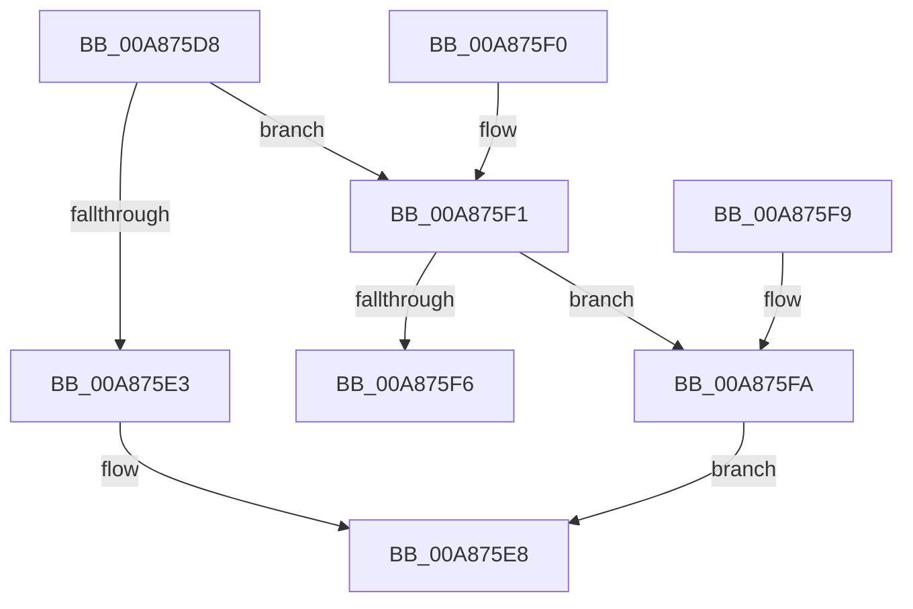

# HvIsCurrentLogSwappable

- RVA: `0x00A875D8`–`0x00A87601` (길이 `41` bytes)
- VA: `0x0000000140A875D8`
- 실행 섹션: `PAGE`
- PDB 이름 있음: `예`; PDB Function 태그: `아니요`
- unwind 정보 RVA: `0x000DB714`
- 디코드: `15`개 명령, `41/41` bytes 표시
- 미해석 바이트: `0` (있으면 어셈블리에 `.byte`로 보존)

> 이 문서는 커널 이미지의 기계어와 PDB 기호를 분석해 생성했습니다. 4번과 5번은 함수 원형과 자료형을 바이너리 사용 방식에서 추정한 C 해석이며 원본 소스 복구 결과는 아닙니다.

## 1. Dependencies

- 직접 호출 지점: **0**; 고유 호출 대상: **0**
- 직접 호출자로 확인된 함수: **2**
- RIP 상대 이미지 참조: **0**

### Outgoing calls
- 직접 디코드된 call 명령이 없습니다.

### Direct callers
- [CmpFlushHive](../9B/CmpFlushHive_function_009B3DC0.md) at `0x009B4652`
- [CmpGenerateFlushControlData](../9B/CmpGenerateFlushControlData_function_009B4BCC.md) at `0x009B4E15`
- [CmpGenerateFlushControlData](../9B/CmpGenerateFlushControlData_function_009B4BCC.md) at `0x009B4E91`

### Static image references
- 디코드된 RIP-relative 메모리 참조가 없습니다.

## 2. Other-region calls and transfers

- 다른 실행 섹션으로 향하는 call: **0**
- 별도 외부 분기/꼬리 이동을 확인하지 못했습니다.

## 3. Assembly (complete function range)

```asm
00A875D8  8B 81 A8 00 00 00               mov eax, dword ptr [rcx + 0xa8]
00A875DE  83 F8 04                        cmp eax, 4
00A875E1  75 0E                           jne 0x140a875f1
00A875E3  B8 C1 00 00 00                  mov eax, 0xc1
00A875E8  80 3C 08 00                     cmp byte ptr [rax + rcx], 0
00A875EC  0F 94 C0                        sete al
00A875EF  C3                              ret
00A875F0  CC                              int3
00A875F1  83 F8 05                        cmp eax, 5
00A875F4  74 04                           je 0x140a875fa
00A875F6  32 C0                           xor al, al
00A875F8  C3                              ret
00A875F9  CC                              int3
00A875FA  B8 C0 00 00 00                  mov eax, 0xc0
00A875FF  EB E7                           jmp 0x140a875e8
```

## 4. C-style interpretation (structured pseudocode)

```c
__int64 __fastcall HvIsCurrentLogSwappable(__int64 a1)
{
    __int64 result;

    if (((unsigned int)((unsigned int)(*(unsigned int *)(a1 + 168)))) != 4) goto loc_00A875F1;
loc_00A875E8:
    result = ((*(unsigned __int8 *)(193 + a1 * 1)) == 0) ? 1 : 0;
    return result;
loc_00A875F1:
    if (((unsigned int)(result)) == 5) goto loc_00A875FA;
    result = 0;
    return result;
loc_00A875FA:
    goto loc_00A875E8;
}
```

## 5. (Beta) C Style

```c
int64_t HvIsCurrentLogSwappable(void *Arg1)
{
    uint8_t *arg1 = (uint8_t *)Arg1;

    int64_t result;

    if (((uint32_t)((uint32_t)(*(uint32_t *)(arg1 + 0xA8)))) != 4) goto loc_00A875F1;
loc_00A875E8:
    result = ((*(uint8_t *)(193 + arg1 * 1)) == 0) ? 1 : 0;
    return result;
loc_00A875F1:
    if (((uint32_t)(result)) == 5) goto loc_00A875FA;
    result = 0;
    return result;
loc_00A875FA:
    goto loc_00A875E8;
}
```

### 관측된 메모리 오프셋

구조체 형식이 확인되지 않은 접근은 인자 기준의 오프셋으로만 기록했습니다.

| 기준 인자 | 오프셋 표현 | 폭 (bit) | 접근 |
|---|---:|---:|---|
| `Arg1` | `+ 0xA8` | `32` | `R` |

## 6. Execution-region graph

[열기: 2D/3D 그래프와 함수 탐색 컨트롤 패널](../../../control-panel.html?section=page&rva=0x00A875D8&view=graph)

- 2D 그래프는 위에서 아래로 흐르고, 3D 그래프는 빈 공간을 드래그해 회전합니다. Shift+드래그는 이동, 휠은 확대·축소, 함수 노드 선택은 대상 보고서 이동입니다.

### Static fallback


