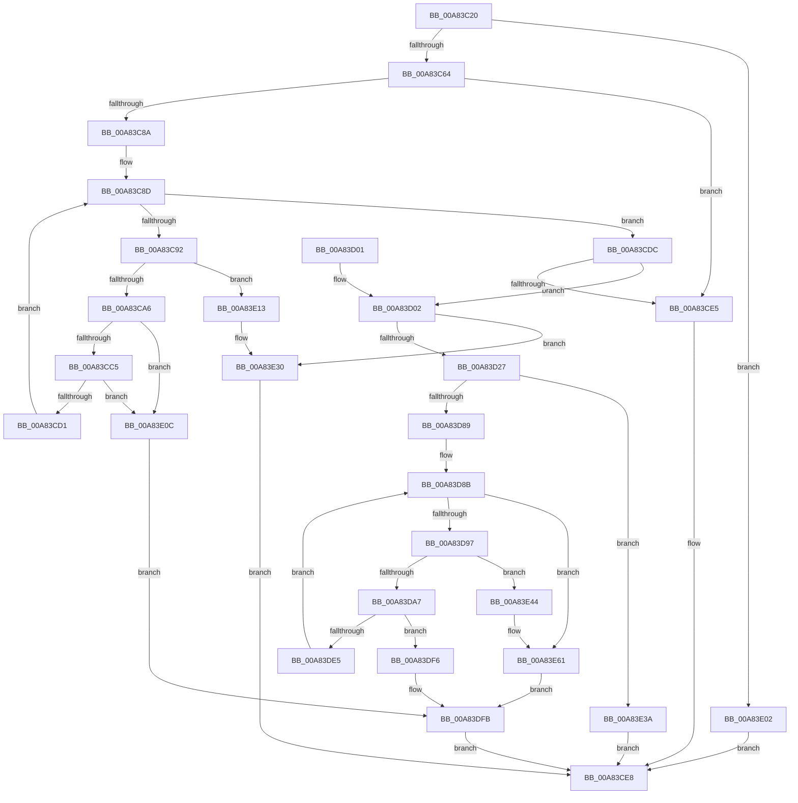

# HvWriteExternal

- RVA: `0x00A83C20`–`0x00A83E79` (길이 `601` bytes)
- VA: `0x0000000140A83C20`
- 실행 섹션: `PAGE`
- PDB 이름 있음: `예`; PDB Function 태그: `아니요`
- unwind 정보 RVA: `0x000B7540`
- 디코드: `157`개 명령, `601/601` bytes 표시
- 미해석 바이트: `0` (있으면 어셈블리에 `.byte`로 보존)

> 이 문서는 커널 이미지의 기계어와 PDB 기호를 분석해 생성했습니다. 4번과 5번은 함수 원형과 자료형을 바이너리 사용 방식에서 추정한 C 해석이며 원본 소스 복구 결과는 아닙니다.

## 1. Dependencies

- 직접 호출 지점: **17**; 고유 호출 대상: **12**
- 직접 호출자로 확인된 함수: **2**
- RIP 상대 이미지 참조: **0**

### Outgoing calls
- `0x00A83C52` → [HvpGetBinContextInitialize](../../pagecmrc/BC/HvpGetBinContextInitialize_function_00BC98D0.md) (function, `0x00BC98D0`)
- `0x00A83C7E` → [CmpDoFileSetSizeEx](../9B/CmpDoFileSetSizeEx_function_009B2A4C.md) (function, `0x009B2A4C`)
- `0x00A83C98` → [HvpGetCellMap](../../pagecmrc/BC/HvpGetCellMap_function_00BC9710.md) (function, `0x00BC9710`)
- `0x00A83CAD` → [HvpMapEntryGetBinAddress](../../pagecmrc/BC/HvpMapEntryGetBinAddress_function_00BC9770.md) (function, `0x00BC9770`)
- `0x00A83CD5` → [HvpMapEntryReleaseBinAddress](../../pagecmrc/BC/HvpMapEntryReleaseBinAddress_function_00BC9790.md) (function, `0x00BC9790`)
- `0x00A83D16` → [ExAllocatePool2](../../poolcode/B8/ExAllocatePool2_function_00B820F0.md) (function, `0x00B820F0`)
- `0x00A83D31` → [memcpy](../../text/6C/memcpy_function_006C6840.md) (function, `0x006C6840`)
- `0x00A83D45` → [HvpHeaderCheckSum](../../pagecmrc/BC/HvpHeaderCheckSum_function_00BC97A0.md) (function, `0x00BC97A0`)
- `0x00A83D70` → [guard_dispatch_icall](../../text/6B/guard_dispatch_icall_function_006BAAD0.md) (function, `0x006BAAD0`)
- `0x00A83D7C` → [ExFreePoolWithTag](../../poolcode/B8/ExFreePoolWithTag_function_00B82870.md) (function, `0x00B82870`)
- `0x00A83D99` → [HvpGetCellMap](../../pagecmrc/BC/HvpGetCellMap_function_00BC9710.md) (function, `0x00BC9710`)
- `0x00A83DAE` → [HvpMapEntryGetBinAddress](../../pagecmrc/BC/HvpMapEntryGetBinAddress_function_00BC9770.md) (function, `0x00BC9770`)
- `0x00A83DDC` → [guard_dispatch_icall](../../text/6B/guard_dispatch_icall_function_006BAAD0.md) (function, `0x006BAAD0`)
- `0x00A83DE9` → [HvpMapEntryReleaseBinAddress](../../pagecmrc/BC/HvpMapEntryReleaseBinAddress_function_00BC9790.md) (function, `0x00BC9790`)
- `0x00A83E2A` → [KeBugCheckEx](../../text/4F/KeBugCheckEx_function_004FD660.md) (function, `0x004FD660`)
- `0x00A83E5B` → [KeBugCheckEx](../../text/4F/KeBugCheckEx_function_004FD660.md) (function, `0x004FD660`)
- `0x00A83E66` → [CmpFileFlush](../9B/CmpFileFlush_function_009B9A04.md) (function, `0x009B9A04`)

### Direct callers
- [CmSaveKey](../7D/CmSaveKey_function_007DDBDC.md) at `0x007DDF90`
- [CmSaveMergedKeys](../7D/CmSaveMergedKeys_function_007DE040.md) at `0x007DE3F1`

### Static image references
- 디코드된 RIP-relative 메모리 참조가 없습니다.

## 2. Other-region calls and transfers

- 다른 실행 섹션으로 향하는 call: **15**
  - `0x00A83C52` → [HvpGetBinContextInitialize](../../pagecmrc/BC/HvpGetBinContextInitialize_function_00BC98D0.md) (`PAGE` → `PAGECMRC`)
  - `0x00A83C98` → [HvpGetCellMap](../../pagecmrc/BC/HvpGetCellMap_function_00BC9710.md) (`PAGE` → `PAGECMRC`)
  - `0x00A83CAD` → [HvpMapEntryGetBinAddress](../../pagecmrc/BC/HvpMapEntryGetBinAddress_function_00BC9770.md) (`PAGE` → `PAGECMRC`)
  - `0x00A83CD5` → [HvpMapEntryReleaseBinAddress](../../pagecmrc/BC/HvpMapEntryReleaseBinAddress_function_00BC9790.md) (`PAGE` → `PAGECMRC`)
  - `0x00A83D16` → [ExAllocatePool2](../../poolcode/B8/ExAllocatePool2_function_00B820F0.md) (`PAGE` → `POOLCODE`)
  - `0x00A83D31` → [memcpy](../../text/6C/memcpy_function_006C6840.md) (`PAGE` → `.text`)
  - `0x00A83D45` → [HvpHeaderCheckSum](../../pagecmrc/BC/HvpHeaderCheckSum_function_00BC97A0.md) (`PAGE` → `PAGECMRC`)
  - `0x00A83D70` → [guard_dispatch_icall](../../text/6B/guard_dispatch_icall_function_006BAAD0.md) (`PAGE` → `.text`)
  - `0x00A83D7C` → [ExFreePoolWithTag](../../poolcode/B8/ExFreePoolWithTag_function_00B82870.md) (`PAGE` → `POOLCODE`)
  - `0x00A83D99` → [HvpGetCellMap](../../pagecmrc/BC/HvpGetCellMap_function_00BC9710.md) (`PAGE` → `PAGECMRC`)
  - `0x00A83DAE` → [HvpMapEntryGetBinAddress](../../pagecmrc/BC/HvpMapEntryGetBinAddress_function_00BC9770.md) (`PAGE` → `PAGECMRC`)
  - `0x00A83DDC` → [guard_dispatch_icall](../../text/6B/guard_dispatch_icall_function_006BAAD0.md) (`PAGE` → `.text`)
  - `0x00A83DE9` → [HvpMapEntryReleaseBinAddress](../../pagecmrc/BC/HvpMapEntryReleaseBinAddress_function_00BC9790.md) (`PAGE` → `PAGECMRC`)
  - `0x00A83E2A` → [KeBugCheckEx](../../text/4F/KeBugCheckEx_function_004FD660.md) (`PAGE` → `.text`)
  - `0x00A83E5B` → [KeBugCheckEx](../../text/4F/KeBugCheckEx_function_004FD660.md) (`PAGE` → `.text`)
- 별도 외부 분기/꼬리 이동을 확인하지 못했습니다.

## 3. Assembly (complete function range)

```asm
00A83C20  48 89 5C 24 10                  mov qword ptr [rsp + 0x10], rbx
00A83C25  48 89 74 24 18                  mov qword ptr [rsp + 0x18], rsi
00A83C2A  55                              push rbp
00A83C2B  57                              push rdi
00A83C2C  41 54                           push r12
00A83C2E  41 55                           push r13
00A83C30  41 56                           push r14
00A83C32  48 8B EC                        mov rbp, rsp
00A83C35  48 83 EC 50                     sub rsp, 0x50
00A83C39  33 C0                           xor eax, eax
00A83C3B  48 8B F1                        mov rsi, rcx
00A83C3E  33 FF                           xor edi, edi
00A83C40  89 45 F0                        mov dword ptr [rbp - 0x10], eax
00A83C43  0F 57 C0                        xorps xmm0, xmm0
00A83C46  66 89 7D 30                     mov word ptr [rbp + 0x30], di
00A83C4A  48 8D 4D 30                     lea rcx, [rbp + 0x30]
00A83C4E  0F 11 45 E0                     movups xmmword ptr [rbp - 0x20], xmm0
00A83C52  E8 79 5C 14 00                  call 0x140bc98d0
00A83C57  48 39 BE 18 06 00 00            cmp qword ptr [rsi + 0x618], rdi
00A83C5E  0F 84 9E 01 00 00               je 0x140a83e02
00A83C64  44 8B A6 18 01 00 00            mov r12d, dword ptr [rsi + 0x118]
00A83C6B  8D 5F 02                        lea ebx, [rdi + 2]
00A83C6E  45 33 C9                        xor r9d, r9d
00A83C71  8B D3                           mov edx, ebx
00A83C73  48 8B CE                        mov rcx, rsi
00A83C76  45 8D 84 24 00 10 00 00         lea r8d, [r12 + 0x1000]
00A83C7E  E8 C9 ED F2 FF                  call 0x1409b2a4c
00A83C83  44 8B D8                        mov r11d, eax
00A83C86  85 C0                           test eax, eax
00A83C88  78 5B                           js 0x140a83ce5
00A83C8A  44 8B D7                        mov r10d, edi
00A83C8D  45 3B D4                        cmp r10d, r12d
00A83C90  73 4A                           jae 0x140a83cdc
00A83C92  41 8B D2                        mov edx, r10d
00A83C95  48 8B CE                        mov rcx, rsi
00A83C98  E8 73 5A 14 00                  call 0x140bc9710
00A83C9D  48 85 C0                        test rax, rax
00A83CA0  0F 84 6D 01 00 00               je 0x140a83e13
00A83CA6  4C 8D 45 30                     lea r8, [rbp + 0x30]
00A83CAA  48 8B D0                        mov rdx, rax
00A83CAD  E8 BE 5A 14 00                  call 0x140bc9770
00A83CB2  8B 48 08                        mov ecx, dword ptr [rax + 8]
00A83CB5  44 03 D1                        add r10d, ecx
00A83CB8  44 3B 96 18 01 00 00            cmp r10d, dword ptr [rsi + 0x118]
00A83CBF  0F 87 47 01 00 00               ja 0x140a83e0c
00A83CC5  F7 C1 FF 0F 00 00               test ecx, 0xfff
00A83CCB  0F 85 3B 01 00 00               jne 0x140a83e0c
00A83CD1  4C 8D 45 30                     lea r8, [rbp + 0x30]
00A83CD5  E8 B6 5A 14 00                  call 0x140bc9790
00A83CDA  EB B1                           jmp 0x140a83c8d
00A83CDC  44 3B 96 18 01 00 00            cmp r10d, dword ptr [rsi + 0x118]
00A83CE3  73 1D                           jae 0x140a83d02
00A83CE5  41 8B C3                        mov eax, r11d
00A83CE8  4C 8D 5C 24 50                  lea r11, [rsp + 0x50]
00A83CED  49 8B 5B 38                     mov rbx, qword ptr [r11 + 0x38]
00A83CF1  49 8B 73 40                     mov rsi, qword ptr [r11 + 0x40]
00A83CF5  49 8B E3                        mov rsp, r11
00A83CF8  41 5E                           pop r14
00A83CFA  41 5D                           pop r13
00A83CFC  41 5C                           pop r12
00A83CFE  5F                              pop rdi
00A83CFF  5D                              pop rbp
00A83D00  C3                              ret
00A83D01  CC                              int3
00A83D02  41 BE 00 10 00 00               mov r14d, 0x1000
00A83D08  41 B8 43 4D 20 20               mov r8d, 0x20204d43
00A83D0E  41 8B D6                        mov edx, r14d
00A83D11  B9 08 01 00 00                  mov ecx, 0x108
00A83D16  E8 D5 E3 0F 00                  call 0x140b820f0
00A83D1B  4C 8B E8                        mov r13, rax
00A83D1E  48 85 C0                        test rax, rax
00A83D21  0F 84 09 01 00 00               je 0x140a83e30
00A83D27  48 8B 56 40                     mov rdx, qword ptr [rsi + 0x40]
00A83D2B  45 8B C6                        mov r8d, r14d
00A83D2E  48 8B C8                        mov rcx, rax
00A83D31  E8 0A 2B C4 FF                  call 0x1406c6840
00A83D36  49 8B CD                        mov rcx, r13
00A83D39  45 89 65 28                     mov dword ptr [r13 + 0x28], r12d
00A83D3D  41 C7 45 2C 01 00 00 00         mov dword ptr [r13 + 0x2c], 1
00A83D45  E8 56 5A 14 00                  call 0x140bc97a0
00A83D4A  41 89 85 FC 01 00 00            mov dword ptr [r13 + 0x1fc], eax
00A83D51  4C 8D 45 E0                     lea r8, [rbp - 0x20]
00A83D55  48 8B 46 28                     mov rax, qword ptr [rsi + 0x28]
00A83D59  41 B9 01 00 00 00               mov r9d, 1
00A83D5F  8B D3                           mov edx, ebx
00A83D61  4C 89 6D E8                     mov qword ptr [rbp - 0x18], r13
00A83D65  48 8B CE                        mov rcx, rsi
00A83D68  44 89 75 F0                     mov dword ptr [rbp - 0x10], r14d
00A83D6C  89 7C 24 20                     mov dword ptr [rsp + 0x20], edi
00A83D70  E8 5B 6D C3 FF                  call 0x1406baad0
00A83D75  33 D2                           xor edx, edx
00A83D77  49 8B CD                        mov rcx, r13
00A83D7A  8B D8                           mov ebx, eax
00A83D7C  E8 EF EA 0F 00                  call 0x140b82870
00A83D81  85 DB                           test ebx, ebx
00A83D83  0F 88 B1 00 00 00               js 0x140a83e3a
00A83D89  8B DF                           mov ebx, edi
00A83D8B  48 8B CE                        mov rcx, rsi
00A83D8E  41 3B DC                        cmp ebx, r12d
00A83D91  0F 83 CA 00 00 00               jae 0x140a83e61
00A83D97  8B D3                           mov edx, ebx
00A83D99  E8 72 59 14 00                  call 0x140bc9710
00A83D9E  48 85 C0                        test rax, rax
00A83DA1  0F 84 9D 00 00 00               je 0x140a83e44
00A83DA7  4C 8D 45 30                     lea r8, [rbp + 0x30]
00A83DAB  48 8B D0                        mov rdx, rax
00A83DAE  E8 BD 59 14 00                  call 0x140bc9770
00A83DB3  41 B9 01 00 00 00               mov r9d, 1
00A83DB9  89 7C 24 20                     mov dword ptr [rsp + 0x20], edi
00A83DBD  4C 8D 45 E0                     lea r8, [rbp - 0x20]
00A83DC1  48 8B CE                        mov rcx, rsi
00A83DC4  44 8B 68 08                     mov r13d, dword ptr [rax + 8]
00A83DC8  48 89 45 E8                     mov qword ptr [rbp - 0x18], rax
00A83DCC  41 8D 51 01                     lea edx, [r9 + 1]
00A83DD0  48 8B 46 28                     mov rax, qword ptr [rsi + 0x28]
00A83DD4  44 89 75 E0                     mov dword ptr [rbp - 0x20], r14d
00A83DD8  44 89 6D F0                     mov dword ptr [rbp - 0x10], r13d
00A83DDC  E8 EF 6C C3 FF                  call 0x1406baad0
00A83DE1  85 C0                           test eax, eax
00A83DE3  78 11                           js 0x140a83df6
00A83DE5  4C 8D 45 30                     lea r8, [rbp + 0x30]
00A83DE9  E8 A2 59 14 00                  call 0x140bc9790
00A83DEE  45 03 F5                        add r14d, r13d
00A83DF1  41 03 DD                        add ebx, r13d
00A83DF4  EB 95                           jmp 0x140a83d8b
00A83DF6  B9 4D 01 00 C0                  mov ecx, 0xc000014d
00A83DFB  8B C1                           mov eax, ecx
00A83DFD  E9 E6 FE FF FF                  jmp 0x140a83ce8
00A83E02  B8 0D 00 00 C0                  mov eax, 0xc000000d
00A83E07  E9 DC FE FF FF                  jmp 0x140a83ce8
00A83E0C  B9 4C 01 00 C0                  mov ecx, 0xc000014c
00A83E11  EB E8                           jmp 0x140a83dfb
00A83E13  BA 01 00 00 00                  mov edx, 1
00A83E18  45 8B CA                        mov r9d, r10d
00A83E1B  4C 8B C6                        mov r8, rsi
00A83E1E  48 C7 44 24 20 E0 0C 00 00      mov qword ptr [rsp + 0x20], 0xce0
00A83E27  8D 4A 50                        lea ecx, [rdx + 0x50]
00A83E2A  E8 31 98 A7 FF                  call 0x1404fd660
00A83E2F  CC                              int3
00A83E30  B8 9A 00 00 C0                  mov eax, 0xc000009a
00A83E35  E9 AE FE FF FF                  jmp 0x140a83ce8
00A83E3A  B8 4D 01 00 C0                  mov eax, 0xc000014d
00A83E3F  E9 A4 FE FF FF                  jmp 0x140a83ce8
00A83E44  BA 01 00 00 00                  mov edx, 1
00A83E49  44 8B CB                        mov r9d, ebx
00A83E4C  4C 8B C6                        mov r8, rsi
00A83E4F  48 C7 44 24 20 37 0D 00 00      mov qword ptr [rsp + 0x20], 0xd37
00A83E58  8D 4A 50                        lea ecx, [rdx + 0x50]
00A83E5B  E8 00 98 A7 FF                  call 0x1404fd660
00A83E60  CC                              int3
00A83E61  BA 02 00 00 00                  mov edx, 2
00A83E66  E8 99 5B F3 FF                  call 0x1409b9a04
00A83E6B  B9 4D 01 00 C0                  mov ecx, 0xc000014d
00A83E70  85 C0                           test eax, eax
00A83E72  0F 48 F9                        cmovs edi, ecx
00A83E75  8B CF                           mov ecx, edi
00A83E77  EB 82                           jmp 0x140a83dfb
```

## 4. C-style interpretation (structured pseudocode)

```c
__int64 __fastcall HvWriteExternal(__int64 a1, __int64 a2, __int64 a3, int a4)
{
    __int64 result;
    __int64 v_r10;
    __int64 v_r14;
    __int64 v_rbx;
    __int64 v_rdi;
    __int64 v_rsp;
    unsigned __int64 v_stack_m28;
    unsigned int v_stack_m30;
    unsigned int v_stack_m38;
    unsigned __int64 v_stack_m40;
    unsigned __int64 v_stack_m48;
    unsigned __int64 v_stack_p10;
    unsigned __int64 v_stack_p18;
    unsigned __int16 v_stack_p8;

    v_stack_p10 = v_rbx;
    v_stack_p18 = v_rsi;
    v_rsp = (v_rsp) - (80);
    result = 0;
    v_rdi = 0;
    v_stack_m38 = 0;
    v_stack_p8 = 0;
    v_stack_m48 = v_xmm0;
    result = HvpGetBinContextInitialize(v_stack_p8, a2, a3, a4);
    if ((*(unsigned __int64 *)(a1 + 1560)) == 0) goto loc_00A83E02;
    a4 = 0;
    result = CmpDoFileSetSizeEx(a1, (unsigned int)((unsigned int)(v_rdi + 2)), (unsigned int)(*(unsigned int *)(a1 + 280)) + 4096, a4);
    if (sign_flag) goto loc_00A83CE5;
loc_00A83C8D:
    if (0 >= ((unsigned int)((unsigned int)(*(unsigned int *)(a1 + 280))))) goto loc_00A83CDC;
    result = HvpGetCellMap(a1, 0, (unsigned int)(*(unsigned int *)(a1 + 280)) + 4096, a4);
    if (result == 0) goto loc_00A83E13;
    result = HvpMapEntryGetBinAddress(a1, result, v_stack_p8, a4);
    v_r10 = (unsigned int)((0) + ((unsigned int)((unsigned int)(*(unsigned int *)(result + 8)))));
    if (((unsigned int)(v_r10)) > (*(unsigned int *)(a1 + 280))) goto loc_00A83E0C;
    if ((((unsigned int)((unsigned int)(*(unsigned int *)(result + 8)))) & (0xFFFULL)) != 0) goto loc_00A83E0C;
    result = HvpMapEntryReleaseBinAddress((unsigned int)(*(unsigned int *)(result + 8)), result, v_stack_p8, a4);
    goto loc_00A83C8D;
loc_00A83CDC:
    if (((unsigned int)(v_r10)) >= (*(unsigned int *)(a1 + 280))) goto loc_00A83D02;
loc_00A83CE5:
loc_00A83CE8:
    return (unsigned int)((unsigned int)((unsigned int)((unsigned int)(result))));
loc_00A83D02:
    result = ExAllocatePool2(264, (unsigned int)((unsigned int)((unsigned int)(0x1000ULL))), (unsigned int)(0x20204D43ULL), a4);
    if (result == 0) goto loc_00A83E30;
    result = memcpy(result, *(unsigned __int64 *)(*(unsigned __int64 *)(v_stack_m28 + 64) + 64), (unsigned int)((unsigned int)((unsigned int)(0x1000ULL))), a4);
    *(unsigned int *)(result + 40) = (unsigned int)((unsigned int)(*(unsigned int *)(a1 + 280)));
    *(unsigned int *)(result + 44) = 1;
    result = HvpHeaderCheckSum(result, *(unsigned __int64 *)(*(unsigned __int64 *)(v_stack_m28 + 64) + 64), (unsigned int)((unsigned int)((unsigned int)(0x1000ULL))), a4);
    *(unsigned int *)(result + 508) = (unsigned int)(result);
    v_stack_m40 = result;
    v_stack_m38 = (unsigned int)((unsigned int)(0x1000ULL));
    v_stack_m30 = 0;
    result = guard_dispatch_icall(*(unsigned __int64 *)(v_stack_m28 + 64), (unsigned int)((unsigned int)(*(unsigned __int64 *)(v_stack_m28 + 56))), v_stack_m48, 1);
    a2 = 0;
    result = ExFreePoolWithTag(result, a2, v_stack_m48, 1);
    if (sign_flag) goto loc_00A83E3A;
loc_00A83D8B:
    if (0 >= ((unsigned int)((unsigned int)(*(unsigned int *)(a1 + 280))))) goto loc_00A83E61;
    result = HvpGetCellMap(*(unsigned __int64 *)(v_stack_m28 + 64), 0, v_stack_m48, 1);
    if (result == 0) goto loc_00A83E44;
    result = HvpMapEntryGetBinAddress(*(unsigned __int64 *)(v_stack_m28 + 64), result, v_stack_p8, 1);
    v_stack_m30 = 0;
    v_stack_m40 = result;
    v_stack_m48 = (unsigned int)((unsigned int)(0x1000ULL));
    v_stack_m38 = (unsigned int)((unsigned int)(*(unsigned int *)(result + 8)));
    result = guard_dispatch_icall(*(unsigned __int64 *)(v_stack_m28 + 64), 1 + 1, v_stack_m48, 1);
    if (sign_flag) goto loc_00A83DF6;
    result = HvpMapEntryReleaseBinAddress(*(unsigned __int64 *)(v_stack_m28 + 64), 1 + 1, v_stack_p8, 1);
    v_r14 = (unsigned int)(((unsigned int)(0x1000ULL)) + ((unsigned int)((unsigned int)(*(unsigned int *)(result + 8)))));
    v_rbx = (unsigned int)((0) + ((unsigned int)((unsigned int)(*(unsigned int *)(result + 8)))));
    goto loc_00A83D8B;
loc_00A83DF6:
loc_00A83DFB:
    goto loc_00A83CE8;
loc_00A83E02:
    goto loc_00A83CE8;
loc_00A83E0C:
    goto loc_00A83DFB;
loc_00A83E13:
    v_stack_m30 = 0xCE0ULL;
    result = KeBugCheckEx(1 + 80, 1, *(unsigned __int64 *)(v_stack_m28 + 64), (unsigned int)((unsigned int)(v_r10)));
loc_00A83E30:
    goto loc_00A83CE8;
loc_00A83E3A:
    goto loc_00A83CE8;
loc_00A83E44:
    v_stack_m30 = 0xD37ULL;
    result = KeBugCheckEx(1 + 80, 1, *(unsigned __int64 *)(v_stack_m28 + 64), (unsigned int)((unsigned int)(v_rbx)));
loc_00A83E61:
    result = CmpFileFlush(1 + 80, 2, *(unsigned __int64 *)(v_stack_m28 + 64), (unsigned int)((unsigned int)(v_rbx)));
    if (sign_flag) { v_rdi = (unsigned int)((unsigned int)(0xC000014DULL)); }
    goto loc_00A83DFB;
}
```

## 5. (Beta) C Style

```c
int64_t HvWriteExternal(void *Arg1, int64_t Arg2, int64_t Arg3, int32_t Arg4)
{
    uint8_t *arg1 = (uint8_t *)Arg1;

    int64_t result;
    int64_t local_r10;
    int64_t local_r14;
    int64_t local_rbx;
    int64_t local_rdi;
    int64_t local_rsp;
    uint64_t v_stack_m28;
    uint32_t v_stack_m30;
    uint32_t v_stack_m38;
    uint64_t v_stack_m40;
    uint64_t v_stack_m48;
    uint64_t v_stack_p10;
    uint64_t v_stack_p18;
    uint16_t v_stack_p8;

    v_stack_p10 = local_rbx;
    v_stack_p18 = local_rsi;
    local_rsp = (local_rsp) - (80);
    result = 0;
    local_rdi = 0;
    v_stack_m38 = 0;
    v_stack_p8 = 0;
    v_stack_m48 = v_xmm0;
    result = HvpGetBinContextInitialize(v_stack_p8, Arg2, Arg3, Arg4);
    if ((*(uint64_t *)(arg1 + 0x618)) == 0) goto loc_00A83E02;
    Arg4 = 0;
    result = CmpDoFileSetSizeEx(Arg1, (uint32_t)((uint32_t)(local_rdi + 2)), (uint32_t)(*(uint32_t *)(arg1 + 0x118)) + 4096, Arg4);
    if (sign_flag) goto loc_00A83CE5;
loc_00A83C8D:
    if (0 >= ((uint32_t)((uint32_t)(*(uint32_t *)(arg1 + 0x118))))) goto loc_00A83CDC;
    result = HvpGetCellMap(Arg1, 0, (uint32_t)(*(uint32_t *)(arg1 + 0x118)) + 4096, Arg4);
    if (result == 0) goto loc_00A83E13;
    result = HvpMapEntryGetBinAddress(Arg1, result, v_stack_p8, Arg4);
    local_r10 = (uint32_t)((0) + ((uint32_t)((uint32_t)(*(uint32_t *)(result + 0x8)))));
    if (((uint32_t)(local_r10)) > (*(uint32_t *)(arg1 + 0x118))) goto loc_00A83E0C;
    if ((((uint32_t)((uint32_t)(*(uint32_t *)(result + 0x8)))) & (0xFFFULL)) != 0) goto loc_00A83E0C;
    result = HvpMapEntryReleaseBinAddress((uint32_t)(*(uint32_t *)(result + 0x8)), result, v_stack_p8, Arg4);
    goto loc_00A83C8D;
loc_00A83CDC:
    if (((uint32_t)(local_r10)) >= (*(uint32_t *)(arg1 + 0x118))) goto loc_00A83D02;
loc_00A83CE5:
loc_00A83CE8:
    return (uint32_t)((uint32_t)((uint32_t)((uint32_t)(result))));
loc_00A83D02:
    result = ExAllocatePool2(264, (uint32_t)((uint32_t)((uint32_t)(0x1000ULL))), (uint32_t)(0x20204D43ULL), Arg4);
    if (result == 0) goto loc_00A83E30;
    result = memcpy(result, *(uint64_t *)(*(uint64_t *)(v_stack_m28 + 0x40) + 0x40), (uint32_t)((uint32_t)((uint32_t)(0x1000ULL))), Arg4);
    *(uint32_t *)(result + 0x28) = (uint32_t)((uint32_t)(*(uint32_t *)(arg1 + 0x118)));
    *(uint32_t *)(result + 0x2C) = 1;
    result = HvpHeaderCheckSum(result, *(uint64_t *)(*(uint64_t *)(v_stack_m28 + 0x40) + 0x40), (uint32_t)((uint32_t)((uint32_t)(0x1000ULL))), Arg4);
    *(uint32_t *)(result + 0x1FC) = (uint32_t)(result);
    v_stack_m40 = result;
    v_stack_m38 = (uint32_t)((uint32_t)(0x1000ULL));
    v_stack_m30 = 0;
    result = guard_dispatch_icall(*(uint64_t *)(v_stack_m28 + 0x40), (uint32_t)((uint32_t)(*(uint64_t *)(v_stack_m28 + 0x38))), v_stack_m48, 1);
    Arg2 = 0;
    result = ExFreePoolWithTag(result, Arg2, v_stack_m48, 1);
    if (sign_flag) goto loc_00A83E3A;
loc_00A83D8B:
    if (0 >= ((uint32_t)((uint32_t)(*(uint32_t *)(arg1 + 0x118))))) goto loc_00A83E61;
    result = HvpGetCellMap(*(uint64_t *)(v_stack_m28 + 0x40), 0, v_stack_m48, 1);
    if (result == 0) goto loc_00A83E44;
    result = HvpMapEntryGetBinAddress(*(uint64_t *)(v_stack_m28 + 0x40), result, v_stack_p8, 1);
    v_stack_m30 = 0;
    v_stack_m40 = result;
    v_stack_m48 = (uint32_t)((uint32_t)(0x1000ULL));
    v_stack_m38 = (uint32_t)((uint32_t)(*(uint32_t *)(result + 0x8)));
    result = guard_dispatch_icall(*(uint64_t *)(v_stack_m28 + 0x40), 1 + 1, v_stack_m48, 1);
    if (sign_flag) goto loc_00A83DF6;
    result = HvpMapEntryReleaseBinAddress(*(uint64_t *)(v_stack_m28 + 0x40), 1 + 1, v_stack_p8, 1);
    local_r14 = (uint32_t)(((uint32_t)(0x1000ULL)) + ((uint32_t)((uint32_t)(*(uint32_t *)(result + 0x8)))));
    local_rbx = (uint32_t)((0) + ((uint32_t)((uint32_t)(*(uint32_t *)(result + 0x8)))));
    goto loc_00A83D8B;
loc_00A83DF6:
loc_00A83DFB:
    goto loc_00A83CE8;
loc_00A83E02:
    goto loc_00A83CE8;
loc_00A83E0C:
    goto loc_00A83DFB;
loc_00A83E13:
    v_stack_m30 = 0xCE0ULL;
    result = KeBugCheckEx(1 + 80, 1, *(uint64_t *)(v_stack_m28 + 0x40), (uint32_t)((uint32_t)(local_r10)));
loc_00A83E30:
    goto loc_00A83CE8;
loc_00A83E3A:
    goto loc_00A83CE8;
loc_00A83E44:
    v_stack_m30 = 0xD37ULL;
    result = KeBugCheckEx(1 + 80, 1, *(uint64_t *)(v_stack_m28 + 0x40), (uint32_t)((uint32_t)(local_rbx)));
loc_00A83E61:
    result = CmpFileFlush(1 + 80, 2, *(uint64_t *)(v_stack_m28 + 0x40), (uint32_t)((uint32_t)(local_rbx)));
    if (sign_flag) { local_rdi = (uint32_t)((uint32_t)(0xC000014DULL)); }
    goto loc_00A83DFB;
}
```

### 관측된 메모리 오프셋

구조체 형식이 확인되지 않은 접근은 인자 기준의 오프셋으로만 기록했습니다.

| 기준 인자 | 오프셋 표현 | 폭 (bit) | 접근 |
|---|---:|---:|---|
| `Arg1` | `+ 0x28` | `64` | `R` |
| `Arg1` | `+ 0x40` | `64` | `R` |
| `Arg1` | `+ 0x118` | `32` | `R` |
| `Arg1` | `+ 0x618` | `64` | `R` |

## 6. Execution-region graph

[열기: 2D/3D 그래프와 함수 탐색 컨트롤 패널](../../../control-panel.html?section=page&rva=0x00A83C20&view=graph)

- 2D 그래프는 위에서 아래로 흐르고, 3D 그래프는 빈 공간을 드래그해 회전합니다. Shift+드래그는 이동, 휠은 확대·축소, 함수 노드 선택은 대상 보고서 이동입니다.

### Static fallback


