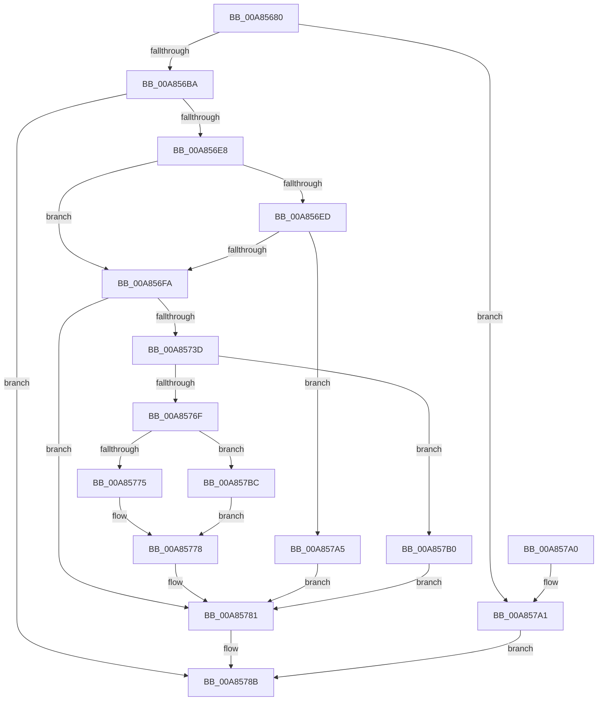

# IoConvertFileHandleToKernelHandle

- RVA: `0x00A85680`–`0x00A857CD` (길이 `333` bytes)
- VA: `0x0000000140A85680`
- 실행 섹션: `PAGE`
- PDB 이름 있음: `예`; PDB Function 태그: `아니요`
- unwind 정보 RVA: `0x000B7A00`
- 디코드: `92`개 명령, `333/333` bytes 표시
- 미해석 바이트: `0` (있으면 어셈블리에 `.byte`로 보존)

> 이 문서는 커널 이미지의 기계어와 PDB 기호를 분석해 생성했습니다. 4번과 5번은 함수 원형과 자료형을 바이너리 사용 방식에서 추정한 C 해석이며 원본 소스 복구 결과는 아닙니다.

## 1. Dependencies

- 직접 호출 지점: **7**; 고유 호출 대상: **4**
- 직접 호출자로 확인된 함수: **8**
- RIP 상대 이미지 참조: **2**

### Outgoing calls
- `0x00A856DB` → [ObReferenceObjectByHandle](../86/ObReferenceObjectByHandle_function_00868DB0.md) (function, `0x00868DB0`)
- `0x00A8572E` → [ObDuplicateObject](../8C/ObDuplicateObject_function_008C4FA0.md) (function, `0x008C4FA0`)
- `0x00A85764` → [ObReferenceObjectByHandle](../86/ObReferenceObjectByHandle_function_00868DB0.md) (function, `0x00868DB0`)
- `0x00A8577C` → [ObfDereferenceObject](../../text/2F/ObfDereferenceObject_function_002F9350.md) (function, `0x002F9350`)
- `0x00A85784` → [ObfDereferenceObject](../../text/2F/ObfDereferenceObject_function_002F9350.md) (function, `0x002F9350`)
- `0x00A857B5` → [ObCloseHandle](../8A/ObCloseHandle_function_008A1870.md) (function, `0x008A1870`)
- `0x00A857C6` → [ObCloseHandle](../8A/ObCloseHandle_function_008A1870.md) (function, `0x008A1870`)

### Direct callers
- [SshpSessionManagerOpenControlTrace](../77/SshpSessionManagerOpenControlTrace_function_007744C0.md) at `0x00774510`
- [ExpQueryElamCertInfo](../7C/ExpQueryElamCertInfo_function_007C4564.md) at `0x007C45CF`
- [NtRestoreKey](../7E/NtRestoreKey_function_007E0CC0.md) at `0x007E0DAA`
- [NtSaveMergedKeys](../7E/NtSaveMergedKeys_function_007E1070.md) at `0x007E1227`
- [CmpNameFromAttributes](../87/CmpNameFromAttributes_function_00876AC8.md) at `0x00876C8C`
- [IopOpenLinkOrRenameTarget](../8A/IopOpenLinkOrRenameTarget_function_008AAC04.md) at `0x008AAEEE`
- [NtSaveKeyEx](NtSaveKeyEx_function_00A853C0.md) at `0x00A854AF`
- [ExpQueryCodeIntegrityCertificateInfo](ExpQueryCodeIntegrityCertificateInfo_function_00A8552C.md) at `0x00A855A9`

### Static image references
- `0x00A856BA` → RVA `0x00FC6AE0` (`ALMOSTRO`; read)
- `0x00A85707` → RVA `0x00FC6AB0` (`ALMOSTRO`; read)

## 2. Other-region calls and transfers

- 다른 실행 섹션으로 향하는 call: **2**
  - `0x00A8577C` → [ObfDereferenceObject](../../text/2F/ObfDereferenceObject_function_002F9350.md) (`PAGE` → `.text`)
  - `0x00A85784` → [ObfDereferenceObject](../../text/2F/ObfDereferenceObject_function_002F9350.md) (`PAGE` → `.text`)
- 별도 외부 분기/꼬리 이동을 확인하지 못했습니다.

## 3. Assembly (complete function range)

```asm
00A85680  4C 8B DC                        mov r11, rsp
00A85683  49 89 5B 10                     mov qword ptr [r11 + 0x10], rbx
00A85687  49 89 73 18                     mov qword ptr [r11 + 0x18], rsi
00A8568B  55                              push rbp
00A8568C  57                              push rdi
00A8568D  41 56                           push r14
00A8568F  48 8B EC                        mov rbp, rsp
00A85692  48 83 EC 50                     sub rsp, 0x50
00A85696  4C 8B 75 40                     mov r14, qword ptr [rbp + 0x40]
00A8569A  41 8A F1                        mov sil, r9b
00A8569D  48 83 65 F0 00                  and qword ptr [rbp - 0x10], 0
00A856A2  41 8B D8                        mov ebx, r8d
00A856A5  48 83 65 20 00                  and qword ptr [rbp + 0x20], 0
00A856AA  48 8B F9                        mov rdi, rcx
00A856AD  49 83 26 00                     and qword ptr [r14], 0
00A856B1  48 85 C9                        test rcx, rcx
00A856B4  0F 84 E7 00 00 00               je 0x140a857a1
00A856BA  4C 8B 05 1F 14 54 00            mov r8, qword ptr [rip + 0x54141f]
00A856C1  48 8D 45 20                     lea rax, [rbp + 0x20]
00A856C5  48 83 65 40 00                  and qword ptr [rbp + 0x40], 0
00A856CA  44 8A CA                        mov r9b, dl
00A856CD  49 89 43 C0                     mov qword ptr [r11 - 0x40], rax
00A856D1  33 D2                           xor edx, edx
00A856D3  48 8D 45 40                     lea rax, [rbp + 0x40]
00A856D7  49 89 43 B8                     mov qword ptr [r11 - 0x48], rax
00A856DB  E8 D0 36 DE FF                  call 0x140868db0
00A856E0  85 C0                           test eax, eax
00A856E2  0F 88 A3 00 00 00               js 0x140a8578b
00A856E8  40 84 F6                        test sil, sil
00A856EB  75 0D                           jne 0x140a856fa
00A856ED  8B 45 24                        mov eax, dword ptr [rbp + 0x24]
00A856F0  23 C3                           and eax, ebx
00A856F2  3B C3                           cmp eax, ebx
00A856F4  0F 85 AB 00 00 00               jne 0x140a857a5
00A856FA  65 48 8B 04 25 88 01 00 00      mov rax, qword ptr gs:[0x188]
00A85703  4C 8D 4D F0                     lea r9, [rbp - 0x10]
00A85707  4C 8B 05 A2 13 54 00            mov r8, qword ptr [rip + 0x5413a2]
00A8570E  48 8B D7                        mov rdx, rdi
00A85711  C6 44 24 38 00                  mov byte ptr [rsp + 0x38], 0
00A85716  83 64 24 30 00                  and dword ptr [rsp + 0x30], 0
00A8571B  48 8B 88 B8 00 00 00            mov rcx, qword ptr [rax + 0xb8]
00A85722  C7 44 24 28 00 02 00 00         mov dword ptr [rsp + 0x28], 0x200
00A8572A  89 5C 24 20                     mov dword ptr [rsp + 0x20], ebx
00A8572E  E8 6D F8 E3 FF                  call 0x1408c4fa0
00A85733  48 8B 75 40                     mov rsi, qword ptr [rbp + 0x40]
00A85737  8B D8                           mov ebx, eax
00A85739  85 C0                           test eax, eax
00A8573B  78 44                           js 0x140a85781
00A8573D  48 8B 7D F0                     mov rdi, qword ptr [rbp - 0x10]
00A85741  48 8D 45 40                     lea rax, [rbp + 0x40]
00A85745  4C 8B 05 94 13 54 00            mov r8, qword ptr [rip + 0x541394]
00A8574C  48 8B CF                        mov rcx, rdi
00A8574F  48 83 64 24 28 00               and qword ptr [rsp + 0x28], 0
00A85755  45 33 C9                        xor r9d, r9d
00A85758  48 83 65 40 00                  and qword ptr [rbp + 0x40], 0
00A8575D  33 D2                           xor edx, edx
00A8575F  48 89 44 24 20                  mov qword ptr [rsp + 0x20], rax
00A85764  E8 47 36 DE FF                  call 0x140868db0
00A85769  8B D8                           mov ebx, eax
00A8576B  85 C0                           test eax, eax
00A8576D  78 41                           js 0x140a857b0
00A8576F  48 39 75 40                     cmp qword ptr [rbp + 0x40], rsi
00A85773  75 47                           jne 0x140a857bc
00A85775  49 89 3E                        mov qword ptr [r14], rdi
00A85778  48 8B 4D 40                     mov rcx, qword ptr [rbp + 0x40]
00A8577C  E8 CF 3B 87 FF                  call 0x1402f9350
00A85781  48 8B CE                        mov rcx, rsi
00A85784  E8 C7 3B 87 FF                  call 0x1402f9350
00A85789  8B C3                           mov eax, ebx
00A8578B  4C 8D 5C 24 50                  lea r11, [rsp + 0x50]
00A85790  49 8B 5B 28                     mov rbx, qword ptr [r11 + 0x28]
00A85794  49 8B 73 30                     mov rsi, qword ptr [r11 + 0x30]
00A85798  49 8B E3                        mov rsp, r11
00A8579B  41 5E                           pop r14
00A8579D  5F                              pop rdi
00A8579E  5D                              pop rbp
00A8579F  C3                              ret
00A857A0  CC                              int3
00A857A1  33 C0                           xor eax, eax
00A857A3  EB E6                           jmp 0x140a8578b
00A857A5  48 8B 75 40                     mov rsi, qword ptr [rbp + 0x40]
00A857A9  BB 22 00 00 C0                  mov ebx, 0xc0000022
00A857AE  EB D1                           jmp 0x140a85781
00A857B0  33 D2                           xor edx, edx
00A857B2  48 8B CF                        mov rcx, rdi
00A857B5  E8 B6 C0 E1 FF                  call 0x1408a1870
00A857BA  EB C5                           jmp 0x140a85781
00A857BC  33 D2                           xor edx, edx
00A857BE  48 8B CF                        mov rcx, rdi
00A857C1  BB 24 00 00 C0                  mov ebx, 0xc0000024
00A857C6  E8 A5 C0 E1 FF                  call 0x1408a1870
00A857CB  EB AB                           jmp 0x140a85778
```

## 4. C-style interpretation (structured pseudocode)

```c
__int64 __fastcall IoConvertFileHandleToKernelHandle(__int64 a1, int a2, int a3, unsigned __int8 a4, __int64 a5)
{
    __int64 result;
    __int64 v_rsp;
    unsigned __int64 v_stack_m18;
    unsigned __int64 v_stack_m28;
    unsigned __int8 v_stack_m30;
    unsigned int v_stack_m38;
    unsigned int v_stack_m40;
    unsigned int v_stack_m48;
    unsigned __int64 v_stack_p8;
    unsigned int v_stack_pC;

    *(unsigned __int64 *)(v_rsp + 16) = v_rbx;
    *(unsigned __int64 *)(v_rsp + 24) = v_rsi;
    v_rsp = (v_rsp) - (80);
    if (a1 == 0) goto loc_00A857A1;
    *(unsigned __int64 *)(v_rsp - 64) = v_stack_p8;
    a2 = 0;
    *(unsigned __int64 *)(v_rsp - 72) = a5;
    result = ObReferenceObjectByHandle(a1, a2, *(unsigned __int64 *)(v_rip + 5510175), (unsigned __int8)(a2));
    if (sign_flag) goto loc_00A8578B;
    if (a4 != 0) goto loc_00A856FA;
    result = (unsigned int)(((unsigned int)(v_stack_pC)) & ((unsigned int)((unsigned int)(a3))));
    if (((unsigned int)(result)) != ((unsigned int)((unsigned int)(a3)))) goto loc_00A857A5;
loc_00A856FA:
    v_stack_m30 = 0;
    v_stack_m40 = 512;
    v_stack_m48 = (unsigned int)((unsigned int)(a3));
    result = ObDuplicateObject(*(unsigned __int64 *)(*(unsigned __int64 *)(gs_base + (0 + 392)) + 184), a1, *(unsigned __int64 *)(v_rip + 5510050), v_stack_m28);
    if (sign_flag) goto loc_00A85781;
    a4 = 0;
    a2 = 0;
    v_stack_m48 = a5;
    result = ObReferenceObjectByHandle(v_stack_m28, a2, *(unsigned __int64 *)(v_rip + 5510036), a4);
    if (sign_flag) goto loc_00A857B0;
    if (a5 != a5) goto loc_00A857BC;
    *(unsigned __int64 *)(a5) = v_stack_m28;
loc_00A85778:
    result = ObfDereferenceObject(a5, a2, *(unsigned __int64 *)(v_rip + 5510036), a4);
loc_00A85781:
    result = ObfDereferenceObject(a5, a2, *(unsigned __int64 *)(v_rip + 5510036), a4);
loc_00A8578B:
    return (unsigned int)((unsigned int)((unsigned int)((unsigned int)(result))));
loc_00A857A1:
    result = 0;
    goto loc_00A8578B;
loc_00A857A5:
    goto loc_00A85781;
loc_00A857B0:
    a2 = 0;
    result = ObCloseHandle(v_stack_m28, a2, *(unsigned __int64 *)(v_rip + 5510036), a4);
    goto loc_00A85781;
loc_00A857BC:
    a2 = 0;
    result = ObCloseHandle(v_stack_m28, a2, *(unsigned __int64 *)(v_rip + 5510036), a4);
    goto loc_00A85778;
}
```

## 5. (Beta) C Style

```c
int64_t IoConvertFileHandleToKernelHandle(int64_t Arg1, int32_t Arg2, int32_t Arg3, uint8_t Arg4, void *Arg5)
{
    uint8_t *arg5 = (uint8_t *)Arg5;

    int64_t result;
    int64_t local_rsp;
    uint64_t v_stack_m18;
    uint64_t v_stack_m28;
    uint8_t v_stack_m30;
    uint32_t v_stack_m38;
    uint32_t v_stack_m40;
    uint32_t v_stack_m48;
    uint64_t v_stack_p8;
    uint32_t v_stack_pC;

    *(uint64_t *)(local_rsp + 0x10) = local_rbx;
    *(uint64_t *)(local_rsp + 0x18) = local_rsi;
    local_rsp = (local_rsp) - (80);
    if (Arg1 == 0) goto loc_00A857A1;
    *(uint64_t *)(local_rsp - 0x40) = v_stack_p8;
    Arg2 = 0;
    *(void **)(local_rsp - 0x48) = Arg5;
    result = ObReferenceObjectByHandle(Arg1, Arg2, *(uint64_t *)(v_rip + 0x54141F), (uint8_t)(Arg2));
    if (sign_flag) goto loc_00A8578B;
    if (Arg4 != 0) goto loc_00A856FA;
    result = (uint32_t)(((uint32_t)(v_stack_pC)) & ((uint32_t)((uint32_t)(Arg3))));
    if (((uint32_t)(result)) != ((uint32_t)((uint32_t)(Arg3)))) goto loc_00A857A5;
loc_00A856FA:
    v_stack_m30 = 0;
    v_stack_m40 = 512;
    v_stack_m48 = (uint32_t)((uint32_t)(Arg3));
    result = ObDuplicateObject(*(uint64_t *)(*(uint64_t *)(gs_base + (0 + 0x188)) + 0xB8), Arg1, *(uint64_t *)(v_rip + 0x5413A2), v_stack_m28);
    if (sign_flag) goto loc_00A85781;
    Arg4 = 0;
    Arg2 = 0;
    v_stack_m48 = Arg5;
    result = ObReferenceObjectByHandle(v_stack_m28, Arg2, *(uint64_t *)(v_rip + 0x541394), Arg4);
    if (sign_flag) goto loc_00A857B0;
    if (Arg5 != Arg5) goto loc_00A857BC;
    *(uint64_t *)(arg5) = v_stack_m28;
loc_00A85778:
    result = ObfDereferenceObject(Arg5, Arg2, *(uint64_t *)(v_rip + 0x541394), Arg4);
loc_00A85781:
    result = ObfDereferenceObject(Arg5, Arg2, *(uint64_t *)(v_rip + 0x541394), Arg4);
loc_00A8578B:
    return (uint32_t)((uint32_t)((uint32_t)((uint32_t)(result))));
loc_00A857A1:
    result = 0;
    goto loc_00A8578B;
loc_00A857A5:
    goto loc_00A85781;
loc_00A857B0:
    Arg2 = 0;
    result = ObCloseHandle(v_stack_m28, Arg2, *(uint64_t *)(v_rip + 0x541394), Arg4);
    goto loc_00A85781;
loc_00A857BC:
    Arg2 = 0;
    result = ObCloseHandle(v_stack_m28, Arg2, *(uint64_t *)(v_rip + 0x541394), Arg4);
    goto loc_00A85778;
}
```

### 관측된 메모리 오프셋

구조체 형식이 확인되지 않은 접근은 인자 기준의 오프셋으로만 기록했습니다.

| 기준 인자 | 오프셋 표현 | 폭 (bit) | 접근 |
|---|---:|---:|---|
| `Arg5` | `+ 0x0` | `64` | `R/W` |
| `Arg5` | `+ 0x0` | `64` | `W` |

## 6. Execution-region graph

[열기: 2D/3D 그래프와 함수 탐색 컨트롤 패널](../../../control-panel.html?section=page&rva=0x00A85680&view=graph)

- 2D 그래프는 위에서 아래로 흐르고, 3D 그래프는 빈 공간을 드래그해 회전합니다. Shift+드래그는 이동, 휠은 확대·축소, 함수 노드 선택은 대상 보고서 이동입니다.

### Static fallback


