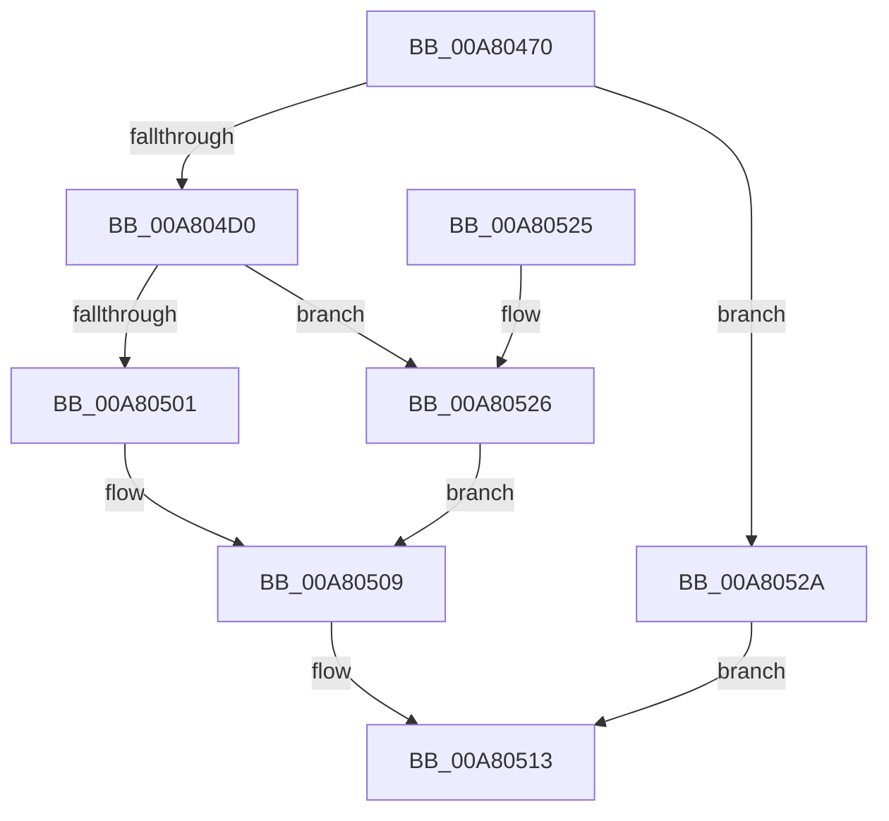

# IoCreateNotificationEvent

- RVA: `0x00A80470`–`0x00A8052E` (길이 `190` bytes)
- VA: `0x0000000140A80470`
- 실행 섹션: `PAGE`
- PDB 이름 있음: `예`; PDB Function 태그: `아니요`
- unwind 정보 RVA: `0x000B7050`
- 디코드: `51`개 명령, `190/190` bytes 표시
- 미해석 바이트: `0` (있으면 어셈블리에 `.byte`로 보존)

> 이 문서는 커널 이미지의 기계어와 PDB 기호를 분석해 생성했습니다. 4번과 5번은 함수 원형과 자료형을 바이너리 사용 방식에서 추정한 C 해석이며 원본 소스 복구 결과는 아닙니다.

## 1. Dependencies

- 직접 호출 지점: **3**; 고유 호출 대상: **3**
- 직접 호출자로 확인된 함수: **3**
- RIP 상대 이미지 참조: **1**

### Outgoing calls
- `0x00A804C7` → [ZwCreateEvent](../../text/6A/ZwCreateEvent_function_006AD9D0.md) (function, `0x006AD9D0`)
- `0x00A804F4` → [ObReferenceObjectByHandle](../86/ObReferenceObjectByHandle_function_00868DB0.md) (function, `0x00868DB0`)
- `0x00A80504` → [ObfDereferenceObject](../../text/2F/ObfDereferenceObject_function_002F9350.md) (function, `0x002F9350`)

### Direct callers
- [IoCaptureLiveDump](../../text/4E/IoCaptureLiveDump_function_004E085C.md) at `0x004E0A2F`
- [IoCaptureLiveDump](../../text/4E/IoCaptureLiveDump_function_004E085C.md) at `0x004E0A50`
- [IoCaptureLiveDump](../../text/4E/IoCaptureLiveDump_function_004E085C.md) at `0x004E0A71`
- [HvlPhase2Initialize](../../text/58/HvlPhase2Initialize_function_00583EA0.md) at `0x00584173`
- [DifIoCreateNotificationEventWrapper](../../text/62/DifIoCreateNotificationEventWrapper_function_00629500.md) at `0x006295D4`

### Static image references
- `0x00A804D0` → RVA `0x00FC6B80` (`ALMOSTRO`; read)

## 2. Other-region calls and transfers

- 다른 실행 섹션으로 향하는 call: **2**
  - `0x00A804C7` → [ZwCreateEvent](../../text/6A/ZwCreateEvent_function_006AD9D0.md) (`PAGE` → `.text`)
  - `0x00A80504` → [ObfDereferenceObject](../../text/2F/ObfDereferenceObject_function_002F9350.md) (`PAGE` → `.text`)
- 별도 외부 분기/꼬리 이동을 확인하지 못했습니다.

## 3. Assembly (complete function range)

```asm
00A80470  48 89 5C 24 10                  mov qword ptr [rsp + 0x10], rbx
00A80475  48 89 7C 24 20                  mov qword ptr [rsp + 0x20], rdi
00A8047A  55                              push rbp
00A8047B  48 8B EC                        mov rbp, rsp
00A8047E  48 83 EC 60                     sub rsp, 0x60
00A80482  83 65 EC 00                     and dword ptr [rbp - 0x14], 0
00A80486  4C 8D 45 D0                     lea r8, [rbp - 0x30]
00A8048A  48 83 65 10 00                  and qword ptr [rbp + 0x10], 0
00A8048F  48 8B FA                        mov rdi, rdx
00A80492  48 83 65 D8 00                  and qword ptr [rbp - 0x28], 0
00A80497  0F 57 C0                        xorps xmm0, xmm0
00A8049A  48 89 4D E0                     mov qword ptr [rbp - 0x20], rcx
00A8049E  BA 03 00 1F 00                  mov edx, 0x1f0003
00A804A3  48 C7 45 D0 30 00 00 00         mov qword ptr [rbp - 0x30], 0x30
00A804AB  48 8D 4D 10                     lea rcx, [rbp + 0x10]
00A804AF  83 65 D4 00                     and dword ptr [rbp - 0x2c], 0
00A804B3  45 33 C9                        xor r9d, r9d
00A804B6  F3 0F 7F 45 F0                  movdqu xmmword ptr [rbp - 0x10], xmm0
00A804BB  C7 45 E8 80 02 00 00            mov dword ptr [rbp - 0x18], 0x280
00A804C2  C6 44 24 20 01                  mov byte ptr [rsp + 0x20], 1
00A804C7  E8 04 D5 C2 FF                  call 0x1406ad9d0
00A804CC  85 C0                           test eax, eax
00A804CE  78 5A                           js 0x140a8052a
00A804D0  4C 8B 05 A9 66 54 00            mov r8, qword ptr [rip + 0x5466a9]
00A804D7  48 8D 45 20                     lea rax, [rbp + 0x20]
00A804DB  48 83 64 24 28 00               and qword ptr [rsp + 0x28], 0
00A804E1  45 33 C9                        xor r9d, r9d
00A804E4  48 8B 4D 10                     mov rcx, qword ptr [rbp + 0x10]
00A804E8  33 D2                           xor edx, edx
00A804EA  48 83 65 20 00                  and qword ptr [rbp + 0x20], 0
00A804EF  48 89 44 24 20                  mov qword ptr [rsp + 0x20], rax
00A804F4  E8 B7 88 DE FF                  call 0x140868db0
00A804F9  48 8B 5D 20                     mov rbx, qword ptr [rbp + 0x20]
00A804FD  85 C0                           test eax, eax
00A804FF  78 25                           js 0x140a80526
00A80501  48 8B CB                        mov rcx, rbx
00A80504  E8 47 8E 87 FF                  call 0x1402f9350
00A80509  48 8B 4D 10                     mov rcx, qword ptr [rbp + 0x10]
00A8050D  48 8B C3                        mov rax, rbx
00A80510  48 89 0F                        mov qword ptr [rdi], rcx
00A80513  4C 8D 5C 24 60                  lea r11, [rsp + 0x60]
00A80518  49 8B 5B 18                     mov rbx, qword ptr [r11 + 0x18]
00A8051C  49 8B 7B 28                     mov rdi, qword ptr [r11 + 0x28]
00A80520  49 8B E3                        mov rsp, r11
00A80523  5D                              pop rbp
00A80524  C3                              ret
00A80525  CC                              int3
00A80526  33 DB                           xor ebx, ebx
00A80528  EB DF                           jmp 0x140a80509
00A8052A  33 C0                           xor eax, eax
00A8052C  EB E5                           jmp 0x140a80513
```

## 4. C-style interpretation (structured pseudocode)

```c
__int64 __fastcall IoCreateNotificationEvent(__int64 a1, __int64 a2, __int64 a3, int a4)
{
    __int64 result;
    __int64 v_rbx;
    __int64 v_rsp;
    unsigned __int64 v_stack_m18;
    unsigned int v_stack_m1C;
    unsigned int v_stack_m20;
    unsigned __int64 v_stack_m28;
    unsigned __int64 v_stack_m30;
    unsigned int v_stack_m34;
    unsigned __int64 v_stack_m38;
    unsigned __int64 v_stack_m40;
    unsigned __int8 v_stack_m48;
    unsigned __int64 v_stack_m8;
    unsigned __int64 v_stack_p10;
    unsigned __int64 v_stack_p18;
    unsigned __int64 v_stack_p20;
    unsigned __int64 v_stack_p8;

    v_stack_p10 = v_rbx;
    v_stack_p20 = v_rdi;
    v_rsp = (v_rsp) - (96);
    v_stack_m28 = a1;
    v_stack_m38 = 48;
    a4 = 0;
    v_stack_m18 = v_xmm0;
    v_stack_m20 = 640;
    v_stack_m48 = 1;
    result = ZwCreateEvent(v_stack_p8, (unsigned int)(0x1F0003ULL), v_stack_m38, a4);
    if (sign_flag) goto loc_00A8052A;
    a4 = 0;
    a2 = 0;
    v_stack_m48 = v_stack_p18;
    result = ObReferenceObjectByHandle(v_stack_p8, a2, *(unsigned __int64 *)(v_rip + 5531305), a4);
    if (sign_flag) goto loc_00A80526;
    result = ObfDereferenceObject(v_stack_p18, a2, *(unsigned __int64 *)(v_rip + 5531305), a4);
loc_00A80509:
    *(unsigned __int64 *)(a2) = v_stack_p8;
loc_00A80513:
    return v_stack_p18;
loc_00A80526:
    v_rbx = 0;
    goto loc_00A80509;
loc_00A8052A:
    result = 0;
    goto loc_00A80513;
}
```

## 5. (Beta) C Style

```c
int64_t IoCreateNotificationEvent(int64_t Arg1, void *Arg2, int64_t Arg3, int32_t Arg4)
{
    uint8_t *arg2 = (uint8_t *)Arg2;

    int64_t result;
    int64_t local_rbx;
    int64_t local_rsp;
    uint64_t v_stack_m18;
    uint32_t v_stack_m1C;
    uint32_t v_stack_m20;
    uint64_t v_stack_m28;
    uint64_t v_stack_m30;
    uint32_t v_stack_m34;
    uint64_t v_stack_m38;
    uint64_t v_stack_m40;
    uint8_t v_stack_m48;
    uint64_t v_stack_m8;
    uint64_t v_stack_p10;
    uint64_t v_stack_p18;
    uint64_t v_stack_p20;
    uint64_t v_stack_p8;

    v_stack_p10 = local_rbx;
    v_stack_p20 = local_rdi;
    local_rsp = (local_rsp) - (96);
    v_stack_m28 = Arg1;
    v_stack_m38 = 48;
    Arg4 = 0;
    v_stack_m18 = v_xmm0;
    v_stack_m20 = 640;
    v_stack_m48 = 1;
    result = ZwCreateEvent(v_stack_p8, (uint32_t)(0x1F0003ULL), v_stack_m38, Arg4);
    if (sign_flag) goto loc_00A8052A;
    Arg4 = 0;
    Arg2 = 0;
    v_stack_m48 = v_stack_p18;
    result = ObReferenceObjectByHandle(v_stack_p8, Arg2, *(uint64_t *)(v_rip + 0x5466A9), Arg4);
    if (sign_flag) goto loc_00A80526;
    result = ObfDereferenceObject(v_stack_p18, Arg2, *(uint64_t *)(v_rip + 0x5466A9), Arg4);
loc_00A80509:
    *(uint64_t *)(arg2) = v_stack_p8;
loc_00A80513:
    return v_stack_p18;
loc_00A80526:
    local_rbx = 0;
    goto loc_00A80509;
loc_00A8052A:
    result = 0;
    goto loc_00A80513;
}
```

### 관측된 메모리 오프셋

구조체 형식이 확인되지 않은 접근은 인자 기준의 오프셋으로만 기록했습니다.

| 기준 인자 | 오프셋 표현 | 폭 (bit) | 접근 |
|---|---:|---:|---|
| `Arg2` | `+ 0x0` | `64` | `W` |

## 6. Execution-region graph

[열기: 2D/3D 그래프와 함수 탐색 컨트롤 패널](../../../control-panel.html?section=page&rva=0x00A80470&view=graph)

- 2D 그래프는 위에서 아래로 흐르고, 3D 그래프는 빈 공간을 드래그해 회전합니다. Shift+드래그는 이동, 휠은 확대·축소, 함수 노드 선택은 대상 보고서 이동입니다.

### Static fallback


