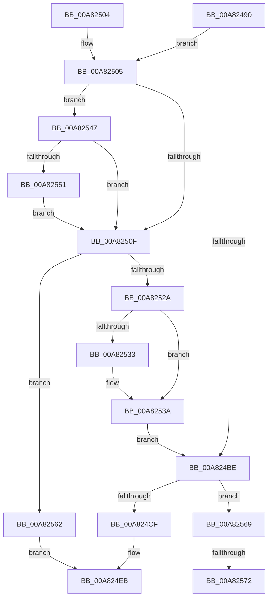

# IoReplaceFileObjectName

- RVA: `0x00A82490`–`0x00A82582` (길이 `242` bytes)
- VA: `0x0000000140A82490`
- 실행 섹션: `PAGE`
- PDB 이름 있음: `예`; PDB Function 태그: `예`
- unwind 정보 RVA: `0x00096A74`
- 디코드: `69`개 명령, `242/242` bytes 표시
- 미해석 바이트: `0` (있으면 어셈블리에 `.byte`로 보존)

> 이 문서는 커널 이미지의 기계어와 PDB 기호를 분석해 생성했습니다. 4번과 5번은 함수 원형과 자료형을 바이너리 사용 방식에서 추정한 C 해석이며 원본 소스 복구 결과는 아닙니다.

## 1. Dependencies

- 직접 호출 지점: **5**; 고유 호출 대상: **4**
- 직접 호출자로 확인된 함수: **0**
- RIP 상대 이미지 참조: **0**

### Outgoing calls
- `0x00A824D5` → [memset](../../text/6C/memset_function_006C6C40.md) (function, `0x006C6C40`)
- `0x00A824E4` → [memcpy](../../text/6C/memcpy_function_006C6840.md) (function, `0x006C6840`)
- `0x00A8251D` → [ExAllocatePool2](../../poolcode/B8/ExAllocatePool2_function_00B820F0.md) (function, `0x00B820F0`)
- `0x00A82535` → [ExFreePoolWithTag](../../poolcode/B8/ExFreePoolWithTag_function_00B82870.md) (function, `0x00B82870`)
- `0x00A82574` → [ExFreePoolWithTag](../../poolcode/B8/ExFreePoolWithTag_function_00B82870.md) (function, `0x00B82870`)

### Direct callers
- 이 함수 시작 RVA로 연결되는 직접 call은 확인되지 않았습니다. 간접 호출은 완전히 역산할 수 없습니다.

### Static image references
- 디코드된 RIP-relative 메모리 참조가 없습니다.

## 2. Other-region calls and transfers

- 다른 실행 섹션으로 향하는 call: **5**
  - `0x00A824D5` → [memset](../../text/6C/memset_function_006C6C40.md) (`PAGE` → `.text`)
  - `0x00A824E4` → [memcpy](../../text/6C/memcpy_function_006C6840.md) (`PAGE` → `.text`)
  - `0x00A8251D` → [ExAllocatePool2](../../poolcode/B8/ExAllocatePool2_function_00B820F0.md) (`PAGE` → `POOLCODE`)
  - `0x00A82535` → [ExFreePoolWithTag](../../poolcode/B8/ExFreePoolWithTag_function_00B82870.md) (`PAGE` → `POOLCODE`)
  - `0x00A82574` → [ExFreePoolWithTag](../../poolcode/B8/ExFreePoolWithTag_function_00B82870.md) (`PAGE` → `POOLCODE`)
- call이 아닌 외부 분기/꼬리 이동: **2**
  - `0x00A8256C` → [sub_00B43A46](../B4/Unknown_function_00B43A46.md) (`tail-transfer`)
  - `0x00A8257D` → [sub_00B43A46](../B4/Unknown_function_00B43A46.md) (`tail-transfer`)

## 3. Assembly (complete function range)

```asm
00A82490  48 89 5C 24 08                  mov qword ptr [rsp + 8], rbx
00A82495  48 89 6C 24 10                  mov qword ptr [rsp + 0x10], rbp
00A8249A  48 89 74 24 18                  mov qword ptr [rsp + 0x18], rsi
00A8249F  57                              push rdi
00A824A0  41 56                           push r14
00A824A2  41 57                           push r15
00A824A4  48 83 EC 20                     sub rsp, 0x20
00A824A8  0F B7 79 5A                     movzx edi, word ptr [rcx + 0x5a]
00A824AC  45 33 FF                        xor r15d, r15d
00A824AF  41 0F B7 F0                     movzx esi, r8w
00A824B3  4C 8B F2                        mov r14, rdx
00A824B6  48 8B D9                        mov rbx, rcx
00A824B9  66 3B F7                        cmp si, di
00A824BC  77 47                           ja 0x140a82505
00A824BE  48 8B 4B 60                     mov rcx, qword ptr [rbx + 0x60]
00A824C2  66 89 73 58                     mov word ptr [rbx + 0x58], si
00A824C6  66 85 F6                        test si, si
00A824C9  0F 84 9A 00 00 00               je 0x140a82569
00A824CF  44 0F B7 C7                     movzx r8d, di
00A824D3  33 D2                           xor edx, edx
00A824D5  E8 66 47 C4 FF                  call 0x1406c6c40
00A824DA  48 8B 4B 60                     mov rcx, qword ptr [rbx + 0x60]
00A824DE  4C 8B C6                        mov r8, rsi
00A824E1  49 8B D6                        mov rdx, r14
00A824E4  E8 57 43 C4 FF                  call 0x1406c6840
00A824E9  33 C0                           xor eax, eax
00A824EB  48 8B 5C 24 40                  mov rbx, qword ptr [rsp + 0x40]
00A824F0  48 8B 6C 24 48                  mov rbp, qword ptr [rsp + 0x48]
00A824F5  48 8B 74 24 50                  mov rsi, qword ptr [rsp + 0x50]
00A824FA  48 83 C4 20                     add rsp, 0x20
00A824FE  41 5F                           pop r15
00A82500  41 5E                           pop r14
00A82502  5F                              pop rdi
00A82503  C3                              ret
00A82504  CC                              int3
00A82505  BF 38 00 00 00                  mov edi, 0x38
00A8250A  66 3B F7                        cmp si, di
00A8250D  73 38                           jae 0x140a82547
00A8250F  0F B7 D7                        movzx edx, di
00A82512  B9 00 01 00 00                  mov ecx, 0x100
00A82517  41 B8 49 6F 4E 6D               mov r8d, 0x6d4e6f49
00A8251D  E8 CE FB 0F 00                  call 0x140b820f0
00A82522  48 8B E8                        mov rbp, rax
00A82525  48 85 C0                        test rax, rax
00A82528  74 38                           je 0x140a82562
00A8252A  48 8B 4B 60                     mov rcx, qword ptr [rbx + 0x60]
00A8252E  48 85 C9                        test rcx, rcx
00A82531  74 07                           je 0x140a8253a
00A82533  33 D2                           xor edx, edx
00A82535  E8 36 03 10 00                  call 0x140b82870
00A8253A  48 89 6B 60                     mov qword ptr [rbx + 0x60], rbp
00A8253E  66 89 7B 5A                     mov word ptr [rbx + 0x5a], di
00A82542  E9 77 FF FF FF                  jmp 0x140a824be
00A82547  BF 78 00 00 00                  mov edi, 0x78
00A8254C  66 3B F7                        cmp si, di
00A8254F  72 BE                           jb 0x140a8250f
00A82551  B8 F8 00 00 00                  mov eax, 0xf8
00A82556  66 3B F0                        cmp si, ax
00A82559  66 0F 43 C6                     cmovae ax, si
00A8255D  0F B7 F8                        movzx edi, ax
00A82560  EB AD                           jmp 0x140a8250f
00A82562  B8 9A 00 00 C0                  mov eax, 0xc000009a
00A82567  EB 82                           jmp 0x140a824eb
00A82569  48 85 C9                        test rcx, rcx
00A8256C  0F 84 D4 14 0C 00               je 0x140b43a46
00A82572  33 D2                           xor edx, edx
00A82574  E8 F7 02 10 00                  call 0x140b82870
00A82579  4C 89 7B 60                     mov qword ptr [rbx + 0x60], r15
00A8257D  E9 C4 14 0C 00                  jmp 0x140b43a46
```

## 4. C-style interpretation (structured pseudocode)

```c
__int64 __fastcall IoReplaceFileObjectName(__int64 a1, __int64 a2, unsigned __int16 a3)
{
    __int64 result;
    __int64 v_r15;
    __int64 v_rsp;
    unsigned __int64 v_stack_p10;
    unsigned __int64 v_stack_p18;
    unsigned __int64 v_stack_p8;

    v_stack_p8 = v_rbx;
    v_stack_p10 = v_rbp;
    v_stack_p18 = v_rsi;
    v_rsp = (v_rsp) - (32);
    v_r15 = 0;
    if (a3 > ((unsigned __int16)(*(unsigned __int16 *)(a1 + 90)))) goto loc_00A82505;
loc_00A824BE:
    *(unsigned __int16 *)(a1 + 88) = a3;
    if (a3 == 0) goto loc_00A82569;
    a2 = 0;
    result = memset(*(unsigned __int64 *)(a1 + 96), a2, (unsigned __int16)(*(unsigned __int16 *)(a1 + 90)), a4);
    result = memcpy(*(unsigned __int64 *)(a1 + 96), 0, a3, a4);
    result = 0;
loc_00A824EB:
    v_rsp = (v_rsp) + (32);
    return result;
loc_00A82505:
    if (((unsigned __int16)(v_stack_p18)) >= 56) goto loc_00A82547;
loc_00A8250F:
    result = ExAllocatePool2(256, 56, (unsigned int)(0x6D4E6F49ULL), a4);
    if (result == 0) goto loc_00A82562;
    if (*(unsigned __int64 *)(v_stack_p8 + 96) != 0) {
        a2 = 0;
        result = ExFreePoolWithTag(*(unsigned __int64 *)(v_stack_p8 + 96), a2, (unsigned int)(0x6D4E6F49ULL), a4);
    }
    *(unsigned __int64 *)(v_stack_p8 + 96) = result;
    *(unsigned __int16 *)(v_stack_p8 + 90) = 56;
    goto loc_00A824BE;
loc_00A82547:
    if (((unsigned __int16)(v_stack_p18)) < 120) goto loc_00A8250F;
    result = 248;
    if (((unsigned __int16)(v_stack_p18)) >= 248) { result = (unsigned __int16)(v_stack_p18); }
    goto loc_00A8250F;
loc_00A82562:
    goto loc_00A824EB;
loc_00A82569:
    a2 = 0;
    result = ExFreePoolWithTag(*(unsigned __int64 *)(v_stack_p8 + 96), a2, (unsigned int)(0x6D4E6F49ULL), a4);
    *(unsigned __int64 *)(v_stack_p8 + 96) = 0;
}
```

## 5. (Beta) C Style

```c
int64_t IoReplaceFileObjectName(void *Arg1, int64_t Arg2, uint16_t Arg3)
{
    uint8_t *arg1 = (uint8_t *)Arg1;

    int64_t result;
    int64_t local_r15;
    int64_t local_rsp;
    uint64_t v_stack_p10;
    uint64_t v_stack_p18;
    uint64_t v_stack_p8;

    v_stack_p8 = local_rbx;
    v_stack_p10 = local_rbp;
    v_stack_p18 = local_rsi;
    local_rsp = (local_rsp) - (32);
    local_r15 = 0;
    if (Arg3 > ((uint16_t)(*(uint16_t *)(arg1 + 0x5A)))) goto loc_00A82505;
loc_00A824BE:
    *(uint16_t *)(arg1 + 0x58) = Arg3;
    if (Arg3 == 0) goto loc_00A82569;
    Arg2 = 0;
    result = memset(*(uint64_t *)(arg1 + 0x60), Arg2, (uint16_t)(*(uint16_t *)(arg1 + 0x5A)), a4);
    result = memcpy(*(uint64_t *)(arg1 + 0x60), 0, Arg3, a4);
    result = 0;
loc_00A824EB:
    local_rsp = (local_rsp) + (32);
    return result;
loc_00A82505:
    if (((uint16_t)(v_stack_p18)) >= 56) goto loc_00A82547;
loc_00A8250F:
    result = ExAllocatePool2(256, 56, (uint32_t)(0x6D4E6F49ULL), a4);
    if (result == 0) goto loc_00A82562;
    if (*(uint64_t *)(v_stack_p8 + 0x60) != 0) {
        Arg2 = 0;
        result = ExFreePoolWithTag(*(uint64_t *)(v_stack_p8 + 0x60), Arg2, (uint32_t)(0x6D4E6F49ULL), a4);
    }
    *(uint64_t *)(v_stack_p8 + 0x60) = result;
    *(uint16_t *)(v_stack_p8 + 0x5A) = 56;
    goto loc_00A824BE;
loc_00A82547:
    if (((uint16_t)(v_stack_p18)) < 120) goto loc_00A8250F;
    result = 248;
    if (((uint16_t)(v_stack_p18)) >= 248) { result = (uint16_t)(v_stack_p18); }
    goto loc_00A8250F;
loc_00A82562:
    goto loc_00A824EB;
loc_00A82569:
    Arg2 = 0;
    result = ExFreePoolWithTag(*(uint64_t *)(v_stack_p8 + 0x60), Arg2, (uint32_t)(0x6D4E6F49ULL), a4);
    *(uint64_t *)(v_stack_p8 + 0x60) = 0;
}
```

### 관측된 메모리 오프셋

구조체 형식이 확인되지 않은 접근은 인자 기준의 오프셋으로만 기록했습니다.

| 기준 인자 | 오프셋 표현 | 폭 (bit) | 접근 |
|---|---:|---:|---|
| `Arg1` | `+ 0x58` | `16` | `W` |
| `Arg1` | `+ 0x5A` | `16` | `R` |
| `Arg1` | `+ 0x5A` | `16` | `W` |
| `Arg1` | `+ 0x60` | `64` | `R` |
| `Arg1` | `+ 0x60` | `64` | `W` |

## 6. Execution-region graph

[열기: 2D/3D 그래프와 함수 탐색 컨트롤 패널](../../../control-panel.html?section=page&rva=0x00A82490&view=graph)

- 2D 그래프는 위에서 아래로 흐르고, 3D 그래프는 빈 공간을 드래그해 회전합니다. Shift+드래그는 이동, 휠은 확대·축소, 함수 노드 선택은 대상 보고서 이동입니다.

### Static fallback


