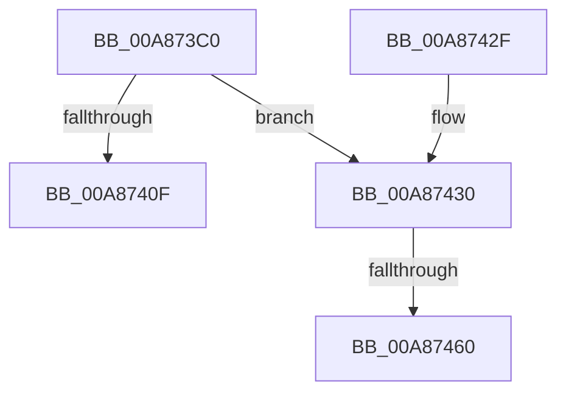

# IoWMIDeviceObjectToInstanceName

- RVA: `0x00A873C0`–`0x00A8746A` (길이 `170` bytes)
- VA: `0x0000000140A873C0`
- 실행 섹션: `PAGE`
- PDB 이름 있음: `예`; PDB Function 태그: `예`
- unwind 정보 RVA: `0x000B7DA4`
- 디코드: `46`개 명령, `170/170` bytes 표시
- 미해석 바이트: `0` (있으면 어셈블리에 `.byte`로 보존)

> 이 문서는 커널 이미지의 기계어와 PDB 기호를 분석해 생성했습니다. 4번과 5번은 함수 원형과 자료형을 바이너리 사용 방식에서 추정한 C 해석이며 원본 소스 복구 결과는 아닙니다.

## 1. Dependencies

- 직접 호출 지점: **4**; 고유 호출 대상: **4**
- 직접 호출자로 확인된 함수: **1**
- RIP 상대 이미지 참조: **0**

### Outgoing calls
- `0x00A873EC` → [IoGetDeviceAttachmentBaseRef](../../text/27/IoGetDeviceAttachmentBaseRef_function_00272710.md) (function, `0x00272710`)
- `0x00A87404` → [WmipGetGuidObjectInstanceInfo](WmipGetGuidObjectInstanceInfo_function_00A87470.md) (function, `0x00A87470`)
- `0x00A87412` → [ObfDereferenceObject](../../text/2F/ObfDereferenceObject_function_002F9350.md) (function, `0x002F9350`)
- `0x00A8744B` → [ExAllocatePool2](../../poolcode/B8/ExAllocatePool2_function_00B820F0.md) (function, `0x00B820F0`)

### Direct callers
- [IoWMIHandleToInstanceName](../AA/IoWMIHandleToInstanceName_function_00AAF3E0.md) at `0x00AAF420`

### Static image references
- 디코드된 RIP-relative 메모리 참조가 없습니다.

## 2. Other-region calls and transfers

- 다른 실행 섹션으로 향하는 call: **3**
  - `0x00A873EC` → [IoGetDeviceAttachmentBaseRef](../../text/27/IoGetDeviceAttachmentBaseRef_function_00272710.md) (`PAGE` → `.text`)
  - `0x00A87412` → [ObfDereferenceObject](../../text/2F/ObfDereferenceObject_function_002F9350.md) (`PAGE` → `.text`)
  - `0x00A8744B` → [ExAllocatePool2](../../poolcode/B8/ExAllocatePool2_function_00B820F0.md) (`PAGE` → `POOLCODE`)
- call이 아닌 외부 분기/꼬리 이동: **2**
  - `0x00A8745A` → [sub_00B44B48](../B4/Unknown_function_00B44B48.md) (`tail-transfer`)
  - `0x00A87465` → [sub_00B44B48 + 0x38](../B4/Unknown_function_00B44B48.md) (`tail-transfer`)

## 3. Assembly (complete function range)

```asm
00A873C0  48 8B C4                        mov rax, rsp
00A873C3  48 89 58 08                     mov qword ptr [rax + 8], rbx
00A873C7  48 89 68 10                     mov qword ptr [rax + 0x10], rbp
00A873CB  48 89 78 18                     mov qword ptr [rax + 0x18], rdi
00A873CF  41 56                           push r14
00A873D1  48 83 EC 40                     sub rsp, 0x40
00A873D5  48 8B D9                        mov rbx, rcx
00A873D8  0F 57 C0                        xorps xmm0, xmm0
00A873DB  45 33 F6                        xor r14d, r14d
00A873DE  48 8B CA                        mov rcx, rdx
00A873E1  44 89 70 20                     mov dword ptr [rax + 0x20], r14d
00A873E5  49 8B F8                        mov rdi, r8
00A873E8  0F 11 40 E8                     movups xmmword ptr [rax - 0x18], xmm0
00A873EC  E8 1F B3 7E FF                  call 0x140272710
00A873F1  4C 8D 4C 24 68                  lea r9, [rsp + 0x68]
00A873F6  48 8B D0                        mov rdx, rax
00A873F9  4C 8D 44 24 30                  lea r8, [rsp + 0x30]
00A873FE  48 8B CB                        mov rcx, rbx
00A87401  48 8B E8                        mov rbp, rax
00A87404  E8 67 00 00 00                  call 0x140a87470
00A87409  8B D8                           mov ebx, eax
00A8740B  85 C0                           test eax, eax
00A8740D  79 21                           jns 0x140a87430
00A8740F  48 8B CD                        mov rcx, rbp
00A87412  E8 39 1F 87 FF                  call 0x1402f9350
00A87417  48 8B 6C 24 58                  mov rbp, qword ptr [rsp + 0x58]
00A8741C  8B C3                           mov eax, ebx
00A8741E  48 8B 5C 24 50                  mov rbx, qword ptr [rsp + 0x50]
00A87423  48 8B 7C 24 60                  mov rdi, qword ptr [rsp + 0x60]
00A87428  48 83 C4 40                     add rsp, 0x40
00A8742C  41 5E                           pop r14
00A8742E  C3                              ret
00A8742F  CC                              int3
00A87430  0F B7 4C 24 30                  movzx ecx, word ptr [rsp + 0x30]
00A87435  41 B8 57 6D 69 49               mov r8d, 0x49696d57
00A8743B  66 83 C1 20                     add cx, 0x20
00A8743F  0F B7 D1                        movzx edx, cx
00A87442  B9 00 01 00 00                  mov ecx, 0x100
00A87447  66 89 57 02                     mov word ptr [rdi + 2], dx
00A8744B  E8 A0 AC 0F 00                  call 0x140b820f0
00A87450  48 89 47 08                     mov qword ptr [rdi + 8], rax
00A87454  48 8B C8                        mov rcx, rax
00A87457  48 85 C0                        test rax, rax
00A8745A  0F 85 E8 D6 0B 00               jne 0x140b44b48
00A87460  BB 9A 00 00 C0                  mov ebx, 0xc000009a
00A87465  E9 16 D7 0B 00                  jmp 0x140b44b80
```

## 4. C-style interpretation (structured pseudocode)

```c
__int64 __fastcall IoWMIDeviceObjectToInstanceName(__int64 a1, __int64 a2, __int64 a3)
{
    __int64 result;
    __int64 v_r14;
    __int64 v_rsp;
    unsigned __int64 v_stack_m18;
    unsigned __int64 v_stack_p10;
    unsigned __int64 v_stack_p18;
    unsigned __int64 v_stack_p20;
    unsigned __int16 v_stack_p30;
    unsigned __int64 v_stack_p8;

    *(unsigned __int64 *)(v_rsp + 8) = v_rbx;
    *(unsigned __int64 *)(v_rsp + 16) = v_rbp;
    *(unsigned __int64 *)(v_rsp + 24) = v_rdi;
    v_rsp = (v_rsp) - (64);
    v_r14 = 0;
    *(unsigned int *)(v_rsp + 32) = 0;
    *(unsigned __int64 *)(v_rsp - 24) = v_xmm0;
    result = IoGetDeviceAttachmentBaseRef(a2, a2, a3, a4);
    result = WmipGetGuidObjectInstanceInfo(a1, result, v_stack_m18, v_stack_p20);
    if (!sign_flag) goto loc_00A87430;
    result = ObfDereferenceObject(result, result, v_stack_m18, v_stack_p20);
    v_rsp = (v_rsp) + (64);
    return (unsigned int)((unsigned int)((unsigned int)((unsigned int)(result))));
loc_00A87430:
    a1 = (unsigned __int16)((v_stack_p30) + (32));
    *(unsigned __int16 *)(v_stack_p18 + 2) = (unsigned __int16)((unsigned __int16)(a1));
    result = ExAllocatePool2(256, (unsigned __int16)(a1), (unsigned int)(0x49696D57ULL), v_stack_p20);
    *(unsigned __int64 *)(v_stack_p18 + 8) = result;
}
```

## 5. (Beta) C Style

```c
int64_t IoWMIDeviceObjectToInstanceName(int64_t Arg1, int64_t Arg2, void *Arg3)
{
    uint8_t *arg3 = (uint8_t *)Arg3;

    int64_t result;
    int64_t local_r14;
    int64_t local_rsp;
    uint64_t v_stack_m18;
    uint64_t v_stack_p10;
    uint64_t v_stack_p18;
    uint64_t v_stack_p20;
    uint16_t v_stack_p30;
    uint64_t v_stack_p8;

    *(uint64_t *)(local_rsp + 0x8) = local_rbx;
    *(uint64_t *)(local_rsp + 0x10) = local_rbp;
    *(uint64_t *)(local_rsp + 0x18) = local_rdi;
    local_rsp = (local_rsp) - (64);
    local_r14 = 0;
    *(uint32_t *)(local_rsp + 0x20) = 0;
    *(uint64_t *)(local_rsp - 0x18) = v_xmm0;
    result = IoGetDeviceAttachmentBaseRef(Arg2, Arg2, Arg3, a4);
    result = WmipGetGuidObjectInstanceInfo(Arg1, result, v_stack_m18, v_stack_p20);
    if (!sign_flag) goto loc_00A87430;
    result = ObfDereferenceObject(result, result, v_stack_m18, v_stack_p20);
    local_rsp = (local_rsp) + (64);
    return (uint32_t)((uint32_t)((uint32_t)((uint32_t)(result))));
loc_00A87430:
    Arg1 = (uint16_t)((v_stack_p30) + (32));
    *(uint16_t *)(v_stack_p18 + 0x2) = (uint16_t)((uint16_t)(Arg1));
    result = ExAllocatePool2(256, (uint16_t)(Arg1), (uint32_t)(0x49696D57ULL), v_stack_p20);
    *(uint64_t *)(v_stack_p18 + 0x8) = result;
}
```

### 관측된 메모리 오프셋

구조체 형식이 확인되지 않은 접근은 인자 기준의 오프셋으로만 기록했습니다.

| 기준 인자 | 오프셋 표현 | 폭 (bit) | 접근 |
|---|---:|---:|---|
| `Arg3` | `+ 0x2` | `16` | `W` |
| `Arg3` | `+ 0x8` | `64` | `W` |

## 6. Execution-region graph

[열기: 2D/3D 그래프와 함수 탐색 컨트롤 패널](../../../control-panel.html?section=page&rva=0x00A873C0&view=graph)

- 2D 그래프는 위에서 아래로 흐르고, 3D 그래프는 빈 공간을 드래그해 회전합니다. Shift+드래그는 이동, 휠은 확대·축소, 함수 노드 선택은 대상 보고서 이동입니다.

### Static fallback


