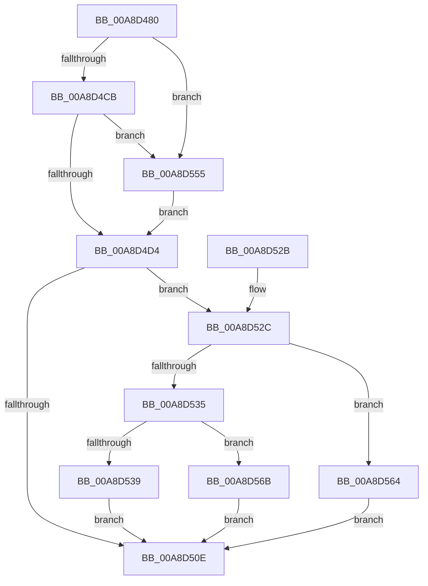

# IoWMIQueryAllData

- RVA: `0x00A8D480`–`0x00A8D577` (길이 `247` bytes)
- VA: `0x0000000140A8D480`
- 실행 섹션: `PAGE`
- PDB 이름 있음: `예`; PDB Function 태그: `아니요`
- unwind 정보 RVA: `0x000B87A8`
- 디코드: `69`개 명령, `247/247` bytes 표시
- 미해석 바이트: `0` (있으면 어셈블리에 `.byte`로 보존)

> 이 문서는 커널 이미지의 기계어와 PDB 기호를 분석해 생성했습니다. 4번과 5번은 함수 원형과 자료형을 바이너리 사용 방식에서 추정한 C 해석이며 원본 소스 복구 결과는 아닙니다.

## 1. Dependencies

- 직접 호출 지점: **3**; 고유 호출 대상: **3**
- 직접 호출자로 확인된 함수: **0**
- RIP 상대 이미지 참조: **1**

### Outgoing calls
- `0x00A8D4B6` → [memset](../../text/6C/memset_function_006C6C40.md) (function, `0x006C6C40`)
- `0x00A8D503` → [WmipQueryAllData](../9E/WmipQueryAllData_function_009E086C.md) (function, `0x009E086C`)
- `0x00A8D51B` → [_security_check_cookie](../../text/6A/_security_check_cookie_function_006AC640.md) (function, `0x006AC640`)

### Direct callers
- 이 함수 시작 RVA로 연결되는 직접 call은 확인되지 않았습니다. 간접 호출은 완전히 역산할 수 없습니다.

### Static image references
- `0x00A8D48B` → RVA `0x00E0A740` (`.data`; read)

## 2. Other-region calls and transfers

- 다른 실행 섹션으로 향하는 call: **2**
  - `0x00A8D4B6` → [memset](../../text/6C/memset_function_006C6C40.md) (`PAGE` → `.text`)
  - `0x00A8D51B` → [_security_check_cookie](../../text/6A/_security_check_cookie_function_006AC640.md) (`PAGE` → `.text`)
- 별도 외부 분기/꼬리 이동을 확인하지 못했습니다.

## 3. Assembly (complete function range)

```asm
00A8D480  40 53                           push rbx
00A8D482  56                              push rsi
00A8D483  57                              push rdi
00A8D484  48 81 EC A0 00 00 00            sub rsp, 0xa0
00A8D48B  48 8B 05 AE D2 37 00            mov rax, qword ptr [rip + 0x37d2ae]
00A8D492  48 33 C4                        xor rax, rsp
00A8D495  48 89 84 24 90 00 00 00         mov qword ptr [rsp + 0x90], rax
00A8D49D  83 64 24 40 00                  and dword ptr [rsp + 0x40], 0
00A8D4A2  48 8B FA                        mov rdi, rdx
00A8D4A5  33 D2                           xor edx, edx
00A8D4A7  49 8B D8                        mov rbx, r8
00A8D4AA  48 8B F1                        mov rsi, rcx
00A8D4AD  48 8D 4C 24 44                  lea rcx, [rsp + 0x44]
00A8D4B2  44 8D 42 44                     lea r8d, [rdx + 0x44]
00A8D4B6  E8 85 97 C3 FF                  call 0x1406c6c40
00A8D4BB  83 64 24 30 00                  and dword ptr [rsp + 0x30], 0
00A8D4C0  8B 07                           mov eax, dword ptr [rdi]
00A8D4C2  48 85 DB                        test rbx, rbx
00A8D4C5  0F 84 8A 00 00 00               je 0x140a8d555
00A8D4CB  83 F8 48                        cmp eax, 0x48
00A8D4CE  0F 82 81 00 00 00               jb 0x140a8d555
00A8D4D4  48 83 63 10 00                  and qword ptr [rbx + 0x10], 0
00A8D4D9  48 8D 4C 24 30                  lea rcx, [rsp + 0x30]
00A8D4DE  83 63 0C 00                     and dword ptr [rbx + 0xc], 0
00A8D4E2  4C 8B CB                        mov r9, rbx
00A8D4E5  48 89 4C 24 28                  mov qword ptr [rsp + 0x28], rcx
00A8D4EA  45 33 C0                        xor r8d, r8d
00A8D4ED  48 8B CE                        mov rcx, rsi
00A8D4F0  C7 43 2C 01 00 00 00            mov dword ptr [rbx + 0x2c], 1
00A8D4F7  33 D2                           xor edx, edx
00A8D4F9  C7 03 30 00 00 00               mov dword ptr [rbx], 0x30
00A8D4FF  89 44 24 20                     mov dword ptr [rsp + 0x20], eax
00A8D503  E8 64 33 F5 FF                  call 0x1409e086c
00A8D508  8B C8                           mov ecx, eax
00A8D50A  85 C0                           test eax, eax
00A8D50C  79 1E                           jns 0x140a8d52c
00A8D50E  8B C1                           mov eax, ecx
00A8D510  48 8B 8C 24 90 00 00 00         mov rcx, qword ptr [rsp + 0x90]
00A8D518  48 33 CC                        xor rcx, rsp
00A8D51B  E8 20 F1 C1 FF                  call 0x1406ac640
00A8D520  48 81 C4 A0 00 00 00            add rsp, 0xa0
00A8D527  5F                              pop rdi
00A8D528  5E                              pop rsi
00A8D529  5B                              pop rbx
00A8D52A  C3                              ret
00A8D52B  CC                              int3
00A8D52C  8B 43 2C                        mov eax, dword ptr [rbx + 0x2c]
00A8D52F  0F BA E0 08                     bt eax, 8
00A8D533  72 2F                           jb 0x140a8d564
00A8D535  A8 20                           test al, 0x20
00A8D537  75 32                           jne 0x140a8d56b
00A8D539  8B 44 24 30                     mov eax, dword ptr [rsp + 0x30]
00A8D53D  48 8D 54 24 40                  lea rdx, [rsp + 0x40]
00A8D542  89 07                           mov dword ptr [rdi], eax
00A8D544  48 3B DA                        cmp rbx, rdx
00A8D547  8B C1                           mov eax, ecx
00A8D549  B9 23 00 00 C0                  mov ecx, 0xc0000023
00A8D54E  0F 44 C1                        cmove eax, ecx
00A8D551  8B C8                           mov ecx, eax
00A8D553  EB B9                           jmp 0x140a8d50e
00A8D555  48 8D 5C 24 40                  lea rbx, [rsp + 0x40]
00A8D55A  B8 48 00 00 00                  mov eax, 0x48
00A8D55F  E9 70 FF FF FF                  jmp 0x140a8d4d4
00A8D564  B9 BB 00 00 C0                  mov ecx, 0xc00000bb
00A8D569  EB A3                           jmp 0x140a8d50e
00A8D56B  8B 43 30                        mov eax, dword ptr [rbx + 0x30]
00A8D56E  B9 23 00 00 C0                  mov ecx, 0xc0000023
00A8D573  89 07                           mov dword ptr [rdi], eax
00A8D575  EB 97                           jmp 0x140a8d50e
```

## 4. C-style interpretation (structured pseudocode)

```c
__int64 __fastcall IoWMIQueryAllData(__int64 a1, __int64 a2, __int64 a3)
{
    __int64 result;
    __int64 v_rsp;
    unsigned __int64 v_stack_m28;
    unsigned __int64 v_stack_m74;
    unsigned int v_stack_m78;
    unsigned int v_stack_m88;
    unsigned __int64 v_stack_m90;
    unsigned int v_stack_m98;
    unsigned int v_stack_p30;
    unsigned __int64 v_stack_p40;

    v_rsp = (v_rsp) - (160);
    result = (*(unsigned __int64 *)(v_rip + 3658414)) ^ (v_rsp);
    v_stack_m28 = result;
    a2 = 0;
    result = memset(v_stack_m74, a2, a2 + 68, a4);
    if (a3 == 0) goto loc_00A8D555;
    if (((unsigned int)((unsigned int)(*(unsigned int *)(a2)))) < 72) goto loc_00A8D555;
loc_00A8D4D4:
    v_stack_m90 = v_stack_m88;
    a3 = 0;
    *(unsigned int *)(a3 + 44) = 1;
    a2 = 0;
    *(unsigned int *)(a3) = 48;
    v_stack_m98 = (unsigned int)((unsigned int)(*(unsigned int *)(a2)));
    result = WmipQueryAllData(a1, a2, a3, a3);
    if (!sign_flag) goto loc_00A8D52C;
loc_00A8D50E:
    a1 = (v_stack_m28) ^ (v_rsp);
    result = _security_check_cookie(a1, a2, a3, a3);
    v_rsp = (v_rsp) + (160);
    return result;
loc_00A8D52C:
    if (condition_is_below) goto loc_00A8D564;
    if ((((unsigned __int8)((unsigned int)(*(unsigned int *)(a3 + 44)))) & (32)) != 0) goto loc_00A8D56B;
    *(unsigned int *)(a2) = (unsigned int)((unsigned int)(v_stack_p30));
    result = (unsigned int)((unsigned int)(a1));
    if (0 == v_stack_p40) { result = (unsigned int)((unsigned int)(0xC0000023ULL)); }
    goto loc_00A8D50E;
loc_00A8D555:
    goto loc_00A8D4D4;
loc_00A8D564:
    goto loc_00A8D50E;
loc_00A8D56B:
    *(unsigned int *)(a2) = (unsigned int)((unsigned int)(*(unsigned int *)(v_stack_p40 + 48)));
    goto loc_00A8D50E;
}
```

## 5. (Beta) C Style

```c
int64_t IoWMIQueryAllData(int64_t Arg1, void *Arg2, int64_t Arg3)
{
    uint8_t *arg2 = (uint8_t *)Arg2;

    int64_t result;
    int64_t local_rsp;
    uint64_t v_stack_m28;
    uint64_t v_stack_m74;
    uint32_t v_stack_m78;
    uint32_t v_stack_m88;
    uint64_t v_stack_m90;
    uint32_t v_stack_m98;
    uint32_t v_stack_p30;
    uint64_t v_stack_p40;

    local_rsp = (local_rsp) - (160);
    result = (*(uint64_t *)(v_rip + 0x37D2AE)) ^ (local_rsp);
    v_stack_m28 = result;
    Arg2 = 0;
    result = memset(v_stack_m74, Arg2, Arg2 + 68, a4);
    if (Arg3 == 0) goto loc_00A8D555;
    if (((uint32_t)((uint32_t)(*(uint32_t *)(arg2)))) < 72) goto loc_00A8D555;
loc_00A8D4D4:
    v_stack_m90 = v_stack_m88;
    Arg3 = 0;
    *(uint32_t *)(Arg3 + 0x2C) = 1;
    Arg2 = 0;
    *(uint32_t *)(Arg3) = 48;
    v_stack_m98 = (uint32_t)((uint32_t)(*(uint32_t *)(arg2)));
    result = WmipQueryAllData(Arg1, Arg2, Arg3, Arg3);
    if (!sign_flag) goto loc_00A8D52C;
loc_00A8D50E:
    Arg1 = (v_stack_m28) ^ (local_rsp);
    result = _security_check_cookie(Arg1, Arg2, Arg3, Arg3);
    local_rsp = (local_rsp) + (160);
    return result;
loc_00A8D52C:
    if (condition_is_below) goto loc_00A8D564;
    if ((((uint8_t)((uint32_t)(*(uint32_t *)(Arg3 + 0x2C)))) & (32)) != 0) goto loc_00A8D56B;
    *(uint32_t *)(arg2) = (uint32_t)((uint32_t)(v_stack_p30));
    result = (uint32_t)((uint32_t)(Arg1));
    if (0 == v_stack_p40) { result = (uint32_t)((uint32_t)(0xC0000023ULL)); }
    goto loc_00A8D50E;
loc_00A8D555:
    goto loc_00A8D4D4;
loc_00A8D564:
    goto loc_00A8D50E;
loc_00A8D56B:
    *(uint32_t *)(arg2) = (uint32_t)((uint32_t)(*(uint32_t *)(v_stack_p40 + 0x30)));
    goto loc_00A8D50E;
}
```

### 관측된 메모리 오프셋

구조체 형식이 확인되지 않은 접근은 인자 기준의 오프셋으로만 기록했습니다.

| 기준 인자 | 오프셋 표현 | 폭 (bit) | 접근 |
|---|---:|---:|---|
| `Arg2` | `+ 0x0` | `32` | `R` |
| `Arg2` | `+ 0x0` | `32` | `W` |

## 6. Execution-region graph

[열기: 2D/3D 그래프와 함수 탐색 컨트롤 패널](../../../control-panel.html?section=page&rva=0x00A8D480&view=graph)

- 2D 그래프는 위에서 아래로 흐르고, 3D 그래프는 빈 공간을 드래그해 회전합니다. Shift+드래그는 이동, 휠은 확대·축소, 함수 노드 선택은 대상 보고서 이동입니다.

### Static fallback


