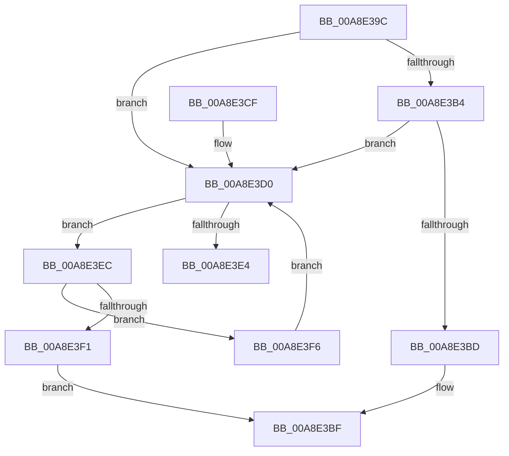

# IopCallDriverReinitializationRoutines

- RVA: `0x00A8E39C`–`0x00A8E401` (길이 `101` bytes)
- VA: `0x0000000140A8E39C`
- 실행 섹션: `PAGE`
- PDB 이름 있음: `예`; PDB Function 태그: `예`
- unwind 정보 RVA: `0x0006F5D0`
- 디코드: `31`개 명령, `101/101` bytes 표시
- 미해석 바이트: `0` (있으면 어셈블리에 `.byte`로 보존)

> 이 문서는 커널 이미지의 기계어와 PDB 기호를 분석해 생성했습니다. 4번과 5번은 함수 원형과 자료형을 바이너리 사용 방식에서 추정한 C 해석이며 원본 소스 복구 결과는 아닙니다.

## 1. Dependencies

- 직접 호출 지점: **1**; 고유 호출 대상: **1**
- 직접 호출자로 확인된 함수: **2**
- RIP 상대 이미지 참조: **3**

### Outgoing calls
- `0x00A8E3D7` → [IopInterlockedRemoveHeadList](../../text/4B/IopInterlockedRemoveHeadList_function_004B4FB0.md) (function, `0x004B4FB0`)

### Direct callers
- [PnpCompleteSystemStartProcess](../../text/5A/PnpCompleteSystemStartProcess_function_005A6F2C.md) at `0x005A6F54`
- [PipCallDriverAddDeviceQueryRoutine](../99/PipCallDriverAddDeviceQueryRoutine_function_00996604.md) at `0x00996A97`

### Static image references
- `0x00A8E3B4` → RVA `0x00E66101` (`.data`; read)
- `0x00A8E3D0` → RVA `0x00F8D230` (`.data`; read)
- `0x00A8E3F6` → RVA `0x00E66101` (`.data`; write)

## 2. Other-region calls and transfers

- 다른 실행 섹션으로 향하는 call: **1**
  - `0x00A8E3D7` → [IopInterlockedRemoveHeadList](../../text/4B/IopInterlockedRemoveHeadList_function_004B4FB0.md) (`PAGE` → `.text`)
- call이 아닌 외부 분기/꼬리 이동: **1**
  - `0x00A8E3E7` → [sub_00B4657A](../B4/Unknown_function_00B4657A.md) (`tail-transfer`)

## 3. Assembly (complete function range)

```asm
00A8E39C  48 89 5C 24 08                  mov qword ptr [rsp + 8], rbx
00A8E3A1  48 89 74 24 10                  mov qword ptr [rsp + 0x10], rsi
00A8E3A6  57                              push rdi
00A8E3A7  48 83 EC 20                     sub rsp, 0x20
00A8E3AB  40 32 F6                        xor sil, sil
00A8E3AE  8A D9                           mov bl, cl
00A8E3B0  84 C9                           test cl, cl
00A8E3B2  75 1C                           jne 0x140a8e3d0
00A8E3B4  40 38 35 46 7D 3D 00            cmp byte ptr [rip + 0x3d7d46], sil
00A8E3BB  75 13                           jne 0x140a8e3d0
00A8E3BD  32 C0                           xor al, al
00A8E3BF  48 8B 5C 24 30                  mov rbx, qword ptr [rsp + 0x30]
00A8E3C4  48 8B 74 24 38                  mov rsi, qword ptr [rsp + 0x38]
00A8E3C9  48 83 C4 20                     add rsp, 0x20
00A8E3CD  5F                              pop rdi
00A8E3CE  C3                              ret
00A8E3CF  CC                              int3
00A8E3D0  48 8D 0D 59 EE 4F 00            lea rcx, [rip + 0x4fee59]
00A8E3D7  E8 D4 6B A2 FF                  call 0x1404b4fb0
00A8E3DC  48 8B F8                        mov rdi, rax
00A8E3DF  48 85 C0                        test rax, rax
00A8E3E2  74 08                           je 0x140a8e3ec
00A8E3E4  40 B6 01                        mov sil, 1
00A8E3E7  E9 8E 81 0B 00                  jmp 0x140b4657a
00A8E3EC  80 FB 01                        cmp bl, 1
00A8E3EF  74 05                           je 0x140a8e3f6
00A8E3F1  40 8A C6                        mov al, sil
00A8E3F4  EB C9                           jmp 0x140a8e3bf
00A8E3F6  C6 05 04 7D 3D 00 01            mov byte ptr [rip + 0x3d7d04], 1
00A8E3FD  32 DB                           xor bl, bl
00A8E3FF  EB CF                           jmp 0x140a8e3d0
```

## 4. C-style interpretation (structured pseudocode)

```c
__int64 __fastcall IopCallDriverReinitializationRoutines(unsigned __int8 a1)
{
    __int64 result;
    __int64 v_rbx;
    __int64 v_rsi;
    __int64 v_rsp;
    unsigned __int64 v_stack_p10;
    unsigned __int64 v_stack_p8;

    v_stack_p8 = v_rbx;
    v_stack_p10 = v_rsi;
    v_rsp = (v_rsp) - (32);
    v_rsi = 0;
    if (a1 != 0) goto loc_00A8E3D0;
    if ((*(unsigned __int8 *)(v_rip + 4029766)) != 0) goto loc_00A8E3D0;
    result = 0;
loc_00A8E3BF:
    v_rsp = (v_rsp) + (32);
    return result;
loc_00A8E3D0:
    result = IopInterlockedRemoveHeadList(v_rip + 5238361, a2, a3, a4);
    if (result == 0) goto loc_00A8E3EC;
loc_00A8E3EC:
    if (((unsigned __int8)(v_stack_p8)) == 1) goto loc_00A8E3F6;
    goto loc_00A8E3BF;
loc_00A8E3F6:
    *(unsigned __int8 *)(v_rip + 4029700) = 1;
    v_rbx = 0;
    goto loc_00A8E3D0;
}
```

## 5. (Beta) C Style

```c
int64_t IopCallDriverReinitializationRoutines(uint8_t Arg1)
{
    int64_t result;
    int64_t local_rbx;
    int64_t local_rsi;
    int64_t local_rsp;
    uint64_t v_stack_p10;
    uint64_t v_stack_p8;

    v_stack_p8 = local_rbx;
    v_stack_p10 = local_rsi;
    local_rsp = (local_rsp) - (32);
    local_rsi = 0;
    if (Arg1 != 0) goto loc_00A8E3D0;
    if ((*(uint8_t *)(v_rip + 0x3D7D46)) != 0) goto loc_00A8E3D0;
    result = 0;
loc_00A8E3BF:
    local_rsp = (local_rsp) + (32);
    return result;
loc_00A8E3D0:
    result = IopInterlockedRemoveHeadList(v_rip + 5238361, a2, a3, a4);
    if (result == 0) goto loc_00A8E3EC;
loc_00A8E3EC:
    if (((uint8_t)(v_stack_p8)) == 1) goto loc_00A8E3F6;
    goto loc_00A8E3BF;
loc_00A8E3F6:
    *(uint8_t *)(v_rip + 0x3D7D04) = 1;
    local_rbx = 0;
    goto loc_00A8E3D0;
}
```

## 6. Execution-region graph

[열기: 2D/3D 그래프와 함수 탐색 컨트롤 패널](../../../control-panel.html?section=page&rva=0x00A8E39C&view=graph)

- 2D 그래프는 위에서 아래로 흐르고, 3D 그래프는 빈 공간을 드래그해 회전합니다. Shift+드래그는 이동, 휠은 확대·축소, 함수 노드 선택은 대상 보고서 이동입니다.

### Static fallback


