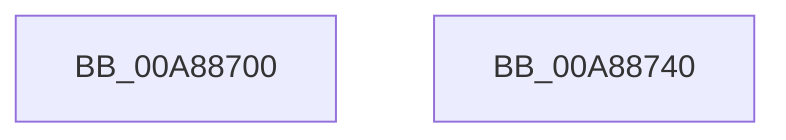

# IopCancelIrpsInCurrentThreadListApcRoutine

- RVA: `0x00A88700`–`0x00A88741` (길이 `65` bytes)
- VA: `0x0000000140A88700`
- 실행 섹션: `PAGE`
- PDB 이름 있음: `예`; PDB Function 태그: `아니요`
- unwind 정보 RVA: `0x0005CF00`
- 디코드: `17`개 명령, `65/65` bytes 표시
- 미해석 바이트: `0` (있으면 어셈블리에 `.byte`로 보존)

> 이 문서는 커널 이미지의 기계어와 PDB 기호를 분석해 생성했습니다. 4번과 5번은 함수 원형과 자료형을 바이너리 사용 방식에서 추정한 C 해석이며 원본 소스 복구 결과는 아닙니다.

## 1. Dependencies

- 직접 호출 지점: **2**; 고유 호출 대상: **2**
- 직접 호출자로 확인된 함수: **0**
- RIP 상대 이미지 참조: **0**

### Outgoing calls
- `0x00A88721` → [IopCancelIrpsInCurrentThreadList](../../text/47/IopCancelIrpsInCurrentThreadList_function_0047AB14.md) (function, `0x0047AB14`)
- `0x00A88735` → [KeSetEvent](../../text/33/KeSetEvent_function_0033F310.md) (function, `0x0033F310`)

### Direct callers
- 이 함수 시작 RVA로 연결되는 직접 call은 확인되지 않았습니다. 간접 호출은 완전히 역산할 수 없습니다.

### Static image references
- 디코드된 RIP-relative 메모리 참조가 없습니다.

## 2. Other-region calls and transfers

- 다른 실행 섹션으로 향하는 call: **2**
  - `0x00A88721` → [IopCancelIrpsInCurrentThreadList](../../text/47/IopCancelIrpsInCurrentThreadList_function_0047AB14.md) (`PAGE` → `.text`)
  - `0x00A88735` → [KeSetEvent](../../text/33/KeSetEvent_function_0033F310.md) (`PAGE` → `.text`)
- 별도 외부 분기/꼬리 이동을 확인하지 못했습니다.

## 3. Assembly (complete function range)

```asm
00A88700  40 53                           push rbx
00A88702  48 83 EC 20                     sub rsp, 0x20
00A88706  65 48 8B 14 25 88 01 00 00      mov rdx, qword ptr gs:[0x188]
00A8870F  48 8B D9                        mov rbx, rcx
00A88712  44 8A 89 80 00 00 00            mov r9b, byte ptr [rcx + 0x80]
00A88719  4C 8B 41 60                     mov r8, qword ptr [rcx + 0x60]
00A8871D  48 8B 49 58                     mov rcx, qword ptr [rcx + 0x58]
00A88721  E8 EE 23 9F FF                  call 0x14047ab14
00A88726  09 83 84 00 00 00               or dword ptr [rbx + 0x84], eax
00A8872C  48 8D 4B 68                     lea rcx, [rbx + 0x68]
00A88730  45 33 C0                        xor r8d, r8d
00A88733  33 D2                           xor edx, edx
00A88735  E8 D6 6B 8B FF                  call 0x14033f310
00A8873A  48 83 C4 20                     add rsp, 0x20
00A8873E  5B                              pop rbx
00A8873F  C3                              ret
00A88740  CC                              int3
```

## 4. C-style interpretation (structured pseudocode)

```c
__int64 __fastcall IopCancelIrpsInCurrentThreadListApcRoutine(__int64 a1)
{
    __int64 result;
    __int64 v_rsp;

    v_rsp = (v_rsp) - (32);
    result = IopCancelIrpsInCurrentThreadList(*(unsigned __int64 *)(a1 + 88), *(unsigned __int64 *)(gs_base + (0 + 392)), *(unsigned __int64 *)(a1 + 96), *(unsigned __int8 *)(a1 + 128));
    a3 = 0;
    a2 = 0;
    result = KeSetEvent(a1 + 104, a2, a3, *(unsigned __int8 *)(a1 + 128));
    v_rsp = (v_rsp) + (32);
    return result;
}
```

## 5. (Beta) C Style

```c
int64_t IopCancelIrpsInCurrentThreadListApcRoutine(void *Arg1)
{
    uint8_t *arg1 = (uint8_t *)Arg1;

    int64_t result;
    int64_t local_rsp;

    local_rsp = (local_rsp) - (32);
    result = IopCancelIrpsInCurrentThreadList(*(uint64_t *)(arg1 + 0x58), *(uint64_t *)(gs_base + (0 + 0x188)), *(uint64_t *)(arg1 + 0x60), *(uint8_t *)(arg1 + 0x80));
    a3 = 0;
    a2 = 0;
    result = KeSetEvent(Arg1 + 104, a2, a3, *(uint8_t *)(arg1 + 0x80));
    local_rsp = (local_rsp) + (32);
    return result;
}
```

### 관측된 메모리 오프셋

구조체 형식이 확인되지 않은 접근은 인자 기준의 오프셋으로만 기록했습니다.

| 기준 인자 | 오프셋 표현 | 폭 (bit) | 접근 |
|---|---:|---:|---|
| `Arg1` | `+ 0x58` | `64` | `R` |
| `Arg1` | `+ 0x60` | `64` | `R` |
| `Arg1` | `+ 0x68` | `64` | `R` |
| `Arg1` | `+ 0x80` | `8` | `R` |
| `Arg1` | `+ 0x84` | `32` | `R/W` |

## 6. Execution-region graph

[열기: 2D/3D 그래프와 함수 탐색 컨트롤 패널](../../../control-panel.html?section=page&rva=0x00A88700&view=graph)

- 2D 그래프는 위에서 아래로 흐르고, 3D 그래프는 빈 공간을 드래그해 회전합니다. Shift+드래그는 이동, 휠은 확대·축소, 함수 노드 선택은 대상 보고서 이동입니다.

### Static fallback


