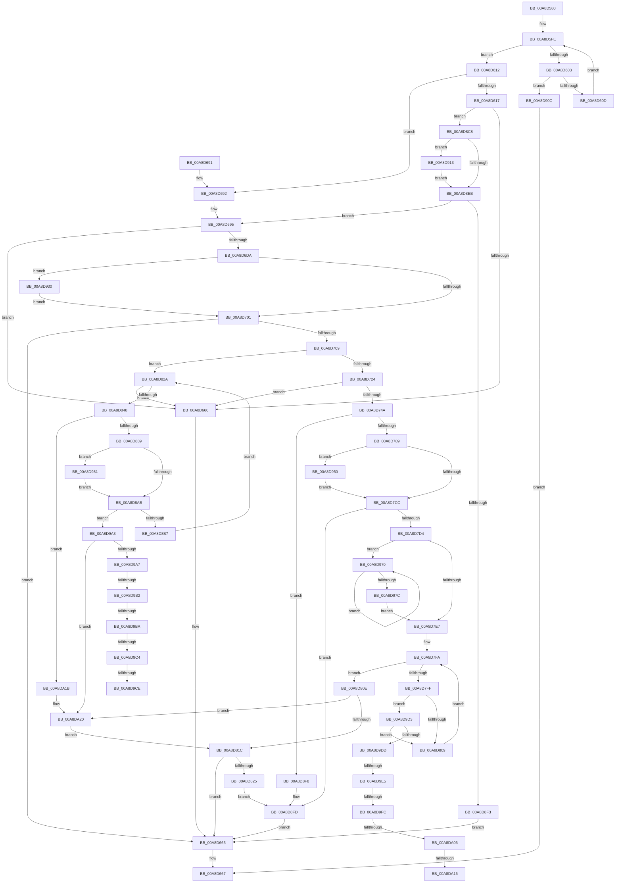

# IopCreateArcName

- RVA: `0x00A8D580`–`0x00A8DA2F` (길이 `1,199` bytes)
- VA: `0x0000000140A8D580`
- 실행 섹션: `PAGE`
- PDB 이름 있음: `예`; PDB Function 태그: `예`
- unwind 정보 RVA: `0x000B87C4`
- 디코드: `297`개 명령, `1,199/1,199` bytes 표시
- 미해석 바이트: `0` (있으면 어셈블리에 `.byte`로 보존)

> 이 문서는 커널 이미지의 기계어와 PDB 기호를 분석해 생성했습니다. 4번과 5번은 함수 원형과 자료형을 바이너리 사용 방식에서 추정한 C 해석이며 원본 소스 복구 결과는 아닙니다.

## 1. Dependencies

- 직접 호출 지점: **25**; 고유 호출 대상: **12**
- 직접 호출자로 확인된 함수: **2**
- RIP 상대 이미지 참조: **2**

### Outgoing calls
- `0x00A8D64F` → [IoBuildDeviceIoControlRequest](../../text/20/IoBuildDeviceIoControlRequest_function_00204FD0.md) (function, `0x00204FD0`)
- `0x00A8D671` → [_security_check_cookie](../../text/6A/_security_check_cookie_function_006AC640.md) (function, `0x006AC640`)
- `0x00A8D6CD` → [IoBuildDeviceIoControlRequest](../../text/20/IoBuildDeviceIoControlRequest_function_00204FD0.md) (function, `0x00204FD0`)
- `0x00A8D6E4` → [KeInitializeEvent](../../text/40/KeInitializeEvent_function_0040DD10.md) (function, `0x0040DD10`)
- `0x00A8D6EF` → [IofCallDriver](../../text/29/IofCallDriver_function_0029B4B0.md) (function, `0x0029B4B0`)
- `0x00A8D739` → [ExAllocatePool2](../../poolcode/B8/ExAllocatePool2_function_00B820F0.md) (function, `0x00B820F0`)
- `0x00A8D778` → [IopBuildAsynchronousFsdRequest](../../text/29/IopBuildAsynchronousFsdRequest_function_0029DD40.md) (function, `0x0029DD40`)
- `0x00A8D795` → [IopQueueThreadIrp](../../text/20/IopQueueThreadIrp_function_002075C0.md) (function, `0x002075C0`)
- `0x00A8D7AF` → [KeInitializeEvent](../../text/40/KeInitializeEvent_function_0040DD10.md) (function, `0x0040DD10`)
- `0x00A8D7BA` → [IofCallDriver](../../text/29/IofCallDriver_function_0029B4B0.md) (function, `0x0029B4B0`)
- `0x00A8D837` → [ExAllocatePool2](../../poolcode/B8/ExAllocatePool2_function_00B820F0.md) (function, `0x00B820F0`)
- `0x00A8D878` → [IoBuildDeviceIoControlRequest](../../text/20/IoBuildDeviceIoControlRequest_function_00204FD0.md) (function, `0x00204FD0`)
- `0x00A8D88E` → [KeResetEvent](../../text/24/KeResetEvent_function_00248350.md) (function, `0x00248350`)
- `0x00A8D899` → [IofCallDriver](../../text/29/IofCallDriver_function_0029B4B0.md) (function, `0x0029B4B0`)
- `0x00A8D8BC` → [ExFreePoolWithTag](../../poolcode/B8/ExFreePoolWithTag_function_00B82870.md) (function, `0x00B82870`)
- `0x00A8D8D2` → [KeInitializeEvent](../../text/40/KeInitializeEvent_function_0040DD10.md) (function, `0x0040DD10`)
- `0x00A8D8DD` → [IofCallDriver](../../text/29/IofCallDriver_function_0029B4B0.md) (function, `0x0029B4B0`)
- `0x00A8D902` → [ExFreePoolWithTag](../../poolcode/B8/ExFreePoolWithTag_function_00B82870.md) (function, `0x00B82870`)
- `0x00A8D925` → [KeWaitForSingleObject](../../text/20/KeWaitForSingleObject_function_0020E6B0.md) (function, `0x0020E6B0`)
- `0x00A8D942` → [KeWaitForSingleObject](../../text/20/KeWaitForSingleObject_function_0020E6B0.md) (function, `0x0020E6B0`)
- `0x00A8D962` → [KeWaitForSingleObject](../../text/20/KeWaitForSingleObject_function_0020E6B0.md) (function, `0x0020E6B0`)
- `0x00A8D995` → [KeWaitForSingleObject](../../text/20/KeWaitForSingleObject_function_0020E6B0.md) (function, `0x0020E6B0`)
- `0x00A8D9EF` → [IopVerifyDiskSignature](../71/IopVerifyDiskSignature_function_0071CE1C.md) (function, `0x0071CE1C`)
- `0x00A8DA09` → [VhdVerifyBootDisk](../83/VhdVerifyBootDisk_function_0083BB84.md) (function, `0x0083BB84`)
- `0x00A8DA25` → [ExFreePoolWithTag](../../poolcode/B8/ExFreePoolWithTag_function_00B82870.md) (function, `0x00B82870`)

### Direct callers
- [IoCreateArcName](../71/IoCreateArcName_function_0071D170.md) at `0x0071D177`
- [IopCreateArcNamesDisk](../../init/C2/IopCreateArcNamesDisk_function_00C2C594.md) at `0x00C2C6C0`

### Static image references
- `0x00A8D59F` → RVA `0x00E0A740` (`.data`; read)
- `0x00A8D5BF` → RVA `0x00FD9C58` (`PAGEDATA`; read)

## 2. Other-region calls and transfers

- 다른 실행 섹션으로 향하는 call: **23**
  - `0x00A8D64F` → [IoBuildDeviceIoControlRequest](../../text/20/IoBuildDeviceIoControlRequest_function_00204FD0.md) (`PAGE` → `.text`)
  - `0x00A8D671` → [_security_check_cookie](../../text/6A/_security_check_cookie_function_006AC640.md) (`PAGE` → `.text`)
  - `0x00A8D6CD` → [IoBuildDeviceIoControlRequest](../../text/20/IoBuildDeviceIoControlRequest_function_00204FD0.md) (`PAGE` → `.text`)
  - `0x00A8D6E4` → [KeInitializeEvent](../../text/40/KeInitializeEvent_function_0040DD10.md) (`PAGE` → `.text`)
  - `0x00A8D6EF` → [IofCallDriver](../../text/29/IofCallDriver_function_0029B4B0.md) (`PAGE` → `.text`)
  - `0x00A8D739` → [ExAllocatePool2](../../poolcode/B8/ExAllocatePool2_function_00B820F0.md) (`PAGE` → `POOLCODE`)
  - `0x00A8D778` → [IopBuildAsynchronousFsdRequest](../../text/29/IopBuildAsynchronousFsdRequest_function_0029DD40.md) (`PAGE` → `.text`)
  - `0x00A8D795` → [IopQueueThreadIrp](../../text/20/IopQueueThreadIrp_function_002075C0.md) (`PAGE` → `.text`)
  - `0x00A8D7AF` → [KeInitializeEvent](../../text/40/KeInitializeEvent_function_0040DD10.md) (`PAGE` → `.text`)
  - `0x00A8D7BA` → [IofCallDriver](../../text/29/IofCallDriver_function_0029B4B0.md) (`PAGE` → `.text`)
  - `0x00A8D837` → [ExAllocatePool2](../../poolcode/B8/ExAllocatePool2_function_00B820F0.md) (`PAGE` → `POOLCODE`)
  - `0x00A8D878` → [IoBuildDeviceIoControlRequest](../../text/20/IoBuildDeviceIoControlRequest_function_00204FD0.md) (`PAGE` → `.text`)
  - `0x00A8D88E` → [KeResetEvent](../../text/24/KeResetEvent_function_00248350.md) (`PAGE` → `.text`)
  - `0x00A8D899` → [IofCallDriver](../../text/29/IofCallDriver_function_0029B4B0.md) (`PAGE` → `.text`)
  - `0x00A8D8BC` → [ExFreePoolWithTag](../../poolcode/B8/ExFreePoolWithTag_function_00B82870.md) (`PAGE` → `POOLCODE`)
  - `0x00A8D8D2` → [KeInitializeEvent](../../text/40/KeInitializeEvent_function_0040DD10.md) (`PAGE` → `.text`)
  - `0x00A8D8DD` → [IofCallDriver](../../text/29/IofCallDriver_function_0029B4B0.md) (`PAGE` → `.text`)
  - `0x00A8D902` → [ExFreePoolWithTag](../../poolcode/B8/ExFreePoolWithTag_function_00B82870.md) (`PAGE` → `POOLCODE`)
  - `0x00A8D925` → [KeWaitForSingleObject](../../text/20/KeWaitForSingleObject_function_0020E6B0.md) (`PAGE` → `.text`)
  - `0x00A8D942` → [KeWaitForSingleObject](../../text/20/KeWaitForSingleObject_function_0020E6B0.md) (`PAGE` → `.text`)
  - `0x00A8D962` → [KeWaitForSingleObject](../../text/20/KeWaitForSingleObject_function_0020E6B0.md) (`PAGE` → `.text`)
  - `0x00A8D995` → [KeWaitForSingleObject](../../text/20/KeWaitForSingleObject_function_0020E6B0.md) (`PAGE` → `.text`)
  - `0x00A8DA25` → [ExFreePoolWithTag](../../poolcode/B8/ExFreePoolWithTag_function_00B82870.md) (`PAGE` → `POOLCODE`)
- call이 아닌 외부 분기/꼬리 이동: **10**
  - `0x00A8D9AC` → [sub_00B46364 + 0x8](../B4/Unknown_function_00B46364.md) (`tail-transfer`)
  - `0x00A8D9B4` → [sub_00B46364](../B4/Unknown_function_00B46364.md) (`tail-transfer`)
  - `0x00A8D9BE` → [sub_00B46364](../B4/Unknown_function_00B46364.md) (`tail-transfer`)
  - `0x00A8D9C8` → [sub_00B46364](../B4/Unknown_function_00B46364.md) (`tail-transfer`)
  - `0x00A8D9CE` → [sub_00B46364 + 0x8](../B4/Unknown_function_00B46364.md) (`tail-transfer`)
  - `0x00A8D9DF` → [sub_00B46364 + 0xF5](../B4/Unknown_function_00B46364.md) (`tail-transfer`)
  - `0x00A8D9F6` → [sub_00B46364 + 0x10E](../B4/Unknown_function_00B46364.md) (`tail-transfer`)
  - `0x00A8DA00` → [sub_00B46364 + 0x11](../B4/Unknown_function_00B46364.md) (`tail-transfer`)
  - `0x00A8DA10` → [sub_00B46364 + 0x11](../B4/Unknown_function_00B46364.md) (`tail-transfer`)
  - `0x00A8DA16` → [sub_00B46364 + 0x10E](../B4/Unknown_function_00B46364.md) (`tail-transfer`)

## 3. Assembly (complete function range)

```asm
00A8D580  48 89 5C 24 18                  mov qword ptr [rsp + 0x18], rbx
00A8D585  55                              push rbp
00A8D586  56                              push rsi
00A8D587  57                              push rdi
00A8D588  41 54                           push r12
00A8D58A  41 55                           push r13
00A8D58C  41 56                           push r14
00A8D58E  41 57                           push r15
00A8D590  48 8D AC 24 60 FF FF FF         lea rbp, [rsp - 0xa0]
00A8D598  48 81 EC A0 01 00 00            sub rsp, 0x1a0
00A8D59F  48 8B 05 9A D1 37 00            mov rax, qword ptr [rip + 0x37d19a]
00A8D5A6  48 33 C4                        xor rax, rsp
00A8D5A9  48 89 85 90 00 00 00            mov qword ptr [rbp + 0x90], rax
00A8D5B0  0F 57 C0                        xorps xmm0, xmm0
00A8D5B3  45 33 ED                        xor r13d, r13d
00A8D5B6  33 C0                           xor eax, eax
00A8D5B8  4C 8B F1                        mov r14, rcx
00A8D5BB  48 89 45 B8                     mov qword ptr [rbp - 0x48], rax
00A8D5BF  48 8D 0D 92 C6 54 00            lea rcx, [rip + 0x54c692]
00A8D5C6  89 45 C0                        mov dword ptr [rbp - 0x40], eax
00A8D5C9  45 8B E5                        mov r12d, r13d
00A8D5CC  48 89 45 B0                     mov qword ptr [rbp - 0x50], rax
00A8D5D0  45 8B FD                        mov r15d, r13d
00A8D5D3  48 89 44 24 60                  mov qword ptr [rsp + 0x60], rax
00A8D5D8  41 8B F5                        mov esi, r13d
00A8D5DB  48 8B 05 76 C6 54 00            mov rax, qword ptr [rip + 0x54c676]
00A8D5E2  BF 00 10 00 00                  mov edi, 0x1000
00A8D5E7  0F 11 44 24 78                  movups xmmword ptr [rsp + 0x78], xmm0
00A8D5EC  0F 11 45 90                     movups xmmword ptr [rbp - 0x70], xmm0
00A8D5F0  0F 11 45 A0                     movups xmmword ptr [rbp - 0x60], xmm0
00A8D5F4  0F 11 44 24 50                  movups xmmword ptr [rsp + 0x50], xmm0
00A8D5F9  0F 11 44 24 68                  movups xmmword ptr [rsp + 0x68], xmm0
00A8D5FE  48 3B C1                        cmp rax, rcx
00A8D601  74 0F                           je 0x140a8d612
00A8D603  4C 39 70 40                     cmp qword ptr [rax + 0x40], r14
00A8D607  0F 84 FF 02 00 00               je 0x140a8d90c
00A8D60D  48 8B 00                        mov rax, qword ptr [rax]
00A8D610  EB EC                           jmp 0x140a8d5fe
00A8D612  83 FA FF                        cmp edx, -1
00A8D615  75 7B                           jne 0x140a8d692
00A8D617  48 8D 44 24 68                  lea rax, [rsp + 0x68]
00A8D61C  45 33 C9                        xor r9d, r9d
00A8D61F  48 89 44 24 40                  mov qword ptr [rsp + 0x40], rax
00A8D624  45 33 C0                        xor r8d, r8d
00A8D627  48 8D 44 24 50                  lea rax, [rsp + 0x50]
00A8D62C  49 8B D6                        mov rdx, r14
00A8D62F  48 89 44 24 38                  mov qword ptr [rsp + 0x38], rax
00A8D634  B9 80 10 2D 00                  mov ecx, 0x2d1080
00A8D639  44 88 6C 24 30                  mov byte ptr [rsp + 0x30], r13b
00A8D63E  48 8D 45 B8                     lea rax, [rbp - 0x48]
00A8D642  C7 44 24 28 0C 00 00 00         mov dword ptr [rsp + 0x28], 0xc
00A8D64A  48 89 44 24 20                  mov qword ptr [rsp + 0x20], rax
00A8D64F  E8 7C 79 77 FF                  call 0x140204fd0
00A8D654  48 8B D8                        mov rbx, rax
00A8D657  48 85 C0                        test rax, rax
00A8D65A  0F 85 68 02 00 00               jne 0x140a8d8c8
00A8D660  BB 9A 00 00 C0                  mov ebx, 0xc000009a
00A8D665  8B C3                           mov eax, ebx
00A8D667  48 8B 8D 90 00 00 00            mov rcx, qword ptr [rbp + 0x90]
00A8D66E  48 33 CC                        xor rcx, rsp
00A8D671  E8 CA EF C1 FF                  call 0x1406ac640
00A8D676  48 8B 9C 24 F0 01 00 00         mov rbx, qword ptr [rsp + 0x1f0]
00A8D67E  48 81 C4 A0 01 00 00            add rsp, 0x1a0
00A8D685  41 5F                           pop r15
00A8D687  41 5E                           pop r14
00A8D689  41 5D                           pop r13
00A8D68B  41 5C                           pop r12
00A8D68D  5F                              pop rdi
00A8D68E  5E                              pop rsi
00A8D68F  5D                              pop rbp
00A8D690  C3                              ret
00A8D691  CC                              int3
00A8D692  89 55 BC                        mov dword ptr [rbp - 0x44], edx
00A8D695  48 8D 44 24 68                  lea rax, [rsp + 0x68]
00A8D69A  45 33 C9                        xor r9d, r9d
00A8D69D  48 89 44 24 40                  mov qword ptr [rsp + 0x40], rax
00A8D6A2  45 33 C0                        xor r8d, r8d
00A8D6A5  48 8D 44 24 50                  lea rax, [rsp + 0x50]
00A8D6AA  49 8B D6                        mov rdx, r14
00A8D6AD  48 89 44 24 38                  mov qword ptr [rsp + 0x38], rax
00A8D6B2  B9 00 00 07 00                  mov ecx, 0x70000
00A8D6B7  44 88 6C 24 30                  mov byte ptr [rsp + 0x30], r13b
00A8D6BC  48 8D 45 A0                     lea rax, [rbp - 0x60]
00A8D6C0  C7 44 24 28 18 00 00 00         mov dword ptr [rsp + 0x28], 0x18
00A8D6C8  48 89 44 24 20                  mov qword ptr [rsp + 0x20], rax
00A8D6CD  E8 FE 78 77 FF                  call 0x140204fd0
00A8D6D2  48 8B D8                        mov rbx, rax
00A8D6D5  48 85 C0                        test rax, rax
00A8D6D8  74 86                           je 0x140a8d660
00A8D6DA  45 33 C0                        xor r8d, r8d
00A8D6DD  48 8D 4C 24 50                  lea rcx, [rsp + 0x50]
00A8D6E2  33 D2                           xor edx, edx
00A8D6E4  E8 27 06 98 FF                  call 0x14040dd10
00A8D6E9  48 8B D3                        mov rdx, rbx
00A8D6EC  49 8B CE                        mov rcx, r14
00A8D6EF  E8 BC DD 80 FF                  call 0x14029b4b0
00A8D6F4  8B D8                           mov ebx, eax
00A8D6F6  3D 03 01 00 00                  cmp eax, 0x103
00A8D6FB  0F 84 2F 02 00 00               je 0x140a8d930
00A8D701  85 DB                           test ebx, ebx
00A8D703  0F 88 5C FF FF FF               js 0x140a8d665
00A8D709  8B 45 B4                        mov eax, dword ptr [rbp - 0x4c]
00A8D70C  B9 00 02 00 00                  mov ecx, 0x200
00A8D711  3B C1                           cmp eax, ecx
00A8D713  0F 42 C1                        cmovb eax, ecx
00A8D716  41 83 7E 48 02                  cmp dword ptr [r14 + 0x48], 2
00A8D71B  89 45 B4                        mov dword ptr [rbp - 0x4c], eax
00A8D71E  0F 85 06 01 00 00               jne 0x140a8d82a
00A8D724  8B D0                           mov edx, eax
00A8D726  B9 48 00 00 00                  mov ecx, 0x48
00A8D72B  41 B8 49 6F 20 20               mov r8d, 0x20206f49
00A8D731  48 C7 45 88 00 80 00 00         mov qword ptr [rbp - 0x78], 0x8000
00A8D739  E8 B2 49 0F 00                  call 0x140b820f0
00A8D73E  4C 8B E0                        mov r12, rax
00A8D741  48 85 C0                        test rax, rax
00A8D744  0F 84 16 FF FF FF               je 0x140a8d660
00A8D74A  48 8B 85 D8 00 00 00            mov rax, qword ptr [rbp + 0xd8]
00A8D751  4D 8B C4                        mov r8, r12
00A8D754  44 8B 4D B4                     mov r9d, dword ptr [rbp - 0x4c]
00A8D758  49 8B D6                        mov rdx, r14
00A8D75B  48 89 44 24 30                  mov qword ptr [rsp + 0x30], rax
00A8D760  B9 03 00 00 00                  mov ecx, 3
00A8D765  48 8D 44 24 68                  lea rax, [rsp + 0x68]
00A8D76A  48 89 44 24 28                  mov qword ptr [rsp + 0x28], rax
00A8D76F  48 8D 45 88                     lea rax, [rbp - 0x78]
00A8D773  48 89 44 24 20                  mov qword ptr [rsp + 0x20], rax
00A8D778  E8 C3 05 81 FF                  call 0x14029dd40
00A8D77D  48 8B D8                        mov rbx, rax
00A8D780  48 85 C0                        test rax, rax
00A8D783  0F 84 6F 01 00 00               je 0x140a8d8f8
00A8D789  48 8D 44 24 50                  lea rax, [rsp + 0x50]
00A8D78E  48 8B CB                        mov rcx, rbx
00A8D791  48 89 43 50                     mov qword ptr [rbx + 0x50], rax
00A8D795  E8 26 9E 77 FF                  call 0x1402075c0
00A8D79A  48 8B 83 B8 00 00 00            mov rax, qword ptr [rbx + 0xb8]
00A8D7A1  48 8D 4C 24 50                  lea rcx, [rsp + 0x50]
00A8D7A6  45 33 C0                        xor r8d, r8d
00A8D7A9  33 D2                           xor edx, edx
00A8D7AB  80 48 BA 02                     or byte ptr [rax - 0x46], 2
00A8D7AF  E8 5C 05 98 FF                  call 0x14040dd10
00A8D7B4  48 8B D3                        mov rdx, rbx
00A8D7B7  49 8B CE                        mov rcx, r14
00A8D7BA  E8 F1 DC 80 FF                  call 0x14029b4b0
00A8D7BF  8B D8                           mov ebx, eax
00A8D7C1  3D 03 01 00 00                  cmp eax, 0x103
00A8D7C6  0F 84 84 01 00 00               je 0x140a8d950
00A8D7CC  85 DB                           test ebx, ebx
00A8D7CE  0F 88 29 01 00 00               js 0x140a8d8fd
00A8D7D4  8B 4D B4                        mov ecx, dword ptr [rbp - 0x4c]
00A8D7D7  49 8B C5                        mov rax, r13
00A8D7DA  48 C1 E9 02                     shr rcx, 2
00A8D7DE  48 85 C9                        test rcx, rcx
00A8D7E1  0F 85 89 01 00 00               jne 0x140a8d970
00A8D7E7  41 F7 DF                        neg r15d
00A8D7EA  B3 01                           mov bl, 1
00A8D7EC  48 8B 3D 65 C4 54 00            mov rdi, qword ptr [rip + 0x54c465]
00A8D7F3  48 8D 05 5E C4 54 00            lea rax, [rip + 0x54c45e]
00A8D7FA  48 3B F8                        cmp rdi, rax
00A8D7FD  74 0F                           je 0x140a8d80e
00A8D7FF  44 38 6F 48                     cmp byte ptr [rdi + 0x48], r13b
00A8D803  0F 84 CA 01 00 00               je 0x140a8d9d3
00A8D809  48 8B 3F                        mov rdi, qword ptr [rdi]
00A8D80C  EB EC                           jmp 0x140a8d7fa
00A8D80E  BB BB 00 00 C0                  mov ebx, 0xc00000bb
00A8D813  48 85 F6                        test rsi, rsi
00A8D816  0F 85 04 02 00 00               jne 0x140a8da20
00A8D81C  4D 85 E4                        test r12, r12
00A8D81F  0F 84 40 FE FF FF               je 0x140a8d665
00A8D825  E9 D3 00 00 00                  jmp 0x140a8d8fd
00A8D82A  8B D7                           mov edx, edi
00A8D82C  B9 40 00 00 00                  mov ecx, 0x40
00A8D831  41 B8 49 6F 42 6F               mov r8d, 0x6f426f49
00A8D837  E8 B4 48 0F 00                  call 0x140b820f0
00A8D83C  48 8B F0                        mov rsi, rax
00A8D83F  48 85 C0                        test rax, rax
00A8D842  0F 84 18 FE FF FF               je 0x140a8d660
00A8D848  48 8D 44 24 68                  lea rax, [rsp + 0x68]
00A8D84D  45 33 C9                        xor r9d, r9d
00A8D850  48 89 44 24 40                  mov qword ptr [rsp + 0x40], rax
00A8D855  45 33 C0                        xor r8d, r8d
00A8D858  48 8D 44 24 50                  lea rax, [rsp + 0x50]
00A8D85D  49 8B D6                        mov rdx, r14
00A8D860  48 89 44 24 38                  mov qword ptr [rsp + 0x38], rax
00A8D865  B9 50 00 07 00                  mov ecx, 0x70050
00A8D86A  44 88 6C 24 30                  mov byte ptr [rsp + 0x30], r13b
00A8D86F  89 7C 24 28                     mov dword ptr [rsp + 0x28], edi
00A8D873  48 89 74 24 20                  mov qword ptr [rsp + 0x20], rsi
00A8D878  E8 53 77 77 FF                  call 0x140204fd0
00A8D87D  48 8B D8                        mov rbx, rax
00A8D880  48 85 C0                        test rax, rax
00A8D883  0F 84 92 01 00 00               je 0x140a8da1b
00A8D889  48 8D 4C 24 50                  lea rcx, [rsp + 0x50]
00A8D88E  E8 BD AA 7B FF                  call 0x140248350
00A8D893  48 8B D3                        mov rdx, rbx
00A8D896  49 8B CE                        mov rcx, r14
00A8D899  E8 12 DC 80 FF                  call 0x14029b4b0
00A8D89E  8B D8                           mov ebx, eax
00A8D8A0  3D 03 01 00 00                  cmp eax, 0x103
00A8D8A5  0F 84 D6 00 00 00               je 0x140a8d981
00A8D8AB  81 FB 23 00 00 C0               cmp ebx, 0xc0000023
00A8D8B1  0F 85 EC 00 00 00               jne 0x140a8d9a3
00A8D8B7  33 D2                           xor edx, edx
00A8D8B9  48 8B CE                        mov rcx, rsi
00A8D8BC  E8 AF 4F 0F 00                  call 0x140b82870
00A8D8C1  03 FF                           add edi, edi
00A8D8C3  E9 62 FF FF FF                  jmp 0x140a8d82a
00A8D8C8  45 33 C0                        xor r8d, r8d
00A8D8CB  48 8D 4C 24 50                  lea rcx, [rsp + 0x50]
00A8D8D0  33 D2                           xor edx, edx
00A8D8D2  E8 39 04 98 FF                  call 0x14040dd10
00A8D8D7  48 8B D3                        mov rdx, rbx
00A8D8DA  49 8B CE                        mov rcx, r14
00A8D8DD  E8 CE DB 80 FF                  call 0x14029b4b0
00A8D8E2  8B D8                           mov ebx, eax
00A8D8E4  3D 03 01 00 00                  cmp eax, 0x103
00A8D8E9  74 28                           je 0x140a8d913
00A8D8EB  85 DB                           test ebx, ebx
00A8D8ED  0F 89 A2 FD FF FF               jns 0x140a8d695
00A8D8F3  E9 6D FD FF FF                  jmp 0x140a8d665
00A8D8F8  BB 9A 00 00 C0                  mov ebx, 0xc000009a
00A8D8FD  33 D2                           xor edx, edx
00A8D8FF  49 8B CC                        mov rcx, r12
00A8D902  E8 69 4F 0F 00                  call 0x140b82870
00A8D907  E9 59 FD FF FF                  jmp 0x140a8d665
00A8D90C  33 C0                           xor eax, eax
00A8D90E  E9 54 FD FF FF                  jmp 0x140a8d667
00A8D913  45 33 C9                        xor r9d, r9d
00A8D916  4C 89 6C 24 20                  mov qword ptr [rsp + 0x20], r13
00A8D91B  45 33 C0                        xor r8d, r8d
00A8D91E  48 8D 4C 24 50                  lea rcx, [rsp + 0x50]
00A8D923  33 D2                           xor edx, edx
00A8D925  E8 86 0D 78 FF                  call 0x14020e6b0
00A8D92A  8B 5C 24 68                     mov ebx, dword ptr [rsp + 0x68]
00A8D92E  EB BB                           jmp 0x140a8d8eb
00A8D930  45 33 C9                        xor r9d, r9d
00A8D933  4C 89 6C 24 20                  mov qword ptr [rsp + 0x20], r13
00A8D938  45 33 C0                        xor r8d, r8d
00A8D93B  48 8D 4C 24 50                  lea rcx, [rsp + 0x50]
00A8D940  33 D2                           xor edx, edx
00A8D942  E8 69 0D 78 FF                  call 0x14020e6b0
00A8D947  8B 5C 24 68                     mov ebx, dword ptr [rsp + 0x68]
00A8D94B  E9 B1 FD FF FF                  jmp 0x140a8d701
00A8D950  45 33 C9                        xor r9d, r9d
00A8D953  4C 89 6C 24 20                  mov qword ptr [rsp + 0x20], r13
00A8D958  45 33 C0                        xor r8d, r8d
00A8D95B  48 8D 4C 24 50                  lea rcx, [rsp + 0x50]
00A8D960  33 D2                           xor edx, edx
00A8D962  E8 49 0D 78 FF                  call 0x14020e6b0
00A8D967  8B 5C 24 68                     mov ebx, dword ptr [rsp + 0x68]
00A8D96B  E9 5C FE FF FF                  jmp 0x140a8d7cc
00A8D970  45 03 3C 84                     add r15d, dword ptr [r12 + rax*4]
00A8D974  48 FF C0                        inc rax
00A8D977  48 3B C1                        cmp rax, rcx
00A8D97A  72 F4                           jb 0x140a8d970
00A8D97C  E9 66 FE FF FF                  jmp 0x140a8d7e7
00A8D981  45 33 C9                        xor r9d, r9d
00A8D984  4C 89 6C 24 20                  mov qword ptr [rsp + 0x20], r13
00A8D989  45 33 C0                        xor r8d, r8d
00A8D98C  48 8D 4C 24 50                  lea rcx, [rsp + 0x50]
00A8D991  41 8D 51 05                     lea edx, [r9 + 5]
00A8D995  E8 16 0D 78 FF                  call 0x14020e6b0
00A8D99A  8B 5C 24 68                     mov ebx, dword ptr [rsp + 0x68]
00A8D99E  E9 08 FF FF FF                  jmp 0x140a8d8ab
00A8D9A3  85 DB                           test ebx, ebx
00A8D9A5  78 79                           js 0x140a8da20
00A8D9A7  8B 06                           mov eax, dword ptr [rsi]
00A8D9A9  83 F8 02                        cmp eax, 2
00A8D9AC  0F 84 BA 89 0B 00               je 0x140b4636c
00A8D9B2  85 C0                           test eax, eax
00A8D9B4  0F 85 AA 89 0B 00               jne 0x140b46364
00A8D9BA  44 39 6E 04                     cmp dword ptr [rsi + 4], r13d
00A8D9BE  0F 85 A0 89 0B 00               jne 0x140b46364
00A8D9C4  44 39 6E 08                     cmp dword ptr [rsi + 8], r13d
00A8D9C8  0F 85 96 89 0B 00               jne 0x140b46364
00A8D9CE  E9 99 89 0B 00                  jmp 0x140b4636c
00A8D9D3  4C 39 6F 40                     cmp qword ptr [rdi + 0x40], r13
00A8D9D7  0F 85 2C FE FF FF               jne 0x140a8d809
00A8D9DD  84 DB                           test bl, bl
00A8D9DF  0F 85 74 8A 0B 00               jne 0x140b46459
00A8D9E5  4C 8D 45 88                     lea r8, [rbp - 0x78]
00A8D9E9  48 8B D7                        mov rdx, rdi
00A8D9EC  48 8B CE                        mov rcx, rsi
00A8D9EF  E8 28 F4 C8 FF                  call 0x14071ce1c
00A8D9F4  84 C0                           test al, al
00A8D9F6  0F 84 76 8A 0B 00               je 0x140b46472
00A8D9FC  4C 39 6F 38                     cmp qword ptr [rdi + 0x38], r13
00A8DA00  0F 84 6F 89 0B 00               je 0x140b46375
00A8DA06  49 8B CE                        mov rcx, r14
00A8DA09  E8 76 E1 DA FF                  call 0x14083bb84
00A8DA0E  84 C0                           test al, al
00A8DA10  0F 85 5F 89 0B 00               jne 0x140b46375
00A8DA16  E9 57 8A 0B 00                  jmp 0x140b46472
00A8DA1B  BB 9A 00 00 C0                  mov ebx, 0xc000009a
00A8DA20  33 D2                           xor edx, edx
00A8DA22  48 8B CE                        mov rcx, rsi
00A8DA25  E8 46 4E 0F 00                  call 0x140b82870
00A8DA2A  E9 ED FD FF FF                  jmp 0x140a8d81c
```

## 4. C-style interpretation (structured pseudocode)

```c
__int64 __fastcall IopCreateArcName(__int64 a1, int a2, int a3, int a4)
{
    __int64 result;
    __int64 v_r13;
    __int64 v_r15;
    __int64 v_rdi;
    __int64 v_rsp;
    unsigned int v_stack_m118;
    unsigned int v_stack_m11C;
    unsigned __int64 v_stack_m120;
    unsigned int v_stack_m124;
    unsigned __int64 v_stack_m128;
    unsigned __int64 v_stack_m138;
    unsigned __int64 v_stack_m148;
    unsigned __int64 v_stack_m150;
    unsigned __int64 v_stack_m160;
    unsigned __int64 v_stack_m170;
    unsigned __int64 v_stack_m178;
    unsigned __int64 v_stack_m188;
    unsigned __int64 v_stack_m198;
    unsigned __int64 v_stack_m1A0;
    unsigned __int8 v_stack_m1A8;
    unsigned int v_stack_m1B0;
    unsigned __int64 v_stack_m1B8;
    unsigned __int64 v_stack_m48;
    unsigned __int64 v_stack_mD8;
    unsigned __int64 v_stack_p0;
    unsigned __int64 v_stack_p18;
    unsigned __int64 v_stack_p20;
    unsigned int v_stack_p28;
    unsigned __int8 v_stack_p30;
    unsigned __int64 v_stack_p38;
    unsigned __int64 v_stack_p40;
    unsigned __int64 v_stack_p50;
    unsigned __int64 v_stack_p68;

    v_stack_p18 = v_rbx;
    v_rsp = (v_rsp) - (416);
    result = (*(unsigned __int64 *)(v_rip + 3658138)) ^ (v_rsp);
    v_stack_m48 = result;
    v_r13 = 0;
    result = 0;
    v_stack_m120 = 0;
    v_stack_m118 = 0;
    v_stack_m128 = 0;
    v_stack_m178 = 0;
    v_stack_m160 = v_xmm0;
    v_stack_m148 = v_xmm0;
    v_stack_m138 = v_xmm0;
    v_stack_m188 = v_xmm0;
    v_stack_m170 = v_xmm0;
loc_00A8D5FE:
    if ((*(unsigned __int64 *)(v_rip + 5555830)) == (v_rip + 5555858)) goto loc_00A8D612;
    if ((*(unsigned __int64 *)(*(unsigned __int64 *)(v_rip + 5555830) + 64)) == a1) goto loc_00A8D90C;
    goto loc_00A8D5FE;
loc_00A8D612:
    if (a2 != -1) goto loc_00A8D692;
    a4 = 0;
    v_stack_m198 = v_stack_m170;
    a3 = 0;
    v_stack_m1A0 = v_stack_m188;
    v_stack_m1A8 = 0;
    v_stack_m1B0 = 12;
    v_stack_m1B8 = v_stack_m120;
    result = IoBuildDeviceIoControlRequest((unsigned int)(0x2D1080ULL), a1, a3, a4);
    if (result != 0) goto loc_00A8D8C8;
loc_00A8D660:
loc_00A8D665:
loc_00A8D667:
    a1 = (v_stack_m48) ^ (v_rsp);
    result = _security_check_cookie(a1, a1, a3, a4);
    v_rsp = (v_rsp) + (416);
    return result;
loc_00A8D692:
    v_stack_m11C = (unsigned int)(a1);
loc_00A8D695:
    a4 = 0;
    v_stack_p40 = v_stack_p68;
    a3 = 0;
    v_stack_p38 = v_stack_p50;
    v_stack_p30 = 0;
    v_stack_p28 = 24;
    v_stack_p20 = v_stack_m138;
    result = IoBuildDeviceIoControlRequest((unsigned int)(0x70000ULL), a1, a3, a4);
    if (result == 0) goto loc_00A8D660;
    a3 = 0;
    a2 = 0;
    result = KeInitializeEvent(v_stack_p50, a2, a3, a4);
    result = IofCallDriver(a1, result, a3, a4);
    if (((unsigned int)(result)) == 259) goto loc_00A8D930;
loc_00A8D701:
    if (sign_flag) goto loc_00A8D665;
    result = (unsigned int)(v_stack_m124);
    if (((unsigned int)((unsigned int)(v_stack_m124))) < 512) { result = 512; }
    v_stack_m124 = (unsigned int)(result);
    if ((*(unsigned int *)(a1 + 72)) != 2) goto loc_00A8D82A;
    v_stack_m150 = 0x8000ULL;
    result = ExAllocatePool2(72, (unsigned int)((unsigned int)(result)), (unsigned int)(0x20206F49ULL), a4);
    if (result == 0) goto loc_00A8D660;
    v_stack_p30 = v_stack_p0;
    v_stack_p28 = v_stack_p68;
    v_stack_p20 = v_stack_m150;
    result = IopBuildAsynchronousFsdRequest(3, a1, result, (unsigned int)(v_stack_m124));
    if (result == 0) goto loc_00A8D8F8;
    *(unsigned __int64 *)(result + 80) = v_stack_p50;
    result = IopQueueThreadIrp(result, a1, result, (unsigned int)(v_stack_m124));
    a3 = 0;
    a2 = 0;
    result = KeInitializeEvent(v_stack_p50, a2, a3, (unsigned int)(v_stack_m124));
    result = IofCallDriver(a1, result, a3, (unsigned int)(v_stack_m124));
    if (((unsigned int)(result)) == 259) goto loc_00A8D950;
loc_00A8D7CC:
    if (sign_flag) goto loc_00A8D8FD;
    a1 = ((unsigned int)(v_stack_m124)) >> (2);
    if (a1 != 0) goto loc_00A8D970;
loc_00A8D7E7:
    v_r15 = (unsigned int)(-(0));
loc_00A8D7FA:
    if ((*(unsigned __int64 *)(v_rip + 5555301)) == (v_rip + 5555294)) goto loc_00A8D80E;
    if ((*(unsigned __int8 *)(*(unsigned __int64 *)(v_rip + 5555301) + 72)) == 0) goto loc_00A8D9D3;
loc_00A8D809:
    goto loc_00A8D7FA;
loc_00A8D80E:
    if (0 != 0) goto loc_00A8DA20;
loc_00A8D81C:
    if (result == 0) goto loc_00A8D665;
    goto loc_00A8D8FD;
loc_00A8D82A:
    result = ExAllocatePool2(64, (unsigned int)((unsigned int)(*(unsigned __int64 *)(*(unsigned __int64 *)(v_rip + 5555301)))), (unsigned int)(0x6F426F49ULL), (unsigned int)(v_stack_m124));
    if (result == 0) goto loc_00A8D660;
    a4 = 0;
    v_stack_p40 = v_stack_p68;
    a3 = 0;
    v_stack_p38 = v_stack_p50;
    v_stack_p30 = 0;
    v_stack_p28 = (unsigned int)(*(unsigned __int64 *)(*(unsigned __int64 *)(v_rip + 5555301)));
    v_stack_p20 = result;
    result = IoBuildDeviceIoControlRequest((unsigned int)(0x70050ULL), a1, a3, a4);
    if (result == 0) goto loc_00A8DA1B;
    result = KeResetEvent(v_stack_p50, a1, a3, a4);
    result = IofCallDriver(a1, result, a3, a4);
    if (((unsigned int)(result)) == 259) goto loc_00A8D981;
loc_00A8D8AB:
    if (((unsigned int)((unsigned int)((unsigned int)(result)))) != 0xC0000023ULL) goto loc_00A8D9A3;
    a2 = 0;
    result = ExFreePoolWithTag(result, a2, a3, a4);
    v_rdi = (unsigned int)((*(unsigned __int64 *)(*(unsigned __int64 *)(v_rip + 5555301))) + ((unsigned int)(*(unsigned __int64 *)(*(unsigned __int64 *)(v_rip + 5555301)))));
    goto loc_00A8D82A;
loc_00A8D8C8:
    a3 = 0;
    a2 = 0;
    result = KeInitializeEvent(v_stack_p50, a2, a3, a4);
    result = IofCallDriver(a1, (unsigned int)((unsigned int)(result)), a3, a4);
    if (((unsigned int)(result)) == 259) goto loc_00A8D913;
loc_00A8D8EB:
    if (!sign_flag) goto loc_00A8D695;
    goto loc_00A8D665;
loc_00A8D8F8:
loc_00A8D8FD:
    a2 = 0;
    result = ExFreePoolWithTag(result, a2, a3, a4);
    goto loc_00A8D665;
loc_00A8D90C:
    result = 0;
    goto loc_00A8D667;
loc_00A8D913:
    a4 = 0;
    v_stack_p20 = 0;
    a3 = 0;
    a2 = 0;
    result = KeWaitForSingleObject(v_stack_p50, a2, a3, a4);
    goto loc_00A8D8EB;
loc_00A8D930:
    a4 = 0;
    v_stack_p20 = 0;
    a3 = 0;
    a2 = 0;
    result = KeWaitForSingleObject(v_stack_p50, a2, a3, a4);
    goto loc_00A8D701;
loc_00A8D950:
    a4 = 0;
    v_stack_p20 = 0;
    a3 = 0;
    a2 = 0;
    result = KeWaitForSingleObject(v_stack_p50, a2, a3, a4);
    goto loc_00A8D7CC;
loc_00A8D970:
    v_r15 = (unsigned int)((v_r15) + (*(unsigned int *)(result + result * 4)));
    result = (result) + 1;
    if (result < v_stack_p50) goto loc_00A8D970;
    goto loc_00A8D7E7;
loc_00A8D981:
    a4 = 0;
    v_stack_p20 = 0;
    a3 = 0;
    result = KeWaitForSingleObject(v_stack_p50, a4 + 5, a3, a4);
    goto loc_00A8D8AB;
loc_00A8D9A3:
    if (sign_flag) goto loc_00A8DA20;
loc_00A8D9D3:
    if ((*(unsigned __int64 *)(v_rdi + 64)) != 0) goto loc_00A8D809;
    result = IopVerifyDiskSignature(result, v_rdi, v_stack_m150, a4);
    result = VhdVerifyBootDisk(a1, v_rdi, v_stack_m150, a4);
loc_00A8DA1B:
loc_00A8DA20:
    a2 = 0;
    result = ExFreePoolWithTag(result, a2, v_stack_m150, a4);
    goto loc_00A8D81C;
}
```

## 5. (Beta) C Style

```c
int64_t IopCreateArcName(void *Arg1, int32_t Arg2, int32_t Arg3, int32_t Arg4)
{
    uint8_t *arg1 = (uint8_t *)Arg1;

    int64_t result;
    int64_t local_r13;
    int64_t local_r15;
    int64_t local_rdi;
    int64_t local_rsp;
    uint32_t v_stack_m118;
    uint32_t v_stack_m11C;
    uint64_t v_stack_m120;
    uint32_t v_stack_m124;
    uint64_t v_stack_m128;
    uint64_t v_stack_m138;
    uint64_t v_stack_m148;
    uint64_t v_stack_m150;
    uint64_t v_stack_m160;
    uint64_t v_stack_m170;
    uint64_t v_stack_m178;
    uint64_t v_stack_m188;
    uint64_t v_stack_m198;
    uint64_t v_stack_m1A0;
    uint8_t v_stack_m1A8;
    uint32_t v_stack_m1B0;
    uint64_t v_stack_m1B8;
    uint64_t v_stack_m48;
    uint64_t v_stack_mD8;
    uint64_t v_stack_p0;
    uint64_t v_stack_p18;
    uint64_t v_stack_p20;
    uint32_t v_stack_p28;
    uint8_t v_stack_p30;
    uint64_t v_stack_p38;
    uint64_t v_stack_p40;
    uint64_t v_stack_p50;
    uint64_t v_stack_p68;

    v_stack_p18 = local_rbx;
    local_rsp = (local_rsp) - (416);
    result = (*(uint64_t *)(v_rip + 0x37D19A)) ^ (local_rsp);
    v_stack_m48 = result;
    local_r13 = 0;
    result = 0;
    v_stack_m120 = 0;
    v_stack_m118 = 0;
    v_stack_m128 = 0;
    v_stack_m178 = 0;
    v_stack_m160 = v_xmm0;
    v_stack_m148 = v_xmm0;
    v_stack_m138 = v_xmm0;
    v_stack_m188 = v_xmm0;
    v_stack_m170 = v_xmm0;
loc_00A8D5FE:
    if ((*(uint64_t *)(v_rip + 0x54C676)) == (v_rip + 5555858)) goto loc_00A8D612;
    if ((*(uint64_t *)(*(uint64_t *)(v_rip + 0x54C676) + 0x40)) == Arg1) goto loc_00A8D90C;
    goto loc_00A8D5FE;
loc_00A8D612:
    if (Arg2 != -1) goto loc_00A8D692;
    Arg4 = 0;
    v_stack_m198 = v_stack_m170;
    Arg3 = 0;
    v_stack_m1A0 = v_stack_m188;
    v_stack_m1A8 = 0;
    v_stack_m1B0 = 12;
    v_stack_m1B8 = v_stack_m120;
    result = IoBuildDeviceIoControlRequest((uint32_t)(0x2D1080ULL), Arg1, Arg3, Arg4);
    if (result != 0) goto loc_00A8D8C8;
loc_00A8D660:
loc_00A8D665:
loc_00A8D667:
    Arg1 = (v_stack_m48) ^ (local_rsp);
    result = _security_check_cookie(Arg1, Arg1, Arg3, Arg4);
    local_rsp = (local_rsp) + (416);
    return result;
loc_00A8D692:
    v_stack_m11C = (uint32_t)(Arg1);
loc_00A8D695:
    Arg4 = 0;
    v_stack_p40 = v_stack_p68;
    Arg3 = 0;
    v_stack_p38 = v_stack_p50;
    v_stack_p30 = 0;
    v_stack_p28 = 24;
    v_stack_p20 = v_stack_m138;
    result = IoBuildDeviceIoControlRequest((uint32_t)(0x70000ULL), Arg1, Arg3, Arg4);
    if (result == 0) goto loc_00A8D660;
    Arg3 = 0;
    Arg2 = 0;
    result = KeInitializeEvent(v_stack_p50, Arg2, Arg3, Arg4);
    result = IofCallDriver(Arg1, result, Arg3, Arg4);
    if (((uint32_t)(result)) == 259) goto loc_00A8D930;
loc_00A8D701:
    if (sign_flag) goto loc_00A8D665;
    result = (uint32_t)(v_stack_m124);
    if (((uint32_t)((uint32_t)(v_stack_m124))) < 512) { result = 512; }
    v_stack_m124 = (uint32_t)(result);
    if ((*(uint32_t *)(arg1 + 0x48)) != 2) goto loc_00A8D82A;
    v_stack_m150 = 0x8000ULL;
    result = ExAllocatePool2(72, (uint32_t)((uint32_t)(result)), (uint32_t)(0x20206F49ULL), Arg4);
    if (result == 0) goto loc_00A8D660;
    v_stack_p30 = v_stack_p0;
    v_stack_p28 = v_stack_p68;
    v_stack_p20 = v_stack_m150;
    result = IopBuildAsynchronousFsdRequest(3, Arg1, result, (uint32_t)(v_stack_m124));
    if (result == 0) goto loc_00A8D8F8;
    *(uint64_t *)(result + 0x50) = v_stack_p50;
    result = IopQueueThreadIrp(result, Arg1, result, (uint32_t)(v_stack_m124));
    Arg3 = 0;
    Arg2 = 0;
    result = KeInitializeEvent(v_stack_p50, Arg2, Arg3, (uint32_t)(v_stack_m124));
    result = IofCallDriver(Arg1, result, Arg3, (uint32_t)(v_stack_m124));
    if (((uint32_t)(result)) == 259) goto loc_00A8D950;
loc_00A8D7CC:
    if (sign_flag) goto loc_00A8D8FD;
    Arg1 = ((uint32_t)(v_stack_m124)) >> (2);
    if (Arg1 != NULL) goto loc_00A8D970;
loc_00A8D7E7:
    local_r15 = (uint32_t)(-(0));
loc_00A8D7FA:
    if ((*(uint64_t *)(v_rip + 0x54C465)) == (v_rip + 5555294)) goto loc_00A8D80E;
    if ((*(uint8_t *)(*(uint64_t *)(v_rip + 0x54C465) + 0x48)) == 0) goto loc_00A8D9D3;
loc_00A8D809:
    goto loc_00A8D7FA;
loc_00A8D80E:
    if (0 != 0) goto loc_00A8DA20;
loc_00A8D81C:
    if (result == 0) goto loc_00A8D665;
    goto loc_00A8D8FD;
loc_00A8D82A:
    result = ExAllocatePool2(64, (uint32_t)((uint32_t)(*(uint64_t *)(*(uint64_t *)(v_rip + 0x54C465)))), (uint32_t)(0x6F426F49ULL), (uint32_t)(v_stack_m124));
    if (result == 0) goto loc_00A8D660;
    Arg4 = 0;
    v_stack_p40 = v_stack_p68;
    Arg3 = 0;
    v_stack_p38 = v_stack_p50;
    v_stack_p30 = 0;
    v_stack_p28 = (uint32_t)(*(uint64_t *)(*(uint64_t *)(v_rip + 0x54C465)));
    v_stack_p20 = result;
    result = IoBuildDeviceIoControlRequest((uint32_t)(0x70050ULL), Arg1, Arg3, Arg4);
    if (result == 0) goto loc_00A8DA1B;
    result = KeResetEvent(v_stack_p50, Arg1, Arg3, Arg4);
    result = IofCallDriver(Arg1, result, Arg3, Arg4);
    if (((uint32_t)(result)) == 259) goto loc_00A8D981;
loc_00A8D8AB:
    if (((uint32_t)((uint32_t)((uint32_t)(result)))) != 0xC0000023ULL) goto loc_00A8D9A3;
    Arg2 = 0;
    result = ExFreePoolWithTag(result, Arg2, Arg3, Arg4);
    local_rdi = (uint32_t)((*(uint64_t *)(*(uint64_t *)(v_rip + 0x54C465))) + ((uint32_t)(*(uint64_t *)(*(uint64_t *)(v_rip + 0x54C465)))));
    goto loc_00A8D82A;
loc_00A8D8C8:
    Arg3 = 0;
    Arg2 = 0;
    result = KeInitializeEvent(v_stack_p50, Arg2, Arg3, Arg4);
    result = IofCallDriver(Arg1, (uint32_t)((uint32_t)(result)), Arg3, Arg4);
    if (((uint32_t)(result)) == 259) goto loc_00A8D913;
loc_00A8D8EB:
    if (!sign_flag) goto loc_00A8D695;
    goto loc_00A8D665;
loc_00A8D8F8:
loc_00A8D8FD:
    Arg2 = 0;
    result = ExFreePoolWithTag(result, Arg2, Arg3, Arg4);
    goto loc_00A8D665;
loc_00A8D90C:
    result = 0;
    goto loc_00A8D667;
loc_00A8D913:
    Arg4 = 0;
    v_stack_p20 = 0;
    Arg3 = 0;
    Arg2 = 0;
    result = KeWaitForSingleObject(v_stack_p50, Arg2, Arg3, Arg4);
    goto loc_00A8D8EB;
loc_00A8D930:
    Arg4 = 0;
    v_stack_p20 = 0;
    Arg3 = 0;
    Arg2 = 0;
    result = KeWaitForSingleObject(v_stack_p50, Arg2, Arg3, Arg4);
    goto loc_00A8D701;
loc_00A8D950:
    Arg4 = 0;
    v_stack_p20 = 0;
    Arg3 = 0;
    Arg2 = 0;
    result = KeWaitForSingleObject(v_stack_p50, Arg2, Arg3, Arg4);
    goto loc_00A8D7CC;
loc_00A8D970:
    local_r15 = (uint32_t)((local_r15) + (*(uint32_t *)(result + result * 4)));
    result = (result) + 1;
    if (result < v_stack_p50) goto loc_00A8D970;
    goto loc_00A8D7E7;
loc_00A8D981:
    Arg4 = 0;
    v_stack_p20 = 0;
    Arg3 = 0;
    result = KeWaitForSingleObject(v_stack_p50, Arg4 + 5, Arg3, Arg4);
    goto loc_00A8D8AB;
loc_00A8D9A3:
    if (sign_flag) goto loc_00A8DA20;
loc_00A8D9D3:
    if ((*(uint64_t *)(local_rdi + 0x40)) != 0) goto loc_00A8D809;
    result = IopVerifyDiskSignature(result, local_rdi, v_stack_m150, Arg4);
    result = VhdVerifyBootDisk(Arg1, local_rdi, v_stack_m150, Arg4);
loc_00A8DA1B:
loc_00A8DA20:
    Arg2 = 0;
    result = ExFreePoolWithTag(result, Arg2, v_stack_m150, Arg4);
    goto loc_00A8D81C;
}
```

### 관측된 메모리 오프셋

구조체 형식이 확인되지 않은 접근은 인자 기준의 오프셋으로만 기록했습니다.

| 기준 인자 | 오프셋 표현 | 폭 (bit) | 접근 |
|---|---:|---:|---|
| `Arg1` | `+ 0x48` | `32` | `R` |

## 6. Execution-region graph

[열기: 2D/3D 그래프와 함수 탐색 컨트롤 패널](../../../control-panel.html?section=page&rva=0x00A8D580&view=graph)

- 2D 그래프는 위에서 아래로 흐르고, 3D 그래프는 빈 공간을 드래그해 회전합니다. Shift+드래그는 이동, 휠은 확대·축소, 함수 노드 선택은 대상 보고서 이동입니다.

### Static fallback


