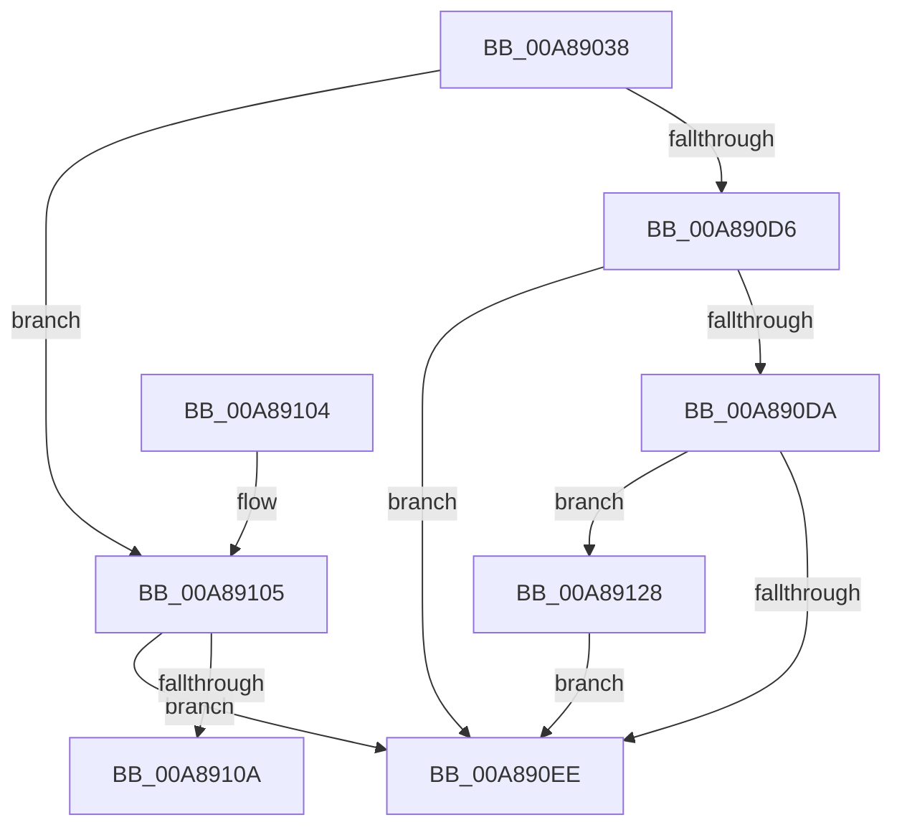

# IopCreateRegistryKeyEx

- RVA: `0x00A89038`–`0x00A8912F` (길이 `247` bytes)
- VA: `0x0000000140A89038`
- 실행 섹션: `PAGE`
- PDB 이름 있음: `예`; PDB Function 태그: `예`
- unwind 정보 RVA: `0x000B8204`
- 디코드: `77`개 명령, `247/247` bytes 표시
- 미해석 바이트: `0` (있으면 어셈블리에 `.byte`로 보존)

> 이 문서는 커널 이미지의 기계어와 PDB 기호를 분석해 생성했습니다. 4번과 5번은 함수 원형과 자료형을 바이너리 사용 방식에서 추정한 C 해석이며 원본 소스 복구 결과는 아닙니다.

## 1. Dependencies

- 직접 호출 지점: **1**; 고유 호출 대상: **1**
- 직접 호출자로 확인된 함수: **18**
- RIP 상대 이미지 참조: **0**

### Outgoing calls
- `0x00A890C8` → [ZwCreateKey](../../text/6A/ZwCreateKey_function_006AD470.md) (function, `0x006AD470`)

### Direct callers
- [IoSetSystemPartition](../71/IoSetSystemPartition_function_0071DF90.md) at `0x0071E04A`
- [PipHardwareConfigTriggerRespecialize](../72/PipHardwareConfigTriggerRespecialize_function_0072364C.md) at `0x0072369C`
- [IopWriteResourceList](../72/IopWriteResourceList_function_0072A5F0.md) at `0x0072A62C`
- [IopWriteResourceList](../72/IopWriteResourceList_function_0072A5F0.md) at `0x0072A658`
- [NtDisableLastKnownGood](../83/NtDisableLastKnownGood_function_0083C560.md) at `0x0083C60D`
- [PiDevCfgConfigureSoftwareDevices](../96/PiDevCfgConfigureSoftwareDevices_function_009652EC.md) at `0x00965398`
- [PipOpenServiceEnumKeys](../99/PipOpenServiceEnumKeys_function_00998E94.md) at `0x00998FB2`
- [IopUpdateSecureDeviceClassState](../9A/IopUpdateSecureDeviceClassState_function_009A2CE8.md) at `0x009A2E46`
- [PnpBuildCmResourceList](../AA/PnpBuildCmResourceList_function_00AAB034.md) at `0x00AAB371`
- [sub_00B2D22A](../B2/Unknown_function_00B2D22A.md) at `0x00B2D34A`
- [sub_00B2D22A](../B2/Unknown_function_00B2D22A.md) at `0x00B2D383`
- [sub_00B48128](../B4/Unknown_function_00B48128.md) at `0x00B4814B`
- [IopStoreSystemPartitionInformation](../../init/C2/IopStoreSystemPartitionInformation_function_00C2D780.md) at `0x00C2D8EE`
- [IopInitializePlugPlayServices](../../init/C2/IopInitializePlugPlayServices_function_00C2F298.md) at `0x00C2F67B`
- [PiInitFirmwareResources](../../init/C3/PiInitFirmwareResources_function_00C301C8.md) at `0x00C3023A`
- [PiInitFirmwareResources](../../init/C3/PiInitFirmwareResources_function_00C301C8.md) at `0x00C30279`
- [PiInitFirmwareResources](../../init/C3/PiInitFirmwareResources_function_00C301C8.md) at `0x00C302C7`
- [PipHardwareConfigInit](../../init/C3/PipHardwareConfigInit_function_00C30D24.md) at `0x00C30DCA`
- [PipHardwareConfigInit](../../init/C3/PipHardwareConfigInit_function_00C30D24.md) at `0x00C30EAA`
- [PipHardwareConfigInit](../../init/C3/PipHardwareConfigInit_function_00C30D24.md) at `0x00C310A5`
- [IoReportHalResourceUsage](../../init/C3/IoReportHalResourceUsage_function_00C32FB0.md) at `0x00C3302C`
- [IopInitializeResourceMap](../../init/C3/IopInitializeResourceMap_function_00C33198.md) at `0x00C334C9`
- [PnpOpenCCSPnpRegKey](../../init/C3/PnpOpenCCSPnpRegKey_function_00C33658.md) at `0x00C336C0`
- [PipInitComputerIds](../../init/C7/PipInitComputerIds_function_00C74734.md) at `0x00C7483C`
- [PipInitComputerIds](../../init/C7/PipInitComputerIds_function_00C74734.md) at `0x00C74888`

### Static image references
- 디코드된 RIP-relative 메모리 참조가 없습니다.

## 2. Other-region calls and transfers

- 다른 실행 섹션으로 향하는 call: **1**
  - `0x00A890C8` → [ZwCreateKey](../../text/6A/ZwCreateKey_function_006AD470.md) (`PAGE` → `.text`)
- call이 아닌 외부 분기/꼬리 이동: **1**
  - `0x00A89123` → [sub_00B452D2](../B4/Unknown_function_00B452D2.md) (`tail-transfer`)

## 3. Assembly (complete function range)

```asm
00A89038  44 89 4C 24 20                  mov dword ptr [rsp + 0x20], r9d
00A8903D  48 89 4C 24 08                  mov qword ptr [rsp + 8], rcx
00A89042  55                              push rbp
00A89043  53                              push rbx
00A89044  56                              push rsi
00A89045  57                              push rdi
00A89046  41 54                           push r12
00A89048  41 55                           push r13
00A8904A  41 56                           push r14
00A8904C  41 57                           push r15
00A8904E  48 8D 6C 24 F1                  lea rbp, [rsp - 0xf]
00A89053  48 81 EC A8 00 00 00            sub rsp, 0xa8
00A8905A  83 65 EB 00                     and dword ptr [rbp - 0x15], 0
00A8905E  48 8B F9                        mov rdi, rcx
00A89061  83 65 67 00                     and dword ptr [rbp + 0x67], 0
00A89065  45 33 FF                        xor r15d, r15d
00A89068  4C 21 39                        and qword ptr [rcx], r15
00A8906B  41 8B C1                        mov eax, r9d
00A8906E  48 8D 4D 67                     lea rcx, [rbp + 0x67]
00A89072  48 89 55 D7                     mov qword ptr [rbp - 0x29], rdx
00A89076  48 89 4C 24 30                  mov qword ptr [rsp + 0x30], rcx
00A8907B  0F 57 C0                        xorps xmm0, xmm0
00A8907E  8B 4D 77                        mov ecx, dword ptr [rbp + 0x77]
00A89081  45 8D 6F 01                     lea r13d, [r15 + 1]
00A89085  89 4C 24 28                     mov dword ptr [rsp + 0x28], ecx
00A89089  4D 8B F0                        mov r14, r8
00A8908C  4C 21 7C 24 20                  and qword ptr [rsp + 0x20], r15
00A89091  48 8D 4D B7                     lea rcx, [rbp - 0x49]
00A89095  48 8B DA                        mov rbx, rdx
00A89098  4C 89 45 DF                     mov qword ptr [rbp - 0x21], r8
00A8909C  0F 57 C9                        xorps xmm1, xmm1
00A8909F  48 C7 45 CF 30 00 00 00         mov qword ptr [rbp - 0x31], 0x30
00A890A7  83 65 D3 00                     and dword ptr [rbp - 0x2d], 0
00A890AB  4C 8D 45 CF                     lea r8, [rbp - 0x31]
00A890AF  45 33 C9                        xor r9d, r9d
00A890B2  C7 45 E7 40 02 00 00            mov dword ptr [rbp - 0x19], 0x240
00A890B9  8B D0                           mov edx, eax
00A890BB  0F 11 45 AF                     movups xmmword ptr [rbp - 0x51], xmm0
00A890BF  0F 11 4D BF                     movups xmmword ptr [rbp - 0x41], xmm1
00A890C3  F3 0F 7F 45 EF                  movdqu xmmword ptr [rbp - 0x11], xmm0
00A890C8  E8 A3 43 C2 FF                  call 0x1406ad470
00A890CD  8B F0                           mov esi, eax
00A890CF  3D 34 00 00 C0                  cmp eax, 0xc0000034
00A890D4  74 2F                           je 0x140a89105
00A890D6  85 F6                           test esi, esi
00A890D8  78 14                           js 0x140a890ee
00A890DA  41 8B C5                        mov eax, r13d
00A890DD  48 8B 4C C5 AF                  mov rcx, qword ptr [rbp + rax*8 - 0x51]
00A890E2  48 89 0F                        mov qword ptr [rdi], rcx
00A890E5  48 8B 4D 7F                     mov rcx, qword ptr [rbp + 0x7f]
00A890E9  48 85 C9                        test rcx, rcx
00A890EC  75 3A                           jne 0x140a89128
00A890EE  8B C6                           mov eax, esi
00A890F0  48 81 C4 A8 00 00 00            add rsp, 0xa8
00A890F7  41 5F                           pop r15
00A890F9  41 5E                           pop r14
00A890FB  41 5D                           pop r13
00A890FD  41 5C                           pop r12
00A890FF  5F                              pop rdi
00A89100  5E                              pop rsi
00A89101  5B                              pop rbx
00A89102  5D                              pop rbp
00A89103  C3                              ret
00A89104  CC                              int3
00A89105  48 85 DB                        test rbx, rbx
00A89108  74 E4                           je 0x140a890ee
00A8910A  4C 21 7D AF                     and qword ptr [rbp - 0x51], r15
00A8910E  49 8B 7E 08                     mov rdi, qword ptr [r14 + 8]
00A89112  45 0F B7 26                     movzx r12d, word ptr [r14]
00A89116  48 89 5D B7                     mov qword ptr [rbp - 0x49], rbx
00A8911A  33 DB                           xor ebx, ebx
00A8911C  4C 03 E7                        add r12, rdi
00A8911F  44 88 6D 5F                     mov byte ptr [rbp + 0x5f], r13b
00A89123  E9 AA C1 0B 00                  jmp 0x140b452d2
00A89128  8B 45 67                        mov eax, dword ptr [rbp + 0x67]
00A8912B  89 01                           mov dword ptr [rcx], eax
00A8912D  EB BF                           jmp 0x140a890ee
```

## 4. C-style interpretation (structured pseudocode)

```c
__int64 __fastcall IopCreateRegistryKeyEx(__int64 a1, __int64 a2, __int64 a3, int a4, unsigned int a5, __int64 a6)
{
    __int64 result;
    __int64 v_r12;
    __int64 v_r15;
    __int64 v_rbx;
    __int64 v_rsp;
    unsigned __int64 v_stack_m4F;
    unsigned __int64 v_stack_m60;
    unsigned int v_stack_m64;
    unsigned int v_stack_m68;
    unsigned __int64 v_stack_m70;
    unsigned __int64 v_stack_m78;
    unsigned int v_stack_m7C;
    unsigned __int64 v_stack_m80;
    unsigned __int64 v_stack_m90;
    unsigned __int64 v_stack_m98;
    unsigned __int64 v_stack_mA0;
    unsigned __int64 v_stack_mB8;
    unsigned int v_stack_mC0;
    unsigned __int64 v_stack_mC8;
    unsigned __int8 v_stack_p10;
    unsigned int v_stack_p18;
    unsigned int v_stack_p20;
    unsigned __int64 v_stack_p8;

    v_stack_p20 = a4;
    v_stack_p8 = a1;
    v_rsp = (v_rsp) - (168);
    v_r15 = 0;
    v_stack_m78 = a2;
    v_stack_mB8 = v_stack_p18;
    v_stack_mC0 = (unsigned int)((unsigned int)(a5));
    v_stack_m70 = a3;
    v_stack_m80 = 48;
    a4 = 0;
    v_stack_m68 = 576;
    v_stack_mA0 = v_xmm0;
    v_stack_m90 = v_xmm1;
    v_stack_m60 = v_xmm0;
    result = ZwCreateKey(v_stack_m98, (unsigned int)((unsigned int)((unsigned int)(a4))), v_stack_m80, a4);
    if (((unsigned int)(result)) == 0xC0000034ULL) goto loc_00A89105;
    if (sign_flag) goto loc_00A890EE;
    *(unsigned __int64 *)(a1) = *(unsigned __int64 *)(v_stack_m4F + (unsigned int)((unsigned int)(v_r15 + 1)) * 8 - 81);
    if (a6 != 0) goto loc_00A89128;
loc_00A890EE:
    v_rsp = (v_rsp) + (168);
    return (unsigned int)((unsigned int)((unsigned int)((unsigned int)(result))));
loc_00A89105:
    if (a2 == 0) goto loc_00A890EE;
    v_stack_m98 = a2;
    v_rbx = 0;
    v_r12 = (*(unsigned __int16 *)(a3)) + (*(unsigned __int64 *)(a3 + 8));
    v_stack_p10 = (unsigned __int8)(v_r15 + 1);
loc_00A89128:
    *(unsigned int *)(a6) = (unsigned int)((unsigned int)(v_stack_p18));
    goto loc_00A890EE;
}
```

## 5. (Beta) C Style

```c
int64_t IopCreateRegistryKeyEx(void *Arg1, int64_t Arg2, void *Arg3, int32_t Arg4, uint32_t Arg5, int64_t Arg6)
{
    uint8_t *arg1 = (uint8_t *)Arg1;
    uint8_t *arg3 = (uint8_t *)Arg3;

    int64_t result;
    int64_t local_r12;
    int64_t local_r15;
    int64_t local_rbx;
    int64_t local_rsp;
    uint64_t v_stack_m4F;
    uint64_t v_stack_m60;
    uint32_t v_stack_m64;
    uint32_t v_stack_m68;
    uint64_t v_stack_m70;
    uint64_t v_stack_m78;
    uint32_t v_stack_m7C;
    uint64_t v_stack_m80;
    uint64_t v_stack_m90;
    uint64_t v_stack_m98;
    uint64_t v_stack_mA0;
    uint64_t v_stack_mB8;
    uint32_t v_stack_mC0;
    uint64_t v_stack_mC8;
    uint8_t v_stack_p10;
    uint32_t v_stack_p18;
    uint32_t v_stack_p20;
    uint64_t v_stack_p8;

    v_stack_p20 = Arg4;
    v_stack_p8 = Arg1;
    local_rsp = (local_rsp) - (168);
    local_r15 = 0;
    v_stack_m78 = Arg2;
    v_stack_mB8 = v_stack_p18;
    v_stack_mC0 = (uint32_t)((uint32_t)(Arg5));
    v_stack_m70 = Arg3;
    v_stack_m80 = 48;
    Arg4 = 0;
    v_stack_m68 = 576;
    v_stack_mA0 = v_xmm0;
    v_stack_m90 = v_xmm1;
    v_stack_m60 = v_xmm0;
    result = ZwCreateKey(v_stack_m98, (uint32_t)((uint32_t)((uint32_t)(Arg4))), v_stack_m80, Arg4);
    if (((uint32_t)(result)) == 0xC0000034ULL) goto loc_00A89105;
    if (sign_flag) goto loc_00A890EE;
    *(uint64_t *)(arg1) = *(uint64_t *)(v_stack_m4F + (uint32_t)((uint32_t)(local_r15 + 0x1)) * 8 - 0x51);
    if (Arg6 != 0) goto loc_00A89128;
loc_00A890EE:
    local_rsp = (local_rsp) + (168);
    return (uint32_t)((uint32_t)((uint32_t)((uint32_t)(result))));
loc_00A89105:
    if (Arg2 == 0) goto loc_00A890EE;
    v_stack_m98 = Arg2;
    local_rbx = 0;
    local_r12 = (*(uint16_t *)(arg3)) + (*(uint64_t *)(arg3 + 0x8));
    v_stack_p10 = (uint8_t)(local_r15 + 1);
loc_00A89128:
    *(uint32_t *)(Arg6) = (uint32_t)((uint32_t)(v_stack_p18));
    goto loc_00A890EE;
}
```

### 관측된 메모리 오프셋

구조체 형식이 확인되지 않은 접근은 인자 기준의 오프셋으로만 기록했습니다.

| 기준 인자 | 오프셋 표현 | 폭 (bit) | 접근 |
|---|---:|---:|---|
| `Arg1` | `+ 0x0` | `64` | `R/W` |
| `Arg1` | `+ 0x0` | `64` | `W` |
| `Arg3` | `+ 0x0` | `16` | `R` |
| `Arg3` | `+ 0x8` | `64` | `R` |

## 6. Execution-region graph

[열기: 2D/3D 그래프와 함수 탐색 컨트롤 패널](../../../control-panel.html?section=page&rva=0x00A89038&view=graph)

- 2D 그래프는 위에서 아래로 흐르고, 3D 그래프는 빈 공간을 드래그해 회전합니다. Shift+드래그는 이동, 휠은 확대·축소, 함수 노드 선택은 대상 보고서 이동입니다.

### Static fallback


