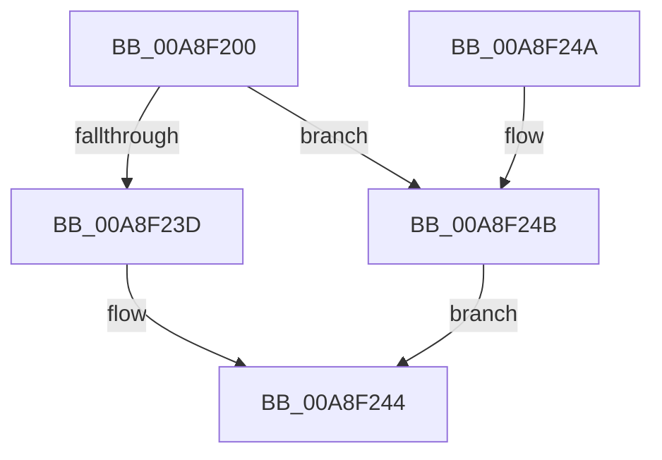

# IopOpenRegistryKey

- RVA: `0x00A8F200`–`0x00A8F26A` (길이 `106` bytes)
- VA: `0x0000000140A8F200`
- 실행 섹션: `PAGE`
- PDB 이름 있음: `예`; PDB Function 태그: `아니요`
- unwind 정보 RVA: `0x000B8BEC`
- 디코드: `28`개 명령, `106/106` bytes 표시
- 미해석 바이트: `0` (있으면 어셈블리에 `.byte`로 보존)

> 이 문서는 커널 이미지의 기계어와 PDB 기호를 분석해 생성했습니다. 4번과 5번은 함수 원형과 자료형을 바이너리 사용 방식에서 추정한 C 해석이며 원본 소스 복구 결과는 아닙니다.

## 1. Dependencies

- 직접 호출 지점: **2**; 고유 호출 대상: **2**
- 직접 호출자로 확인된 함수: **14**
- RIP 상대 이미지 참조: **0**

### Outgoing calls
- `0x00A8F23F` → [ZwOpenKey](../../text/6A/ZwOpenKey_function_006AD310.md) (function, `0x006AD310`)
- `0x00A8F263` → [ZwCreateKey](../../text/6A/ZwCreateKey_function_006AD470.md) (function, `0x006AD470`)

### Direct callers
- [IopAllowRemoteDASD](../../text/4D/IopAllowRemoteDASD_function_004D5BAC.md) at `0x004D5C14`
- [IopInitializeOfflineCrashDump](../../text/59/IopInitializeOfflineCrashDump_function_00595A24.md) at `0x00595AE6`
- [IopIsBitlockerOn](../../text/59/IopIsBitlockerOn_function_00595C3C.md) at `0x00595C81`
- [IopReadDumpRegistry](../../text/59/IopReadDumpRegistry_function_00595CE0.md) at `0x00595D27`
- [IoInitializeLiveDump](../../text/59/IoInitializeLiveDump_function_00598B14.md) at `0x00598B80`
- [IopLiveDumpInitRegistrySettings](../../text/59/IopLiveDumpInitRegistrySettings_function_0059C8A4.md) at `0x0059C8E1`
- [SecureDump_ReadRegistry](../../text/5A/SecureDump_ReadRegistry_function_005A3668.md) at `0x005A36BB`
- [IopInitializeDumpPolicySettings](../71/IopInitializeDumpPolicySettings_function_0071A444.md) at `0x0071A4C6`
- [IopInitializeDumpPolicySettings](../71/IopInitializeDumpPolicySettings_function_0071A444.md) at `0x0071A50B`
- [IopInitializeDumpPolicySettings](../71/IopInitializeDumpPolicySettings_function_0071A444.md) at `0x0071A58D`
- [IopInitializeDumpPolicySettings](../71/IopInitializeDumpPolicySettings_function_0071A444.md) at `0x0071A5D1`
- [IopCopyBootLogRegistryToFile](../71/IopCopyBootLogRegistryToFile_function_0071B19C.md) at `0x0071B2FC`
- [IopCopyBootLogRegistryToFile](../71/IopCopyBootLogRegistryToFile_function_0071B19C.md) at `0x0071B362`
- [IopSymlinkQueryEnabledClasses](../71/IopSymlinkQueryEnabledClasses_function_0071EF6C.md) at `0x0071EFD3`
- [pIoQueryDeviceDescription](../71/pIoQueryDeviceDescription_function_0071F10C.md) at `0x0071F203`
- [pIoQueryDeviceDescription](../71/pIoQueryDeviceDescription_function_0071F10C.md) at `0x0071F2CC`
- [pIoQueryDeviceDescription](../71/pIoQueryDeviceDescription_function_0071F10C.md) at `0x0071F3BE`
- [pIoQueryDeviceDescription](../71/pIoQueryDeviceDescription_function_0071F10C.md) at `0x0071F482`
- [IopUnloadDriver](../AB/IopUnloadDriver_function_00ABF868.md) at `0x00ABFA05`
- [IopSafebootDriverLoad](../AD/IopSafebootDriverLoad_function_00AD2880.md) at `0x00AD297A`
- [IopSafebootDriverLoad](../AD/IopSafebootDriverLoad_function_00AD2880.md) at `0x00AD2997`
- [sub_00B46996](../B4/Unknown_function_00B46996.md) at `0x00B46A94`
- [sub_00B46996](../B4/Unknown_function_00B46996.md) at `0x00B46AB4`

### Static image references
- 디코드된 RIP-relative 메모리 참조가 없습니다.

## 2. Other-region calls and transfers

- 다른 실행 섹션으로 향하는 call: **2**
  - `0x00A8F23F` → [ZwOpenKey](../../text/6A/ZwOpenKey_function_006AD310.md) (`PAGE` → `.text`)
  - `0x00A8F263` → [ZwCreateKey](../../text/6A/ZwCreateKey_function_006AD470.md) (`PAGE` → `.text`)
- 별도 외부 분기/꼬리 이동을 확인하지 못했습니다.

## 3. Assembly (complete function range)

```asm
00A8F200  40 55                           push rbp
00A8F202  48 8B EC                        mov rbp, rsp
00A8F205  48 83 EC 70                     sub rsp, 0x70
00A8F209  41 8B C1                        mov eax, r9d
00A8F20C  4C 89 45 E0                     mov qword ptr [rbp - 0x20], r8
00A8F210  45 33 C9                        xor r9d, r9d
00A8F213  48 C7 45 D0 30 00 00 00         mov qword ptr [rbp - 0x30], 0x30
00A8F21B  4C 8D 45 D0                     lea r8, [rbp - 0x30]
00A8F21F  0F 57 C0                        xorps xmm0, xmm0
00A8F222  48 C7 45 E8 40 02 00 00         mov qword ptr [rbp - 0x18], 0x240
00A8F22A  44 89 4D 18                     mov dword ptr [rbp + 0x18], r9d
00A8F22E  48 89 55 D8                     mov qword ptr [rbp - 0x28], rdx
00A8F232  F3 0F 7F 45 F0                  movdqu xmmword ptr [rbp - 0x10], xmm0
00A8F237  44 38 4D 30                     cmp byte ptr [rbp + 0x30], r9b
00A8F23B  75 0E                           jne 0x140a8f24b
00A8F23D  8B D0                           mov edx, eax
00A8F23F  E8 CC E0 C1 FF                  call 0x1406ad310
00A8F244  48 83 C4 70                     add rsp, 0x70
00A8F248  5D                              pop rbp
00A8F249  C3                              ret
00A8F24A  CC                              int3
00A8F24B  48 8D 55 18                     lea rdx, [rbp + 0x18]
00A8F24F  48 89 54 24 30                  mov qword ptr [rsp + 0x30], rdx
00A8F254  8B D0                           mov edx, eax
00A8F256  C7 44 24 28 01 00 00 00         mov dword ptr [rsp + 0x28], 1
00A8F25E  4C 89 4C 24 20                  mov qword ptr [rsp + 0x20], r9
00A8F263  E8 08 E2 C1 FF                  call 0x1406ad470
00A8F268  EB DA                           jmp 0x140a8f244
```

## 4. C-style interpretation (structured pseudocode)

```c
__int64 __fastcall IopOpenRegistryKey(__int64 a1, __int64 a2, __int64 a3, int a4, unsigned __int8 a5)
{
    __int64 result;
    __int64 v_rsp;
    unsigned __int64 v_stack_m18;
    unsigned __int64 v_stack_m20;
    unsigned __int64 v_stack_m28;
    unsigned __int64 v_stack_m30;
    unsigned __int64 v_stack_m38;
    unsigned int v_stack_p10;
    unsigned __int64 v_stack_p20;
    unsigned int v_stack_p28;
    unsigned __int64 v_stack_p30;

    v_rsp = (v_rsp) - (112);
    v_stack_m28 = a3;
    a4 = 0;
    v_stack_m38 = 48;
    v_stack_m20 = 576;
    v_stack_p10 = 0;
    v_stack_m30 = a2;
    v_stack_m18 = v_xmm0;
    if (a5 != 0) goto loc_00A8F24B;
    result = ZwOpenKey(a1, (unsigned int)((unsigned int)((unsigned int)(a4))), v_stack_m38, a4);
loc_00A8F244:
    v_rsp = (v_rsp) + (112);
    return result;
loc_00A8F24B:
    v_stack_p30 = v_stack_p10;
    v_stack_p28 = 1;
    v_stack_p20 = 0;
    result = ZwCreateKey(a1, (unsigned int)((unsigned int)(result)), v_stack_m38, a4);
    goto loc_00A8F244;
}
```

## 5. (Beta) C Style

```c
int64_t IopOpenRegistryKey(int64_t Arg1, int64_t Arg2, int64_t Arg3, int32_t Arg4, uint8_t Arg5)
{
    int64_t result;
    int64_t local_rsp;
    uint64_t v_stack_m18;
    uint64_t v_stack_m20;
    uint64_t v_stack_m28;
    uint64_t v_stack_m30;
    uint64_t v_stack_m38;
    uint32_t v_stack_p10;
    uint64_t v_stack_p20;
    uint32_t v_stack_p28;
    uint64_t v_stack_p30;

    local_rsp = (local_rsp) - (112);
    v_stack_m28 = Arg3;
    Arg4 = 0;
    v_stack_m38 = 48;
    v_stack_m20 = 576;
    v_stack_p10 = 0;
    v_stack_m30 = Arg2;
    v_stack_m18 = v_xmm0;
    if (Arg5 != 0) goto loc_00A8F24B;
    result = ZwOpenKey(Arg1, (uint32_t)((uint32_t)((uint32_t)(Arg4))), v_stack_m38, Arg4);
loc_00A8F244:
    local_rsp = (local_rsp) + (112);
    return result;
loc_00A8F24B:
    v_stack_p30 = v_stack_p10;
    v_stack_p28 = 1;
    v_stack_p20 = 0;
    result = ZwCreateKey(Arg1, (uint32_t)((uint32_t)(result)), v_stack_m38, Arg4);
    goto loc_00A8F244;
}
```

## 6. Execution-region graph

[열기: 2D/3D 그래프와 함수 탐색 컨트롤 패널](../../../control-panel.html?section=page&rva=0x00A8F200&view=graph)

- 2D 그래프는 위에서 아래로 흐르고, 3D 그래프는 빈 공간을 드래그해 회전합니다. Shift+드래그는 이동, 휠은 확대·축소, 함수 노드 선택은 대상 보고서 이동입니다.

### Static fallback


