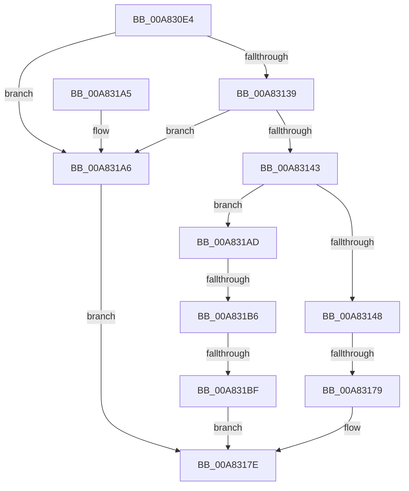

# IopQueryResourceHandlerInterface

- RVA: `0x00A830E4`–`0x00A831C6` (길이 `226` bytes)
- VA: `0x0000000140A830E4`
- 실행 섹션: `PAGE`
- PDB 이름 있음: `예`; PDB Function 태그: `예`
- unwind 정보 RVA: `0x000B738C`
- 디코드: `62`개 명령, `226/226` bytes 표시
- 미해석 바이트: `0` (있으면 어셈블리에 `.byte`로 보존)

> 이 문서는 커널 이미지의 기계어와 PDB 기호를 분석해 생성했습니다. 4번과 5번은 함수 원형과 자료형을 바이너리 사용 방식에서 추정한 C 해석이며 원본 소스 복구 결과는 아닙니다.

## 1. Dependencies

- 직접 호출 지점: **2**; 고유 호출 대상: **2**
- 직접 호출자로 확인된 함수: **4**
- RIP 상대 이미지 참조: **2**

### Outgoing calls
- `0x00A83165` → [ExAllocatePool2](../../poolcode/B8/ExAllocatePool2_function_00B820F0.md) (function, `0x00B820F0`)
- `0x00A83185` → [_security_check_cookie](../../text/6A/_security_check_cookie_function_006AC640.md) (function, `0x006AC640`)

### Direct callers
- [IoTranslateBusAddress](../../text/5A/IoTranslateBusAddress_function_005A5F60.md) at `0x005A6040`
- [IopDuplicateDetection](../72/IopDuplicateDetection_function_0072E4AC.md) at `0x0072E4F9`
- [IopSetupArbiterAndTranslators](IopSetupArbiterAndTranslators_function_00A82E68.md) at `0x00A82FAF`
- [sub_00B43B26](../B4/Unknown_function_00B43B26.md) at `0x00B43B92`

### Static image references
- `0x00A83100` → RVA `0x00E0A740` (`.data`; read)
- `0x00A83148` → RVA `0x0001BCE8` (`.rdata`; read)

## 2. Other-region calls and transfers

- 다른 실행 섹션으로 향하는 call: **2**
  - `0x00A83165` → [ExAllocatePool2](../../poolcode/B8/ExAllocatePool2_function_00B820F0.md) (`PAGE` → `POOLCODE`)
  - `0x00A83185` → [_security_check_cookie](../../text/6A/_security_check_cookie_function_006AC640.md) (`PAGE` → `.text`)
- call이 아닌 외부 분기/꼬리 이동: **3**
  - `0x00A83173` → [sub_00B43D12 + 0x22](../B4/Unknown_function_00B43D12.md) (`tail-transfer`)
  - `0x00A831B0` → [sub_00B43D12 + 0x11](../B4/Unknown_function_00B43D12.md) (`tail-transfer`)
  - `0x00A831B9` → [sub_00B43D12](../B4/Unknown_function_00B43D12.md) (`tail-transfer`)

## 3. Assembly (complete function range)

```asm
00A830E4  48 89 5C 24 08                  mov qword ptr [rsp + 8], rbx
00A830E9  55                              push rbp
00A830EA  56                              push rsi
00A830EB  57                              push rdi
00A830EC  41 54                           push r12
00A830EE  41 55                           push r13
00A830F0  41 56                           push r14
00A830F2  41 57                           push r15
00A830F4  48 8D 6C 24 D9                  lea rbp, [rsp - 0x27]
00A830F9  48 81 EC 90 00 00 00            sub rsp, 0x90
00A83100  48 8B 05 39 76 38 00            mov rax, qword ptr [rip + 0x387639]
00A83107  48 33 C4                        xor rax, rsp
00A8310A  48 89 45 1F                     mov qword ptr [rbp + 0x1f], rax
00A8310E  48 8B 82 38 01 00 00            mov rax, qword ptr [rdx + 0x138]
00A83115  4C 8B F2                        mov r14, rdx
00A83118  0F 57 C0                        xorps xmm0, xmm0
00A8311B  45 0F B6 E0                     movzx r12d, r8b
00A8311F  0F 11 45 0F                     movups xmmword ptr [rbp + 0xf], xmm0
00A83123  4D 8B F9                        mov r15, r9
00A83126  8B F9                           mov edi, ecx
00A83128  48 8B 50 28                     mov rdx, qword ptr [rax + 0x28]
00A8312C  49 8B 46 08                     mov rax, qword ptr [r14 + 8]
00A83130  48 39 82 B0 01 00 00            cmp qword ptr [rdx + 0x1b0], rax
00A83137  74 6D                           je 0x140a831a6
00A83139  41 F7 46 30 00 10 00 00         test dword ptr [r14 + 0x30], 0x1000
00A83141  74 63                           je 0x140a831a6
00A83143  83 E9 01                        sub ecx, 1
00A83146  75 65                           jne 0x140a831ad
00A83148  0F 10 05 99 8B 59 FF            movups xmm0, xmmword ptr [rip - 0xa67467]
00A8314F  8D 59 34                        lea ebx, [rcx + 0x34]
00A83152  0F B7 D3                        movzx edx, bx
00A83155  B9 00 01 00 00                  mov ecx, 0x100
00A8315A  41 B8 50 70 20 20               mov r8d, 0x20207050
00A83160  F3 0F 7F 45 0F                  movdqu xmmword ptr [rbp + 0xf], xmm0
00A83165  E8 86 EF 0F 00                  call 0x140b820f0
00A8316A  45 33 ED                        xor r13d, r13d
00A8316D  48 8B F0                        mov rsi, rax
00A83170  48 85 C0                        test rax, rax
00A83173  0F 85 BB 0B 0C 00               jne 0x140b43d34
00A83179  B8 9A 00 00 C0                  mov eax, 0xc000009a
00A8317E  48 8B 4D 1F                     mov rcx, qword ptr [rbp + 0x1f]
00A83182  48 33 CC                        xor rcx, rsp
00A83185  E8 B6 94 C2 FF                  call 0x1406ac640
00A8318A  48 8B 9C 24 D0 00 00 00         mov rbx, qword ptr [rsp + 0xd0]
00A83192  48 81 C4 90 00 00 00            add rsp, 0x90
00A83199  41 5F                           pop r15
00A8319B  41 5E                           pop r14
00A8319D  41 5D                           pop r13
00A8319F  41 5C                           pop r12
00A831A1  5F                              pop rdi
00A831A2  5E                              pop rsi
00A831A3  5D                              pop rbp
00A831A4  C3                              ret
00A831A5  CC                              int3
00A831A6  B8 BB 00 00 C0                  mov eax, 0xc00000bb
00A831AB  EB D1                           jmp 0x140a8317e
00A831AD  83 E9 01                        sub ecx, 1
00A831B0  0F 84 6D 0B 0C 00               je 0x140b43d23
00A831B6  83 F9 01                        cmp ecx, 1
00A831B9  0F 84 53 0B 0C 00               je 0x140b43d12
00A831BF  B8 0D 00 00 C0                  mov eax, 0xc000000d
00A831C4  EB B8                           jmp 0x140a8317e
```

## 4. C-style interpretation (structured pseudocode)

```c
__int64 __fastcall IopQueryResourceHandlerInterface(int a1, __int64 a2, unsigned __int8 a3, __int64 a4)
{
    __int64 result;
    __int64 v_r13;
    __int64 v_rsp;
    unsigned __int64 v_stack_m40;
    unsigned __int64 v_stack_m50;
    unsigned __int64 v_stack_m5F;
    unsigned __int64 v_stack_p8;

    v_stack_p8 = v_rbx;
    v_rsp = (v_rsp) - (144);
    result = (*(unsigned __int64 *)(v_rip + 3700281)) ^ (v_rsp);
    v_stack_m40 = result;
    v_stack_m50 = v_xmm0;
    if ((*(unsigned __int64 *)(*(unsigned __int64 *)(*(unsigned __int64 *)(a2 + 312) + 40) + 432)) == (*(unsigned __int64 *)(a2 + 8))) goto loc_00A831A6;
    if (((*(unsigned int *)(a2 + 48)) & (0x1000ULL)) == 0) goto loc_00A831A6;
    a1 = (unsigned int)((a1) - (1));
    if (condition_is_not_equal) goto loc_00A831AD;
    v_stack_m50 = v_xmm0;
    result = ExAllocatePool2(256, (unsigned __int16)(a1 + 52), (unsigned int)(0x20207050ULL), a4);
    v_r13 = 0;
loc_00A8317E:
    a1 = (v_stack_m40) ^ (v_rsp);
    result = _security_check_cookie(a1, (unsigned __int16)(a1 + 52), (unsigned int)(0x20207050ULL), a4);
    v_rsp = (v_rsp) + (144);
    return result;
loc_00A831A6:
    goto loc_00A8317E;
loc_00A831AD:
    a1 = (unsigned int)((a1) - (1));
    goto loc_00A8317E;
}
```

## 5. (Beta) C Style

```c
int64_t IopQueryResourceHandlerInterface(void *Arg1, void *Arg2, uint8_t Arg3, int64_t Arg4)
{
    uint8_t *arg1 = (uint8_t *)Arg1;
    uint8_t *arg2 = (uint8_t *)Arg2;

    int64_t result;
    int64_t local_r13;
    int64_t local_rsp;
    uint64_t v_stack_m40;
    uint64_t v_stack_m50;
    uint64_t v_stack_m5F;
    uint64_t v_stack_p8;

    v_stack_p8 = local_rbx;
    local_rsp = (local_rsp) - (144);
    result = (*(uint64_t *)(v_rip + 0x387639)) ^ (local_rsp);
    v_stack_m40 = result;
    v_stack_m50 = v_xmm0;
    if ((*(uint64_t *)(*(uint64_t *)(*(uint64_t *)(arg2 + 0x138) + 0x28) + 0x1B0)) == (*(uint64_t *)(arg2 + 0x8))) goto loc_00A831A6;
    if (((*(uint32_t *)(arg2 + 0x30)) & (0x1000ULL)) == 0) goto loc_00A831A6;
    Arg1 = (uint32_t)((Arg1) - (1));
    if (condition_is_not_equal) goto loc_00A831AD;
    v_stack_m50 = v_xmm0;
    result = ExAllocatePool2(256, (uint16_t)(Arg1 + 52), (uint32_t)(0x20207050ULL), Arg4);
    local_r13 = 0;
loc_00A8317E:
    Arg1 = (v_stack_m40) ^ (local_rsp);
    result = _security_check_cookie(Arg1, (uint16_t)(Arg1 + 52), (uint32_t)(0x20207050ULL), Arg4);
    local_rsp = (local_rsp) + (144);
    return result;
loc_00A831A6:
    goto loc_00A8317E;
loc_00A831AD:
    Arg1 = (uint32_t)((Arg1) - (1));
    goto loc_00A8317E;
}
```

### 관측된 메모리 오프셋

구조체 형식이 확인되지 않은 접근은 인자 기준의 오프셋으로만 기록했습니다.

| 기준 인자 | 오프셋 표현 | 폭 (bit) | 접근 |
|---|---:|---:|---|
| `Arg1` | `+ 0x34` | `32` | `R` |
| `Arg2` | `+ 0x8` | `64` | `R` |
| `Arg2` | `+ 0x30` | `32` | `R` |
| `Arg2` | `+ 0x138` | `64` | `R` |

## 6. Execution-region graph

[열기: 2D/3D 그래프와 함수 탐색 컨트롤 패널](../../../control-panel.html?section=page&rva=0x00A830E4&view=graph)

- 2D 그래프는 위에서 아래로 흐르고, 3D 그래프는 빈 공간을 드래그해 회전합니다. Shift+드래그는 이동, 휠은 확대·축소, 함수 노드 선택은 대상 보고서 이동입니다.

### Static fallback


