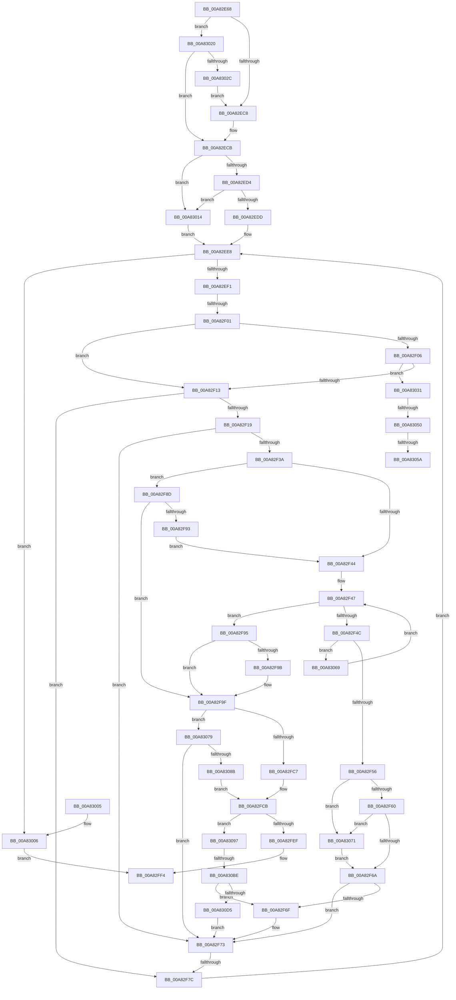

# IopSetupArbiterAndTranslators

- RVA: `0x00A82E68`–`0x00A830DD` (길이 `629` bytes)
- VA: `0x0000000140A82E68`
- 실행 섹션: `PAGE`
- PDB 이름 있음: `예`; PDB Function 태그: `예`
- unwind 정보 RVA: `0x000B7360`
- 디코드: `165`개 명령, `629/629` bytes 표시
- 미해석 바이트: `0` (있으면 어셈블리에 `.byte`로 보존)

> 이 문서는 커널 이미지의 기계어와 PDB 기호를 분석해 생성했습니다. 4번과 5번은 함수 원형과 자료형을 바이너리 사용 방식에서 추정한 C 해석이며 원본 소스 복구 결과는 아닙니다.

## 1. Dependencies

- 직접 호출 지점: **3**; 고유 호출 대상: **3**
- 직접 호출자로 확인된 함수: **1**
- RIP 상대 이미지 참조: **1**

### Outgoing calls
- `0x00A82FAF` → [IopQueryResourceHandlerInterface](IopQueryResourceHandlerInterface_function_00A830E4.md) (function, `0x00A830E4`)
- `0x00A82FDB` → [ExAllocatePool2](../../poolcode/B8/ExAllocatePool2_function_00B820F0.md) (function, `0x00B820F0`)
- `0x00A83040` → [IopFindResourceHandlerInfo](../A9/IopFindResourceHandlerInfo_function_00A9B644.md) (function, `0x00A9B644`)

### Direct callers
- [IopResourceRequirementsListToReqList](IopResourceRequirementsListToReqList_function_00A82954.md) at `0x00A82C9C`

### Static image references
- `0x00A82EF1` → RVA `0x00F8C438` (`.data`; read)

## 2. Other-region calls and transfers

- 다른 실행 섹션으로 향하는 call: **1**
  - `0x00A82FDB` → [ExAllocatePool2](../../poolcode/B8/ExAllocatePool2_function_00B820F0.md) (`PAGE` → `POOLCODE`)
- call이 아닌 외부 분기/꼬리 이동: **6**
  - `0x00A82EFB` → [sub_00B43B26](../B4/Unknown_function_00B43B26.md) (`tail-transfer`)
  - `0x00A82F76` → [sub_00B43B26 + 0x183](../B4/Unknown_function_00B43B26.md) (`tail-transfer`)
  - `0x00A8304A` → [sub_00B43B26 + 0x136](../B4/Unknown_function_00B43B26.md) (`tail-transfer`)
  - `0x00A83054` → [sub_00B43B26 + 0x5C](../B4/Unknown_function_00B43B26.md) (`tail-transfer`)
  - `0x00A83064` → [sub_00B43B26 + 0x60](../B4/Unknown_function_00B43B26.md) (`tail-transfer`)
  - `0x00A830B8` → [sub_00B43B26 + 0x1E5](../B4/Unknown_function_00B43B26.md) (`tail-transfer`)

## 3. Assembly (complete function range)

```asm
00A82E68  40 55                           push rbp
00A82E6A  53                              push rbx
00A82E6B  56                              push rsi
00A82E6C  57                              push rdi
00A82E6D  41 54                           push r12
00A82E6F  41 55                           push r13
00A82E71  41 56                           push r14
00A82E73  41 57                           push r15
00A82E75  48 8B EC                        mov rbp, rsp
00A82E78  48 83 EC 58                     sub rsp, 0x58
00A82E7C  45 33 DB                        xor r11d, r11d
00A82E7F  C6 45 50 01                     mov byte ptr [rbp + 0x50], 1
00A82E83  4C 8B F9                        mov r15, rcx
00A82E86  4C 89 5D D8                     mov qword ptr [rbp - 0x28], r11
00A82E8A  48 8B 49 48                     mov rcx, qword ptr [rcx + 0x48]
00A82E8E  45 8A E3                        mov r12b, r11b
00A82E91  48 89 4D 60                     mov qword ptr [rbp + 0x60], rcx
00A82E95  45 8A C3                        mov r8b, r11b
00A82E98  4C 89 5D E0                     mov qword ptr [rbp - 0x20], r11
00A82E9C  49 8B 47 20                     mov rax, qword ptr [r15 + 0x20]
00A82EA0  44 88 5D 48                     mov byte ptr [rbp + 0x48], r11b
00A82EA4  4C 89 5D 58                     mov qword ptr [rbp + 0x58], r11
00A82EA8  48 8B 50 40                     mov rdx, qword ptr [rax + 0x40]
00A82EAC  0F B6 42 01                     movzx eax, byte ptr [rdx + 1]
00A82EB0  41 8D 53 03                     lea edx, [r11 + 3]
00A82EB4  3C 07                           cmp al, 7
00A82EB6  8B F0                           mov esi, eax
00A82EB8  41 8B 47 50                     mov eax, dword ptr [r15 + 0x50]
00A82EBC  0F 44 F2                        cmove esi, edx
00A82EBF  83 F8 01                        cmp eax, 1
00A82EC2  0F 84 58 01 00 00               je 0x140a83020
00A82EC8  45 8A EB                        mov r13b, r11b
00A82ECB  48 85 C9                        test rcx, rcx
00A82ECE  0F 84 40 01 00 00               je 0x140a83014
00A82ED4  83 F8 01                        cmp eax, 1
00A82ED7  0F 84 37 01 00 00               je 0x140a83014
00A82EDD  48 8B 81 38 01 00 00            mov rax, qword ptr [rcx + 0x138]
00A82EE4  48 8B 58 28                     mov rbx, qword ptr [rax + 0x28]
00A82EE8  48 85 DB                        test rbx, rbx
00A82EEB  0F 84 15 01 00 00               je 0x140a83006
00A82EF1  4C 8B 0D 40 95 50 00            mov r9, qword ptr [rip + 0x509540]
00A82EF8  49 3B D9                        cmp rbx, r9
00A82EFB  0F 84 25 0C 0C 00               je 0x140b43b26
00A82F01  45 84 E4                        test r12b, r12b
00A82F04  75 0D                           jne 0x140a82f13
00A82F06  4C 8B 73 20                     mov r14, qword ptr [rbx + 0x20]
00A82F0A  4C 3B F1                        cmp r14, rcx
00A82F0D  0F 85 1E 01 00 00               jne 0x140a83031
00A82F13  44 38 5D 50                     cmp byte ptr [rbp + 0x50], r11b
00A82F17  74 63                           je 0x140a82f7c
00A82F19  40 8A CE                        mov cl, sil
00A82F1C  48 8D 93 F8 01 00 00            lea rdx, [rbx + 0x1f8]
00A82F23  41 BE 01 00 00 00               mov r14d, 1
00A82F29  49 8B FB                        mov rdi, r11
00A82F2C  66 41 D3 E6                     shl r14w, cl
00A82F30  66 44 85 B3 08 02 00 00         test word ptr [rbx + 0x208], r14w
00A82F38  75 39                           jne 0x140a82f73
00A82F3A  66 44 85 B3 0A 02 00 00         test word ptr [rbx + 0x20a], r14w
00A82F42  74 49                           je 0x140a82f8d
00A82F44  48 8B 02                        mov rax, qword ptr [rdx]
00A82F47  48 3B C2                        cmp rax, rdx
00A82F4A  74 49                           je 0x140a82f95
00A82F4C  40 38 70 10                     cmp byte ptr [rax + 0x10], sil
00A82F50  0F 85 13 01 00 00               jne 0x140a83069
00A82F56  40 80 FE 0F                     cmp sil, 0xf
00A82F5A  0F 86 11 01 00 00               jbe 0x140a83071
00A82F60  4C 39 58 18                     cmp qword ptr [rax + 0x18], r11
00A82F64  0F 85 07 01 00 00               jne 0x140a83071
00A82F6A  48 85 FF                        test rdi, rdi
00A82F6D  74 04                           je 0x140a82f73
00A82F6F  C6 45 48 01                     mov byte ptr [rbp + 0x48], 1
00A82F73  45 84 E4                        test r12b, r12b
00A82F76  0F 84 2D 0D 0C 00               je 0x140b43ca9
00A82F7C  48 8B 5B 10                     mov rbx, qword ptr [rbx + 0x10]
00A82F80  48 8B 4D 60                     mov rcx, qword ptr [rbp + 0x60]
00A82F84  44 8A 45 48                     mov r8b, byte ptr [rbp + 0x48]
00A82F88  E9 5B FF FF FF                  jmp 0x140a82ee8
00A82F8D  40 80 FE 0F                     cmp sil, 0xf
00A82F91  76 0C                           jbe 0x140a82f9f
00A82F93  EB AF                           jmp 0x140a82f44
00A82F95  40 80 FE 0F                     cmp sil, 0xf
00A82F99  76 04                           jbe 0x140a82f9f
00A82F9B  45 0F B7 F3                     movzx r14d, r11w
00A82F9F  48 8B 53 20                     mov rdx, qword ptr [rbx + 0x20]
00A82FA3  4C 8D 4D 58                     lea r9, [rbp + 0x58]
00A82FA7  44 8A C6                        mov r8b, sil
00A82FAA  B9 01 00 00 00                  mov ecx, 1
00A82FAF  E8 30 01 00 00                  call 0x140a830e4
00A82FB4  66 44 09 B3 0A 02 00 00         or word ptr [rbx + 0x20a], r14w
00A82FBC  45 33 DB                        xor r11d, r11d
00A82FBF  85 C0                           test eax, eax
00A82FC1  0F 88 B2 00 00 00               js 0x140a83079
00A82FC7  4C 8B 75 58                     mov r14, qword ptr [rbp + 0x58]
00A82FCB  BA 28 00 00 00                  mov edx, 0x28
00A82FD0  B9 00 01 00 00                  mov ecx, 0x100
00A82FD5  41 B8 50 70 20 20               mov r8d, 0x20207050
00A82FDB  E8 10 F1 0F 00                  call 0x140b820f0
00A82FE0  45 33 DB                        xor r11d, r11d
00A82FE3  48 8B F8                        mov rdi, rax
00A82FE6  48 85 C0                        test rax, rax
00A82FE9  0F 85 A8 00 00 00               jne 0x140a83097
00A82FEF  B8 9A 00 00 C0                  mov eax, 0xc000009a
00A82FF4  48 83 C4 58                     add rsp, 0x58
00A82FF8  41 5F                           pop r15
00A82FFA  41 5E                           pop r14
00A82FFC  41 5D                           pop r13
00A82FFE  41 5C                           pop r12
00A83000  5F                              pop rdi
00A83001  5E                              pop rsi
00A83002  5B                              pop rbx
00A83003  5D                              pop rbp
00A83004  C3                              ret
00A83005  CC                              int3
00A83006  41 F6 DC                        neg r12b
00A83009  1B C0                           sbb eax, eax
00A8300B  F7 D0                           not eax
00A8300D  25 8A 00 00 C0                  and eax, 0xc000008a
00A83012  EB E0                           jmp 0x140a82ff4
00A83014  48 8B 1D 1D 94 50 00            mov rbx, qword ptr [rip + 0x50941d]
00A8301B  E9 C8 FE FF FF                  jmp 0x140a82ee8
00A83020  41 B5 01                        mov r13b, 1
00A83023  45 39 1F                        cmp dword ptr [r15], r11d
00A83026  0F 84 9F FE FF FF               je 0x140a82ecb
00A8302C  E9 97 FE FF FF                  jmp 0x140a82ec8
00A83031  4C 8D 4D D8                     lea r9, [rbp - 0x28]
00A83035  44 8A C6                        mov r8b, sil
00A83038  48 8B D3                        mov rdx, rbx
00A8303B  B9 02 00 00 00                  mov ecx, 2
00A83040  E8 FF 85 01 00                  call 0x140a9b644
00A83045  45 33 DB                        xor r11d, r11d
00A83048  84 C0                           test al, al
00A8304A  0F 85 0C 0C 0C 00               jne 0x140b43c5c
00A83050  40 80 FE 0F                     cmp sil, 0xf
00A83054  0F 87 28 0B 0C 00               ja 0x140b43b82
00A8305A  40 8A CE                        mov cl, sil
00A8305D  41 8D 7B 01                     lea edi, [r11 + 1]
00A83061  66 D3 E7                        shl di, cl
00A83064  E9 1D 0B 0C 00                  jmp 0x140b43b86
00A83069  48 8B 00                        mov rax, qword ptr [rax]
00A8306C  E9 D6 FE FF FF                  jmp 0x140a82f47
00A83071  48 8B F8                        mov rdi, rax
00A83074  E9 F1 FE FF FF                  jmp 0x140a82f6a
00A83079  66 44 09 B3 08 02 00 00         or word ptr [rbx + 0x208], r14w
00A83081  40 80 FE 0F                     cmp sil, 0xf
00A83085  0F 86 E8 FE FF FF               jbe 0x140a82f73
00A8308B  4D 8B F3                        mov r14, r11
00A8308E  4C 89 5D 58                     mov qword ptr [rbp + 0x58], r11
00A83092  E9 34 FF FF FF                  jmp 0x140a82fcb
00A83097  40 88 70 10                     mov byte ptr [rax + 0x10], sil
00A8309B  48 89 78 08                     mov qword ptr [rax + 8], rdi
00A8309F  48 89 38                        mov qword ptr [rax], rdi
00A830A2  4C 89 70 18                     mov qword ptr [rax + 0x18], r14
00A830A6  48 89 58 20                     mov qword ptr [rax + 0x20], rbx
00A830AA  48 8D 83 F8 01 00 00            lea rax, [rbx + 0x1f8]
00A830B1  48 8B 48 08                     mov rcx, qword ptr [rax + 8]
00A830B5  48 39 01                        cmp qword ptr [rcx], rax
00A830B8  0F 85 4D 0C 0C 00               jne 0x140b43d0b
00A830BE  48 89 07                        mov qword ptr [rdi], rax
00A830C1  48 89 4F 08                     mov qword ptr [rdi + 8], rcx
00A830C5  48 89 39                        mov qword ptr [rcx], rdi
00A830C8  48 89 78 08                     mov qword ptr [rax + 8], rdi
00A830CC  4D 85 F6                        test r14, r14
00A830CF  0F 85 9A FE FF FF               jne 0x140a82f6f
00A830D5  49 8B FB                        mov rdi, r11
00A830D8  E9 96 FE FF FF                  jmp 0x140a82f73
```

## 4. C-style interpretation (structured pseudocode)

```c
__int64 __fastcall IopSetupArbiterAndTranslators(__int64 a1)
{
    __int64 result;
    __int64 v_r11;
    __int64 v_r12;
    __int64 v_r14;
    __int64 v_rdi;
    __int64 v_rsi;
    __int64 v_rsp;
    unsigned __int64 v_stack_m60;
    unsigned __int64 v_stack_m68;
    unsigned __int8 v_stack_p10;
    unsigned __int64 v_stack_p18;
    unsigned __int64 v_stack_p20;
    unsigned __int8 v_stack_p8;

    v_rsp = (v_rsp) - (88);
    v_r11 = 0;
    v_stack_p10 = 1;
    v_stack_m68 = 0;
    v_stack_p20 = *(unsigned __int64 *)(a1 + 72);
    v_stack_m60 = 0;
    v_stack_p8 = 0;
    v_stack_p18 = 0;
    v_rsi = (unsigned int)((unsigned int)(*(unsigned __int8 *)(*(unsigned __int64 *)(*(unsigned __int64 *)(a1 + 32) + 64) + 1)));
    if (((unsigned __int8)(*(unsigned __int8 *)(*(unsigned __int64 *)(*(unsigned __int64 *)(a1 + 32) + 64) + 1))) == 7) { v_rsi = (unsigned int)(v_r11 + 3); }
    if (((unsigned int)((unsigned int)(*(unsigned int *)(a1 + 80)))) == 1) goto loc_00A83020;
loc_00A82EC8:
loc_00A82ECB:
    if (*(unsigned __int64 *)(a1 + 72) == 0) goto loc_00A83014;
    if (((unsigned int)((unsigned int)(*(unsigned int *)(a1 + 80)))) == 1) goto loc_00A83014;
loc_00A82EE8:
    if (*(unsigned __int64 *)(*(unsigned __int64 *)(*(unsigned __int64 *)(a1 + 72) + 312) + 40) == 0) goto loc_00A83006;
    if (0 != 0) goto loc_00A82F13;
    if ((*(unsigned __int64 *)(*(unsigned __int64 *)(*(unsigned __int64 *)(*(unsigned __int64 *)(a1 + 72) + 312) + 40) + 32)) != (*(unsigned __int64 *)(a1 + 72))) goto loc_00A83031;
loc_00A82F13:
    if (v_stack_p10 == 0) goto loc_00A82F7C;
    v_r14 = (unsigned __int16)((1) << ((unsigned __int8)((unsigned __int8)(v_rsi))));
    if (((*(unsigned __int16 *)(*(unsigned __int64 *)(*(unsigned __int64 *)(*(unsigned __int64 *)(a1 + 72) + 312) + 40) + 520)) & ((unsigned __int16)(v_r14))) != 0) goto loc_00A82F73;
    if (((*(unsigned __int16 *)(*(unsigned __int64 *)(*(unsigned __int64 *)(*(unsigned __int64 *)(a1 + 72) + 312) + 40) + 522)) & ((unsigned __int16)(v_r14))) == 0) goto loc_00A82F8D;
loc_00A82F44:
loc_00A82F47:
    if ((*(unsigned __int64 *)(*(unsigned __int64 *)(*(unsigned __int64 *)(*(unsigned __int64 *)(a1 + 72) + 312) + 40) + 504)) == (*(unsigned __int64 *)(*(unsigned __int64 *)(*(unsigned __int64 *)(a1 + 72) + 312) + 40) + 504)) goto loc_00A82F95;
    if ((*(unsigned __int8 *)(*(unsigned __int64 *)(*(unsigned __int64 *)(*(unsigned __int64 *)(*(unsigned __int64 *)(a1 + 72) + 312) + 40) + 504) + 16)) != ((unsigned __int8)(v_rsi))) goto loc_00A83069;
    if (((unsigned __int8)(v_rsi)) <= 15) goto loc_00A83071;
    if ((*(unsigned __int64 *)(*(unsigned __int64 *)(*(unsigned __int64 *)(*(unsigned __int64 *)(*(unsigned __int64 *)(a1 + 72) + 312) + 40) + 504) + 24)) != 0) goto loc_00A83071;
loc_00A82F6A:
    if (0 != 0) {
        v_stack_p8 = 1;
    }
loc_00A82F7C:
    goto loc_00A82EE8;
loc_00A82F8D:
    if (((unsigned __int8)(v_rsi)) <= 15) goto loc_00A82F9F;
    goto loc_00A82F44;
loc_00A82F95:
    if (((unsigned __int8)(v_rsi)) >= = 15) {
        v_r14 = 0;
    }
    result = IopQueryResourceHandlerInterface(1, *(unsigned __int64 *)(*(unsigned __int64 *)(*(unsigned __int64 *)(*(unsigned __int64 *)(*(unsigned __int64 *)(a1 + 72) + 312) + 40) + 16) + 32), (unsigned __int8)(v_rsi), v_stack_p18);
    v_r11 = 0;
    if (sign_flag) goto loc_00A83079;
loc_00A82FCB:
    result = ExAllocatePool2(256, 40, (unsigned int)(0x20207050ULL), v_stack_p18);
    v_r11 = 0;
    if (result != 0) goto loc_00A83097;
loc_00A82FF4:
    v_rsp = (v_rsp) + (88);
    return (unsigned int)(0xC000009AULL);
loc_00A83006:
    v_r12 = (unsigned __int8)(-(0));
    result = (unsigned int)(~((unsigned int)(0xC000009AULL)));
    result = (unsigned int)((result) & (0xC000008AULL));
    goto loc_00A82FF4;
loc_00A83014:
    goto loc_00A82EE8;
loc_00A83020:
    if ((*(unsigned int *)(a1)) == 0) goto loc_00A82ECB;
    goto loc_00A82EC8;
loc_00A83031:
    result = IopFindResourceHandlerInfo(2, *(unsigned __int64 *)(v_rip + 5280797), (unsigned __int8)(v_rsi), v_stack_m68);
    v_r11 = 0;
    v_rdi = (unsigned __int16)((v_r11 + 1) << ((unsigned __int8)((unsigned __int8)(v_rsi))));
loc_00A83069:
    goto loc_00A82F47;
loc_00A83071:
    goto loc_00A82F6A;
loc_00A83079:
    if (((unsigned __int8)(v_rsi)) <= 15) goto loc_00A82F73;
    v_stack_p18 = 0;
    goto loc_00A82FCB;
loc_00A83097:
    *(unsigned __int8 *)(*(unsigned __int64 *)(result) + 16) = (unsigned __int8)(v_rsi);
    *(unsigned __int64 *)(*(unsigned __int64 *)(result) + 8) = *(unsigned __int64 *)(result);
    *(unsigned __int64 *)(*(unsigned __int64 *)(result)) = *(unsigned __int64 *)(result);
    *(unsigned __int64 *)(*(unsigned __int64 *)(result) + 24) = 0;
    *(unsigned __int64 *)(*(unsigned __int64 *)(result) + 32) = *(unsigned __int64 *)(v_rip + 5280797);
    *(unsigned __int64 *)(*(unsigned __int64 *)(result)) = *(unsigned __int64 *)(v_rip + 5280797) + 504;
    *(unsigned __int64 *)(*(unsigned __int64 *)(result) + 8) = *(unsigned __int64 *)(*(unsigned __int64 *)(v_rip + 5280797) + 504 + 8);
    *(unsigned __int64 *)(*(unsigned __int64 *)(*(unsigned __int64 *)(v_rip + 5280797) + 504 + 8)) = *(unsigned __int64 *)(result);
    *(unsigned __int64 *)(*(unsigned __int64 *)(v_rip + 5280797) + 504 + 8) = *(unsigned __int64 *)(result);
    if (0 != 0) goto loc_00A82F6F;
    goto loc_00A82F73;
}
```

## 5. (Beta) C Style

```c
int64_t IopSetupArbiterAndTranslators(void *Arg1)
{
    uint8_t *arg1 = (uint8_t *)Arg1;

    int64_t result;
    int64_t local_r11;
    int64_t local_r12;
    int64_t local_r14;
    int64_t local_rdi;
    int64_t local_rsi;
    int64_t local_rsp;
    uint64_t v_stack_m60;
    uint64_t v_stack_m68;
    uint8_t v_stack_p10;
    uint64_t v_stack_p18;
    uint64_t v_stack_p20;
    uint8_t v_stack_p8;

    local_rsp = (local_rsp) - (88);
    local_r11 = 0;
    v_stack_p10 = 1;
    v_stack_m68 = 0;
    v_stack_p20 = *(uint64_t *)(arg1 + 0x48);
    v_stack_m60 = 0;
    v_stack_p8 = 0;
    v_stack_p18 = 0;
    local_rsi = (uint32_t)((uint32_t)(*(uint8_t *)(*(uint64_t *)(*(uint64_t *)(arg1 + 0x20) + 0x40) + 0x1)));
    if (((uint8_t)(*(uint8_t *)(*(uint64_t *)(*(uint64_t *)(arg1 + 0x20) + 0x40) + 0x1))) == 7) { local_rsi = (uint32_t)(local_r11 + 3); }
    if (((uint32_t)((uint32_t)(*(uint32_t *)(arg1 + 0x50)))) == 1) goto loc_00A83020;
loc_00A82EC8:
loc_00A82ECB:
    if (*(uint64_t *)(arg1 + 0x48) == 0) goto loc_00A83014;
    if (((uint32_t)((uint32_t)(*(uint32_t *)(arg1 + 0x50)))) == 1) goto loc_00A83014;
loc_00A82EE8:
    if (*(uint64_t *)(*(uint64_t *)(*(uint64_t *)(arg1 + 0x48) + 0x138) + 0x28) == 0) goto loc_00A83006;
    if (0 != 0) goto loc_00A82F13;
    if ((*(uint64_t *)(*(uint64_t *)(*(uint64_t *)(*(uint64_t *)(arg1 + 0x48) + 0x138) + 0x28) + 0x20)) != (*(uint64_t *)(arg1 + 0x48))) goto loc_00A83031;
loc_00A82F13:
    if (v_stack_p10 == 0) goto loc_00A82F7C;
    local_r14 = (uint16_t)((1) << ((uint8_t)((uint8_t)(local_rsi))));
    if (((*(uint16_t *)(*(uint64_t *)(*(uint64_t *)(*(uint64_t *)(arg1 + 0x48) + 0x138) + 0x28) + 0x208)) & ((uint16_t)(local_r14))) != 0) goto loc_00A82F73;
    if (((*(uint16_t *)(*(uint64_t *)(*(uint64_t *)(*(uint64_t *)(arg1 + 0x48) + 0x138) + 0x28) + 0x20A)) & ((uint16_t)(local_r14))) == 0) goto loc_00A82F8D;
loc_00A82F44:
loc_00A82F47:
    if ((*(uint64_t *)(*(uint64_t *)(*(uint64_t *)(*(uint64_t *)(arg1 + 0x48) + 0x138) + 0x28) + 0x1F8)) == (*(uint64_t *)(*(uint64_t *)(*(uint64_t *)(arg1 + 0x48) + 0x138) + 0x28) + 504)) goto loc_00A82F95;
    if ((*(uint8_t *)(*(uint64_t *)(*(uint64_t *)(*(uint64_t *)(*(uint64_t *)(arg1 + 0x48) + 0x138) + 0x28) + 0x1F8) + 0x10)) != ((uint8_t)(local_rsi))) goto loc_00A83069;
    if (((uint8_t)(local_rsi)) <= 15) goto loc_00A83071;
    if ((*(uint64_t *)(*(uint64_t *)(*(uint64_t *)(*(uint64_t *)(*(uint64_t *)(arg1 + 0x48) + 0x138) + 0x28) + 0x1F8) + 0x18)) != 0) goto loc_00A83071;
loc_00A82F6A:
    if (0 != 0) {
        v_stack_p8 = 1;
    }
loc_00A82F7C:
    goto loc_00A82EE8;
loc_00A82F8D:
    if (((uint8_t)(local_rsi)) <= 15) goto loc_00A82F9F;
    goto loc_00A82F44;
loc_00A82F95:
    if (((uint8_t)(local_rsi)) >= = 15) {
        local_r14 = 0;
    }
    result = IopQueryResourceHandlerInterface(1, *(uint64_t *)(*(uint64_t *)(*(uint64_t *)(*(uint64_t *)(*(uint64_t *)(arg1 + 0x48) + 0x138) + 0x28) + 0x10) + 0x20), (uint8_t)(local_rsi), v_stack_p18);
    local_r11 = 0;
    if (sign_flag) goto loc_00A83079;
loc_00A82FCB:
    result = ExAllocatePool2(256, 40, (uint32_t)(0x20207050ULL), v_stack_p18);
    local_r11 = 0;
    if (result != 0) goto loc_00A83097;
loc_00A82FF4:
    local_rsp = (local_rsp) + (88);
    return (uint32_t)(0xC000009AULL);
loc_00A83006:
    local_r12 = (uint8_t)(-(0));
    result = (uint32_t)(~((uint32_t)(0xC000009AULL)));
    result = (uint32_t)((result) & (0xC000008AULL));
    goto loc_00A82FF4;
loc_00A83014:
    goto loc_00A82EE8;
loc_00A83020:
    if ((*(uint32_t *)(arg1)) == 0) goto loc_00A82ECB;
    goto loc_00A82EC8;
loc_00A83031:
    result = IopFindResourceHandlerInfo(2, *(uint64_t *)(v_rip + 0x50941D), (uint8_t)(local_rsi), v_stack_m68);
    local_r11 = 0;
    local_rdi = (uint16_t)((local_r11 + 1) << ((uint8_t)((uint8_t)(local_rsi))));
loc_00A83069:
    goto loc_00A82F47;
loc_00A83071:
    goto loc_00A82F6A;
loc_00A83079:
    if (((uint8_t)(local_rsi)) <= 15) goto loc_00A82F73;
    v_stack_p18 = 0;
    goto loc_00A82FCB;
loc_00A83097:
    *(uint8_t *)(*(uint64_t *)(result) + 0x10) = (uint8_t)(local_rsi);
    *(uint64_t *)(*(uint64_t *)(result) + 0x8) = *(uint64_t *)(result);
    *(uint64_t *)(*(uint64_t *)(result)) = *(uint64_t *)(result);
    *(uint64_t *)(*(uint64_t *)(result) + 0x18) = 0;
    *(uint64_t *)(*(uint64_t *)(result) + 0x20) = *(uint64_t *)(v_rip + 0x50941D);
    *(uint64_t *)(*(uint64_t *)(result)) = *(uint64_t *)(v_rip + 0x50941D) + 504;
    *(uint64_t *)(*(uint64_t *)(result) + 0x8) = *(uint64_t *)(*(uint64_t *)(v_rip + 0x50941D) + 0x1F8 + 0x8);
    *(uint64_t *)(*(uint64_t *)(*(uint64_t *)(v_rip + 0x50941D) + 0x1F8 + 0x8)) = *(uint64_t *)(result);
    *(uint64_t *)(*(uint64_t *)(v_rip + 0x50941D) + 0x1F8 + 0x8) = *(uint64_t *)(result);
    if (0 != 0) goto loc_00A82F6F;
    goto loc_00A82F73;
}
```

### 관측된 메모리 오프셋

구조체 형식이 확인되지 않은 접근은 인자 기준의 오프셋으로만 기록했습니다.

| 기준 인자 | 오프셋 표현 | 폭 (bit) | 접근 |
|---|---:|---:|---|
| `Arg1` | `+ 0x0` | `32` | `R` |
| `Arg1` | `+ 0x20` | `64` | `R` |
| `Arg1` | `+ 0x48` | `64` | `R` |
| `Arg1` | `+ 0x50` | `32` | `R` |

## 6. Execution-region graph

[열기: 2D/3D 그래프와 함수 탐색 컨트롤 패널](../../../control-panel.html?section=page&rva=0x00A82E68&view=graph)

- 2D 그래프는 위에서 아래로 흐르고, 3D 그래프는 빈 공간을 드래그해 회전합니다. Shift+드래그는 이동, 휠은 확대·축소, 함수 노드 선택은 대상 보고서 이동입니다.

### Static fallback


