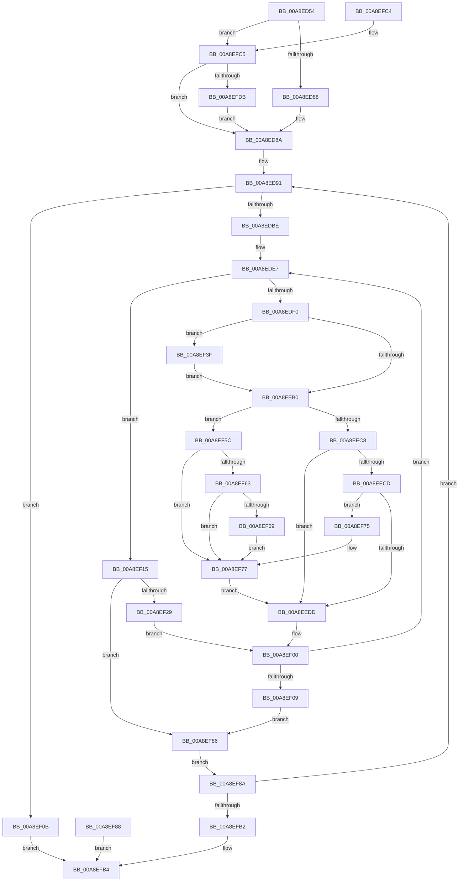

# KeQueryCpuSetInformation

- RVA: `0x00A8ED54`–`0x00A8EFE3` (길이 `655` bytes)
- VA: `0x0000000140A8ED54`
- 실행 섹션: `PAGE`
- PDB 이름 있음: `예`; PDB Function 태그: `아니요`
- unwind 정보 RVA: `0x000B8B24`
- 디코드: `163`개 명령, `655/655` bytes 표시
- 미해석 바이트: `0` (있으면 어셈블리에 `.byte`로 보존)

> 이 문서는 커널 이미지의 기계어와 PDB 기호를 분석해 생성했습니다. 4번과 5번은 함수 원형과 자료형을 바이너리 사용 방식에서 추정한 C 해석이며 원본 소스 복구 결과는 아닙니다.

## 1. Dependencies

- 직접 호출 지점: **4**; 고유 호출 대상: **4**
- 직접 호출자로 확인된 함수: **1**
- RIP 상대 이미지 참조: **5**

### Outgoing calls
- `0x00A8ED98` → [RtlBeginReadTickLock](../../text/39/RtlBeginReadTickLock_function_0039D2A0.md) (function, `0x0039D2A0`)
- `0x00A8EDC6` → [memset](../../text/6C/memset_function_006C6C40.md) (function, `0x006C6C40`)
- `0x00A8EE1F` → [KiGetCpuSetData](../../text/4B/KiGetCpuSetData_function_004BE2A0.md) (function, `0x004BE2A0`)
- `0x00A8EF96` → [RtlTryEndReadTickLock](../../text/41/RtlTryEndReadTickLock_function_0041E4E0.md) (function, `0x0041E4E0`)

### Direct callers
- [ExpQuerySystemInformation](../A5/ExpQuerySystemInformation_function_00A57858.md) at `0x00A5A93C`

### Static image references
- `0x00A8ED8A` → RVA `0x00000000` (`image boundary/outside`; read)
- `0x00A8ED91` → RVA `0x00FC6BF8` (`ALMOSTRO`; read)
- `0x00A8EDA2` → RVA `0x00FC6FD0` (`ALMOSTRO`; read)
- `0x00A8EDDB` → RVA `0x00FC8820` (`ALMOSTRO`; read)
- `0x00A8EF1D` → RVA `0x00FC5018` (`ALMOSTRO`; read)

## 2. Other-region calls and transfers

- 다른 실행 섹션으로 향하는 call: **4**
  - `0x00A8ED98` → [RtlBeginReadTickLock](../../text/39/RtlBeginReadTickLock_function_0039D2A0.md) (`PAGE` → `.text`)
  - `0x00A8EDC6` → [memset](../../text/6C/memset_function_006C6C40.md) (`PAGE` → `.text`)
  - `0x00A8EE1F` → [KiGetCpuSetData](../../text/4B/KiGetCpuSetData_function_004BE2A0.md) (`PAGE` → `.text`)
  - `0x00A8EF96` → [RtlTryEndReadTickLock](../../text/41/RtlTryEndReadTickLock_function_0041E4E0.md) (`PAGE` → `.text`)
- 별도 외부 분기/꼬리 이동을 확인하지 못했습니다.

## 3. Assembly (complete function range)

```asm
00A8ED54  48 8B C4                        mov rax, rsp
00A8ED57  4C 89 40 18                     mov qword ptr [rax + 0x18], r8
00A8ED5B  89 50 10                        mov dword ptr [rax + 0x10], edx
00A8ED5E  48 89 48 08                     mov qword ptr [rax + 8], rcx
00A8ED62  53                              push rbx
00A8ED63  56                              push rsi
00A8ED64  57                              push rdi
00A8ED65  41 54                           push r12
00A8ED67  41 55                           push r13
00A8ED69  41 56                           push r14
00A8ED6B  41 57                           push r15
00A8ED6D  48 83 EC 60                     sub rsp, 0x60
00A8ED71  49 8B F9                        mov rdi, r9
00A8ED74  4C 8B F1                        mov r14, rcx
00A8ED77  83 60 20 00                     and dword ptr [rax + 0x20], 0
00A8ED7B  83 60 8C 00                     and dword ptr [rax - 0x74], 0
00A8ED7F  4D 85 C9                        test r9, r9
00A8ED82  0F 85 3D 02 00 00               jne 0x140a8efc5
00A8ED88  33 DB                           xor ebx, ebx
00A8ED8A  4C 8D 25 6F 12 57 FF            lea r12, [rip - 0xa8ed91]
00A8ED91  48 8D 0D 60 7E 53 00            lea rcx, [rip + 0x537e60]
00A8ED98  E8 03 E5 90 FF                  call 0x14039d2a0
00A8ED9D  48 89 44 24 40                  mov qword ptr [rsp + 0x40], rax
00A8EDA2  44 8B 3D 27 82 53 00            mov r15d, dword ptr [rip + 0x538227]
00A8EDA9  41 8B CF                        mov ecx, r15d
00A8EDAC  C1 E1 05                        shl ecx, 5
00A8EDAF  89 4C 24 38                     mov dword ptr [rsp + 0x38], ecx
00A8EDB3  41 89 08                        mov dword ptr [r8], ecx
00A8EDB6  3B D1                           cmp edx, ecx
00A8EDB8  0F 82 4D 01 00 00               jb 0x140a8ef0b
00A8EDBE  44 8B C1                        mov r8d, ecx
00A8EDC1  33 D2                           xor edx, edx
00A8EDC3  49 8B CE                        mov rcx, r14
00A8EDC6  E8 75 7E C3 FF                  call 0x1406c6c40
00A8EDCB  45 33 C9                        xor r9d, r9d
00A8EDCE  44 89 4C 24 24                  mov dword ptr [rsp + 0x24], r9d
00A8EDD3  45 33 D2                        xor r10d, r10d
00A8EDD6  44 89 54 24 2C                  mov dword ptr [rsp + 0x2c], r10d
00A8EDDB  48 8B 35 3E 9A 53 00            mov rsi, qword ptr [rip + 0x539a3e]
00A8EDE2  48 89 74 24 30                  mov qword ptr [rsp + 0x30], rsi
00A8EDE7  48 85 F6                        test rsi, rsi
00A8EDEA  0F 84 25 01 00 00               je 0x140a8ef15
00A8EDF0  83 64 24 28 00                  and dword ptr [rsp + 0x28], 0
00A8EDF5  4C 0F BC C6                     bsf r8, rsi
00A8EDF9  44 89 44 24 28                  mov dword ptr [rsp + 0x28], r8d
00A8EDFE  41 8B C0                        mov eax, r8d
00A8EE01  48 0F B3 C6                     btr rsi, rax
00A8EE05  48 89 74 24 30                  mov qword ptr [rsp + 0x30], rsi
00A8EE0A  45 8B DA                        mov r11d, r10d
00A8EE0D  49 C1 E3 05                     shl r11, 5
00A8EE11  4D 03 DE                        add r11, r14
00A8EE14  4C 89 5C 24 50                  mov qword ptr [rsp + 0x50], r11
00A8EE19  41 8B D0                        mov edx, r8d
00A8EE1C  41 8B C9                        mov ecx, r9d
00A8EE1F  E8 7C F4 A2 FF                  call 0x1404be2a0
00A8EE24  4C 8B E8                        mov r13, rax
00A8EE27  48 89 44 24 58                  mov qword ptr [rsp + 0x58], rax
00A8EE2C  41 C7 03 20 00 00 00            mov dword ptr [r11], 0x20
00A8EE33  41 83 63 04 00                  and dword ptr [r11 + 4], 0
00A8EE38  41 8B C9                        mov ecx, r9d
00A8EE3B  C1 E1 10                        shl ecx, 0x10
00A8EE3E  41 0B C8                        or ecx, r8d
00A8EE41  0F BA E9 08                     bts ecx, 8
00A8EE45  41 89 4B 08                     mov dword ptr [r11 + 8], ecx
00A8EE49  66 45 89 4B 0C                  mov word ptr [r11 + 0xc], r9w
00A8EE4E  8A 48 01                        mov cl, byte ptr [rax + 1]
00A8EE51  41 88 4B 0E                     mov byte ptr [r11 + 0xe], cl
00A8EE55  8A 50 02                        mov dl, byte ptr [rax + 2]
00A8EE58  41 88 53 0F                     mov byte ptr [r11 + 0xf], dl
00A8EE5C  8A 40 03                        mov al, byte ptr [rax + 3]
00A8EE5F  41 88 43 10                     mov byte ptr [r11 + 0x10], al
00A8EE63  41 8A 45 04                     mov al, byte ptr [r13 + 4]
00A8EE67  41 88 43 11                     mov byte ptr [r11 + 0x11], al
00A8EE6B  41 8A 45 05                     mov al, byte ptr [r13 + 5]
00A8EE6F  41 88 43 12                     mov byte ptr [r11 + 0x12], al
00A8EE73  41 8A 45 06                     mov al, byte ptr [r13 + 6]
00A8EE77  41 88 43 14                     mov byte ptr [r11 + 0x14], al
00A8EE7B  33 D2                           xor edx, edx
00A8EE7D  89 94 24 B8 00 00 00            mov dword ptr [rsp + 0xb8], edx
00A8EE84  45 8B F1                        mov r14d, r9d
00A8EE87  4E 8D 24 CD 00 00 00 00         lea r12, [r9*8]
00A8EE8F  41 8B C8                        mov ecx, r8d
00A8EE92  44 8D 42 01                     lea r8d, [rdx + 1]
00A8EE96  49 D3 E0                        shl r8, cl
00A8EE99  33 C9                           xor ecx, ecx
00A8EE9B  48 8D 05 5E 11 57 FF            lea rax, [rip - 0xa8eea2]
00A8EEA2  4D 85 84 04 C0 81 FC 00         test qword ptr [r12 + rax + 0xfc81c0], r8
00A8EEAA  0F 84 8F 00 00 00               je 0x140a8ef3f
00A8EEB0  4D 03 F6                        add r14, r14
00A8EEB3  48 8D 05 46 11 57 FF            lea rax, [rip - 0xa8eeba]
00A8EEBA  4E 85 84 F0 20 83 FC 00         test qword ptr [rax + r14*8 + 0xfc8320], r8
00A8EEC2  0F 84 94 00 00 00               je 0x140a8ef5c
00A8EEC8  48 85 FF                        test rdi, rdi
00A8EECB  74 10                           je 0x140a8eedd
00A8EECD  F7 87 F0 01 00 00 00 00 00 08   test dword ptr [rdi + 0x1f0], 0x8000000
00A8EED7  0F 85 98 00 00 00               jne 0x140a8ef75
00A8EEDD  41 88 53 13                     mov byte ptr [r11 + 0x13], dl
00A8EEE1  49 8B 45 08                     mov rax, qword ptr [r13 + 8]
00A8EEE5  49 89 43 18                     mov qword ptr [r11 + 0x18], rax
00A8EEE9  41 FF C2                        inc r10d
00A8EEEC  44 89 54 24 2C                  mov dword ptr [rsp + 0x2c], r10d
00A8EEF1  4C 8B B4 24 A0 00 00 00         mov r14, qword ptr [rsp + 0xa0]
00A8EEF9  4C 8D 25 00 11 57 FF            lea r12, [rip - 0xa8ef00]
00A8EF00  45 3B D7                        cmp r10d, r15d
00A8EF03  0F 82 DE FE FF FF               jb 0x140a8ede7
00A8EF09  EB 7B                           jmp 0x140a8ef86
00A8EF0B  B8 23 00 00 C0                  mov eax, 0xc0000023
00A8EF10  E9 9F 00 00 00                  jmp 0x140a8efb4
00A8EF15  41 FF C1                        inc r9d
00A8EF18  44 89 4C 24 24                  mov dword ptr [rsp + 0x24], r9d
00A8EF1D  0F B7 05 F4 60 53 00            movzx eax, word ptr [rip + 0x5360f4]
00A8EF24  44 3B C8                        cmp r9d, eax
00A8EF27  73 5D                           jae 0x140a8ef86
00A8EF29  41 8B C1                        mov eax, r9d
00A8EF2C  48 C1 E0 05                     shl rax, 5
00A8EF30  4A 8B B4 20 20 88 FC 00         mov rsi, qword ptr [rax + r12 + 0xfc8820]
00A8EF38  48 89 74 24 30                  mov qword ptr [rsp + 0x30], rsi
00A8EF3D  EB C1                           jmp 0x140a8ef00
00A8EF3F  BA 01 00 00 00                  mov edx, 1
00A8EF44  89 94 24 B8 00 00 00            mov dword ptr [rsp + 0xb8], edx
00A8EF4B  41 8A 43 13                     mov al, byte ptr [r11 + 0x13]
00A8EF4F  0A C2                           or al, dl
00A8EF51  41 88 43 13                     mov byte ptr [r11 + 0x13], al
00A8EF55  8B CA                           mov ecx, edx
00A8EF57  E9 54 FF FF FF                  jmp 0x140a8eeb0
00A8EF5C  8B D1                           mov edx, ecx
00A8EF5E  48 85 DB                        test rbx, rbx
00A8EF61  74 14                           je 0x140a8ef77
00A8EF63  4D 85 04 1C                     test qword ptr [r12 + rbx], r8
00A8EF67  74 0E                           je 0x140a8ef77
00A8EF69  83 CA 04                        or edx, 4
00A8EF6C  89 94 24 B8 00 00 00            mov dword ptr [rsp + 0xb8], edx
00A8EF73  EB 02                           jmp 0x140a8ef77
00A8EF75  8B D1                           mov edx, ecx
00A8EF77  83 CA 0A                        or edx, 0xa
00A8EF7A  89 94 24 B8 00 00 00            mov dword ptr [rsp + 0xb8], edx
00A8EF81  E9 57 FF FF FF                  jmp 0x140a8eedd
00A8EF86  EB 02                           jmp 0x140a8ef8a
00A8EF88  EB 2A                           jmp 0x140a8efb4
00A8EF8A  48 8B 54 24 40                  mov rdx, qword ptr [rsp + 0x40]
00A8EF8F  48 8D 0D 62 7C 53 00            lea rcx, [rip + 0x537c62]
00A8EF96  E8 45 F5 98 FF                  call 0x14041e4e0
00A8EF9B  85 C0                           test eax, eax
00A8EF9D  4C 8B 84 24 B0 00 00 00         mov r8, qword ptr [rsp + 0xb0]
00A8EFA5  8B 94 24 A8 00 00 00            mov edx, dword ptr [rsp + 0xa8]
00A8EFAC  0F 84 DF FD FF FF               je 0x140a8ed91
00A8EFB2  33 C0                           xor eax, eax
00A8EFB4  48 83 C4 60                     add rsp, 0x60
00A8EFB8  41 5F                           pop r15
00A8EFBA  41 5E                           pop r14
00A8EFBC  41 5D                           pop r13
00A8EFBE  41 5C                           pop r12
00A8EFC0  5F                              pop rdi
00A8EFC1  5E                              pop rsi
00A8EFC2  5B                              pop rbx
00A8EFC3  C3                              ret
00A8EFC4  CC                              int3
00A8EFC5  49 8D 99 C8 06 00 00            lea rbx, [r9 + 0x6c8]
00A8EFCC  41 8B 81 FC 05 00 00            mov eax, dword ptr [r9 + 0x5fc]
00A8EFD3  84 C0                           test al, al
00A8EFD5  0F 89 AF FD FF FF               jns 0x140a8ed8a
00A8EFDB  48 8B 1B                        mov rbx, qword ptr [rbx]
00A8EFDE  E9 A7 FD FF FF                  jmp 0x140a8ed8a
```

## 4. C-style interpretation (structured pseudocode)

```c
__int64 __fastcall KeQueryCpuSetInformation(__int64 a1, int a2, __int64 a3, __int64 a4)
{
    __int64 result;
    __int64 v_r10;
    __int64 v_r11;
    __int64 v_r14;
    __int64 v_rbx;
    __int64 v_rsp;
    unsigned __int64 v_stack_m40;
    unsigned __int64 v_stack_m48;
    unsigned __int64 v_stack_m58;
    unsigned int v_stack_m60;
    unsigned __int64 v_stack_m68;
    unsigned int v_stack_m6C;
    unsigned int v_stack_m70;
    unsigned int v_stack_m74;
    unsigned int v_stack_p10;
    unsigned __int64 v_stack_p18;
    unsigned int v_stack_p20;
    unsigned __int64 v_stack_p8;

    *(unsigned __int64 *)(v_rsp + 24) = a3;
    *(unsigned int *)(v_rsp + 16) = a2;
    *(unsigned __int64 *)(v_rsp + 8) = a1;
    v_rsp = (v_rsp) - (96);
    if (a4 != 0) goto loc_00A8EFC5;
    v_rbx = 0;
loc_00A8ED8A:
loc_00A8ED91:
    result = RtlBeginReadTickLock(v_rip + 5471840, a2, a3, a4);
    v_stack_m58 = result;
    a1 = (unsigned int)(((unsigned int)((unsigned int)((unsigned int)(*(unsigned int *)(v_rip + 5472807))))) << (5));
    v_stack_m60 = (unsigned int)(a1);
    *(unsigned int *)(a3) = (unsigned int)(a1);
    if (a2 < ((unsigned int)(a1))) goto loc_00A8EF0B;
    a2 = 0;
    result = memset(a1, a2, (unsigned int)((unsigned int)(a1)), a4);
    a4 = 0;
    v_stack_m74 = 0;
    v_r10 = 0;
    v_stack_m6C = 0;
    v_stack_m68 = *(unsigned __int64 *)(v_rip + 5478974);
loc_00A8EDE7:
    if (*(unsigned __int64 *)(v_rip + 5478974) == 0) goto loc_00A8EF15;
    v_stack_m70 = (unsigned int)((unsigned int)((unsigned int)(a1)));
    v_stack_m68 = *(unsigned __int64 *)(v_rip + 5478974);
    v_r11 = (0) << (5);
    v_r11 = (v_r11) + (a1);
    v_stack_m48 = v_r11;
    result = KiGetCpuSetData(0, (unsigned int)((unsigned int)((unsigned int)((unsigned int)(a1)))), (unsigned int)((unsigned int)(a1)), a4);
    v_stack_m40 = result;
    *(unsigned int *)(v_r11) = 32;
    a1 = (unsigned int)((0) << (16));
    a1 = (unsigned int)((a1) | ((unsigned int)((unsigned int)((unsigned int)(a1)))));
    *(unsigned int *)(v_r11 + 8) = (unsigned int)(a1);
    *(unsigned __int16 *)(v_r11 + 12) = 0;
    *(unsigned __int8 *)(v_r11 + 14) = (unsigned __int8)(*(unsigned __int8 *)(result + 1));
    *(unsigned __int8 *)(v_r11 + 15) = (unsigned __int8)(*(unsigned __int8 *)(result + 2));
    *(unsigned __int8 *)(v_r11 + 16) = (unsigned __int8)(*(unsigned __int8 *)(result + 3));
    *(unsigned __int8 *)(v_r11 + 17) = (unsigned __int8)(*(unsigned __int8 *)(result + 4));
    *(unsigned __int8 *)(v_r11 + 18) = (unsigned __int8)(*(unsigned __int8 *)(result + 5));
    *(unsigned __int8 *)(v_r11 + 20) = (unsigned __int8)(*(unsigned __int8 *)(result + 6));
    a2 = 0;
    v_stack_p20 = 0;
    a3 = (a2 + 1) << ((unsigned __int8)((unsigned int)((unsigned int)((unsigned int)((unsigned int)(a1))))));
    a1 = 0;
    if (((*(unsigned __int64 *)(a4 * 8 + v_rip - 11071138 * 1 + 16548288)) & (a3)) == 0) goto loc_00A8EF3F;
loc_00A8EEB0:
    v_r14 = (0) + (0);
    if (((*(unsigned __int64 *)(v_rip - 11071162 + v_r14 * 8 + 16548640)) & (a3)) == 0) goto loc_00A8EF5C;
    if (0 == 0) goto loc_00A8EEDD;
    if (((*(unsigned int *)(a4 + 496)) & (0x8000000ULL)) != 0) goto loc_00A8EF75;
loc_00A8EEDD:
    *(unsigned __int8 *)(v_r11 + 19) = 0;
    *(unsigned __int64 *)(v_r11 + 24) = *(unsigned __int64 *)(result + 8);
    v_r10 = (unsigned int)((v_r10) + 1);
    v_stack_m6C = (unsigned int)(v_r10);
loc_00A8EF00:
    if (((unsigned int)(v_r10)) < ((unsigned int)((unsigned int)(*(unsigned int *)(v_rip + 5472807))))) goto loc_00A8EDE7;
    goto loc_00A8EF86;
loc_00A8EF0B:
    goto loc_00A8EFB4;
loc_00A8EF15:
    a4 = (unsigned int)((a4) + 1);
    v_stack_m74 = (unsigned int)(a4);
    if (((unsigned int)(a4)) >= ((unsigned int)(*(unsigned __int16 *)(v_rip + 5464308)))) goto loc_00A8EF86;
    result = ((unsigned int)((unsigned int)(a4))) << (5);
    v_stack_m68 = *(unsigned __int64 *)(result + v_rip - 11071232 * 1 + 16549920);
    goto loc_00A8EF00;
loc_00A8EF3F:
    v_stack_p20 = 1;
    result = (unsigned __int8)((*(unsigned __int8 *)(v_r11 + 19)) | (1));
    *(unsigned __int8 *)(v_r11 + 19) = (unsigned __int8)(result);
    goto loc_00A8EEB0;
loc_00A8EF5C:
    if (0 == 0) goto loc_00A8EF77;
    if (((*(unsigned __int64 *)(v_rip - 11071232 + v_rbx * 1)) & (a3)) == 0) goto loc_00A8EF77;
    a2 = (unsigned int)((1) | (4));
    v_stack_p20 = a2;
    goto loc_00A8EF77;
loc_00A8EF75:
loc_00A8EF77:
    a2 = (unsigned int)((1) | (10));
    v_stack_p20 = a2;
    goto loc_00A8EEDD;
loc_00A8EF86:
    goto loc_00A8EF8A;
loc_00A8EF8A:
    result = RtlTryEndReadTickLock(v_rip + 5471330, v_stack_m58, a3, a4);
    if ((unsigned int)(result) == 0) goto loc_00A8ED91;
    result = 0;
loc_00A8EFB4:
    v_rsp = (v_rsp) + (96);
    return result;
loc_00A8EFC5:
    if (!sign_flag) goto loc_00A8ED8A;
    goto loc_00A8ED8A;
}
```

## 5. (Beta) C Style

```c
int64_t KeQueryCpuSetInformation(int64_t Arg1, int32_t Arg2, int64_t Arg3, int64_t Arg4)
{
    int64_t result;
    int64_t local_r10;
    int64_t local_r11;
    int64_t local_r14;
    int64_t local_rbx;
    int64_t local_rsp;
    uint64_t v_stack_m40;
    uint64_t v_stack_m48;
    uint64_t v_stack_m58;
    uint32_t v_stack_m60;
    uint64_t v_stack_m68;
    uint32_t v_stack_m6C;
    uint32_t v_stack_m70;
    uint32_t v_stack_m74;
    uint32_t v_stack_p10;
    uint64_t v_stack_p18;
    uint32_t v_stack_p20;
    uint64_t v_stack_p8;

    *(uint64_t *)(local_rsp + 0x18) = Arg3;
    *(uint32_t *)(local_rsp + 0x10) = Arg2;
    *(uint64_t *)(local_rsp + 0x8) = Arg1;
    local_rsp = (local_rsp) - (96);
    if (Arg4 != 0) goto loc_00A8EFC5;
    local_rbx = 0;
loc_00A8ED8A:
loc_00A8ED91:
    result = RtlBeginReadTickLock(v_rip + 5471840, Arg2, Arg3, Arg4);
    v_stack_m58 = result;
    Arg1 = (uint32_t)(((uint32_t)((uint32_t)((uint32_t)(*(uint32_t *)(v_rip + 0x538227))))) << (5));
    v_stack_m60 = (uint32_t)(Arg1);
    *(uint32_t *)(Arg3) = (uint32_t)(Arg1);
    if (Arg2 < ((uint32_t)(Arg1))) goto loc_00A8EF0B;
    Arg2 = 0;
    result = memset(Arg1, Arg2, (uint32_t)((uint32_t)(Arg1)), Arg4);
    Arg4 = 0;
    v_stack_m74 = 0;
    local_r10 = 0;
    v_stack_m6C = 0;
    v_stack_m68 = *(uint64_t *)(v_rip + 0x539A3E);
loc_00A8EDE7:
    if (*(uint64_t *)(v_rip + 0x539A3E) == 0) goto loc_00A8EF15;
    v_stack_m70 = (uint32_t)((uint32_t)((uint32_t)(Arg1)));
    v_stack_m68 = *(uint64_t *)(v_rip + 0x539A3E);
    local_r11 = (0) << (5);
    local_r11 = (local_r11) + (Arg1);
    v_stack_m48 = local_r11;
    result = KiGetCpuSetData(0, (uint32_t)((uint32_t)((uint32_t)((uint32_t)(Arg1)))), (uint32_t)((uint32_t)(Arg1)), Arg4);
    v_stack_m40 = result;
    *(uint32_t *)(local_r11) = 32;
    Arg1 = (uint32_t)((0) << (16));
    Arg1 = (uint32_t)((Arg1) | ((uint32_t)((uint32_t)((uint32_t)(Arg1)))));
    *(uint32_t *)(local_r11 + 0x8) = (uint32_t)(Arg1);
    *(uint16_t *)(local_r11 + 0xC) = 0;
    *(uint8_t *)(local_r11 + 0xE) = (uint8_t)(*(uint8_t *)(result + 0x1));
    *(uint8_t *)(local_r11 + 0xF) = (uint8_t)(*(uint8_t *)(result + 0x2));
    *(uint8_t *)(local_r11 + 0x10) = (uint8_t)(*(uint8_t *)(result + 0x3));
    *(uint8_t *)(local_r11 + 0x11) = (uint8_t)(*(uint8_t *)(result + 0x4));
    *(uint8_t *)(local_r11 + 0x12) = (uint8_t)(*(uint8_t *)(result + 0x5));
    *(uint8_t *)(local_r11 + 0x14) = (uint8_t)(*(uint8_t *)(result + 0x6));
    Arg2 = 0;
    v_stack_p20 = 0;
    Arg3 = (Arg2 + 1) << ((uint8_t)((uint32_t)((uint32_t)((uint32_t)((uint32_t)(Arg1))))));
    Arg1 = 0;
    if (((*(uint64_t *)(Arg4 * 8 + v_rip - 0xA8EEA2 * 1 + 0xFC81C0)) & (Arg3)) == 0) goto loc_00A8EF3F;
loc_00A8EEB0:
    local_r14 = (0) + (0);
    if (((*(uint64_t *)(v_rip - 0xA8EEBA + local_r14 * 8 + 0xFC8320)) & (Arg3)) == 0) goto loc_00A8EF5C;
    if (0 == 0) goto loc_00A8EEDD;
    if (((*(uint32_t *)(Arg4 + 0x1F0)) & (0x8000000ULL)) != 0) goto loc_00A8EF75;
loc_00A8EEDD:
    *(uint8_t *)(local_r11 + 0x13) = 0;
    *(uint64_t *)(local_r11 + 0x18) = *(uint64_t *)(result + 0x8);
    local_r10 = (uint32_t)((local_r10) + 1);
    v_stack_m6C = (uint32_t)(local_r10);
loc_00A8EF00:
    if (((uint32_t)(local_r10)) < ((uint32_t)((uint32_t)(*(uint32_t *)(v_rip + 0x538227))))) goto loc_00A8EDE7;
    goto loc_00A8EF86;
loc_00A8EF0B:
    goto loc_00A8EFB4;
loc_00A8EF15:
    Arg4 = (uint32_t)((Arg4) + 1);
    v_stack_m74 = (uint32_t)(Arg4);
    if (((uint32_t)(Arg4)) >= ((uint32_t)(*(uint16_t *)(v_rip + 0x5360F4)))) goto loc_00A8EF86;
    result = ((uint32_t)((uint32_t)(Arg4))) << (5);
    v_stack_m68 = *(uint64_t *)(result + v_rip - 0xA8EF00 * 1 + 0xFC8820);
    goto loc_00A8EF00;
loc_00A8EF3F:
    v_stack_p20 = 1;
    result = (uint8_t)((*(uint8_t *)(local_r11 + 0x13)) | (1));
    *(uint8_t *)(local_r11 + 0x13) = (uint8_t)(result);
    goto loc_00A8EEB0;
loc_00A8EF5C:
    if (0 == 0) goto loc_00A8EF77;
    if (((*(uint64_t *)(v_rip - 0xA8EF00 + local_rbx * 1)) & (Arg3)) == 0) goto loc_00A8EF77;
    Arg2 = (uint32_t)((1) | (4));
    v_stack_p20 = Arg2;
    goto loc_00A8EF77;
loc_00A8EF75:
loc_00A8EF77:
    Arg2 = (uint32_t)((1) | (10));
    v_stack_p20 = Arg2;
    goto loc_00A8EEDD;
loc_00A8EF86:
    goto loc_00A8EF8A;
loc_00A8EF8A:
    result = RtlTryEndReadTickLock(v_rip + 5471330, v_stack_m58, Arg3, Arg4);
    if ((uint32_t)(result) == 0) goto loc_00A8ED91;
    result = 0;
loc_00A8EFB4:
    local_rsp = (local_rsp) + (96);
    return result;
loc_00A8EFC5:
    if (!sign_flag) goto loc_00A8ED8A;
    goto loc_00A8ED8A;
}
```

## 6. Execution-region graph

[열기: 2D/3D 그래프와 함수 탐색 컨트롤 패널](../../../control-panel.html?section=page&rva=0x00A8ED54&view=graph)

- 2D 그래프는 위에서 아래로 흐르고, 3D 그래프는 빈 공간을 드래그해 회전합니다. Shift+드래그는 이동, 휠은 확대·축소, 함수 노드 선택은 대상 보고서 이동입니다.

### Static fallback


