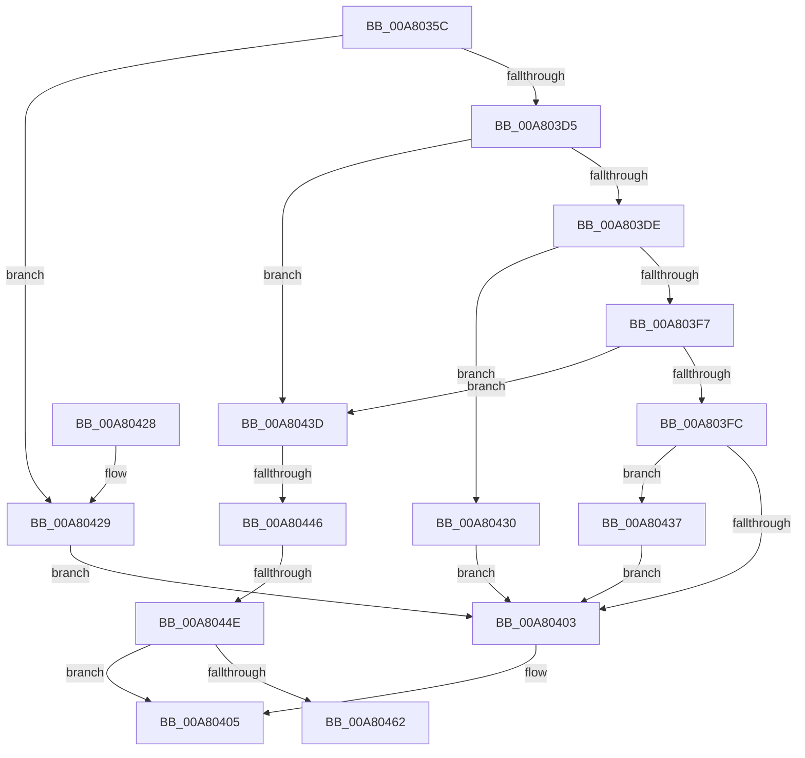

# LdrResGetRCConfig

- RVA: `0x00A8035C`–`0x00A80467` (길이 `267` bytes)
- VA: `0x0000000140A8035C`
- 실행 섹션: `PAGE`
- PDB 이름 있음: `예`; PDB Function 태그: `예`
- unwind 정보 RVA: `0x000B6FF0`
- 디코드: `78`개 명령, `267/267` bytes 표시
- 미해석 바이트: `0` (있으면 어셈블리에 `.byte`로 보존)

> 이 문서는 커널 이미지의 기계어와 PDB 기호를 분석해 생성했습니다. 4번과 5번은 함수 원형과 자료형을 바이너리 사용 방식에서 추정한 C 해석이며 원본 소스 복구 결과는 아닙니다.

## 1. Dependencies

- 직접 호출 지점: **3**; 고유 호출 대상: **3**
- 직접 호출자로 확인된 함수: **2**
- RIP 상대 이미지 참조: **2**

### Outgoing calls
- `0x00A803E7` → [LdrpGetFromMUIMemCache](../../text/45/LdrpGetFromMUIMemCache_function_00455948.md) (function, `0x00455948`)
- `0x00A80410` → [_security_check_cookie](../../text/6A/_security_check_cookie_function_006AC640.md) (function, `0x006AC640`)
- `0x00A80459` → [LdrpResGetMappingSize](../99/LdrpResGetMappingSize_function_00991614.md) (function, `0x00991614`)

### Direct callers
- [LdrpResSearchResourceMappedFile](../../text/45/LdrpResSearchResourceMappedFile_function_00454C98.md) at `0x0045522B`
- [LdrpVerifyAlternateResourceModuleEx](../../text/5E/LdrpVerifyAlternateResourceModuleEx_function_005E5F24.md) at `0x005E5F60`
- [LdrpVerifyAlternateResourceModuleEx](../../text/5E/LdrpVerifyAlternateResourceModuleEx_function_005E5F24.md) at `0x005E5FA3`

### Static image references
- `0x00A80371` → RVA `0x00E0A740` (`.data`; read)
- `0x00A80394` → RVA `0x00B05460` (` ?? ::NNGAKEGL::`string'`; read)

## 2. Other-region calls and transfers

- 다른 실행 섹션으로 향하는 call: **2**
  - `0x00A803E7` → [LdrpGetFromMUIMemCache](../../text/45/LdrpGetFromMUIMemCache_function_00455948.md) (`PAGE` → `.text`)
  - `0x00A80410` → [_security_check_cookie](../../text/6A/_security_check_cookie_function_006AC640.md) (`PAGE` → `.text`)
- call이 아닌 외부 분기/꼬리 이동: **3**
  - `0x00A80440` → [sub_00B42D56](../B4/Unknown_function_00B42D56.md) (`tail-transfer`)
  - `0x00A80448` → [sub_00B42D56](../B4/Unknown_function_00B42D56.md) (`tail-transfer`)
  - `0x00A80462` → [sub_00B42D56](../B4/Unknown_function_00B42D56.md) (`tail-transfer`)

## 3. Assembly (complete function range)

```asm
00A8035C  4C 8B DC                        mov r11, rsp
00A8035F  53                              push rbx
00A80360  56                              push rsi
00A80361  57                              push rdi
00A80362  41 54                           push r12
00A80364  41 55                           push r13
00A80366  41 56                           push r14
00A80368  41 57                           push r15
00A8036A  48 81 EC A0 00 00 00            sub rsp, 0xa0
00A80371  48 8B 05 C8 A3 38 00            mov rax, qword ptr [rip + 0x38a3c8]
00A80378  48 33 C4                        xor rax, rsp
00A8037B  48 89 84 24 90 00 00 00         mov qword ptr [rsp + 0x90], rax
00A80383  45 8B F9                        mov r15d, r9d
00A80386  4D 8B E0                        mov r12, r8
00A80389  48 8B F2                        mov rsi, rdx
00A8038C  4C 8B E9                        mov r13, rcx
00A8038F  48 89 4C 24 70                  mov qword ptr [rsp + 0x70], rcx
00A80394  48 8D 05 C5 50 08 00            lea rax, [rip + 0x850c5]
00A8039B  49 89 43 A0                     mov qword ptr [r11 - 0x60], rax
00A8039F  49 C7 43 A8 01 00 00 00         mov qword ptr [r11 - 0x58], 1
00A803A7  33 DB                           xor ebx, ebx
00A803A9  49 89 5B B0                     mov qword ptr [r11 - 0x50], rbx
00A803AD  49 89 5B 90                     mov qword ptr [r11 - 0x70], rbx
00A803B1  49 89 53 88                     mov qword ptr [r11 - 0x78], rdx
00A803B5  49 89 5B 80                     mov qword ptr [r11 - 0x80], rbx
00A803B9  41 8B F9                        mov edi, r9d
00A803BC  81 E7 00 20 00 00               and edi, 0x2000
00A803C2  8B C7                           mov eax, edi
00A803C4  F7 D8                           neg eax
00A803C6  45 1B F6                        sbb r14d, r14d
00A803C9  41 81 E6 00 10 00 00            and r14d, 0x1000
00A803D0  48 85 C9                        test rcx, rcx
00A803D3  74 54                           je 0x140a80429
00A803D5  38 9C 24 00 01 00 00            cmp byte ptr [rsp + 0x100], bl
00A803DC  74 5F                           je 0x140a8043d
00A803DE  33 D2                           xor edx, edx
00A803E0  44 8D 4B 08                     lea r9d, [rbx + 8]
00A803E4  45 33 C0                        xor r8d, r8d
00A803E7  E8 5C 55 9D FF                  call 0x140455948
00A803EC  48 89 44 24 58                  mov qword ptr [rsp + 0x58], rax
00A803F1  48 83 F8 FF                     cmp rax, -1
00A803F5  74 39                           je 0x140a80430
00A803F7  48 85 C0                        test rax, rax
00A803FA  74 41                           je 0x140a8043d
00A803FC  8B FB                           mov edi, ebx
00A803FE  4D 85 E4                        test r12, r12
00A80401  75 34                           jne 0x140a80437
00A80403  8B C7                           mov eax, edi
00A80405  48 8B 8C 24 90 00 00 00         mov rcx, qword ptr [rsp + 0x90]
00A8040D  48 33 CC                        xor rcx, rsp
00A80410  E8 2B C2 C2 FF                  call 0x1406ac640
00A80415  48 81 C4 A0 00 00 00            add rsp, 0xa0
00A8041C  41 5F                           pop r15
00A8041E  41 5E                           pop r14
00A80420  41 5D                           pop r13
00A80422  41 5C                           pop r12
00A80424  5F                              pop rdi
00A80425  5E                              pop rsi
00A80426  5B                              pop rbx
00A80427  C3                              ret
00A80428  CC                              int3
00A80429  BF 0D 00 00 C0                  mov edi, 0xc000000d
00A8042E  EB D3                           jmp 0x140a80403
00A80430  BF 8A 00 00 C0                  mov edi, 0xc000008a
00A80435  EB CC                           jmp 0x140a80403
00A80437  49 89 04 24                     mov qword ptr [r12], rax
00A8043B  EB C6                           jmp 0x140a80403
00A8043D  48 85 F6                        test rsi, rsi
00A80440  0F 85 10 29 0C 00               jne 0x140b42d56
00A80446  85 FF                           test edi, edi
00A80448  0F 85 08 29 0C 00               jne 0x140b42d56
00A8044E  45 8B C7                        mov r8d, r15d
00A80451  48 8D 54 24 60                  lea rdx, [rsp + 0x60]
00A80456  49 8B CD                        mov rcx, r13
00A80459  E8 B6 11 F1 FF                  call 0x140991614
00A8045E  85 C0                           test eax, eax
00A80460  78 A3                           js 0x140a80405
00A80462  E9 EF 28 0C 00                  jmp 0x140b42d56
```

## 4. C-style interpretation (structured pseudocode)

```c
__int64 __fastcall LdrResGetRCConfig(__int64 a1, __int64 a2, __int64 a3, int a4, unsigned __int8 a5)
{
    __int64 result;
    __int64 v_r14;
    __int64 v_rbx;
    __int64 v_rdi;
    __int64 v_rsp;
    unsigned __int64 v_stack_m48;
    unsigned __int64 v_stack_m68;
    unsigned __int64 v_stack_m80;
    unsigned __int64 v_stack_p60;

    v_rsp = (v_rsp) - (160);
    result = (*(unsigned __int64 *)(v_rip + 3711944)) ^ (v_rsp);
    v_stack_m48 = result;
    v_stack_m68 = a1;
    *(unsigned __int64 *)(v_rsp - 96) = v_rip + 544965;
    *(unsigned __int64 *)(v_rsp - 88) = 1;
    v_rbx = 0;
    *(unsigned __int64 *)(v_rsp - 80) = 0;
    *(unsigned __int64 *)(v_rsp - 112) = 0;
    *(unsigned __int64 *)(v_rsp - 120) = a2;
    *(unsigned __int64 *)(v_rsp - 128) = 0;
    v_rdi = (unsigned int)(((unsigned int)(a4)) & (0x2000ULL));
    result = (unsigned int)(-((unsigned int)((unsigned int)(v_rdi))));
    v_r14 = (unsigned int)((v_r14) & (0x1000ULL));
    if (a1 == 0) goto loc_00A80429;
    if (a5 == 0) goto loc_00A8043D;
    a2 = 0;
    a3 = 0;
    result = LdrpGetFromMUIMemCache(a1, a2, a3, v_rbx + 8);
    v_stack_m80 = result;
    if (result == -1) goto loc_00A80430;
    if (result == 0) goto loc_00A8043D;
    if (0 != 0) goto loc_00A80437;
loc_00A80403:
loc_00A80405:
    a1 = (v_stack_m48) ^ (v_rsp);
    result = _security_check_cookie(a1, a2, a3, v_rbx + 8);
    v_rsp = (v_rsp) + (160);
    return result;
loc_00A80429:
    goto loc_00A80403;
loc_00A80430:
    goto loc_00A80403;
loc_00A80437:
    *(unsigned __int64 *)(a3) = result;
    goto loc_00A80403;
loc_00A8043D:
    result = LdrpResGetMappingSize(a1, v_stack_p60, (unsigned int)((unsigned int)((unsigned int)(a4))), v_rbx + 8);
    if (sign_flag) goto loc_00A80405;
}
```

## 5. (Beta) C Style

```c
int64_t LdrResGetRCConfig(int64_t Arg1, int64_t Arg2, int64_t Arg3, int32_t Arg4, uint8_t Arg5)
{
    int64_t result;
    int64_t local_r14;
    int64_t local_rbx;
    int64_t local_rdi;
    int64_t local_rsp;
    uint64_t v_stack_m48;
    uint64_t v_stack_m68;
    uint64_t v_stack_m80;
    uint64_t v_stack_p60;

    local_rsp = (local_rsp) - (160);
    result = (*(uint64_t *)(v_rip + 0x38A3C8)) ^ (local_rsp);
    v_stack_m48 = result;
    v_stack_m68 = Arg1;
    *(uint64_t *)(local_rsp - 0x60) = v_rip + 544965;
    *(uint64_t *)(local_rsp - 0x58) = 1;
    local_rbx = 0;
    *(uint64_t *)(local_rsp - 0x50) = 0;
    *(uint64_t *)(local_rsp - 0x70) = 0;
    *(uint64_t *)(local_rsp - 0x78) = Arg2;
    *(uint64_t *)(local_rsp - 0x80) = 0;
    local_rdi = (uint32_t)(((uint32_t)(Arg4)) & (0x2000ULL));
    result = (uint32_t)(-((uint32_t)((uint32_t)(local_rdi))));
    local_r14 = (uint32_t)((local_r14) & (0x1000ULL));
    if (Arg1 == 0) goto loc_00A80429;
    if (Arg5 == 0) goto loc_00A8043D;
    Arg2 = 0;
    Arg3 = 0;
    result = LdrpGetFromMUIMemCache(Arg1, Arg2, Arg3, local_rbx + 8);
    v_stack_m80 = result;
    if (result == -1) goto loc_00A80430;
    if (result == 0) goto loc_00A8043D;
    if (0 != 0) goto loc_00A80437;
loc_00A80403:
loc_00A80405:
    Arg1 = (v_stack_m48) ^ (local_rsp);
    result = _security_check_cookie(Arg1, Arg2, Arg3, local_rbx + 8);
    local_rsp = (local_rsp) + (160);
    return result;
loc_00A80429:
    goto loc_00A80403;
loc_00A80430:
    goto loc_00A80403;
loc_00A80437:
    *(uint64_t *)(Arg3) = result;
    goto loc_00A80403;
loc_00A8043D:
    result = LdrpResGetMappingSize(Arg1, v_stack_p60, (uint32_t)((uint32_t)((uint32_t)(Arg4))), local_rbx + 8);
    if (sign_flag) goto loc_00A80405;
}
```

## 6. Execution-region graph

[열기: 2D/3D 그래프와 함수 탐색 컨트롤 패널](../../../control-panel.html?section=page&rva=0x00A8035C&view=graph)

- 2D 그래프는 위에서 아래로 흐르고, 3D 그래프는 빈 공간을 드래그해 회전합니다. Shift+드래그는 이동, 휠은 확대·축소, 함수 노드 선택은 대상 보고서 이동입니다.

### Static fallback


