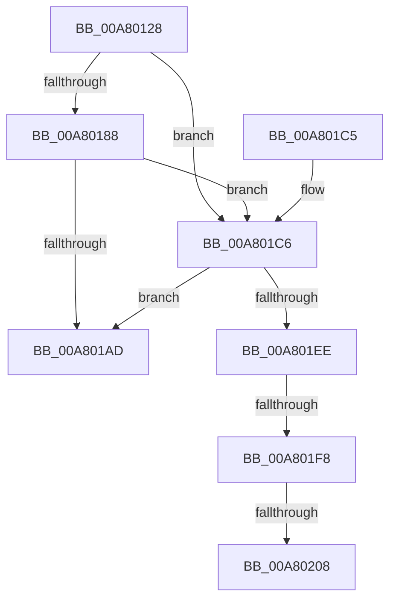

# MiAllocateDriverPage

- RVA: `0x00A80128`–`0x00A80219` (길이 `241` bytes)
- VA: `0x0000000140A80128`
- 실행 섹션: `PAGE`
- PDB 이름 있음: `예`; PDB Function 태그: `예`
- unwind 정보 RVA: `0x000B6F48`
- 디코드: `65`개 명령, `241/241` bytes 표시
- 미해석 바이트: `0` (있으면 어셈블리에 `.byte`로 보존)

> 이 문서는 커널 이미지의 기계어와 PDB 기호를 분석해 생성했습니다. 4번과 5번은 함수 원형과 자료형을 바이너리 사용 방식에서 추정한 C 해석이며 원본 소스 복구 결과는 아닙니다.

## 1. Dependencies

- 직접 호출 지점: **6**; 고유 호출 대상: **5**
- 직접 호출자로 확인된 함수: **4**
- RIP 상대 이미지 참조: **0**

### Outgoing calls
- `0x00A80162` → [MiInitializePageColorBase](../../text/32/MiInitializePageColorBase_function_00320410.md) (function, `0x00320410`)
- `0x00A8016B` → [MiGetNextPageColor](../../text/44/MiGetNextPageColor_function_00442D64.md) (function, `0x00442D64`)
- `0x00A8017B` → [MiUseProtectedSlabAllocatorForDriverPage](../../text/38/MiUseProtectedSlabAllocatorForDriverPage_function_00385CB8.md) (function, `0x00385CB8`)
- `0x00A8019F` → [MiGetSlabPage](../../text/37/MiGetSlabPage_function_00376FBC.md) (function, `0x00376FBC`)
- `0x00A801E0` → [MiGetSlabPage](../../text/37/MiGetSlabPage_function_00376FBC.md) (function, `0x00376FBC`)
- `0x00A80208` → [MiGetSlabCurrentTime](../../text/3B/MiGetSlabCurrentTime_function_003BCBCC.md) (function, `0x003BCBCC`)

### Direct callers
- [MiPrivateFixup](../../text/36/MiPrivateFixup_function_003693E8.md) at `0x003699EC`
- [MiLockCode](../../text/36/MiLockCode_function_0036F91C.md) at `0x0036FD15`
- [MiMakeDriverPagesPrivate](../../text/38/MiMakeDriverPagesPrivate_function_00384C60.md) at `0x00384F1D`
- [MiHandleBootImage](../../init/C6/MiHandleBootImage_function_00C6B854.md) at `0x00C6B9E9`

### Static image references
- 디코드된 RIP-relative 메모리 참조가 없습니다.

## 2. Other-region calls and transfers

- 다른 실행 섹션으로 향하는 call: **6**
  - `0x00A80162` → [MiInitializePageColorBase](../../text/32/MiInitializePageColorBase_function_00320410.md) (`PAGE` → `.text`)
  - `0x00A8016B` → [MiGetNextPageColor](../../text/44/MiGetNextPageColor_function_00442D64.md) (`PAGE` → `.text`)
  - `0x00A8017B` → [MiUseProtectedSlabAllocatorForDriverPage](../../text/38/MiUseProtectedSlabAllocatorForDriverPage_function_00385CB8.md) (`PAGE` → `.text`)
  - `0x00A8019F` → [MiGetSlabPage](../../text/37/MiGetSlabPage_function_00376FBC.md) (`PAGE` → `.text`)
  - `0x00A801E0` → [MiGetSlabPage](../../text/37/MiGetSlabPage_function_00376FBC.md) (`PAGE` → `.text`)
  - `0x00A80208` → [MiGetSlabCurrentTime](../../text/3B/MiGetSlabCurrentTime_function_003BCBCC.md) (`PAGE` → `.text`)
- call이 아닌 외부 분기/꼬리 이동: **3**
  - `0x00A801F2` → [sub_00B42C66 + 0xDB](../B4/Unknown_function_00B42C66.md) (`tail-transfer`)
  - `0x00A80202` → [sub_00B42C66](../B4/Unknown_function_00B42C66.md) (`tail-transfer`)
  - `0x00A80214` → [sub_00B42C66](../B4/Unknown_function_00B42C66.md) (`tail-transfer`)

## 3. Assembly (complete function range)

```asm
00A80128  48 89 5C 24 08                  mov qword ptr [rsp + 8], rbx
00A8012D  48 89 74 24 10                  mov qword ptr [rsp + 0x10], rsi
00A80132  55                              push rbp
00A80133  57                              push rdi
00A80134  41 56                           push r14
00A80136  48 8D 6C 24 B9                  lea rbp, [rsp - 0x47]
00A8013B  48 81 EC 90 00 00 00            sub rsp, 0x90
00A80142  83 65 7F 00                     and dword ptr [rbp + 0x7f], 0
00A80146  4C 8D 4D 2F                     lea r9, [rbp + 0x2f]
00A8014A  45 8B F0                        mov r14d, r8d
00A8014D  8B FA                           mov edi, edx
00A8014F  45 33 C0                        xor r8d, r8d
00A80152  48 8B F1                        mov rsi, rcx
00A80155  0F 57 C0                        xorps xmm0, xmm0
00A80158  33 C9                           xor ecx, ecx
00A8015A  0F 11 45 2F                     movups xmmword ptr [rbp + 0x2f], xmm0
00A8015E  41 8D 50 03                     lea edx, [r8 + 3]
00A80162  E8 A9 02 8A FF                  call 0x140320410
00A80167  48 8D 4D 2F                     lea rcx, [rbp + 0x2f]
00A8016B  E8 F4 2B 9C FF                  call 0x140442d64
00A80170  4C 8D 45 7F                     lea r8, [rbp + 0x7f]
00A80174  8B D7                           mov edx, edi
00A80176  48 8B CE                        mov rcx, rsi
00A80179  8B D8                           mov ebx, eax
00A8017B  E8 38 5B 90 FF                  call 0x140385cb8
00A80180  48 83 CF FF                     or rdi, 0xffffffffffffffff
00A80184  85 C0                           test eax, eax
00A80186  74 3E                           je 0x140a801c6
00A80188  83 64 24 28 00                  and dword ptr [rsp + 0x28], 0
00A8018D  44 8D 4F 03                     lea r9d, [rdi + 3]
00A80191  8B 55 7F                        mov edx, dword ptr [rbp + 0x7f]
00A80194  44 8B C3                        mov r8d, ebx
00A80197  48 8B CE                        mov rcx, rsi
00A8019A  48 89 7C 24 20                  mov qword ptr [rsp + 0x20], rdi
00A8019F  E8 18 6E 8F FF                  call 0x140376fbc
00A801A4  48 89 45 27                     mov qword ptr [rbp + 0x27], rax
00A801A8  48 3B C7                        cmp rax, rdi
00A801AB  74 19                           je 0x140a801c6
00A801AD  4C 8D 9C 24 90 00 00 00         lea r11, [rsp + 0x90]
00A801B5  49 8B 5B 20                     mov rbx, qword ptr [r11 + 0x20]
00A801B9  49 8B 73 28                     mov rsi, qword ptr [r11 + 0x28]
00A801BD  49 8B E3                        mov rsp, r11
00A801C0  41 5E                           pop r14
00A801C2  5F                              pop rdi
00A801C3  5D                              pop rbp
00A801C4  C3                              ret
00A801C5  CC                              int3
00A801C6  83 64 24 28 00                  and dword ptr [rsp + 0x28], 0
00A801CB  41 B9 02 00 00 00               mov r9d, 2
00A801D1  44 8B C3                        mov r8d, ebx
00A801D4  48 89 7C 24 20                  mov qword ptr [rsp + 0x20], rdi
00A801D9  48 8B CE                        mov rcx, rsi
00A801DC  41 8D 51 03                     lea edx, [r9 + 3]
00A801E0  E8 D7 6D 8F FF                  call 0x140376fbc
00A801E5  48 89 45 27                     mov qword ptr [rbp + 0x27], rax
00A801E9  48 3B C7                        cmp rax, rdi
00A801EC  75 BF                           jne 0x140a801ad
00A801EE  41 F6 C6 01                     test r14b, 1
00A801F2  0F 85 49 2B 0C 00               jne 0x140b42d41
00A801F8  48 8B 86 38 41 00 00            mov rax, qword ptr [rsi + 0x4138]
00A801FF  48 85 C0                        test rax, rax
00A80202  0F 85 5E 2A 0C 00               jne 0x140b42c66
00A80208  E8 BF C9 93 FF                  call 0x1403bcbcc
00A8020D  48 89 86 38 41 00 00            mov qword ptr [rsi + 0x4138], rax
00A80214  E9 4D 2A 0C 00                  jmp 0x140b42c66
```

## 4. C-style interpretation (structured pseudocode)

```c
__int64 __fastcall MiAllocateDriverPage(__int64 a1, int a2, int a3)
{
    __int64 result;
    __int64 v_rdi;
    __int64 v_rsp;
    unsigned __int64 v_stack_m18;
    unsigned __int64 v_stack_m30;
    unsigned __int64 v_stack_m38;
    unsigned __int64 v_stack_m5F;
    unsigned int v_stack_m68;
    unsigned __int64 v_stack_m70;
    unsigned int v_stack_m80;
    unsigned __int64 v_stack_m88;
    unsigned __int64 v_stack_p10;
    unsigned int v_stack_p20;
    unsigned __int64 v_stack_p8;

    v_stack_p8 = v_rbx;
    v_stack_p10 = v_rsi;
    v_rsp = (v_rsp) - (144);
    a3 = 0;
    a1 = 0;
    v_stack_m30 = v_xmm0;
    result = MiInitializePageColorBase(a1, a3 + 3, a3, v_stack_m30);
    result = MiGetNextPageColor(v_stack_m30, a3 + 3, a3, v_stack_m30);
    result = MiUseProtectedSlabAllocatorForDriverPage(0, (unsigned int)((unsigned int)((unsigned int)(a2))), v_stack_p20, v_stack_m30);
    v_rdi = ((unsigned int)(a2)) | (-1);
    if ((unsigned int)(result) == 0) goto loc_00A801C6;
    v_stack_m88 = v_rdi;
    result = MiGetSlabPage(0, (unsigned int)(v_stack_p20), (unsigned int)((unsigned int)((unsigned int)((unsigned int)(result)))), v_rdi + 3);
    v_stack_m38 = result;
    if (result == v_rdi) goto loc_00A801C6;
loc_00A801AD:
    return result;
loc_00A801C6:
    v_stack_m70 = v_rdi;
    result = MiGetSlabPage(*(unsigned __int64 *)(v_stack_m18 + 40), 2 + 3, (unsigned int)((unsigned int)(*(unsigned __int64 *)(v_stack_m18 + 32))), 2);
    v_stack_m38 = result;
    if (result != v_rdi) goto loc_00A801AD;
    result = MiGetSlabCurrentTime(*(unsigned __int64 *)(v_stack_m18 + 40), 2 + 3, (unsigned int)((unsigned int)(*(unsigned __int64 *)(v_stack_m18 + 32))), 2);
    *(unsigned __int64 *)(*(unsigned __int64 *)(v_stack_m18 + 40) + 16696) = result;
}
```

## 5. (Beta) C Style

```c
int64_t MiAllocateDriverPage(void *Arg1, void *Arg2, int32_t Arg3)
{
    uint8_t *arg1 = (uint8_t *)Arg1;
    uint8_t *arg2 = (uint8_t *)Arg2;

    int64_t result;
    int64_t local_rdi;
    int64_t local_rsp;
    uint64_t v_stack_m18;
    uint64_t v_stack_m30;
    uint64_t v_stack_m38;
    uint64_t v_stack_m5F;
    uint32_t v_stack_m68;
    uint64_t v_stack_m70;
    uint32_t v_stack_m80;
    uint64_t v_stack_m88;
    uint64_t v_stack_p10;
    uint32_t v_stack_p20;
    uint64_t v_stack_p8;

    v_stack_p8 = local_rbx;
    v_stack_p10 = local_rsi;
    local_rsp = (local_rsp) - (144);
    Arg3 = 0;
    Arg1 = 0;
    v_stack_m30 = v_xmm0;
    result = MiInitializePageColorBase(Arg1, Arg3 + 3, Arg3, v_stack_m30);
    result = MiGetNextPageColor(v_stack_m30, Arg3 + 3, Arg3, v_stack_m30);
    result = MiUseProtectedSlabAllocatorForDriverPage(0, (uint32_t)((uint32_t)((uint32_t)(Arg2))), v_stack_p20, v_stack_m30);
    local_rdi = ((uint32_t)(Arg2)) | (-1);
    if ((uint32_t)(result) == 0) goto loc_00A801C6;
    v_stack_m88 = local_rdi;
    result = MiGetSlabPage(0, (uint32_t)(v_stack_p20), (uint32_t)((uint32_t)((uint32_t)((uint32_t)(result)))), local_rdi + 3);
    v_stack_m38 = result;
    if (result == local_rdi) goto loc_00A801C6;
loc_00A801AD:
    return result;
loc_00A801C6:
    v_stack_m70 = local_rdi;
    result = MiGetSlabPage(*(uint64_t *)(v_stack_m18 + 0x28), 2 + 3, (uint32_t)((uint32_t)(*(uint64_t *)(v_stack_m18 + 0x20))), 2);
    v_stack_m38 = result;
    if (result != local_rdi) goto loc_00A801AD;
    result = MiGetSlabCurrentTime(*(uint64_t *)(v_stack_m18 + 0x28), 2 + 3, (uint32_t)((uint32_t)(*(uint64_t *)(v_stack_m18 + 0x20))), 2);
    *(uint64_t *)(*(uint64_t *)(v_stack_m18 + 0x28) + 0x4138) = result;
}
```

### 관측된 메모리 오프셋

구조체 형식이 확인되지 않은 접근은 인자 기준의 오프셋으로만 기록했습니다.

| 기준 인자 | 오프셋 표현 | 폭 (bit) | 접근 |
|---|---:|---:|---|
| `Arg1` | `+ 0x4138` | `64` | `R` |
| `Arg1` | `+ 0x4138` | `64` | `W` |
| `Arg2` | `+ 0x3` | `32` | `R` |

## 6. Execution-region graph

[열기: 2D/3D 그래프와 함수 탐색 컨트롤 패널](../../../control-panel.html?section=page&rva=0x00A80128&view=graph)

- 2D 그래프는 위에서 아래로 흐르고, 3D 그래프는 빈 공간을 드래그해 회전합니다. Shift+드래그는 이동, 휠은 확대·축소, 함수 노드 선택은 대상 보고서 이동입니다.

### Static fallback


