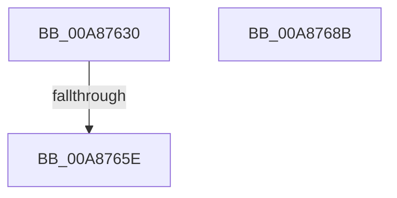

# MiFinishPlaceholderVadReplacement

- RVA: `0x00A87630`–`0x00A8768C` (길이 `92` bytes)
- VA: `0x0000000140A87630`
- 실행 섹션: `PAGE`
- PDB 이름 있음: `예`; PDB Function 태그: `예`
- unwind 정보 RVA: `0x000794E0`
- 디코드: `24`개 명령, `92/92` bytes 표시
- 미해석 바이트: `0` (있으면 어셈블리에 `.byte`로 보존)

> 이 문서는 커널 이미지의 기계어와 PDB 기호를 분석해 생성했습니다. 4번과 5번은 함수 원형과 자료형을 바이너리 사용 방식에서 추정한 C 해석이며 원본 소스 복구 결과는 아닙니다.

## 1. Dependencies

- 직접 호출 지점: **3**; 고유 호출 대상: **3**
- 직접 호출자로 확인된 함수: **2**
- RIP 상대 이미지 참조: **0**

### Outgoing calls
- `0x00A87661` → [MiSetVadDeleted](../../text/29/MiSetVadDeleted_function_00296E00.md) (function, `0x00296E00`)
- `0x00A8766E` → [MiDeleteVad](../88/MiDeleteVad_function_00888C80.md) (function, `0x00888C80`)
- `0x00A87676` → [MiDecrementVadsBeingDeleted](../../text/34/MiDecrementVadsBeingDeleted_function_00341010.md) (function, `0x00341010`)

### Direct callers
- [MiReserveUserMemory](../88/MiReserveUserMemory_function_00884498.md) at `0x00884DFB`
- [sub_0088535F](../88/Unknown_function_0088535F.md) at `0x0088540B`

### Static image references
- 디코드된 RIP-relative 메모리 참조가 없습니다.

## 2. Other-region calls and transfers

- 다른 실행 섹션으로 향하는 call: **2**
  - `0x00A87661` → [MiSetVadDeleted](../../text/29/MiSetVadDeleted_function_00296E00.md) (`PAGE` → `.text`)
  - `0x00A87676` → [MiDecrementVadsBeingDeleted](../../text/34/MiDecrementVadsBeingDeleted_function_00341010.md) (`PAGE` → `.text`)
- call이 아닌 외부 분기/꼬리 이동: **1**
  - `0x00A87658` → [sub_00B44B9C](../B4/Unknown_function_00B44B9C.md) (`tail-transfer`)

## 3. Assembly (complete function range)

```asm
00A87630  48 89 5C 24 08                  mov qword ptr [rsp + 8], rbx
00A87635  48 89 74 24 10                  mov qword ptr [rsp + 0x10], rsi
00A8763A  57                              push rdi
00A8763B  48 83 EC 30                     sub rsp, 0x30
00A8763F  48 8B D9                        mov rbx, rcx
00A87642  65 48 8B 0C 25 88 01 00 00      mov rcx, qword ptr gs:[0x188]
00A8764B  48 8B FA                        mov rdi, rdx
00A8764E  48 8B B1 B8 00 00 00            mov rsi, qword ptr [rcx + 0xb8]
00A87655  45 85 C0                        test r8d, r8d
00A87658  0F 85 3E D5 0B 00               jne 0x140b44b9c
00A8765E  48 8B CB                        mov rcx, rbx
00A87661  E8 9A F7 80 FF                  call 0x140296e00
00A87666  45 33 C0                        xor r8d, r8d
00A87669  33 D2                           xor edx, edx
00A8766B  48 8B CB                        mov rcx, rbx
00A8766E  E8 0D 16 E0 FF                  call 0x140888c80
00A87673  48 8B CF                        mov rcx, rdi
00A87676  E8 95 99 8B FF                  call 0x140341010
00A8767B  48 8B 5C 24 40                  mov rbx, qword ptr [rsp + 0x40]
00A87680  48 8B 74 24 48                  mov rsi, qword ptr [rsp + 0x48]
00A87685  48 83 C4 30                     add rsp, 0x30
00A87689  5F                              pop rdi
00A8768A  C3                              ret
00A8768B  CC                              int3
```

## 4. C-style interpretation (structured pseudocode)

```c
__int64 __fastcall MiFinishPlaceholderVadReplacement(__int64 a1, __int64 a2, int a3)
{
    __int64 result;
    __int64 v_rsp;
    unsigned __int64 v_stack_p10;
    unsigned __int64 v_stack_p8;

    v_stack_p8 = v_rbx;
    v_stack_p10 = v_rsi;
    v_rsp = (v_rsp) - (48);
    result = MiSetVadDeleted(a1, a2, a3, a4);
    a3 = 0;
    a2 = 0;
    result = MiDeleteVad(a1, a2, a3, a4);
    result = MiDecrementVadsBeingDeleted(0, a2, a3, a4);
    v_rsp = (v_rsp) + (48);
    return result;
}
```

## 5. (Beta) C Style

```c
int64_t MiFinishPlaceholderVadReplacement(int64_t Arg1, int64_t Arg2, int32_t Arg3)
{
    int64_t result;
    int64_t local_rsp;
    uint64_t v_stack_p10;
    uint64_t v_stack_p8;

    v_stack_p8 = local_rbx;
    v_stack_p10 = local_rsi;
    local_rsp = (local_rsp) - (48);
    result = MiSetVadDeleted(Arg1, Arg2, Arg3, a4);
    Arg3 = 0;
    Arg2 = 0;
    result = MiDeleteVad(Arg1, Arg2, Arg3, a4);
    result = MiDecrementVadsBeingDeleted(0, Arg2, Arg3, a4);
    local_rsp = (local_rsp) + (48);
    return result;
}
```

## 6. Execution-region graph

[열기: 2D/3D 그래프와 함수 탐색 컨트롤 패널](../../../control-panel.html?section=page&rva=0x00A87630&view=graph)

- 2D 그래프는 위에서 아래로 흐르고, 3D 그래프는 빈 공간을 드래그해 회전합니다. Shift+드래그는 이동, 휠은 확대·축소, 함수 노드 선택은 대상 보고서 이동입니다.

### Static fallback


