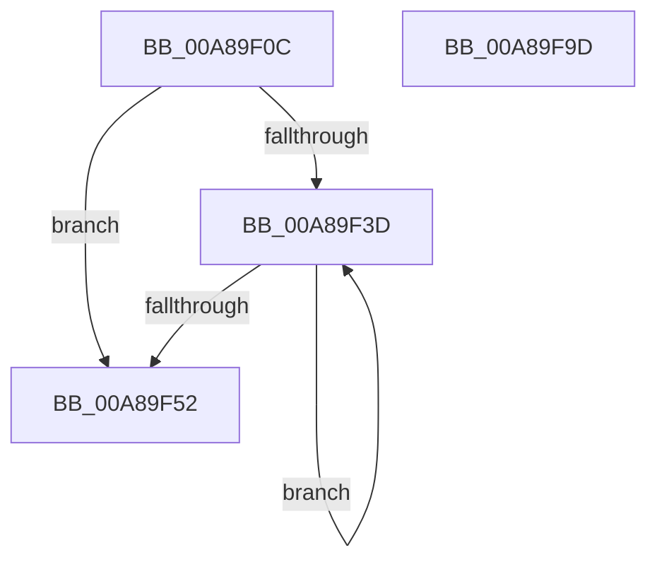

# MiFreeCloneDescriptor

- RVA: `0x00A89F0C`–`0x00A89F9E` (길이 `146` bytes)
- VA: `0x0000000140A89F0C`
- 실행 섹션: `PAGE`
- PDB 이름 있음: `예`; PDB Function 태그: `아니요`
- unwind 정보 RVA: `0x00060300`
- 디코드: `43`개 명령, `146/146` bytes 표시
- 미해석 바이트: `0` (있으면 어셈블리에 `.byte`로 보존)

> 이 문서는 커널 이미지의 기계어와 PDB 기호를 분석해 생성했습니다. 4번과 5번은 함수 원형과 자료형을 바이너리 사용 방식에서 추정한 C 해석이며 원본 소스 복구 결과는 아닙니다.

## 1. Dependencies

- 직접 호출 지점: **6**; 고유 호출 대상: **4**
- 직접 호출자로 확인된 함수: **2**
- RIP 상대 이미지 참조: **0**

### Outgoing calls
- `0x00A89F41` → [MiUnlockPagedAddress](../../text/49/MiUnlockPagedAddress_function_00492FC4.md) (function, `0x00492FC4`)
- `0x00A89F58` → [PsReturnProcessNonPagedPoolQuota](../../text/41/PsReturnProcessNonPagedPoolQuota_function_0041C200.md) (function, `0x0041C200`)
- `0x00A89F61` → [MiDecrementCloneHeaderCount](../../text/4F/MiDecrementCloneHeaderCount_function_004F60F0.md) (function, `0x004F60F0`)
- `0x00A89F6B` → [ExFreePoolWithTag](../../poolcode/B8/ExFreePoolWithTag_function_00B82870.md) (function, `0x00B82870`)
- `0x00A89F75` → [ExFreePoolWithTag](../../poolcode/B8/ExFreePoolWithTag_function_00B82870.md) (function, `0x00B82870`)
- `0x00A89F7F` → [ExFreePoolWithTag](../../poolcode/B8/ExFreePoolWithTag_function_00B82870.md) (function, `0x00B82870`)

### Direct callers
- [MiCloneVads](../../text/22/MiCloneVads_function_0022DC1C.md) at `0x0022E1F0`
- [MiCloneVads](../../text/22/MiCloneVads_function_0022DC1C.md) at `0x0022E235`
- [MiCloneProcessAddressSpace](../AD/MiCloneProcessAddressSpace_function_00AD6F7C.md) at `0x00AD70B6`
- [MiCloneProcessAddressSpace](../AD/MiCloneProcessAddressSpace_function_00AD6F7C.md) at `0x00AD7260`

### Static image references
- 디코드된 RIP-relative 메모리 참조가 없습니다.

## 2. Other-region calls and transfers

- 다른 실행 섹션으로 향하는 call: **6**
  - `0x00A89F41` → [MiUnlockPagedAddress](../../text/49/MiUnlockPagedAddress_function_00492FC4.md) (`PAGE` → `.text`)
  - `0x00A89F58` → [PsReturnProcessNonPagedPoolQuota](../../text/41/PsReturnProcessNonPagedPoolQuota_function_0041C200.md) (`PAGE` → `.text`)
  - `0x00A89F61` → [MiDecrementCloneHeaderCount](../../text/4F/MiDecrementCloneHeaderCount_function_004F60F0.md) (`PAGE` → `.text`)
  - `0x00A89F6B` → [ExFreePoolWithTag](../../poolcode/B8/ExFreePoolWithTag_function_00B82870.md) (`PAGE` → `POOLCODE`)
  - `0x00A89F75` → [ExFreePoolWithTag](../../poolcode/B8/ExFreePoolWithTag_function_00B82870.md) (`PAGE` → `POOLCODE`)
  - `0x00A89F7F` → [ExFreePoolWithTag](../../poolcode/B8/ExFreePoolWithTag_function_00B82870.md) (`PAGE` → `POOLCODE`)
- 별도 외부 분기/꼬리 이동을 확인하지 못했습니다.

## 3. Assembly (complete function range)

```asm
00A89F0C  48 89 5C 24 08                  mov qword ptr [rsp + 8], rbx
00A89F11  48 89 6C 24 10                  mov qword ptr [rsp + 0x10], rbp
00A89F16  48 89 74 24 18                  mov qword ptr [rsp + 0x18], rsi
00A89F1B  57                              push rdi
00A89F1C  41 56                           push r14
00A89F1E  41 57                           push r15
00A89F20  48 83 EC 20                     sub rsp, 0x20
00A89F24  48 8B 6A 38                     mov rbp, qword ptr [rdx + 0x38]
00A89F28  33 DB                           xor ebx, ebx
00A89F2A  48 8B 7A 40                     mov rdi, qword ptr [rdx + 0x40]
00A89F2E  48 8B F2                        mov rsi, rdx
00A89F31  4C 8B F9                        mov r15, rcx
00A89F34  4C 8B 75 10                     mov r14, qword ptr [rbp + 0x10]
00A89F38  48 85 FF                        test rdi, rdi
00A89F3B  74 15                           je 0x140a89f52
00A89F3D  49 8D 0C 1E                     lea rcx, [r14 + rbx]
00A89F41  E8 7E 90 A0 FF                  call 0x140492fc4
00A89F46  48 81 C3 00 10 00 00            add rbx, 0x1000
00A89F4D  48 3B DF                        cmp rbx, rdi
00A89F50  72 EB                           jb 0x140a89f3d
00A89F52  48 8B D7                        mov rdx, rdi
00A89F55  49 8B CF                        mov rcx, r15
00A89F58  E8 A3 22 99 FF                  call 0x14041c200
00A89F5D  48 8B 4D 18                     mov rcx, qword ptr [rbp + 0x18]
00A89F61  E8 8A C1 A6 FF                  call 0x1404f60f0
00A89F66  33 D2                           xor edx, edx
00A89F68  48 8B CD                        mov rcx, rbp
00A89F6B  E8 00 89 0F 00                  call 0x140b82870
00A89F70  33 D2                           xor edx, edx
00A89F72  49 8B CE                        mov rcx, r14
00A89F75  E8 F6 88 0F 00                  call 0x140b82870
00A89F7A  33 D2                           xor edx, edx
00A89F7C  48 8B CE                        mov rcx, rsi
00A89F7F  E8 EC 88 0F 00                  call 0x140b82870
00A89F84  48 8B 5C 24 40                  mov rbx, qword ptr [rsp + 0x40]
00A89F89  48 8B 6C 24 48                  mov rbp, qword ptr [rsp + 0x48]
00A89F8E  48 8B 74 24 50                  mov rsi, qword ptr [rsp + 0x50]
00A89F93  48 83 C4 20                     add rsp, 0x20
00A89F97  41 5F                           pop r15
00A89F99  41 5E                           pop r14
00A89F9B  5F                              pop rdi
00A89F9C  C3                              ret
00A89F9D  CC                              int3
```

## 4. C-style interpretation (structured pseudocode)

```c
__int64 __fastcall MiFreeCloneDescriptor(__int64 a1, __int64 a2)
{
    __int64 result;
    __int64 v_rbx;
    __int64 v_rsp;
    unsigned __int64 v_stack_p10;
    unsigned __int64 v_stack_p18;
    unsigned __int64 v_stack_p8;

    v_stack_p8 = v_rbx;
    v_stack_p10 = v_rbp;
    v_stack_p18 = v_rsi;
    v_rsp = (v_rsp) - (32);
    v_rbx = 0;
    if (*(unsigned __int64 *)(a2 + 64) == 0) goto loc_00A89F52;
loc_00A89F3D:
    result = MiUnlockPagedAddress(*(unsigned __int64 *)(*(unsigned __int64 *)(a2 + 56) + 16) + v_rbx * 1, a2, a3, a4);
    v_rbx = (v_rbx) + (0x1000ULL);
    if (v_rbx < (*(unsigned __int64 *)(a2 + 64))) goto loc_00A89F3D;
loc_00A89F52:
    result = PsReturnProcessNonPagedPoolQuota(a1, *(unsigned __int64 *)(a2 + 64), a3, a4);
    result = MiDecrementCloneHeaderCount(*(unsigned __int64 *)(*(unsigned __int64 *)(a2 + 56) + 24), *(unsigned __int64 *)(a2 + 64), a3, a4);
    a2 = 0;
    result = ExFreePoolWithTag(*(unsigned __int64 *)(a2 + 56), a2, a3, a4);
    a2 = 0;
    result = ExFreePoolWithTag(*(unsigned __int64 *)(*(unsigned __int64 *)(a2 + 56) + 16), a2, a3, a4);
    a2 = 0;
    result = ExFreePoolWithTag(0, a2, a3, a4);
    v_rsp = (v_rsp) + (32);
    return result;
}
```

## 5. (Beta) C Style

```c
int64_t MiFreeCloneDescriptor(int64_t Arg1, void *Arg2)
{
    uint8_t *arg2 = (uint8_t *)Arg2;

    int64_t result;
    int64_t local_rbx;
    int64_t local_rsp;
    uint64_t v_stack_p10;
    uint64_t v_stack_p18;
    uint64_t v_stack_p8;

    v_stack_p8 = local_rbx;
    v_stack_p10 = local_rbp;
    v_stack_p18 = local_rsi;
    local_rsp = (local_rsp) - (32);
    local_rbx = 0;
    if (*(uint64_t *)(arg2 + 0x40) == 0) goto loc_00A89F52;
loc_00A89F3D:
    result = MiUnlockPagedAddress(*(uint64_t *)(*(uint64_t *)(arg2 + 0x38) + 0x10) + local_rbx * 1, Arg2, a3, a4);
    local_rbx = (local_rbx) + (0x1000ULL);
    if (local_rbx < (*(uint64_t *)(arg2 + 0x40))) goto loc_00A89F3D;
loc_00A89F52:
    result = PsReturnProcessNonPagedPoolQuota(Arg1, *(uint64_t *)(arg2 + 0x40), a3, a4);
    result = MiDecrementCloneHeaderCount(*(uint64_t *)(*(uint64_t *)(arg2 + 0x38) + 0x18), *(uint64_t *)(arg2 + 0x40), a3, a4);
    Arg2 = 0;
    result = ExFreePoolWithTag(*(uint64_t *)(arg2 + 0x38), Arg2, a3, a4);
    Arg2 = 0;
    result = ExFreePoolWithTag(*(uint64_t *)(*(uint64_t *)(arg2 + 0x38) + 0x10), Arg2, a3, a4);
    Arg2 = 0;
    result = ExFreePoolWithTag(0, Arg2, a3, a4);
    local_rsp = (local_rsp) + (32);
    return result;
}
```

### 관측된 메모리 오프셋

구조체 형식이 확인되지 않은 접근은 인자 기준의 오프셋으로만 기록했습니다.

| 기준 인자 | 오프셋 표현 | 폭 (bit) | 접근 |
|---|---:|---:|---|
| `Arg2` | `+ 0x38` | `64` | `R` |
| `Arg2` | `+ 0x40` | `64` | `R` |

## 6. Execution-region graph

[열기: 2D/3D 그래프와 함수 탐색 컨트롤 패널](../../../control-panel.html?section=page&rva=0x00A89F0C&view=graph)

- 2D 그래프는 위에서 아래로 흐르고, 3D 그래프는 빈 공간을 드래그해 회전합니다. Shift+드래그는 이동, 휠은 확대·축소, 함수 노드 선택은 대상 보고서 이동입니다.

### Static fallback


